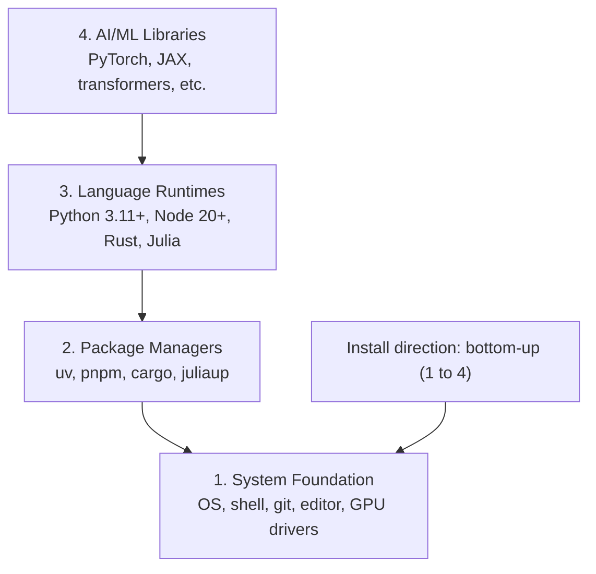
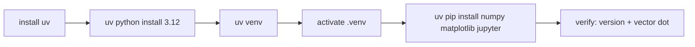
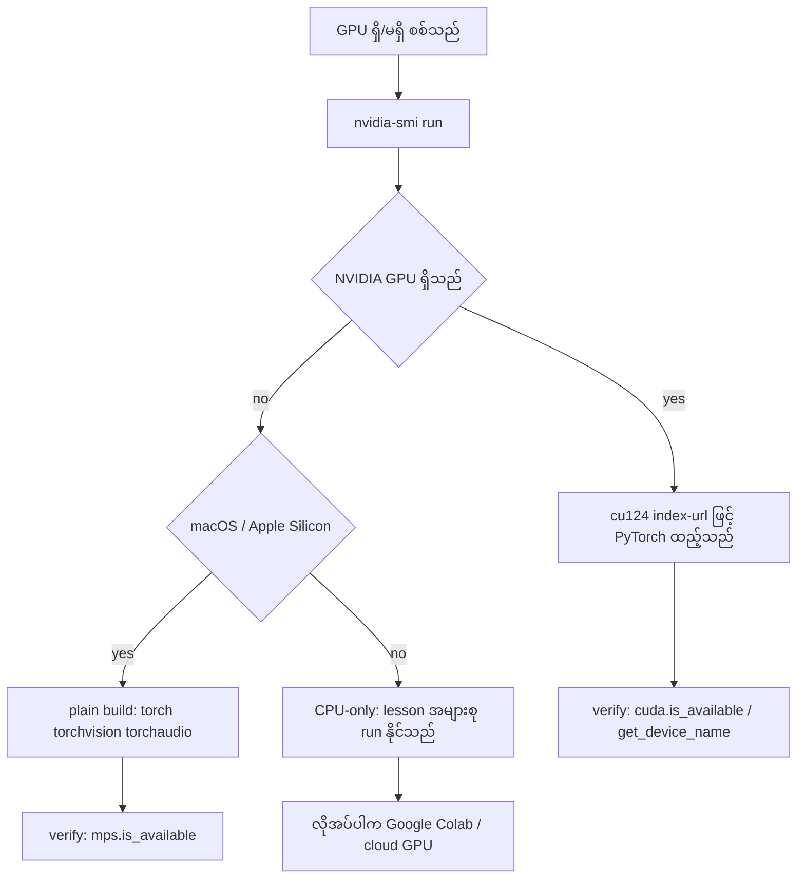
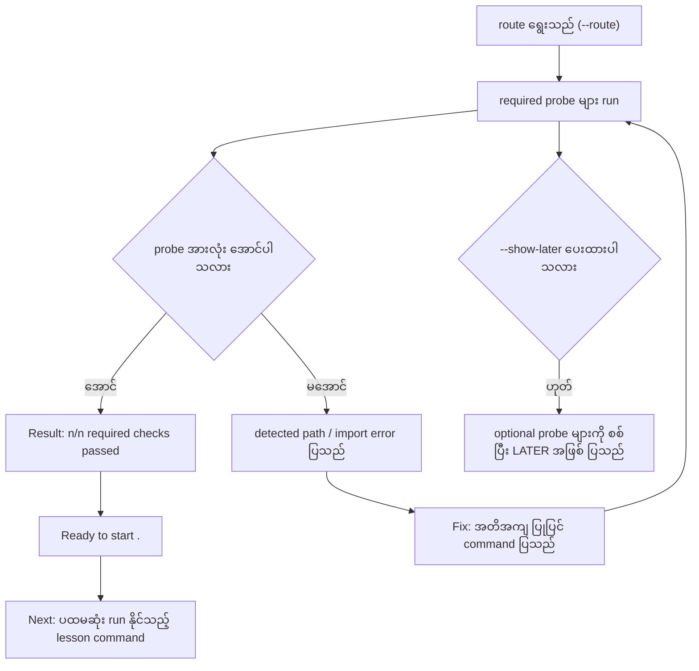

# Module 01 — Dev Environment (သင်ခန်းစာ)

> "Your tools shape your thinking. Set them up once, set them up right."

Source lesson ၏ အဓိက ရပ်တည်ချက်သည် ဤသို့ ဖြစ်သည် — ကိရိယာ (tool) များသည် အတွေးအခေါ်ကို ပြောင်းလဲစေသည်။
ထို့ကြောင့် ပတ်ဝန်းကျင်ကို **တစ်ကြိမ်တည်း မှန်ကန်စွာ** တည်ဆောက်ရမည်။ ဤသင်ခန်းစာသည် AI engineering lesson
၅၀၀ ကျော် အတွက် အခြေခံ ဖြစ်သည့် ပတ်ဝန်းကျင်ကို အလွှာ ၄ လွှာ အနေဖြင့် တည်ဆောက်နည်းကို အစမှ
ရှင်းလင်းပြသည်။

## ပြဿနာ — ပတ်ဝန်းကျင် ပျက်နေလျှင် lesson တိုင်း ရှုံးသည်

AI engineering ကို Python၊ TypeScript၊ Rust နှင့် Julia ဖြင့် လေ့လာရမည် ဖြစ်သည်။ ပတ်ဝန်းကျင် မကောင်းလျှင်
lesson တိုင်းသည် သင်ယူခြင်း အစား tooling နှင့် ရုန်းကန်ခြင်း ဖြစ်လာသည် — import error၊ version ပဋိပက္ခ
(conflict) နှင့် CUDA driver ပျောက်ခြင်းကို နာရီ အများအပြား ရှာရသည်။ လူ အများစုသည် ပတ်ဝန်းကျင် တည်ဆောက်ခြင်းကို
ကျော်လွှားပြီး နောက်မှ ထို အမှားများအတွက် အချိန် ကုန်သည်။ ထို့ကြောင့် ဤ module တွင် တစ်ကြိမ်တည်း
မှန်ကန်စွာ တည်ဆောက်ခြင်းကို လုပ်သည်။

## အလွှာ ၄ လွှာ၏ သဘောတရား

AI engineering ပတ်ဝန်းကျင် တစ်ခုတွင် အလွှာ ၄ လွှာ ရှိသည်။ အလွှာ တစ်ခုစီသည် ၎င်း၏ အောက်ရှိ အလွှာအပေါ်
မှီခိုသည်။ ထို့ကြောင့် install လုပ်ခြင်းကို **အောက်မှ အပေါ်သို့ (bottom-up)** လုပ်ရမည် — အလွှာ ၁
(OS၊ shell၊ git၊ editor၊ GPU driver) သည် အလွှာ ၂ (package manager) ကို ထမ်းသည်; အလွှာ ၂ သည်
အလွှာ ၃ (language runtime) ကို ထမ်းသည်; အလွှာ ၃ သည် အလွှာ ၄ (AI/ML library) ကို ထမ်းသည်။



**Figure 1 — အလွှာ ၄ လွှာ နှင့် မှီခိုမှု အစဉ်**

**ပုံရှင်းလင်းချက် (Figure 1)။** (၁) အပေါ်ဆုံး အလွှာ ၄ တွင် PyTorch၊ JAX၊ transformers ကဲ့သို့ AI/ML
library များ ရှိသည်။ (၂) အလွှာ ၃ တွင် ထို library များကို run ပေးသည့် language runtime — Python 3.11+၊
Node 20+၊ Rust၊ Julia — ရှိသည်။ (၃) အလွှာ ၂ တွင် runtime နှင့် package များကို ထည့်သွင်းပေးသည့် package
manager — uv၊ pnpm၊ cargo၊ juliaup — ရှိသည်။ (၄) အောက်ဆုံး အလွှာ ၁ တွင် OS၊ shell၊ git၊ editor နှင့်
GPU driver ရှိသည်။ (၅) မြှား၏ ဦးတည်ချက်သည် မှီခိုမှုကို ပြသည် — ငါးခုမြောက် မြှားက install လုပ်ခြင်းကို
အောက်မှ အပေါ်သို့ လုပ်ရမည်ဟု သတိပေးသည်။

## အလွှာ တိုင်း မည်သည့် ကိရိယာ ပါဝင်သည်

| အလွှာ | ပါဝင်သည့် အရာ | ပျက်နေလျှင် ဖြစ်သည့် လက္ခဏာ |
|---|---|---|
| 1. System Foundation | OS၊ shell၊ git၊ editor၊ GPU driver | command များ မတွေ့ခြင်း၊ `nvidia-smi` မဖွင့်နိုင်ခြင်း |
| 2. Package Managers | uv၊ pnpm၊ cargo၊ juliaup | package install မလုပ်နိုင်ခြင်း၊ version ပဋိပက္ခ |
| 3. Language Runtimes | Python 3.11+၊ Node 20+၊ Rust၊ Julia | ဘာသာစကား တိုင်း၏ interpreter/compiler မတွေ့ခြင်း |
| 4. AI/ML Libraries | PyTorch၊ JAX၊ transformers (etc.) | `import torch` ကျရှုံးခြင်း၊ GPU backend မတွေ့ခြင်း |

## ဘာသာစကား နှင့် Package Manager နှိုင်းယှဉ်ချက်

Source သည် ဤဇယားကို "Use It" အပိုင်းတွင် ဖော်ပြသည် — ဤ curriculum တွင် မည်သည့် ဘာသာစကားကို မည်သည့်
အပိုင်းတွင် သုံးသည်ကို ပြသည်။

| Language | Used In | Package Manager |
|---|---|---|
| Python | Phases 1-12 (ML, DL, NLP, Vision, Audio, LLMs) | uv |
| TypeScript | Phases 13-17 (Tools, Agents, Swarms, Infra) | pnpm |
| Rust | Phases 12, 15-17 (Performance-critical systems) | cargo |
| Julia | Phase 1 (Math foundations) | Pkg |

ဤဇယားမှ ရသည့် လက်တွေ့ အဓိပ္ပာယ်သည် ဤသို့ ဖြစ်သည် — beginner လမ်းကြောင်းအတွက် Python နှင့် git သာ
လိုအပ်သည်; TypeScript လိုအပ်သည့် agent lesson များ မစမီ Node.js နှင့် pnpm ကို ထည့်ရမည်;
performance-critical lesson များအတွက် cargo လိုအပ်သည်။ ထို့ကြောင့် အလွှာ အားလုံးကို တစ်ကြိမ်တည်း
မတင်ရန် မလိုအပ်ပါ — lesson တစ်ခုက တောင်းဆိုသည့်အခါ ထည့်နိုင်သည်။

## Step 1: System Foundation

ပတ်ဝန်းကျင်ကို စစ်ဆေးပြီး အခြေခံ ကိရိယာများ ထည့်ရမည်။ OS အလိုက် command များ ကွဲပြားသည်။

```bash
# macOS
xcode-select --install
brew install git curl wget

# Ubuntu/Debian
sudo apt update && sudo apt install -y build-essential git curl wget unzip

# Windows (use WSL2)
wsl --install -d Ubuntu-24.04
```

**လုပ်ဆောင်ချက် ရှင်းလင်းချက်။** macOS တွင် `xcode-select --install` သည် Apple command line tools
(compiler နှင့် git အပါအဝင်) ကို ထည့်သည်; `brew install git curl wget` သည် Homebrew မှ git၊ curl၊ wget
ကို ထည့်သည်။ Ubuntu/Debian တွင် `sudo apt update` သည် package index ကို ပြန်လည် ရယူပြီး၊
`sudo apt install -y build-essential git curl wget unzip` သည် compiler toolchain၊ git၊ curl၊ wget နှင့်
**unzip** ကို ထည့်သည်။ Windows တွင် `wsl --install -d Ubuntu-24.04` သည် WSL2 အပေါ် Ubuntu 24.04
ကို ထည့်သည်။
**ရလဒ်။** `git --version` သည် version လိုင်း ပြန်သည်; မအောင်မြင်ပါက PATH ကို စစ်ပါ။
**သတိပြုရန်။** Ubuntu အပေါ်တွင် `unzip` မပါပါက Step 3 ၏ fnm installer သည်
`Not installing fnm due to missing dependencies.` ဖြင့် ရပ်သွားမည်။

## Step 2: Python with uv

Python အတွက် `uv` ကို သုံးသည် — source ဖော်ပြသည့်အတိုင်း `uv` သည် pip ထက် **10-100x အမြန်ဆုံး** ဖြစ်ပြီး
virtual environment ကို အလိုအလျောက် ကိုင်တွယ်ပေးသည်။

```bash
curl -LsSf https://astral.sh/uv/install.sh | sh

uv python install 3.12

uv venv
source .venv/bin/activate  # or .venv\Scripts\activate on Windows

uv pip install numpy matplotlib jupyter
```



**Figure 2 — uv ဖြင့် Python ပတ်ဝန်းကျင် တည်ဆောက်သည့် အစဉ်**

**ပုံရှင်းလင်းချက် (Figure 2)။** (၁) ပထမဆုံး အဆင့်တွင် `curl` မှ installer script ကို run ၍ `uv` ကို ထည့်သည်။
(၂) ဒုတိယ အဆင့်တွင် `uv python install 3.12` သည် Python `3.12` runtime ကို ထည့်သည်။ (၃) တတိယ
အဆင့်တွင် `uv venv` သည် ဤ project အတွက် သီးသန့် `.venv` ကို ဖန်တီးသည်။ (၄) စတုတ္ထ အဆင့်တွင်
`.venv` ကို activate လုပ်သည်; Windows တွင် `.venv\Scripts\activate` ကို သုံးသည်။ (၅) ပဉ္စမ အဆင့်တွင်
`numpy`၊ `matplotlib`၊ `jupyter` ကို virtual environment ထဲ ထည့်သည်။ (၆) ဆဋ္ဌမ အဆင့်တွင် အောက်ပါ
စစ်ဆေးချက် script ကို run ၍ version နှင့် vector တွက်ချက်မှုကို စစ်သည်။

**စစ်ဆေးခြင်း။** ထည့်ပြီးနောက် ဤ script ကို run ရမည်။

```python
import sys
print(f"Python {sys.version}")

import numpy as np
print(f"NumPy {np.__version__}")
a = np.array([1, 2, 3])
print(f"Vector: {a}, dot product with itself: {np.dot(a, a)}")
```

**ရလဒ်။** Script သည် Python ၏ version အပြည့်၊ NumPy version နှင့် `dot product with itself: 14` ကို
ပြသည် — `[1, 2, 3]` vector ကို သူ့ကိုယ်သူ dot လုပ်သည့်အခါ `1*1 + 2*2 + 3*3 = 14` ဖြစ်သည်။
**မအောင်မြင်ပါက။** `ModuleNotFoundError: No module named 'numpy'` ဖြစ်ပါက ပတ်ဝန်းကျင် activate
မလုပ်ထားခြင်း ဖြစ်သည်; `which python3` သည် `.venv` ထဲရှိ python ကို ညွှန်ရမည်။

## Step 3: Node.js with pnpm

TypeScript lesson များ (agent၊ MCP server၊ web app) အတွက် Node.js လိုအပ်သည်။

```bash
curl -fsSL https://fnm.vercel.app/install | bash
fnm install 22
fnm use 22

npm install -g pnpm

node -e "console.log('Node', process.version)"
```

**လုပ်ဆောင်ချက် ရှင်းလင်းချက်။** ပထမ command သည် `fnm` (Fast Node Manager) ကို ထည့်သည်;
`fnm install 22` သည် Node.js 22 ကို ဒေါင်းလုဒ် လုပ်ပြီး `fnm use 22` သည် လက်ရှိ shell တွင်
ထို version ကို သုံးစေသည်။ `npm install -g pnpm` သည် pnpm ကို global ထည့်သည်။ နောက်ဆုံး command
သည် Node ၏ version ကို print လုပ်သည်။
**ရလဒ်။** `Node v22.x.x` ကဲ့သို့ လိုင်း ထွက်သည် — pnpm install ပြီးပါက `pnpm --version` ဖြင့် ထပ်စစ်နိုင်သည်။

**Dependency သတိပေးချက်။** fnm installer သည် `unzip` ကို အရင် စစ်ပြီး မရှိပါက
`Not installing fnm due to missing dependencies.` ဖြင့် ရပ်သည် — Linux တွင် zip archive ကို ဖြေရန်
လိုသည်; macOS တွင် Homebrew ဖြင့် ထည့်သည်။ macOS တွင် `unzip` ပါပြီး ဖြစ်သည်; Ubuntu၊ Debian နှင့်
WSL2 တွင် Step 1 ၏ `sudo apt install -y unzip` မှ ရသည်။

**macOS / Apple Silicon သတိပေးချက်။** Installer သည်
`Error: Cannot install under Rosetta 2 in ARM default prefix (/opt/homebrew)` ဖြင့် ရပ်ပါက terminal သည်
Rosetta 2 အောက်တွင် run နေသည် (`arch` သည် `i386` ကို print လုပ်သည်) သော်လည်း Homebrew သည်
native arm64 build ဖြစ်သည်။ ထို အခြေအနေတွင် arm64 ကို တိုက်ရိုက် တောင်းဆိုပြီး shell တွင် ချိတ်ရမည်။

```bash
arch -arm64 brew install fnm
echo 'eval "$(fnm env --use-on-cd)"' >> ~/.zshrc
source ~/.zshrc
```

ပြီးနောက် `fnm install 22` မှ ရှေ့သို့ ဆက်လုပ်သည်။

## Step 4: Rust

Performance-critical lesson များ (inference၊ systems) အတွက် Rust လိုအပ်သည်။

```bash
curl --proto '=https' --tlsv1.2 -sSf https://sh.rustup.rs | sh

rustc --version
cargo --version
```

**လုပ်ဆောင်ချက် ရှင်းလင်းချက်။** ပထမ command သည် `rustup` installer ကို HTTPS ဖြင့်သာ ရယူသည်
(`--proto '=https' --tlsv1.2`); ဤ installer သည် compiler ဖြစ်သည့် `rustc` နှင့် package manager ဖြစ်သည့်
`cargo` ကို ထည့်သည်။
**ရလဒ်။** `rustc --version` နှင့် `cargo --version` သည် version လိုင်း ပြန်သည်; မတွေ့ပါက shell ကို
ပြန်ဖွင့်ပြီး `~/.cargo/bin` သည် PATH တွင် ပါခြင်းကို စစ်ပါ။

## Step 5: Julia (Optional)

ဤအဆင့်သည် ရွေးချယ်နိုင်သည် — math-heavy lesson များအတွက် သာ လိုအပ်သည်။

```bash
curl -fsSL https://install.julialang.org | sh

julia -e 'println("Julia ", VERSION)'
```

**လုပ်ဆောင်ချက် ရှင်းလင်းချက်။** `juliaup` installer ကို run ၍ Julia ကို ထည့်သည်; ဒုတိယ command သည်
Julia ၏ `VERSION` constant ကို print လုပ်သည်။
**ရလဒ်။** `Julia 1.x.x` ကဲ့သို့ လိုင်း ထွက်သည်။ မအောင်မြင်ပါက shell ကို ပြန်ဖွင့်ပြီး `julia --version` ဖြင့် ထပ်စစ်ပါ။

## Step 6: GPU Setup (If You Have One)

GPU ရှိပါက driver ကို အရင် စစ်ပြီး၊ မိမိ hardware နှင့် **တိုက်ဆိုင်သည့် PyTorch build** ကို ထည့်ရမည်။
တူညီသည့် command တစ်ခုကို စက်တိုင်းတွင် သုံးခြင်းသည် မှားသည်။

```bash
nvidia-smi

# Install PyTorch with CUDA
uv pip install torch torchvision torchaudio --index-url https://download.pytorch.org/whl/cu124
```

macOS / Apple Silicon (M1/M2/M3/M4) တွင် CUDA မရှိပါ — ထို အခြေအနေသည် ကျရှုံးခြင်း မဟုတ်ပါ။
`--index-url .../cuXXX` ကို **မပေးရ** (ထို wheel များသည် Linux/Windows အတွက်သာ ဖြစ်သဖြင့် install ကျရှုံးသည်)။
Apple ၏ MPS (Metal) GPU backend ပါဝင်သည့် ပုံမှန် build ကို ထည့်ရမည်။

```bash
uv pip install torch torchvision torchaudio
```



**Figure 3 — Hardware အလိုက် PyTorch install ရွေးချယ်သည့် လမ်းကြောင်း**

**ပုံရှင်းလင်းချက် (Figure 3)။** (၁) စတင်ရာတွင် `nvidia-smi` ကို run ၍ GPU အခြေအနေကို စစ်သည်။ (၂) NVIDIA
GPU တွေ့ပါက `cu124` index-url ပါသည့် command ဖြင့် CUDA build ကို ထည့်သည်။ (၃) NVIDIA မတွေ့ပါက
macOS/Apple Silicon ဖြစ်/မဖြစ် ခွဲစစ်သည်။ (၄) Apple Silicon ဖြစ်ပါက index-url မပါသည့် ပုံမှန် build ကို
ထည့်ပြီး MPS ကို စစ်သည်။ (၅) နှစ်မျိုးလုံး မဟုတ်ပါက CPU-only ဖြင့် ဆက်လုပ်နိုင်သည် — lesson အများစုသည်
CPU အပေါ်တွင် run နိုင်သည်။ (၆) Training အများကြီး လိုအပ်သည့် lesson အတွက်သာ Google Colab သို့မဟုတ်
cloud GPU ကို သုံးသည်။

**စစ်ဆေးခြင်း (platform တိုင်းတွင် အလုပ်လုပ်သည်)။**

```python
import torch
print(f"CUDA available: {torch.cuda.is_available()}")           # False on macOS — expected
print(f"MPS available:  {torch.backends.mps.is_available()}")   # True on Apple Silicon
if torch.cuda.is_available():
    print(f"GPU: {torch.cuda.get_device_name(0)}")
```

**ရလဒ်။** CPU-only machine တွင် `CUDA available: False` နှင့် `MPS available: False` ထွက်သည် — ထို
အခြေအနေသည် ပုံမှန် ဖြစ်သည်။ GPU မရှိပါက ပြဿနာ မရှိပါ; training-heavy lesson များအတွက် Google Colab
သို့မဟုတ် cloud GPU ကို သုံးနိုင်သည်။

## Step 7: Verify the route you want to start

ဤ lesson ၏ command တိုင်းကို repository root တွင် run ရမည် — repository root သည် `README.md` နှင့်
`phases/` ပါသည့် directory ဖြစ်သည်။ Preflight သည် ရွေးထားသည့် route အတွက် လိုအပ်သည့် အရာကိုသာ စစ်ပြီး
နောက်ပိုင်း tool များကို default အားဖြင့် ကျော်သည် — အသစ် လေ့လာသူသည် သတိပေးချက် အများအပြား အစား
တစ်ခုတည်း ရှင်းလင်းသည့် အဖြေကို ရရှိသည်။

```bash
python3 phases/00-setup-and-tooling/01-dev-environment/code/verify.py --route beginner
```

Route တစ်ခုတည်းကို စစ်လိုပါက —

```bash
python3 phases/00-setup-and-tooling/01-dev-environment/code/verify.py --route ml-foundations
python3 phases/00-setup-and-tooling/01-dev-environment/code/verify.py --route llm-engineering
python3 phases/00-setup-and-tooling/01-dev-environment/code/verify.py --route agents
python3 phases/00-setup-and-tooling/01-dev-environment/code/verify.py --route mcp
python3 phases/00-setup-and-tooling/01-dev-environment/code/verify.py --route agent-skills
python3 phases/00-setup-and-tooling/01-dev-environment/code/verify.py --route certification
```

နောက်ပိုင်း lesson များအတွက် လိုအပ်သည့် ရွေးချယ်နိုင်သည့် tool များကို စစ်လိုပါက `--show-later` ကို ထည့်သည်;
လိုအပ်သည့် tool မရှိခြင်းသည် ရွေးထားသည့် route ကို ဘယ်တော့မှ ပိတ်ဆို့သည် မဟုတ်။



**Figure 4 — Route preflight ၏ လုပ်ငန်းစဉ်**

**ပုံရှင်းလင်းချက် (Figure 4)။** (၁) `--route` ဖြင့် လမ်းကြောင်း ရွေးပြီးနောက် script သည် ထို route ၏ required
probe များကို run သည်။ (၂) အားလုံး အောင်ပါက `Result: n/n required checks passed` လိုင်း ပေါ်ပြီး
`Ready to start <route>.` နှင့် ပထမဆုံး run နိုင်သည့် lesson command ကို ပြသည်။ (၃) ကျရှုံးသည့်
required check တိုင်းတွင် detected path သို့မဟုတ် import error နှင့် အတိအကျ ပြုပြင် command ကို ပြသဖြင့်
အမှားကို ပြင်ပြီး ထပ် run နိုင်သည်။ (၄) `--show-later` ပေးထားပါက နောက်ပိုင်း tool များကို `LATER`
အဖြစ် ထပ်စစ်သည်။ (၅) Agent Skills နှင့် certification route များတွင် Python script တစ်ခုက သက်သေပြ
နိုင်ခြင်း မရှိသည့် manual host check များကိုလည်း ပြသည်။

**လိုအပ်သည့် check အားလုံး အောင်သည့်အခါ beginner preflight သည် ထိုလိုင်းများကို print လုပ်သည်။**

```text
Ready to start Beginner course.
Next: python3 phases/01-math-foundations/01-linear-algebra-intuition/code/vectors.py
```

**သတိ။** ကျရှုံးသည့် required check တိုင်းတွင် detected path သို့မဟုတ် import error နှင့် အတိအကျ ပြုပြင်
command ပါသည်။ Agent Skills နှင့် certification route များတွင် manual host check များလည်း ပြသည် —
Python script တစ်ခုသည် AI host တစ်ခုက skill ကို ရှာတွေ့ပြီး/မတွေ့ပြီး သို့မဟုတ် ရွေးထားသည့် skill scope
တွင် ရေးနိုင်/မရေးနိုင် သက်သေပြနိုင်ခြင်း မရှိသည့်အတွက် ဖြစ်သည်။

## လုပ်ငန်း လည်ပတ်ရေး သတိပြုချက်

- **အစဉ်လိုက် တည်ဆောက်ရမည်။** အလွှာ ၂ သည် အလွှာ ၁ အပေါ် မှီခိုသည်; GPU driver မရှိဘဲ CUDA build
  ကို ထည့်ခြင်းသည် အချိန် ကုန်သည်။
- **Version ကို တစ်ခုချင်း စစ်ရမည်။** `python3 --version`၊ `node --version`၊ `cargo --version`၊
  `julia --version` ဖြင့် စစ်ပြီး၊ အနည်းဆုံး version အောက် ရောက်ပါက ပြုပြင် command ကို run ရမည်။
- **Route တစ်ခုကို ရွေးပြီး စတင်ရမည်။** ဤ module ၏ preflight သည် ရွေးထားသည့် route အတွက် လိုအပ်သည့်
  အရာကိုသာ စစ်သဖြင့် ပြဿနာကို တစ်ကြိမ်လျှင် တစ်ခု ရှင်းနိုင်သည်။
- **Virtual environment ကို activate မလုပ်ဘဲ install မလုပ်ရ။** System Python တွင် `uv pip install`
  လုပ်ပါက version ပဋိပက္ခ ဖြစ်နိုင်သည်။
- **Hardware နှင့် မတိုက်ဆိုင်သည့် wheel မထည့်ရ။** macOS တွင် `--index-url .../cuXXX` မပေးရ;
  ပေးပါက install ကျရှုံးသည် (ထို wheel များသည် Linux/Windows အတွက်သာ ဖြစ်သည်)။
- **Secret များကို ဖော်ပြခြင်း မပြုရ။** `.env` ဖိုင် သို့မဟုတ် terminal log တွင် API key မပေါ်စေရ;
  ဤ course ၏ lab သည် key ၏ အခြေအနေကိုသာ ပြသည်။
- **Version အလိုက် ပြန်စစ်ရန် လိုသည်။** ဤစာတွင် ဖော်ပြထားသည့် version နှင့် index-url များသည်
  release အလိုက် ပြောင်းလဲနိုင်သဖြင့် run မီ official documentation ကို စစ်ရမည်။

## မိမိကိုယ်ကို စစ်ဆေးခြင်း

**မေးခွန်း ၁။** အလွှာ ၄ လွှာ ထဲတွင် ဦးစွာ install လုပ်ရမည့် အလွှာသည် မည်သည့်အရာ ဖြစ်သည်။
**အဖြေ။** System Foundation (OS၊ shell၊ GPU driver) ဖြစ်သည် — အလွှာ တိုင်းသည် အောက်ရှိ အလွှာအပေါ်
မှီခိုသဖြင့် အောက်မှ အပေါ်သို့ တည်ဆောက်ရမည်။

**မေးခွန်း ၂။** Python package manager အဖြစ် `uv` ကို ရွေးချယ်ရသည့် အကြောင်းရင်းသည် မည်သည့်အရာ ဖြစ်သည်။
**အဖြေ။** `uv` သည် pip ထက် ၁၀ ဆမှ ၁၀၀ ဆ အထိ အမြန်ဆုံး ဖြစ်ပြီး virtual environment ကို အလိုအလျောက်
ကိုင်တွယ်ပေးသဖြင့် ဖြစ်သည်။

**မေးခွန်း ၃။** macOS / Apple Silicon တွင် `uv pip install torch torchvision torchaudio` ကို
`--index-url .../cu124` မပါဘဲ run ရသည့် အကြောင်းရင်းသည် မည်သည့်အရာ ဖြစ်သည်။
**အဖြေ။** Apple Silicon တွင် CUDA မရှိသဖြင့် ဖြစ်သည်; `cuXXX` wheel များသည် Linux/Windows အတွက်သာ
ဖြစ်သဖြင့် install ကျရှုံးသည်။ ပုံမှန် build တွင် MPS (Metal) backend ပါဝင်သည်။

**မေးခွန်း ၄။** PyTorch သည် မိမိ GPU ကို ရရှိခြင်း ရှိ/မရှိ မည်သို့ စစ်သည်သည်။
**အဖြေ။** `import torch; print(torch.cuda.is_available())` ဖြင့် စစ်သည်; CUDA ရှိပါက
`torch.cuda.get_device_name(0)` ဖြင့် device အမည်ကို ရနိုင်သည်။ Apple Silicon တွင်
`torch.backends.mps.is_available()` ကို စစ်သည်။

**မေးခွန်း ၅။** `verify.py --route beginner` ၏ required check ကျရှုံးပါက script သည် မည်သည့်အရာကို ပြသည်။
**အဖြေ။** ထို check ၏ detected path သို့မဟုတ် import error နှင့် အတိအကျ ပြုပြင် command ကို ပြသည်;
`Result: n/n required checks passed` လိုင်းသည် required check အားလုံး အောင်ခြင်း ရှိ/မရှိကို ဖော်ပြသည်။

## Technical review notes

- Source lesson ၏ အစဉ်အတိုင်း subtopic Step 1–7 ကို ဖုံးလွှမ်းထားသည်; `code/verify.py` ၏ route အမည်
  ၇ ခု (beginner၊ ml-foundations၊ llm-engineering၊ agents၊ mcp၊ agent-skills၊ certification) ကို
  ဖော်ပြထားသည်။
- Route လမ်းကြောင်း တိုင်း၏ required probe စာရင်း၊ ပြုပြင် command များ၊ အနည်းဆုံး version (`3.11+`၊
  `20+`) နှင့် `Ready to start Beginner course.` / `Next:` လိုင်းများကို source ၏ `verify.py` မှ
  အတိအကျ ယူထားသည်။
- Module ၏ lab စည်းမျဉ်းအရ `node` နှင့် `rust` route profile နှစ်ခုကို ထည့်ထားသည်။ Source တွင် ထို
  အမည်ဖြင့် route မရှိပါ — `node` profile သည် source ၏ `agent-skills` required tuple
  `("python", "git", "node", "npx")` ကို ယူသည်; `rust` profile သည် source ၏ "Use It" ဇယားတွင် Rust ၏
  package manager အဖြစ် ဖော်ပြသည့် `cargo` ကို လိုသည်။ ဤ ကွဲပြားချက်ကို ဤနေရာတွင် မှတ်ထားသည်။
- `.env` ဖိုင် စစ်ဆေးခြင်း (exercise 4) သည် ဤ lesson ၏ source အကြောင်းအရာ မဟုတ်ပါ — ဤ course ၏
  module spec တွင် သတ်မှတ်ထားသည့် exercise ဖြစ်သည်။ ထို့ကြောင့် key အမည်များကို ဥပမာ placeholder
  အဖြစ်သာ သုံးပြီး တကယ့် secret မဟုတ်ပါ။
- Lab သည် offline နှင့် deterministic ဖြစ်ရမည် ဖြစ်သဖြင့် tool version များကို စက် အပေါ်မှ တိုက်ရိုက်
  ဖတ်ခြင်း အစား ပုံသေ manifest (`workstation`၊ `legacy`) ဖြင့် စစ်သည်; parse လုပ်ခြင်းနှင့် နှိုင်းယှဉ်ခြင်း
  logic သည် source ၏ `command_result()` နှင့် `python_result()` တို့နှင့် တူသည်။
- `numpy`၊ `matplotlib`၊ `jupyter` ကို အလွှာ ၄ တွင် ထည့်ထားသည်။ Source သည် အလွှာ ၄ ကို
  "PyTorch, JAX, transformers, etc." ဟု ဖော်ပြသဖြင့် `etc.` အောက်တွင် ထို library များ ပါဝင်သည်;
  Step 2 ၏ `uv pip install numpy matplotlib jupyter` ကို ထောက်အားပြု၍ ဖြစ်သည်။
- Version အလိုက် ပြောင်းလဲနိုင်သည့် အနေအထားများ (Python `3.12`၊ Node `22`၊ `cu124` index-url၊
  PyTorch build tag) ကို source တွင် ပါသည့်အတိုင်း ရေးထားပြီး၊ run မီ ပြန်စစ်ရန် သတိပေးထားသည်။

## References & Further Reading

- Source lesson — <https://aiengineeringfromscratch.com/lesson?path=phases%2F00-setup-and-tooling%2F01-dev-environment>
  (`phases/00-setup-and-tooling/01-dev-environment/docs/en.md`, repository
  <https://github.com/rohitg00/ai-engineering-from-scratch>, MIT)
- Source ၏ preflight script — `phases/00-setup-and-tooling/01-dev-environment/code/verify.py`
  (probe၊ route၊ အနည်းဆုံး version နှင့် ပြုပြင် command တိုင်း၏ အရင်းအမြစ်)
- Source ၏ prompt — `outputs/prompt-env-check.md` (environment ပြဿနာကို AI assistant ဖြင့် ရှာဖွေသည့် prompt)
- uv — <https://docs.astral.sh/uv/> (source သည် installer `https://astral.sh/uv/install.sh` ကို ဖော်ပြသည်)
- fnm (Fast Node Manager) — <https://github.com/Schniz/fnm> (installer `https://fnm.vercel.app/install`)
- rustup — <https://rustup.rs/> (`https://sh.rustup.rs` installer)
- juliaup — <https://install.julialang.org>
- PyTorch install selector — <https://pytorch.org/get-started/locally/>
  (`--index-url https://download.pytorch.org/whl/cu124` wheel များ၏ အတည်ပြု နေရာ)
- Course အတွင်း ဆက်စပ် module များ — `modules/03_gpu_setup_and_cloud/` (GPU စစ်ဆေးခြင်း)၊
  `modules/06_python_environments/` (environment နှင့် lockfile)
