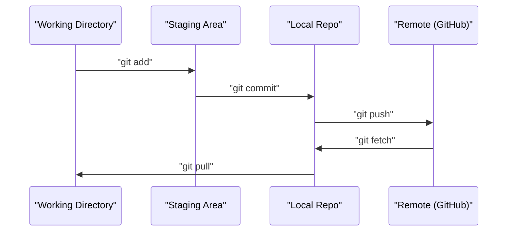
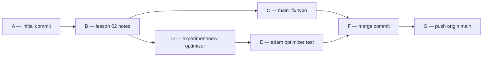
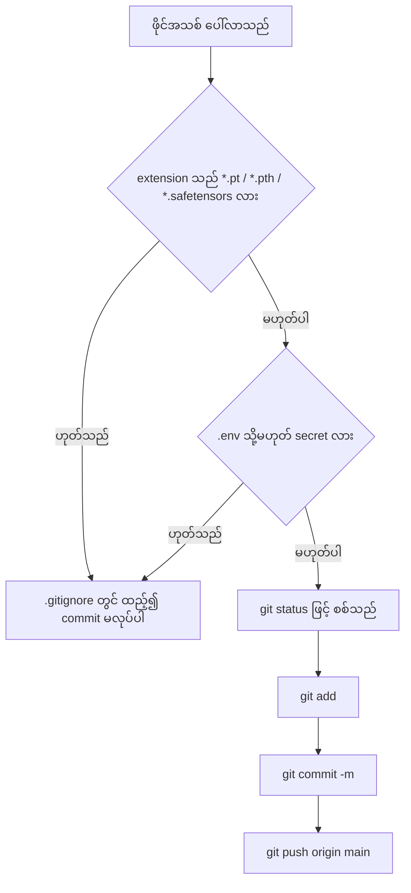
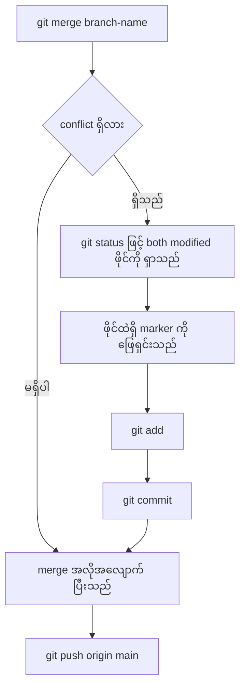

# Module 02 — Git & Collaboration

> Source lesson ၏ စကားလုံးအတိုင်း — "Version control is not optional. Every experiment, every model,
> every lesson you build here gets tracked."

## ၁။ ပြဿနာ — version control မရှိလျှင် ဘာဖြစ်သည်

ဤ course တွင် phase ၂၀ အတွင်း code ဖိုင် ရာနှင့်ချီ ရေးရမည်။ model များကို စမ်းသပ်၍ ချိန်ညှိရမည်။
version control မရှိလျှင် သုံးမျိုးသော ပြဿနာ ဖြစ်လာသည်။

1. **အလုပ်ဆုံးရှုံးခြင်း** — ဖိုင်တစ်ခု ဖျက်မိခြင်း၊ editor မှားဖြင့် ရေးပြီး save လုပ်ခြင်း ဖြစ်လျှင်
   မူလအခြေအနေသို့ ပြန်ရန် နည်းလမ်း မရှိပါ။
2. **မပြန်နိုင်သည့် ချိုးခြင်း** — အလုပ်လုပ်နေသည့် code ကို စမ်းသပ်မှုတစ်ခုအတွက် ပြင်လိုက်ပြီး မအောင်မြင်လျှင်
   မည်သည့် လိုင်းက ပြဿနာ ဖြစ်သည် ကို ပြန်ရှာရန် အချိန် ကုန်သည်။
3. **ပူးပေါင်းလုပ်ဆောင်မှု မဖြစ်နိုင်ခြင်း** — လူနှစ်ဦး တစ်ဖိုင်တည်းကို တစ်ချိန်တည်း ပြင်လျှင် ဘယ်သူ၏
   ပြင်ဆင်မှုက မှန်သည် ကို ဆုံးဖြတ်ရန် စနစ်တစ်ခု လိုသည်။

Source lesson ၏ အဓိကစကားမှာ ရိုးရှင်းသည် — **Git is the tool. GitHub is where the code lives.**
ဤ lesson သည် ဤ course အတွက် လိုအပ်သည့် အတိုင်းအတာသာ ဖုံးလွှမ်းသည်။ rebase၊ cherry-pick၊
submodule များကို ဤ course တွင် မလိုပါ။

## ၂။ အခြေခံ သဘောတရား — လေးခု အကြား ဖိုင်သွားလာမှု

Git ၏ လုပ်ငန်းစဉ်ကို နားလည်ရန် နေရာလေးခု ကို ခွဲခြားရမည်။ ဖိုင်တစ်ခုသည် `git add` နှင့် `git commit`
အဆင့်များကို ဖြတ်၍ နေရာတစ်ခုမှ တစ်ခုသို့ ရွေ့သည်။



Figure 1 — ဖိုင်တစ်ခု၏ လမ်းကြောင်း (working directory မှ remote အထိ)

**ပုံရှင်းလင်းချက် (Figure 1)**

1. `git add` သည် ဖိုင်ကို **working directory** မှ **staging area** သို့ ရွှေ့သည် — ထို အဆင့်တွင် commit မဖြစ်သေးပါ။
2. `git commit` သည် staging area ထဲရှိ အကြောင်းအရာကို snapshot အဖြစ် ယူ၍ **local repo** ထဲ သိမ်းသည်။
3. `git push` သည် local repo ၏ commit များကို **remote** (GitHub) သို့ ပို့သည် — ဤအဆင့်တွင်မှ backup ဖြစ်သည်။
4. လမ်းကြောင်းပြန်သည် `git fetch` နှင့် `git pull` ဖြစ်သည် — remote မှ ပြောင်းလဲမှုကို ပြန်ဆွဲချသည်။
5. မှတ်ရမည့် အချက် — commit မလုပ်ထားသည့် ဖိုင်ကို push မလုပ်နိုင်ပါ။

Source lesson သည် မှတ်ရမည့် အချက် သုံးခုကို ဖော်ပြသည်။

1. Save often (`git commit`)
2. Push to remote (`git push`)
3. Branch for experiments (`git checkout -b experiment`)

### Commit graph ဆိုသည်မှာ

Commit တစ်ခုတိုင်းတွင် မူလ commit (parent) တစ်ခု ရှိသည်။ ထို့ကြောင့် history သည် သစ်ပင် သို့မဟုတ်
ဂရပ် ပုံစံ ဖြစ်လာသည်။ branch တစ်ခု ကိုင်လိုက်လျှင် ဂရပ်တွင် လမ်းကြောင်း နှစ်လမ်း ဖြစ်လာသည်။



Figure 2 — branch နှင့် merge တစ်ခု၏ commit graph

**ပုံရှင်းလင်းချက် (Figure 2)**

1. `A` နှင့် `B` သည် `main` branch ပေါ်ရှိ commit များ ဖြစ်သည်။
2. `B` အမှတ်တွင် `git checkout -b experiment/new-optimizer` ဖြင့် branch အသစ် ဖန်တီးသည် — commit `D`၊ `E` သည် ထို branch ပေါ်တွင်သာ ရှိသည်။
3. တစ်ချိန်တည်းတွင် `main` သည် `C` သို့ ရွေ့သည်။ ထို့ကြောင့် လမ်းကြောင်း နှစ်လမ်း ကွဲထွက်သည်။
4. `git checkout main` ပြီးနောက် `git merge experiment/new-optimizer` လုပ်လျှင် `F` merge commit ပေါ်လာသည်။
5. `F` သည် `C` နှင့် `E` နှစ်ခုလုံးကို parent အဖြစ် ယူသည် — experiment ၏ အလုပ်သည် `main` သို့ ရောက်သည်။
6. `main` ပေါ်တွင် commit အသစ် မရှိလျှင် merge သည် fast-forward ဖြစ်၍ merge commit မလိုပါ။

## ၃။ နည်းလမ်းများ နှိုင်းယှဉ်ခြင်း

Source lesson သည် ဤ course အတွက် လိုအပ်သည့် command အနည်းငယ်ကို ဇယားဖြင့် ဖော်ပြသည်။

| Command | ဘယ်အခါ သုံးသည် | ရလဒ် |
|---|---|---|
| `git clone` | course repo ကို ယူသည့်အခါ | remote repo ၏ copy တစ်ခု local တွင် ဖြစ်လာသည် |
| `git add` + `git commit` | အလုပ်ကို သိမ်းသည့်အခါ | snapshot တစ်ခု local repo ထဲ ဝင်သည် |
| `git push` | GitHub သို့ backup လုပ်သည့်အခါ | commit များ remote သို့ ရောက်သည် |
| `git checkout -b` | `main` ကို မချိုးဘဲ စမ်းသပ်သည့်အခါ | branch အသစ် ဖန်တီး၍ ချက်ချင်း ရွှေ့သည် |
| `git log --oneline` | လုပ်ခဲ့သည့် အလုပ်ကို ပြန်ကြည့်သည့်အခါ | commit တစ်ခုလျှင် လိုင်းတစ်လိုင်း |

Source lesson ၏ အခြေခံ term ဇယား (Key Terms) ကို သတိထားရမည် — လူပြောသည့် အဓိပ္ပာယ်နှင့်
တကယ့် အဓိပ္ပာယ် မတူပါ။

| Term | လူပြောသည့် အနေဖြင့် | တကယ့် အဓိပ္ပာယ် |
|---|---|---|
| Commit | "သိမ်းခြင်း" | အချိန်တစ်ခုတွင် project တစ်ခုလုံး၏ snapshot |
| Branch | "copy တစ်ခု" | commit တစ်ခုကို ညွှန်သည့် pointer — အလုပ်လုပ်သည်နှင့်အမျှ ရွေ့သည် |
| Merge | "code ပေါင်းခြင်း" | branch တစ်ခုမှ ပြောင်းလဲမှုကို အခြား branch သို့ သယ်ခြင်း |
| Remote | "cloud" | အခြားနေရာတွင် ထားသည့် repo ၏ copy (GitHub၊ GitLab) |

Branch သည် "copy" မဟုတ်သဖြင့် ဖိုင်တွေ နှစ်စုံ မဖြစ်ပါ။ ထို့ကြောင့် branch ဖန်တီးခြင်းသည်
စက္ကန့်အနည်းငယ်သာ ကြာသည်။

## ၄။ လက်တွေ့ configuration

### Step 1: Configure git

commit တိုင်းတွင် မည်သူ ရေးသည် ဟူသော အချက်အလက် ပါသည်။ ထို အချက်အလက်ကို တစ်ကြိမ်တည်း
သတ်မှတ်ရမည်။

```bash
git config --global user.name "Your Name"
git config --global user.email "you@example.com"
```

- လိုင်း ၁ — `user.name` ကို သတ်မှတ်သည်။ ရလဒ်သည် `~/.gitconfig` ဖိုင်ထဲ ရေးထားခြင်း ဖြစ်သည်။
- လိုင်း ၂ — `user.email` ကို သတ်မှတ်သည်။ ဤ email သည် GitHub account ၏ email နှင့် တူလျှင်
  commit များကို account နှင့် ဆက်စပ်ပေးသည်။
- `--global` မပါလျှင် repo တစ်ခုတည်းအတွက်သာ သတ်မှတ်သည်။
- မအောင်မြင်ပါက `git config --list` ဖြင့် တန်ဖိုး ရောက်/မရောက် ပြန်စစ်ပါ။
- `git config --global init.defaultBranch main` ဖြင့် branch အမည် မူလတန်ဖိုးကို သတ်မှတ်နိုင်သည်။
  git version အလိုက် မူလ branch အမည် (`master` သို့မဟုတ် `main`) ကွာခြားနိုင်သဖြင့်
  မိမိ version အတွက် version အလိုက် ပြန်စစ်ရန် လိုသည်။

### Step 2: The daily workflow

Source lesson ဖော်ပြသည့် နေ့စဉ် အစီအစဉ် မှာ ဤသို့ ဖြစ်သည်။

```bash
git status
git add file.py
git commit -m "Add perceptron implementation"
git push origin main
```

- `git status` — မည်သည့် ဖိုင် ပြောင်းသည်၊ မည်သည့် ဖိုင် အသစ်၊ မည်သည့် ဖိုင် stage ဖြစ်ပြီး ကို ပြသည်။ commit မလုပ်မီ အမြဲ ကြည့်ရမည်။
- `git add file.py` — ထို ဖိုင်ကို staging area သို့ ရွှေ့သည်။ ရလဒ်သည် `git status` တွင် "Changes to be committed" အောက်၌ ဖိုင်ပေါ်လာခြင်း ဖြစ်သည်။
- `git commit -m "..."` — message နှင့်တကွ snapshot ကို local repo ထဲ သိမ်းသည်။ message သည် ဘာ ပြောင်းသည် ကို တိုတိုရှင်းရှင်း ဖော်ပြရမည်။
- `git push origin main` — local commit များကို `origin` remote ၏ `main` branch သို့ ပို့သည်။
- မအောင်မြင်ပါက remote နှင့် local ကွာနေခြင်း ဖြစ်နိုင်သည်၊ ထိုအခါ `git pull` ဖြင့် ရှေးဦး ပေါင်းရမည်။

အခြေခံစည်းမျဉ်း — commit တစ်ခုလျှင် အလုပ်တစ်ခု သာ ပါရမည်။ "Add perceptron" နှင့် "Fix typo"
ကို commit တစ်ခုတည်းတွင် မရောရပါ။

### Step 3: Branching for experiments

စမ်းသပ်မှုတိုင်းကို branch တစ်ခုတွင် လုပ်ရမည်။ ထိုသို့ လုပ်လျှင် မအောင်မြင်သည့် စမ်းသပ်မှုကို
ဖျက်လိုက်ရုံဖြင့် `main` သည် မူလအတိုင်း ကျန်သည်။

```bash
git checkout -b experiment/new-optimizer

# ... ပြင်ဆင်မှု လုပ်ပြီး commit လုပ်သည် ...

git checkout main
git merge experiment/new-optimizer
```

- `git checkout -b experiment/new-optimizer` — `-b` flag သည် branch အသစ် ဖန်တီးပြီး ချက်ချင်း ထို branch သို့ ရွှေ့သည်။ ရလဒ်သည် `git status` တွင် `On branch experiment/new-optimizer` ပြခြင်း ဖြစ်သည်။
- ထို branch အတွင်း commit လုပ်သည့် အလုပ်သည် `main` ကို လုံးဝ မထိခိုက်ပါ။
- `git checkout main` — `main` သို့ ပြန်ရွှေ့သည်။ branch အတွင်းရှိ ပြင်ဆင်မှုများ ပျောက်သွားသည် မဟုတ်ပါ၊ ထို branch ပေါ်တွင် ကျန်သည်။
- `git merge experiment/new-optimizer` — ထို branch ၏ ပြောင်းလဲမှုကို `main` သို့ ပေါင်းသည်။
- နှစ်ဖက်လုံး ဖိုင်တစ်ခုတည်းကို ပြင်ထားလျှင် conflict ဖြစ်သည်။ ထိုအခါ ဖိုင်ထဲရှိ marker များကို လူက ရွေးပြီး `git add` + `git commit` ဖြင့် အပြီးသတ်ရမည်။

### Step 4: Working with this course repo

Source lesson ဖော်ပြသည့်အတိုင်း — course repo ကို တိုက်ရိုက် push လုပ်ခွင့် မရှိပါ။ maintainer များသာ
write access ရှိသည်။ ထို့ကြောင့် GitHub တွင် **fork** လုပ်ရမည် — repo စာမျက်နှာ၏ ညာဘက်အပေါ်ရှိ
Fork ခလုတ်ဖြင့် ဖြစ်သည်။ fork ပြီးလျှင် `origin` သည် မိမိ၏ copy ကို ညွှန်သည်။

```bash
git clone https://github.com/YOUR-USERNAME/ai-engineering-from-scratch.git
cd ai-engineering-from-scratch

git checkout -b my-progress
# lesson များကို လိုက်လုပ်ပြီး code ကို commit လုပ်သည်
git push origin my-progress
```

- `git clone <URL>` — fork ၏ history တစ်ခုလုံးကို local သို့ ဆွဲချသည်။
- `cd ai-engineering-from-scratch` — repo folder အတွင်းသို့ ဝင်သည်။
- `git checkout -b my-progress` — မိမိ၏ အလုပ်အတွက် branch ဖန်တီးသည်။ `main` ကို မထိပါ။
- `git push origin my-progress` — မိမိ၏ fork ပေါ်သို့ branch ကို ပို့သည်။ ပထမအကြိမ်တွင် `git push -u origin my-progress` ဖြင့် upstream ကို သတ်မှတ်နိုင်သည်။ ထိုနောက် `git push` သာ ရေးလျှင် ရသည်။

## ၅။ Checkpoint နှင့် ဖိုင်ကြီး စီမံခန့်ခွဲမှု

Source lesson ၏ လေ့ကျင့်ခန်း ၂ နှင့် quiz သည် model checkpoint များကို `.gitignore` တွင်
ထည့်ရမည် ဟု ဖော်ပြသည်။ အကြောင်းမှာ ၎င်း ဖိုင်များသည် gigabyte အရွယ်အထိ ကြီးနိုင်ပြီး
ပြန် generate လုပ်နိုင်သဖြင့် ဖြစ်သည်။ git သည် ဖိုင် binary ကြီးများအတွက် ရည်ရွယ်၍ တည်ဆောက်ထားသည် မဟုတ်ပါ။



Figure 3 — `.gitignore` ဆုံးဖြတ်ချက် နှင့် commit အဆင့်များ

**ပုံရှင်းလင်းချက် (Figure 3)**

1. ဖိုင်အသစ် တစ်ခု ပေါ်လာတိုင်း ရှေးဦး စစ်ရမည့် အချက်မှာ ၎င်း၏ extension ဖြစ်သည်။
2. `*.pt`၊ `*.pth`၊ `*.safetensors` ဖြစ်လျှင် `.gitignore` တွင် ထည့်၍ commit မလုပ်ပါ — ပြန် generate လုပ်နိုင်သည်။
3. `.env` သို့မဟုတ် key ပါသည့် ဖိုင်လည်း commit မလုပ်ပါ — ဤ course တွင် key များကို repo ထဲ လုံးဝ မထည့်ရပါ။
4. ကျန်သည့် ဖိုင်များကို `git status` ဖြင့် စစ်ပြီး `git add` လုပ်သည်။
5. နောက်ဆုံး `git commit` နှင့် `git push` ဖြင့် remote သို့ ရောက်သည်။

`.gitignore` ဖိုင်၏ ဥပမာ — လိုင်းတစ်လိုင်းလျှင် pattern တစ်ခု ဖြစ်သည်။

```
# Model checkpoints — ဖိုင်ကြီးများ၊ ပြန် generate လုပ်နိုင်သည်
*.pt
*.pth
*.safetensors

# Secrets နှင့် ပတ်ဝန်းကျင်
.env
.venv/

# Cache နှင့် generated
__pycache__/
data/
```

စစ်နည်းမှာ ရိုးရှင်းသည် — checkpoint extension ဖြင့် ဖိုင်အလွတ် တစ်ခု ဖန်တီးပြီး `git status` run ပါ။
ထို ဖိုင်သည် untracked list တွင် မပေါ်ရပါ။

## ၆။ `git log` ဖြင့် history ဖတ်ခြင်း

`git log --oneline` သည် commit တစ်ခုလျှင် လိုင်းတစ်လိုင်း ပြသည် — ရှေ့တွင် hash အတိုမျိုး၊
နောက်တွင် commit message ဖြစ်သည်။ အလုပ်များလာသည့်အခါ branch လမ်းကြောင်းကို ကြည့်ရန်
`git log --oneline --graph` ကို သုံးသည်။ ထို output တွင် `*` နှင့် `|`၊ `/`၊ `\` သင်္ကေတများဖြင့်
ဂရပ် ပုံစံ ဖော်ပြသည်။

Source lesson ၏ hint အရ path တစ်ခုကို စစ်ထုတ်ရန် `git log --oneline -- phases/00-setup-and-tooling`
ကို သုံးသည်။ commit တစ်ခုက ဘာ ဖိုင် ထည့်သည် ကို ကြည့်ရန် `git show --stat <hash>` ကို သုံးသည်။

## ၇။ လုပ်ငန်းလည်ပတ်ရေး သတိပြုချက် (Cautions)



Figure 4 — merge conflict ဖြစ်လျှင် လိုက်ရမည့် အစီအစဉ်

**ပုံရှင်းလင်းချက် (Figure 4)**

1. `git merge` လုပ်လျှင် git သည် နှစ်ဖက် ပြောင်းလဲမှုကို ကိုယ်တိုင် ပေါင်းရန် ကြိုးစားသည်။
2. မတူညီသည့် လိုင်းများ ဖြစ်လျှင် အလိုအလျောက် ပြီးသည် — merge commit တစ်ခု ဖြစ်လာသည်။
3. လိုင်းတစ်လိုင်းတည်းကို နှစ်ဖက် ပြင်ထားလျှင် git သည် ဆုံးဖြတ်နိုင်ခြင်း မရှိသဖြင့် conflict အဖြစ် ရပ်သည်။
4. ထိုအခါ `git status` သည် "both modified" ဟု ပြသည်။ ဖိုင်ထဲတွင် `<<<<<<<`၊ `=======`၊ `>>>>>>>` marker ဖြင့် နှစ်ဖက် အကြောင်းအရာ ပြထားသည်။
5. လူက မှန်သည့် အကြောင်းအရာကို ရွေးပြီး marker အားလုံး ဖျက်ရမည်။ ထိုနောက် `git add` နှင့် `git commit` ဖြင့် merge ကို အပြီးသတ်သည်။
6. conflict ဖြေရှင်းမပြီးမချင်း push မလုပ်ရပါ။

အခြား သတိပြုရမည့် အချက်များ —

- **API key နှင့် token ကို repo ထဲ လုံးဝ မထည့်ရပါ။** `.env` ဖိုင်ကို `.gitignore` တွင် ထည့်ထားရမည်။
  မတော်တဆ commit လုပ်မိလျှင် history ထဲ ကျန်နေသဖြင့် key ကို rotate လုပ်ရမည်။
- **Model checkpoint နှင့် dataset ကြီးများကို git တွင် မထည့်ရပါ။** `*.pt`၊ `*.pth`၊ `*.safetensors`
  နှင့် `data/` ကို ချန်လှပ်ရမည်။ လိုအပ်လျှင် Git LFS သို့မဟုတ် DVC ကဲ့သို့ သီးခြားနည်းလမ်း လိုသည်
  (ဤ course ၏ module 09 တွင် ဆက်လက် ဖော်ပြသည်)။
- **`main` တွင် တိုက်ရိုက် စမ်းသပ်မှု မလုပ်ရပါ။** branch တစ်ခု ဖန်တီး၍ စမ်းသပ်ပြီး အောင်မြင်မှသာ merge လုပ်ရမည်။
- **commit message ကို အနာဂတ်တွင် ဖတ်မည့်သူအတွက် ရေးရမည်။** "update" ကဲ့သို့ စကားလုံး တစ်လုံးတည်း မရေးရပါ။
- **`git commit` မတိုင်မီ `git status` ကို အမြဲ ကြည့်ရမည်။** မလိုလားသည့် ဖိုင် (checkpoint၊ `.env`) ပါလာခြင်းကို ဤအဆင့်တွင် ဖမ်းနိုင်သည်။
- **`git pull` မလုပ်ဘဲ push လုပ်လျှင် reject ဖြစ်နိုင်သည်။** ထိုအခါ `git pull` → conflict ဖြေရှင်းခြင်း → `git push` အစီအစဉ် လိုက်ရမည်။
- command များသည် version အလိုက် ပြောင်းလဲနိုင်သည်၊ run မီ မိမိ version အတွက် official documentation ကို စစ်ပါ။
  (ဥပမာ — မူလ branch အမည် နှင့် `git config` ၏ option အမည်များ။)

## ၈။ ကိုယ်တိုင် စစ်ဆေးခြင်း (Self-check)

**မေးခွန်း ၁။ version control သည် အဓိကအားဖြင့် ဘာအတွက် ကူညီသည်။**

အဖြေ — ဖိုင်များ၏ ပြောင်းလဲမှုကို အချိန်အလိုက် မှတ်တမ်းတင်ပေးပြီး အခြားသူများနှင့်
ပူးပေါင်းလုပ်ဆောင်နိုင်ရန် ကူညီသည်။ မှားလျှင် မူလအခြေအနေသို့ ပြန်နိုင်သည်။

**မေးခွန်း ၂။ အလုပ်ကို သိမ်း၍ backup လုပ်ရန် အစီအစဉ် မှန်ကန်သည့် အစီအစဉ်က ဘာလဲ။**

အဖြေ — `git add` → `git commit` → `git push` ဖြစ်သည်။ ရှေးဦး stage လုပ်သည်၊ ထိုနောက်
snapshot သိမ်းသည်၊ နောက်ဆုံး remote သို့ ပို့သည်။

**မေးခွန်း ၃။ `git checkout -b experiment/new-optimizer` သည် ဘာလုပ်သည်။**

အဖြေ — `experiment/new-optimizer` အမည်ရှိ branch အသစ်ကို ဖန်တီးပြီး ထို branch သို့ ချက်ချင်း
ရွှေ့သည်။ `-b` flag သည် create-and-switch ကို ဆိုလိုသည်။ `main` သည် မထိခိုက်ပါ။

**မေးခွန်း ၄။ `.pt`၊ `.pth`၊ `.safetensors` ကို `.gitignore` တွင် ထည့်ရသည့် အကြောင်းရင်း က ဘာလဲ။**

အဖြေ — ၎င်းတို့သည် model checkpoint ဖိုင်များ ဖြစ်ပြီး gigabyte အထိ ကြီးနိုင်သည်။ git သည်
ဖိုင် binary ကြီးများအတွက် မသင့်လျော်သဖြင့် ချန်လှပ်ပြီး ပြန် generate လုပ်ခြင်း သို့မဟုတ်
သီးခြား storage တွင် ထားခြင်း ပြုရမည်။

**မေးခွန်း ၅။ branch တစ်ခုကို merge လုပ်သည့်အခါ conflict ဖြစ်လာလျှင် ဘယ်လိုလုပ်ရမည်။**

အဖြေ — `git status` ဖြင့် "both modified" ဖိုင်ကို ရှာပြီး ထို ဖိုင်၏ conflict marker များကို
လူက ရွေးသည်။ marker အားလုံး ဖျက်ပြီးနောက် `git add <file>` နှင့် `git commit` ဖြင့် merge ကို
အပြီးသတ်သည်။ ထိုနောက်မှသာ `git push` လုပ်ရမည်။

## Technical review notes

- Source lesson (02-git-and-collaboration) တွင် version နံပါတ်၊ image tag သို့မဟုတ် package အမည်
  တိတိကျကျ ပါလာခြင်း မရှိပါ။ ထို့ကြောင့် ဤ module တွင် version ကို ကိုယ်တိုင် ထည့်ခြင်း မပြုပါ။
- commit hash အားလုံး (`9f2c1ab`၊ `a3f9c21` စသည်) သည် ပုံစံပြသာ ဖြစ်ပြီး စစ်မှန်သည့် repo တစ်ခု၏
  hash မဟုတ်ပါ။ ဤအချက်ကို `lab.py` နှင့် `solution.md` တွင် "(ပုံစံစားသာ)" ဟု မှတ်ထားသည်။
- Source lesson ၏ "Three things to remember" နှင့် Key Terms ဇယားကို အနေအထားအတိုင်း ထားသည်။
  အဓိပ္ပာယ် ပြင်ခြင်း မပြုပါ။
- Source တွင် figure အဖြစ် `sequenceDiagram` တစ်ခုနှင့် `s0-commit-dag` ဟူသော placeholder တစ်ခု
  ပါသည်။ ဤ course တွင် `s0-commit-dag` placeholder ကို ကိုယ်တိုင်ရေးသည့် commit graph
  `flowchart LR` (Figure 2) အဖြစ် ပြန်ရေးသည်။ အကြောင်းရင်း — third-party ပုံ embed လုပ်ခြင်းကို
  `WRITING_RULES.md` က တားမြစ်ထားသဖြင့် ဖြစ်သည်။
- `git config --global init.defaultBranch main` နှင့် `git push -u` တို့ကို source မှ တိုက်ရိုက်
  မဖော်ပြထားပါ။ သို့သော် source ၏ `git push origin my-progress` ကို အလုပ်လုပ်နိုင်ရန် upstream
  သတ်မှတ်ခြင်း လိုအပ်သဖြင့် ဖော်ပြခြင်း ဖြစ်သည်။ ထို အချက်သည် version အလိုက် ပြောင်းလဲနိုင်သည်။
- `git log --oneline --graph` ကို အပိုဆောင်း ဖော်ပြထားသည်။ source ၏ လေ့ကျင့်ခန်း ၃ နှင့် hint
  တွင် `git log --oneline`၊ `git log --oneline -- <path>` နှင့် `git show --stat <hash>` သာ ပါသည်။
- `lab.py` သည် git command ကို run ခြင်း မရှိပါ — `WRITING_RULES.md` ၏ lab စည်းမျဉ်း (standard library
  သာ၊ network နှင့် subprocess မလိုရ) ကို လိုက်နာရန် လုပ်ငန်းစဉ်များကို pure Python ဖြင့် သရုပ်ဖော်သည်။
- Git LFS နှင့် DVC ကို ဤ module တွင် အမည်သာ ဖော်ပြသည်။ အသေးစိတ်ကို module 09 (Data Management)
  တွင် ဆက်လက် ဖော်ပြသည်။

## References & Further Reading

- Source lesson — Git & Collaboration:
  https://aiengineeringfromscratch.com/lesson?path=phases%2F00-setup-and-tooling%2F02-git-and-collaboration
- Source document — `phases/00-setup-and-tooling/02-git-and-collaboration/docs/en.md`
  (`rohitg00/ai-engineering-from-scratch`, MIT)
- Source repository — https://github.com/rohitg00/ai-engineering-from-scratch
- Git official documentation — `git config`: https://git-scm.com/docs/git-config
- Git official documentation — `git add`: https://git-scm.com/docs/git-add
- Git official documentation — `git commit`: https://git-scm.com/docs/git-commit
- Git official documentation — `git checkout` / `git switch`: https://git-scm.com/docs/git-checkout
- Git official documentation — `git merge` (conflict အပါအဝင်): https://git-scm.com/docs/git-merge
- Git official documentation — `git log`: https://git-scm.com/docs/git-log
- Git official documentation — `gitignore` pattern format: https://git-scm.com/docs/gitignore
- Pro Git book (free) — Recording Changes to the Repository:
  https://git-scm.com/book/en/v2/Git-Basics-Recording-Changes-to-the-Repository
- Pro Git book (free) — Basic Branching and Merging:
  https://git-scm.com/book/en/v2/Git-Branching-Basic-Branching-and-Merging
