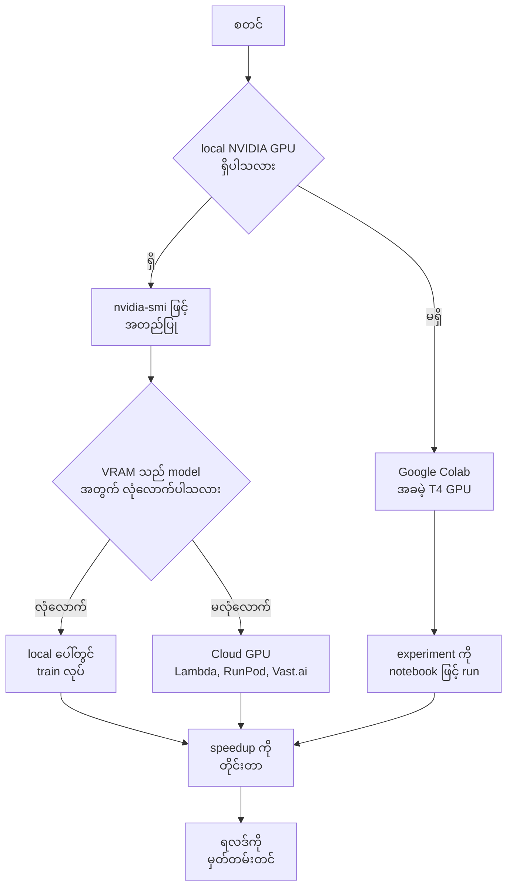
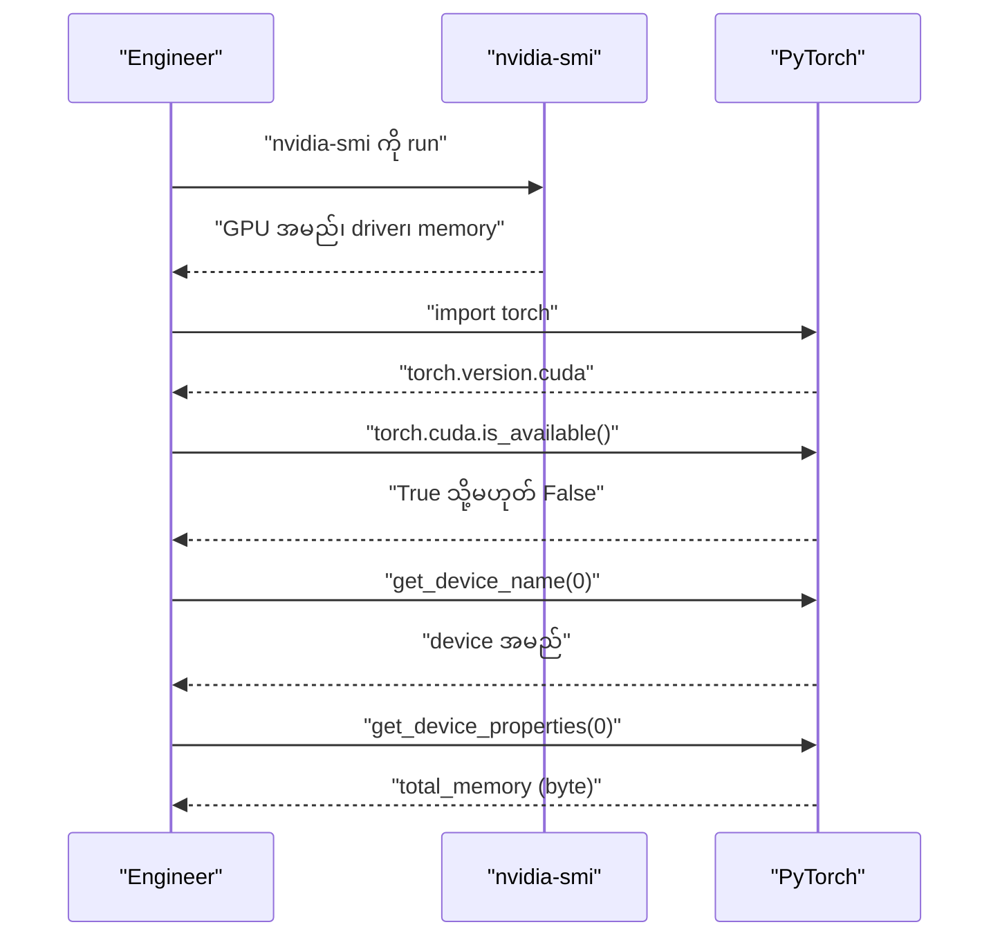
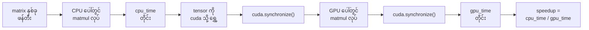

# Module 03 — GPU Setup & Cloud

## ၁။ ပြဿနာ — CPU သည် ဘယ်နေရာတွင် ရပ်တန့်သလဲ

ဤ course ၏ phase 1 မှ phase 3 အထိ lesson အများစုသည် CPU ပေါ်တွင် ကောင်းစွာ run နိုင်သည်။
သို့သော် CNN၊ transformer သို့မဟုတ် LLM များကို train လုပ်သည့် phase 4 မှစ၍ GPU acceleration
လိုအပ်လာသည်။ Source ၏ ဖော်ပြချက်အတိုင်း — CPU ပေါ်တွင် ၈ နာရီ ကြာသည့် training run တစ်ခုသည်
GPU ပေါ်တွင် ၁၀ မိနစ် ကြာသည်။

ထို့ကြောင့် ရင်ဆိုင်ရသည့် မေးခွန်းသည် ရိုးရှင်းသည် — ကိုယ့် machine တွင် GPU ရှိပါသလား၊
မရှိပါက ဘယ်လမ်းကြောင်းကို ရွေးရမည်နည်း။ Source သည် ရွေးချယ်စရာ သုံးမျိုးကို ပေးသည် —
local NVIDIA GPU၊ Google Colab (အခမဲ့) နှင့် cloud GPU (Lambda၊ RunPod၊ Vast.ai)။

## ၂။ အခြေခံ အယူအဆ — GPU သည် ဘာကြောင့် မြန်သလဲ

GPU သည် CPU ထက် clock speed မြင့်သောကြောင့် မြန်သည် မဟုတ်ပါ။ GPU တွင် core ထောင်ပေါင်းများစွာ
ရှိပြီး matrix operation ထောင်ပေါင်းများစွာကို တစ်ချိန်တည်း (parallel) လုပ်ဆောင်နိုင်သောကြောင့်
မြန်သည်။ Neural network training ကို လွှမ်းမိုးထားသည့် လုပ်ဆောင်ချက်သည် matrix multiplication
ဖြစ်သဖြင့် ဤ parallel စွမ်းရည်သည် တိုက်ရိုက် အကျိုးသက်ရောက်သည်။

Key term များကို source အတိုင်း မှတ်ထားရမည် —

| Term | လူအများ ပြောသည့် အဓိပ္ပာယ် | အမှန်တကယ် အဓိပ္ပာယ် |
|---|---|---|
| CUDA | "GPU programming" | NVIDIA ၏ parallel computing platform — GPU ပေါ်တွင် code run နိုင်စေသည် |
| VRAM | "GPU memory" | GPU ပေါ်ရှိ video RAM — system RAM နှင့် သီးခြား ဖြစ်သည်။ Model အရွယ်အစားကို ကန့်သတ်သည် |
| fp16 | "Half precision" | 16-bit floating point — fp32 ၏ တစ်ဝက် memory သုံးပြီး accuracy ဆုံးရှုံးမှု အနည်းငယ်သာ ရှိသည် |
| Tensor Core | "Fast matrix hardware" | Matrix multiplication အတွက် အထူး core — သာမန် core ထက် ၄–၈ ဆ မြန်သည် |

VRAM သည် **model အရွယ်အစားကို ကန့်သတ်သည့် အဓိက အတားအဆီး** ဖြစ်သည်။ ထိုကြောင့် ဤ module တွင်
VRAM မှ model အရွယ်အစားကို ခန့်မှန်းသည့် နည်းလမ်းကို လေ့လာသည်။

## ၃။ ရွေးချယ်စရာ သုံးမျိုး — နှိုင်းယှဉ်ချက်

Source ပေးသည့် နှိုင်းယှဉ်ချက် ဇယား မှာ ဤသို့ ဖြစ်သည် —

| ရွေးချယ်မှု | ကုန်ကျစရိတ် | Setup | သင့်တော်သည့် အခြေအနေ |
|---|---|---|---|
| Local NVIDIA GPU | $0 (ကိုယ့်တွင် ရှိပြီးသား) | CUDA + cuDNN install | ပုံမှန် အသုံးပြုမှု၊ dataset ကြီးများ |
| Google Colab (free tier) | $0 | မလိုပါ | အမြန် experiment၊ အိမ်တွင် GPU မရှိခြင်း |
| Cloud GPU (Lambda, RunPod, Vast.ai) | $0.20–2.00/hr | SSH + install | အလေးအနက် training၊ model ကြီးများ |

ဤဇယားသည် ဆုံးဖြတ်ချက်၏ အခြေခံ ဖြစ်သည် — အခမဲ့ နှင့် အခကြေးငွေ ကြားရှိ ခြားနားချက်သည်
"အမြန် experiment" နှင့် "အလေးအနက် training" ကြားရှိ ခြားနားချက် ဖြစ်သည်။

## ၄။ ဆုံးဖြတ်ချက် လမ်းကြောင်း



**Figure 1 — Local GPU နှင့် cloud route ဆုံးဖြတ်သည့် ဇယား**

ပုံရှင်းလင်းချက် (Figure 1)

၁။ စတင်သည့်အခါ မေးခွန်း တစ်ခုသာ ရှိသည် — ကိုယ့် machine တွင် NVIDIA GPU ရှိ/မရှိ။ `nvidia-smi` ကို
   run ၍ အဖြေ ရနိုင်သည်။
၂။ GPU မရှိပါက လမ်းကြောင်းသည် Google Colab သို့ တိုက်ရိုက် သွားသည်။ Setup မလိုသည့် အခမဲ့ route ဖြစ်သည်။
၃။ GPU ရှိပါက ဒုတိယ မေးခွန်းကို ဆက်မေးသည် — VRAM သည် train လုပ်မည့် model အတွက် လုံလောက်/မလုံလောက်။
၄။ လုံလောက်ပါက local တွင် ဆက်လုပ်သည်; မလုံလောက်ပါက cloud GPU သို့ ပြောင်းသည်။
၅။ လမ်းကြောင်း အားလုံးသည် အဆုံးတွင် speedup တိုင်းတာခြင်း နှင့် ရလဒ် မှတ်တမ်းတင်ခြင်းသို့ ပေါင်းဆုံသည်။

## ၅။ လက်တွေ့ configuration

### Option 1: Local NVIDIA GPU

ပထမဆုံး လုပ်ရမည့် အရာသည် GPU ရှိ/မရှိ စစ်ခြင်း ဖြစ်သည်။

```bash
nvidia-smi
```

ဤ command သည် NVIDIA System Management Interface ကို ခေါ်သည်။ ရလဒ်တွင် GPU အမည်၊ driver version၊
CUDA version၊ လက်ရှိ memory usage၊ temperature နှင့် run နေသည့် process များကို ပြသည်။
Command မတွေ့ပါက သို့မဟုတ် "command not found" ပြပါက NVIDIA driver မထည့်ရသေးခြင်း ဖြစ်သည်။

နောက်တစ်ဆင့်မှာ CUDA ပါသည့် PyTorch ကို install လုပ်ခြင်း ဖြစ်သည်။ ပြီးနောက် PyTorch ၏ CUDA API
ဖြင့် စစ်သည် —

```python
import torch

print(f"CUDA available: {torch.cuda.is_available()}")
print(f"CUDA version: {torch.version.cuda}")
if torch.cuda.is_available():
    print(f"GPU: {torch.cuda.get_device_name(0)}")
    print(f"Memory: {torch.cuda.get_device_properties(0).total_memory / 1e9:.1f} GB")
```

`torch.cuda.is_available()` သည် boolean တန်ဖိုး ပြန်သည်။ `torch.version.cuda` သည် PyTorch build နှင့်
တွဲဖက်သည့် CUDA version ဖြစ်သည်။ `get_device_properties(0).total_memory` သည် byte ဖြင့် ပြန်သဖြင့်
`1e9` ဖြင့် စား၍ GB ပြောင်းသည်။ ဤတန်ဖိုးသည် နောက်ပိုင်း model fit တွက်ချက်မှုတွင် အသုံးဝင်သည်။



**Figure 2 — Local GPU ကို အဆင့်လိုက် စစ်ဆေးသည့် အစဉ်**

ပုံရှင်းလင်းချက် (Figure 2)

၁။ Engineer သည် ပထမ `nvidia-smi` ကို run သည် — ဤအဆင့်သည် driver အဆင့်ကို စစ်သည်။
၂။ ဇယားတွင် GPU အမည် မပေါ်ပါက နောက်အဆင့် များသည် အဓိပ္ပာယ် မရှိပါ။
၃။ ထို့နောက် PyTorch ကို import ၍ CUDA build ရှိ/မရှိ စစ်သည်။
၄။ `is_available()` က False ပြန်ပါက PyTorch build သည် CPU-only ဖြစ်နိုင်သည် (version အလိုက် ပြန်စစ်ရန် လိုသည်)။
၅။ အောင်မြင်ပါက device အမည် နှင့် total memory ကို ယူ၍ မှတ်တမ်းတင်သည်။

### Option 2: Google Colab

၁။ `colab.research.google.com` သို့ သွားသည်။
၂။ Runtime > Change runtime type > T4 GPU ကို ရွေးသည်။
၃။ `!nvidia-smi` ကို run ၍ စစ်သည်။

`!nvidia-smi` တွင် ရှေ့ဆုံးရှိ `!` သည် Colab cell မှ shell command ကို ခေါ်ရန် ဖြစ်သည်။ ဤ cell သည်
GPU အမည် ကို မပြပါက benchmark ရလဒ်သည် အဓိပ္ပာယ် မရှိပါ။ Source တွင် ဖော်ပြထားသည့်အတိုင်း
ဤ course ၏ notebook များကို Colab သို့ တိုက်ရိုက် upload လုပ်နိုင်သည်။

### Option 3: Cloud GPU

Lambda Labs၊ RunPod သို့မဟုတ် Vast.ai အတွက် —

```bash
ssh user@your-gpu-instance

pip install torch torchvision torchaudio
python -c "import torch; print(torch.cuda.get_device_name(0))"
```

`ssh user@your-gpu-instance` သည် instance သို့ remote login လုပ်သည်။ `pip install` သည် PyTorch
package သုံးခုကို ထည့်သည်။ နောက်ဆုံး command သည် one-line ဖြင့် GPU အမည်ကို စစ်သည်။

### No GPU? No problem.

GPU မရှိသည့် အခြေအနေအတွက် source သည် device ကို ရွေးသည့် ပုံစံကို ပေးသည် —

```python
device = torch.device("cuda" if torch.cuda.is_available() else "cpu")
print(f"Using: {device}")
```

ဤပုံစံသည် code ကို GPU ရှိ/မရှိ machine နှစ်မျိုးလုံးတွင် run နိုင်စေသည် — `cuda` မရှိပါက `cpu`
သို့ အလိုအလျောက် ကျသည်။ Lesson အများစုသည် CPU ပေါ်တွင် အလုပ်လုပ်သည်; GPU လိုအပ်သည့် lesson များ
သည် ထိုအကြောင်းကို ရေးထားပြီး Colab link များ ပါသည်။

### Build It: GPU vs CPU benchmark

Source ၏ Build It အပိုင်းတွင် `size = 5000` ကို သုံးသည်၊ ထို့နောက် benchmark code ဖြင့် matrix
multiplication နှစ်ခုကို တိုင်းသည် —

```python
import torch
import time

size = 5000

a_cpu = torch.randn(size, size)
b_cpu = torch.randn(size, size)

start = time.time()
c_cpu = a_cpu @ b_cpu
cpu_time = time.time() - start
print(f"CPU: {cpu_time:.3f}s")

if torch.cuda.is_available():
    a_gpu = a_cpu.to("cuda")
    b_gpu = b_cpu.to("cuda")

    torch.cuda.synchronize()
    start = time.time()
    c_gpu = a_gpu @ b_gpu
    torch.cuda.synchronize()
    gpu_time = time.time() - start
    print(f"GPU: {gpu_time:.3f}s")
    print(f"Speedup: {cpu_time / gpu_time:.0f}x")
```

Source ၏ `code/gpu_check.py` သည် တူညီသည့် ပုံစံကို `size = 4000` ဖြင့် သုံးပြီး device property
များကို ထပ်ဆောင်း ပြသည်။ နှစ်ခုလုံးတွင် အရေးကြီးသည့် အချက်သည် `torch.cuda.synchronize()` ဖြစ်သည်။



**Figure 3 — Benchmark လုပ်ငန်းစဉ် — CPU အချိန်မှ GPU speedup အထိ**

ပုံရှင်းလင်းချက် (Figure 3)

၁။ ပထမ matrix နှစ်ခုကို memory ထဲ ဖန်တီးသည်။
၂။ CPU ပေါ်တွင် matmul ကို run ၍ အချိန်ကို တိုင်းသည်။ ဤအဆင့်သည် synchronous ဖြစ်သဖြင့်
   အပို synchronize မလိုပါ။
၃။ Tensor နှစ်ခုကို `cuda` သို့ ရွှေ့သည် — ဤရွှေ့မှုသည် အချိန်ကို စားသဖြင့် timer အပြင်ဘက်တွင် ထားသည်။
၄။ Timer မစမီ `torch.cuda.synchronize()` ကို ခေါ်သည်။ GPU operation များသည် asynchronous ဖြစ်သဖြင့်
   ဤ call မရှိပါက GPU မပြီးသေးသည့် အချိန်ကို တိုင်းမိမည်။
၅။ Matmul ပြီးနောက် ထပ် synchronize ၍ `gpu_time` ကို တိုင်းသည်။
၆။ အဆုံးတွင် `cpu_time / gpu_time` ဖြင့် speedup ကို `:.0f` format ဖြင့် ပြသည်။

## ၆။ လည်ပတ်ရေး သတိပြုရမည့် အချက်များ

- **Synchronize မမေ့ရ** — GPU operation များသည် asynchronous ဖြစ်သည်။ Python သည် ချက်ချင်း ပြန်လာပြီး
  GPU သည် နောက်ကွယ်တွင် ဆက်တွက်နေသည်။ `torch.cuda.synchronize()` သည် operation အားလုံး ပြီးသည်အထိ
  block လုပ်သဖြင့် အချိန်တိုင်းတာမှု တိကျသည်။
- **ပထမ run ကို မယူရ** — source ၏ hint အတိုင်း ပထမ GPU run တွင် start-up cost ပါသဖြင့် ဒုတိယ run ၏
  နံပါတ်များကိုသာ နှိုင်းယှဉ်ရမည်။
- **VRAM ကို margin ဖြင့် တွက်ရ** — fp16 တွင် parameter တစ်ခုလျှင် ၂ byte ဖြစ်သည်။ သို့သော် activation၊
  gradient၊ optimizer state နှင့် CUDA context များကလည်း memory ကို သုံးသဖြင့် ရလဒ်သည်
  **အနီးစပ်ဆုံး အပေါ်ဆုံးအပိုင်း** သာ ဖြစ်သည်။
- **nvidia-smi ကို အရင် စစ်ရ** — Colab တွင် `!nvidia-smi` မှ GPU အမည် မပြပါက benchmark ရလဒ်သည်
  အဓိပ္ပာယ် မရှိပါ။
- **Version များ တိုက်ဆိုင်ရ** — CUDA version၊ driver version နှင့် PyTorch build သုံးခုသည် တိုက်ဆိုင်ရမည်;
  version အလိုက် ပြန်စစ်ရန် လိုသည်။
- **ကုန်ကျစရိတ်** — cloud GPU သည် `$0.20–2.00/hr` ဖြစ်သဖြင့် အသုံးမလိုသည့်အခါ instance ကို ပိတ်ရမည်။

## ၇။ ကိုယ်တိုင် စစ်ဆေးခြင်း (Self-check)

**မေးခွန်း ၁။ Neural network training အတွက် GPU သည် CPU ထက် ဘာကြောင့် မြန်သလဲ။**
အဖြေ — GPU တွင် parallel computation အတွက် ချိန်ညှိထားသည့် core ထောင်ပေါင်းများစွာ ရှိသောကြောင့်
matrix multiplication ထောင်ပေါင်းများစွာကို တစ်ချိန်တည်း လုပ်နိုင်သည်။ Training ကို လွှမ်းမိုးသည့်
လုပ်ဆောင်ချက်သည် ထို matrix multiplication ဖြစ်သည်။

**မေးခွန်း ၂။ VRAM ဆိုသည်မှာ ဘာကို ဆိုလိုသလဲ။**
အဖြေ — GPU ပေါ်ရှိ video RAM ဖြစ်သည်။ System RAM နှင့် သီးခြား ဖြစ်ပြီး model အရွယ်အစားနှင့်
batch size ကို ကန့်သတ်သည်။

**မေးခွန်း ၃။ NVIDIA GPU ကို detect လုပ်ပြီး status ပြသည့် command သည် ဘာလဲ။**
အဖြေ — `nvidia-smi`။ GPU utilization၊ memory usage၊ temperature နှင့် run နေသည့် process များကို ပြသည်။

**မေးခွန်း ၄။ Benchmark တွင် `torch.cuda.synchronize()` ကို ဘာကြောင့် ခေါ်ရသလဲ။**
အဖြေ — Timer ရပ်မီ GPU operation အားလုံး ပြီးစီးကြောင်း သေချာစေရန် ဖြစ်သည်။ GPU operation များသည်
asynchronous ဖြစ်သဖြင့် synchronize မရှိပါက အချိန်တိုင်းတာမှု လွဲမှားသည်။

**မေးခွန်း ၅။ fp16 rule of thumb အရ 24 GB VRAM တွင် parameter ဘယ်နှစ်ဘီလီယံ ဝင်နိုင်သလဲ။**
အဖြေ — fp16 တွင် parameter တစ်ခုလျှင် ၂ byte ဖြစ်သဖြင့် 24 GB / 2 byte = 12 billion parameters ဖြစ်သည်။
ဤအရေအတွက်သည် အနီးစပ်ဆုံး ဖြစ်သည် — activation၊ gradient နှင့် optimizer state များကလည်း memory သုံးသည်။

## Technical review notes

- Source ၏ Build It အပိုင်းတွင် `size = 5000` ကို သုံးသည်; `code/gpu_check.py` တွင် `size = 4000` ဖြစ်သည်။
  ဤ course တွင် နှစ်ခုလုံးကို source အတိုင်း ဖော်ပြထားသည် — တစ်ခုကို မပြင်ပါ။
- `lab.py` သည် GPU မရှိသည့် machine တွင်လည်း run နိုင်ရမည် ဖြစ်သဖြင့် nvidia-smi ဇယားကို
  ဖမ်းယူထားသည့် **နမူနာ fixture** အဖြစ် ထည့်ထားသည်။ ထို fixture ရှိ device အမည်၊ driver version နှင့်
  memory တန်ဖိုးများသည် source တွင် မပါပါ — ၎င်းတို့သည် simulation အတွက် နမူနာ ဖြစ်သည်။
- Source သည် "keep a margin" ဟု ဆိုသော်လည်း ရာခိုင်နှုန်း အတိအကျ မပေးပါ။ `lab.py` တွင်
  `LAB_RESERVED_FRACTION = 0.10` ကို **lab ၏ နမူနာ margin** အဖြစ် ရှင်းလင်းစွာ မှတ်ထားသည် —
  source မှ ရသည့် တန်ဖိုးအဖြစ် မဖော်ပြပါ။
- fp16 fit သည် `free VRAM` မှ တွက်သည် (spec အတိုင်း)။ Source ၏ `gpu_check.py` သည်
  `total_memory` မှ တွက်သည် — နှစ်ခုလုံး မှန်ကန်ပြီး ရည်ညွှန်းသည့် အခြေခံ တန်ဖိုး ကွာသည်။
- Cloud GPU အခကြေးငွေ (`$0.20–2.00/hr`) နှင့် speedup အရေအတွက်များသည် version၊ hardware နှင့်
  provider အလိုက် ပြောင်းလဲသည် — version အလိုက် ပြန်စစ်ရန် လိုသည်။

## References & Further Reading

- Source lesson — https://aiengineeringfromscratch.com/lesson?path=phases%2F00-setup-and-tooling%2F03-gpu-setup-and-cloud
- Source repository — https://github.com/rohitg00/ai-engineering-from-scratch (MIT), `phases/00-setup-and-tooling/03-gpu-setup-and-cloud/`
- PyTorch CUDA semantics (asynchronous execution နှင့် `torch.cuda.synchronize()`) — https://pytorch.org/docs/stable/notes/cuda.html
- PyTorch installation အထောက်အကူ (CUDA build ရွေးချယ်ခြင်း) — https://pytorch.org/get-started/locally/
- NVIDIA System Management Interface (`nvidia-smi`) — https://developer.nvidia.com/nvidia-system-management-interface
- Google Colab — https://colab.research.google.com
