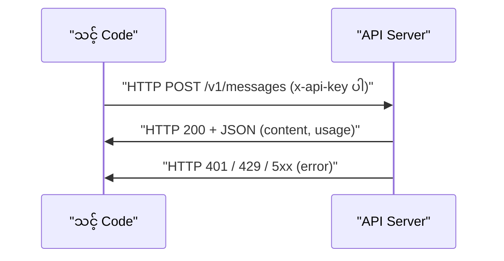
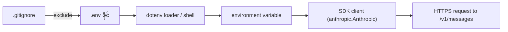
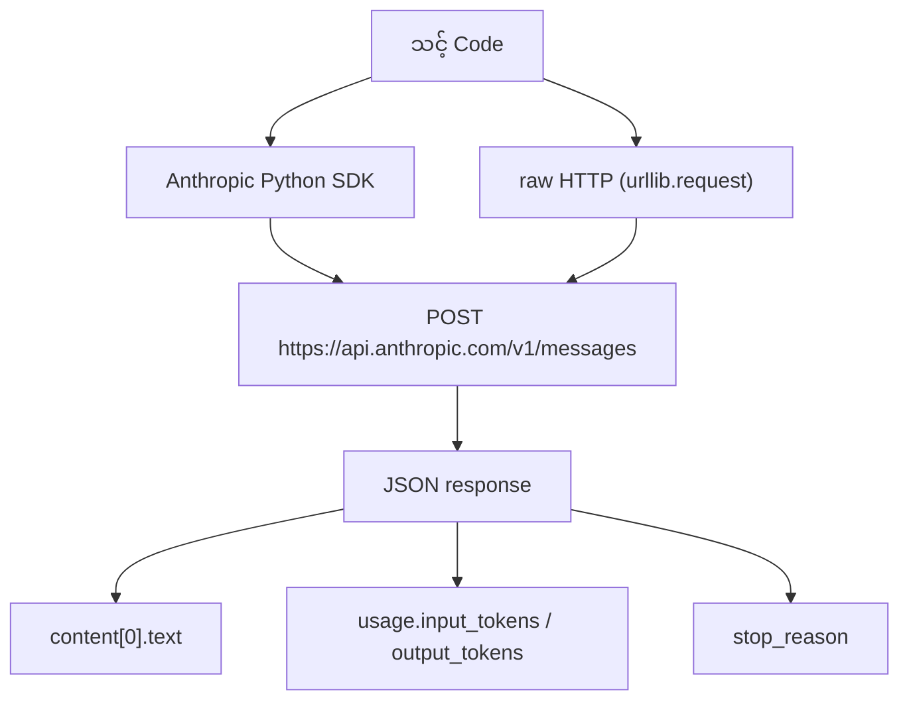
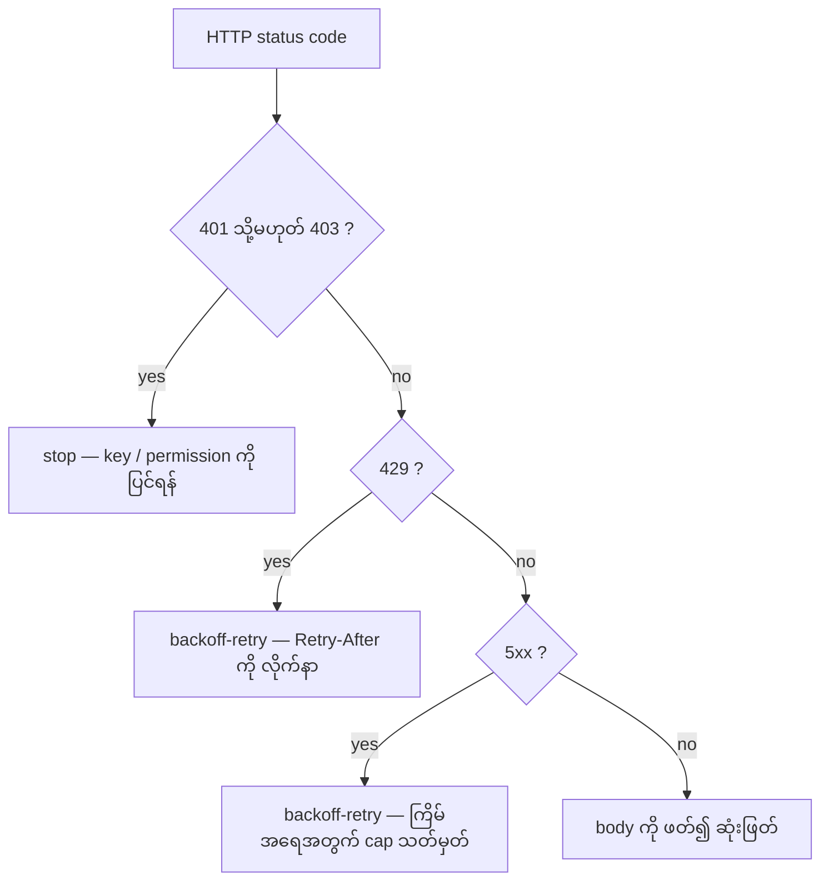

# Module 04 — APIs & Keys

AI application တိုင်းသည် နောက်ဆုံးတွင် HTTP request တစ်ခု ပို့၍ HTTP response တစ်ခု ပြန်ရသည့် ပုံစံသို့ ရောက်သည်။
မော်ဒယ် အမည်၊ SDK အမည်နှင့် JSON field အမည်များ ပြောင်းလဲနိုင်သည်။ သို့သော် request တစ်ခုတွင် endpoint၊ API key၊ request
body နှင့် response body — ဤအစိတ်အပိုင်း ၄ ခု အမြဲ ပါဝင်သည်။ ဤအခန်းသည် ထို ၄ ခုကို တစ်ကြိမ် လက်တွေ့ ဖြတ်သွားပြီး
key ကို လုံခြုံစွာ သိမ်းဆည်းသည့် အလေ့အကျင့်ကို တည်ဆောက်ပေးသည်။

## ဤအခန်းတွင် သင်မည့်အရာ

- API key ကို environment variable နှင့် `.env` ဖိုင်တွင် သိမ်းဆည်းခြင်း — ကုဒ်ထဲတွင် တစ်ကြိမ်မျှ မထည့်ရ
- Anthropic Python SDK ဖြင့် ပထမဆုံး LLM API call ကို ခေါ်ခြင်း
- TypeScript SDK ဖြင့် တူညီသည့် ခေါ်ဆိုမှုကို ရေးခြင်း
- SDK မသုံးဘဲ raw HTTP (`urllib.request`) ဖြင့် ခေါ်ခြင်း
- SDK response နှင့် raw HTTP response ၏ ဖွဲ့စည်းပုံကို နှိုင်းယှဉ်ခြင်း
- authentication မှားခြင်း (401)၊ permission မလုံလောက်ခြင်း (403) နှင့် rate limit (429) တို့ကို ခွဲခြားကိုင်တွယ်ခြင်း

## လိုအပ်ချက် (Prerequisites)

- Phase 0, Lesson 01 (dev environment) ပြီးစီးထားခြင်း
- Python 3.11+ နှင့် Node.js 20+ (TypeScript ပိုင်းအတွက်)
- terminal အခြေခံ အသုံးပြုနိုင်ခြင်း၊ `export` နှင့် environment variable အခြေခံ နားလည်ခြင်း
- network access (ဤ module ၏ lab.py အတွက် မလိုအပ်ပါ — lab သည် offline ဖြစ်သည်)

## ၁။ ပြဿနာ — key ကို ကုဒ်ထဲ ထည့်လျှင် ဘာဖြစ်သနည်း

Phase 11 မှ စ၍ LLM API များ (Anthropic, OpenAI, Google) ကို ခေါ်ရမည်။ Phase 13-16 တွင် agent များသည် ထို API များကို
ကွင်းပတ် (loop) ဖြင့် အကြိမ်များစွာ ခေါ်မည်။ ထို့ကြောင့် key ကို မှန်ကန်စွာ သိမ်းဆည်းသည့် အလေ့အကျင့်ကို ယခုတည်ဆောက်ရသည်။

ကုဒ်ထဲတွင် `api_key = "sk-ant-..."` ကဲ့သို့ တိုက်ရိုက် ရေးထည့်လျှင် အန္တရာယ် ၃ ခု ရှိသည်။

1. ဖိုင် တစ်ခုလုံး git သို့ commit ဖြစ်သွားပြီး public repository သို့ ရောက်နိုင်သည်။ ထိုနေရာမှ scanner များသည်
   key ကို မိနစ်ပိုင်းအတွင်း ရှာတွေ့နိုင်သည်။
2. key ကို rotate လုပ်သည့်အခါ ကုဒ်ကို ပြန်ရေးပြီး deploy ပြန်လုပ်ရသည်။ environment variable ဖြစ်လျှင်
   ကုဒ်ကို မထိဘဲ ပြောင်းနိုင်သည်။
3. screenshot၊ CI log နှင့် error message များတွင် key ပါသွားနိုင်သည်။

အဖြေသည် environment variable ဖြစ်သည်။ Key ကို ကုဒ်နှင့် သီးခြား သိမ်းသည်။ ကုဒ်သည် key ၏ တန်ဖိုးကို မသိဘဲ key ၏
အမည် (`ANTHROPIC_API_KEY`) ကိုသာ ဖတ်သည်။

## ၂။ အခြေခံ သဘောတရား — request တစ်ခုတွင် ပါဝင်သည့် အစိတ်အပိုင်း ၄ ခု

| အစိတ်အပိုင်း | တာဝန် | ဤ module တွင် တန်ဖိုး |
|---|---|---|
| endpoint (URL) | ဘယ် server၊ ဘယ် resource ကို ခေါ်သည်ကို သတ်မှတ်သည် | `https://api.anthropic.com/v1/messages` |
| API key (authentication) | မည်သူ ခေါ်သည်ကို ဖော်ထုတ်ပြီး ခွင့်ပြုသည် | header `x-api-key` |
| request body | မိမိ လိုချင်သည့် အလုပ် (model, max_tokens, messages) | JSON |
| response body | server ပြန်ပေးသည့် အဖြေ (content, usage, stop_reason) | JSON |

**Figure 1 — request နှင့် response အစဉ်**



**ပုံရှင်းလင်းချက် (Figure 1)**

1. သင့် code သည် endpoint တစ်ခုသို့ POST request တစ်ခု ပို့သည်။ Header တွင် `x-api-key` ပါသည်။
2. Server သည် key ကို စစ်သည်။ Key မှန်လျှင် မေးခွန်းကို မော်ဒယ်သို့ ပို့သည်။
3. မော်ဒယ် ပြီးစီးလျှင် server သည် HTTP 200 နှင့် JSON body ကို ပြန်ပေးသည်။
4. Key မှားလျှင် HTTP 401 ပြန်လာသည်။ အကြိမ်အရေအတွက် ကျော်လျှင် HTTP 429 ပြန်လာသည်။
5. Client သည် ထို status code ကို ဖတ်၍ ဆက်လုပ်ရန် သို့မဟုတ် ရပ်ရန် ဆုံးဖြတ်သည်။

## ၃။ API key ကို လုံခြုံစွာ သိမ်းဆည်းခြင်း

နည်းလမ်း နှစ်မျိုး ရှိသည်။ နှစ်မျိုးလုံးတွင် key သည် **ကုဒ်ဖိုင်ထဲ မပါရ**။

နည်းလမ်း ၁ — shell မှ တိုက်ရိုက် export လုပ်ခြင်း (session တစ်ခုအတွက်သာ အသက်ရှင်သည်):

```bash
export ANTHROPIC_API_KEY="sk-ant-..."
export OPENAI_API_KEY="sk-..."
```

နည်းလမ်း ၂ — `.env` ဖိုင် (project တွင် သိမ်းထားပြီး `.gitignore` တွင် ထည့်ရသည်):

```text
ANTHROPIC_API_KEY=sk-ant-...
OPENAI_API_KEY=sk-...
```

**Figure 2 — key သည် ကုဒ်သို့ မည်သို့ ရောက်သနည်း**



**ပုံရှင်းလင်းချက် (Figure 2)**

1. `.env` ဖိုင်သည် key ကို `KEY=VALUE` ပုံစံဖြင့် သိမ်းသည်။ ဤဖိုင်သည် git သို့ မရောက်ရ။
2. dotenv loader သို့မဟုတ် shell သည် `.env` ကို ဖတ်ပြီး value များကို environment variable အဖြစ် ထည့်သည်။
3. SDK client သည် `ANTHROPIC_API_KEY` ကို environment မှ အလိုအလျောက် ဖတ်သည်။ ထို့ကြောင့် ကုဒ်တွင်
   argument ဖြင့် မပေးရ။
4. Client သည် key ကို request header (`x-api-key`) ထဲ ထည့်ပြီး HTTPS ဖြင့် ပို့သည်။
5. `.gitignore` သည် `.env` ကို repository မှ ဖယ်ထုတ်ထားသည်။ ဤအဆင့် မရှိလျှင် အခြားအဆင့် အားလုံး အဓိပ္ပာယ် မရှိ။

`.env` ဖိုင်အပြင် `dotenv` package ကို Python တွင် တိုက်ရိုက် မလိုအပ်ပါ။ SDK သည် environment variable ကို ဖတ်သည်။
သို့သော် script တစ်ခုအဖြစ် run သည့်အခါ `.env` ကို process environment သို့ တင်ပေးသည့် loader တစ်ခု လိုအပ်သည်။
ဤ module ၏ `lab.py` သည် ထို loader ကို standard library ဖြင့် ကိုယ်တိုင် ရေးထားသည်။

## ၄။ ပထမဆုံး API call — Python SDK

```python
import os

import anthropic

client = anthropic.Anthropic()

MODEL = os.environ.get("LLM_MODEL", "claude-sonnet-5")

response = client.messages.create(
    model=MODEL,
    max_tokens=256,
    messages=[{"role": "user", "content": "What is a neural network in one sentence?"}]
)

print(response.content[0].text)
```

လိုင်းတိုင်း၏ လုပ်ဆောင်ချက် —

- `import anthropic` — SDK ကို တင်သည်။ SDK သည် `pip install anthropic` ဖြင့် ထည့်ရသည်။
- `client = anthropic.Anthropic()` — Client တည်ဆောက်သည်။ ဤအချိန်တွင် client သည် `ANTHROPIC_API_KEY`
  environment variable ကို ရှာသည်။ မတွေ့လျှင် အမှားတစ်ခု ဖြစ်သည်။
- `os.environ.get("LLM_MODEL", "claude-sonnet-5")` — မော်ဒယ် အမည်ကို environment မှ ဖတ်သည်။ မရှိလျှင်
  default ကို ယူသည်။ ထို့ကြောင့် မော်ဒယ် ပြောင်းရန် ကုဒ် မပြင်ရ။
- `client.messages.create(...)` — `/v1/messages` endpoint သို့ POST request ပို့သည်။
- `model`၊ `max_tokens` နှင့် `messages` သည် request body ဖြစ်သည်။ `max_tokens=256` သည် output အရှည်၏
  အမြင့်ဆုံး token အရေအတွက် ဖြစ်သည်။
- `response.content[0].text` — response သည် object တစ်ခု ဖြစ်သည်။ `content` သည် block စာရင်း ဖြစ်သည်။
  ပထမ text block ၏ `text` ကို ဖတ်သည်။

`LLM_MODEL` သည် Anthropic မော်ဒယ် id ကို ရွေးသည်။ Default သည် date မပါသည့် Sonnet alias ဖြစ်သည်။
အခြား provider များ (OpenAI, Google) သည် key တစ်ခု + model id တစ်ခု ဆိုသည့် ပုံစံတူညီသော်လည်း SDK၊
endpoint နှင့် request/response schema မတူပါ။ Model id နှင့် SDK version သည် **version အလိုက် ပြန်စစ်ရန် လိုသည်**။

## ၅။ ထို call ကို TypeScript ဖြင့်

```typescript
import Anthropic from "@anthropic-ai/sdk";

const client = new Anthropic();

const MODEL = process.env.LLM_MODEL ?? "claude-sonnet-5";

const response = await client.messages.create({
  model: MODEL,
  max_tokens: 256,
  messages: [{ role: "user", content: "What is a neural network in one sentence?" }],
});

console.log(response.content[0].text);
```

ပုံစံသည် Python နှင့် တူသည်။ ကွာခြားချက် ၃ ခု ရှိသည်။

- environment variable ကို `process.env` (Node.js) မှ ဖတ်သည်။
- မော်ဒယ် ရွေးရန် nullish coalescing operator `??` ကို သုံးသည်။
- call သည် asynchronous ဖြစ်သဖြင့် `await` လိုအပ်သည်။

SDK အမည်သည် `@anthropic-ai/sdk` ဖြစ်သည်။ Node.js version အလိုက် TypeScript setup လိုအပ်ချက် ပြောင်းနိုင်သဖြင့်
official documentation ကို စစ်ပါ။

## ၆။ Raw HTTP (SDK မသုံးဘဲ)

```python
import os
import urllib.request
import json

url = "https://api.anthropic.com/v1/messages"
headers = {
    "Content-Type": "application/json",
    "x-api-key": os.environ["ANTHROPIC_API_KEY"],
    "anthropic-version": "2023-06-01",
}
body = json.dumps({
    "model": os.environ.get("LLM_MODEL", "claude-sonnet-5"),
    "max_tokens": 256,
    "messages": [{"role": "user", "content": "What is a neural network in one sentence?"}],
}).encode()

req = urllib.request.Request(url, data=body, headers=headers, method="POST")
with urllib.request.urlopen(req) as resp:
    result = json.loads(resp.read())
    print(result["content"][0]["text"])
```

ရှင်းလင်းချက် —

- `url` — endpoint ဖြစ်သည်။ SDK အတွင်းတွင် ဤ URL ကို တည်ဆောက်ပေးသည်။
- `Content-Type: application/json` — body သည် JSON ဖြစ်ကြောင်း server ကို အသိပေးသည်။
- `x-api-key` — key ကို ဤ header ဖြင့် ပို့သည်။ Anthropic သည် `Authorization: *** ကို မသုံးပါ။
- `anthropic-version: 2023-06-01` — API version ကို သတ်မှတ်သည်။ ဤ header မပါလျှင် server သည် request ကို
  လက်မခံနိုင်ပါ။ Version အလိုက် ပြန်စစ်ရန် လိုသည်။
- `json.dumps(...).encode()` — dict ကို string သို့ ပြောင်းပြီး byte သို့ ပြောင်းသည်။ `urlopen` သည် byte ကို လိုသည်။
- `urllib.request.Request(..., method="POST")` — request object တည်ဆောက်သည်။
- `urllib.request.urlopen(req)` — request ကို ပို့သည်။ status code 200 မဟုတ်လျှင် exception တစ်ခု ဖြစ်သည်။
- `result["content"][0]["text"]` — JSON ကို dict သို့ ပြောင်းပြီး တူညီသည့် field ကို ဖတ်သည်။

ဤအလုပ်သည် SDK အတွင်းတွင် ဖြစ်သည့် အလုပ်နှင့် တူညီသည်။ ထို့ကြောင့် SDK သည် မမျှော်လင့်သည့် အပြုအမူ
ပြသည့်အခါ raw HTTP ဖြင့် နှိုင်းယှဉ်ခြင်းသည် debugging အတွက် အားကောင်းသည့် နည်းလမ်း ဖြစ်သည်။

**Figure 3 — SDK နှင့် raw HTTP သည် တူညီသည့် response သို့ ရောက်ခြင်း**



**ပုံရှင်းလင်းချက် (Figure 3)**

1. လမ်းကြောင်း နှစ်ခု (SDK နှင့် raw HTTP) သည် တူညီသည့် endpoint သို့ ရောက်သည်။
2. Server သည် လမ်းကြောင်းကို ခွဲခြားမသိပါ။ HTTP request တစ်ခုလျှင် JSON response တစ်ခု ပြန်သည်။
3. SDK သည် JSON ကို object သို့ ပြောင်းပေးသဖြင့် `response.content[0].text` ဟု ရေးနိုင်သည်။
4. Raw HTTP တွင် `result["content"][0]["text"]` ဟု dict ဖြင့် ဖတ်သည်။ Field အမည်များ တူညီသည်။
5. `usage` နှင့် `stop_reason` သည်လည်း လမ်းကြောင်း နှစ်ခုတွင် တူညီသည်။ ထို့ကြောင့် နှိုင်းယှဉ်နိုင်သည်။

### SDK နှင့် raw HTTP နှိုင်းယှဉ်ချက်

| အချက် | SDK | raw HTTP |
|---|---|---|
| လိုအပ်သည့် package | `anthropic` (pip install) | မလိုပါ — `urllib.request` သည် standard library ဖြစ်သည် |
| key ထည့်သည့်နေရာ | environment variable မှ အလိုအလျောက် | header dict ထဲ ကိုယ်တိုင် ထည့်ရသည် |
| version header | SDK က အလိုအလျောက် ထည့်သည် | `anthropic-version` ကို ကိုယ်တိုင် ရေးရသည် |
| response ဖတ်ပုံ | `response.content[0].text` (attribute) | `result["content"][0]["text"]` (dict key) |
| retry အပြုအမူ | SDK က အလိုအလျောက် ပြန်ကြိုးစားသည် | ကိုယ်တိုင် ရေးရသည် |
| ကောင်းသည့်အခါ | အလုပ်တိုင်း — ကုဒ် နည်းသည်၊ error ကိုင်တွယ်မှု ပါသည် | debugging၊ protocol ကို နားလည်ရန်၊ dependency မလိုသည့်အခါ |
| မကောင်းသည့်အခါ | အတွင်းတွင် ဘာဖြစ်သည်ကို ဖုံးထားသည် | ကုဒ် များသည်၊ error handling ကို ကိုယ်တိုင် ရေးရသည် |

## ၇။ error များကို ခွဲခြားပြီး ကိုင်တွယ်ခြင်း

**Figure 4 — status code မှ အပြုအမူ ဆုံးဖြတ်ခြင်း**



**ပုံရှင်းလင်းချက် (Figure 4)**

1. First branch သည် authentication နှင့် permission ကို စစ်သည်။ 401 နှင့် 403 သည် retry ဖြင့် မပြေလည်ပါ —
   ရပ်ပြီး လူက ပြင်ရသည်။
2. Second branch သည် rate limit ကို စစ်သည်။ 429 သည် ခေတ္တသာ ဖြစ်သည်။ စောင့်ပြီး ပြန်ကြိုးစားရသည်။
3. Third branch သည် server error ကို စစ်သည်။ 5xx သည် provider ၏ ပြဿနာ ဖြစ်သည်။ backoff-retry လုပ်သည်။
4. အခြား status များတွင် response body ကို ဖတ်၍ ဆုံးဖြတ်သည်။
5. Backoff-retry လုပ်သည့်အခါ အကြိမ်အရေအတွက် အမြင့်ဆုံး (cap) ကို သတ်မှတ်ရသည်။ မဟုတ်လျှင် ကွင်းပတ်
   အဆုံးမရှိ ဖြစ်နိုင်သည်။

| Status | အဓိပ္ပာယ် | လုပ်ဆောင်ရမည့် အပြုအမူ |
|---|---|---|
| 401 | Authentication failure — key ပျောက်နေသည်၊ မှားနေသည် သို့မဟုတ် revoke ဖြစ်ထားသည် | ရပ်၍ key ကို ပြင်ရန် |
| 403 | Key မှန်သော်လည်း account / organization တွင် ခွင့်မရှိ | ရပ်၍ account သို့မဟုတ် မော်ဒယ် ပြောင်းရန် |
| 429 | Rate limit ကျော်ခြင်း | `Retry-After` ကို လိုက်နာ၍ backoff-retry |
| 500-599 | Provider ၏ အတွင်းပိုင်း ပြဿနာ | backoff-retry (cap ဖြင့်) |
| 400 | Request body မှားခြင်း၊ ဥပမာ `max_tokens` မပါခြင်း | ရပ်၍ payload ကို ပြင်ရန် |
| 404 | Endpoint သို့မဟုတ် model id မရှိခြင်း | ရပ်၍ URL / model id ကို စစ်ရန် |

Source ၏ လေ့ကျင့်ခန်းတွင် မှားသည့် key ကို သုံး၍ error message ကို ဖတ်သည့် အလုပ်ပါသည်။ Authentication
မအောင်မြင်လျှင် **HTTP 401** status ပြန်လာသည်။

## ၈။ လိုအပ်သည့် API များ (ဤ course အတွက်)

| API | ဘယ်အခါ လိုအပ်သနည်း | Free tier |
|---|---|---|
| Anthropic (Claude) | Phases 11-16 (agents, tools) | စာရင်းသွင်းသည့်အခါ $5 credit |
| OpenAI | Phase 11 (နှိုင်းယှဉ်ခြင်း) | စာရင်းသွင်းသည့်အခါ $5 credit |
| Hugging Face | Phases 4-10 (models, datasets) | Free |

ဤ ၃ ခုလုံးကို ယခု မလိုအပ်ပါ။ သင်ခန်းစာက တောင်းသည့်အခါ တစ်ခုချင်း တည်ဆောက်ရသည်။

## ၉။ operational cautions

1. `.env` ဖိုင်ကို git သို့ လုံးဝ မထည့်ရ။ `.gitignore` တွင် `.env` ပါ/မပါ ကို `git status` ဖြင့် စစ်ရသည်။
2. key ကို တစ်ကြိမ်မျှ log ထဲ မထုတ်ရ။ ထုတ်ရန် လိုအပ်လျှင် ပြသင့်သည့် အနည်းဆုံး အပိုင်း
   (ဥပမာ `sk-ant-...0000`) သာ ပြရသည်။
3. key သည် မတော်တဆ ဖော်ထုတ်ခံရလျှင် rotate လုပ်ရသည်။ Git history မှ ဖျက်ခြင်းသည် မလုံလောက်ပါ —
   key သည် ပြန့်သွားပြီး ဖြစ်သည်။
4. Shell history တွင် key မကျန်ရန် `export KEY=...` ကို history မှ ဖယ်ရန် လိုအပ်နိုင်သည်။
5. `max_tokens` သည် cost နှင့် latency ကို တိုက်ရိုက် သက်ရောက်သည်။ တန်ဖိုး မြင့်လွန်းလျှင် မလိုအပ်သည့်
   token အတွက် ငွေ ကုန်နိုင်သည်။
6. response ၏ `usage.input_tokens` နှင့် `usage.output_tokens` ကို မှတ်ရသည်။ ဤတန်ဖိုး နှစ်ခုကို သီးခြား
   နှုန်းထားဖြင့် ကောက်ခံသည်။
7. ဤ course ၏ repository တွင် API key ကို လုံးဝ မသိမ်းရ။ `lab.py` သည် placeholder တန်ဖိုးသာ သုံးသည်။

## ၁၀။ ကိုယ်တိုင် စစ်ဆေးခြင်း (Self-check)

**မေးခွန်း ၁။** API key သည် ဘာအတွက် သုံးသနည်း။
**အဖြေ။** Account ကို ဖော်ထုတ်သည်; request အပေါ် အခွင့်အာဏာ ပေးသည်; provider အတွက် အသုံးပြုမှုနှင့်
ငွေတွက်ချက်မှုကို ခြေရာခံနိုင်စေသည်။

**မေးခွန်း ၂။** key ကို ကုဒ်ထဲ တိုက်ရိုက် မရေးသင့်သည့် အဓိက အကြောင်းရင်းက ဘာလဲ။
**အဖြေ။** ထို key သည် version control သို့ ရောက်ပြီး public ဖြစ်နိုင်သည်။ ထိုနေရာမှ scanner များ ရှာတွေ့ပြီး
အလွဲသုံးနိုင်သည်။

**မေးခွန်း ၃။** Local development တွင် key ကို ဘယ်လို သိမ်းရမည်နည်း။
**အဖြေ။** `.gitignore` တွင် ထည့်ထားသည့် `.env` ဖိုင်တွင် သိမ်းသည်။ သို့မဟုတ် shell တွင် `export` ဖြင့်
session အတွက်သာ သတ်မှတ်သည်။ SDK သည် environment variable မှ အလိုအလျောက် ဖတ်သည်။

**မေးခွန်း ၄။** Raw HTTP ဖြင့် `/v1/messages` ကို ခေါ်သည့်အခါ key ကို ဘယ် header က သယ်သနည်း။
**အဖြေ။** `x-api-key` header ဖြစ်သည်။ `Authorization: *** မဟုတ်ပါ။ `anthropic-version: 2023-06-01`
header သည်လည်း မဖြစ်မနေ လိုအပ်သည်။

**မေးခွန်း ၅။** Rate limit ကျော်လျှင် ဘာဖြစ်သနည်း။
**အဖြေ။** Server သည် HTTP 429 (Too Many Requests) ပြန်သည်။ ခေတ္တ စောင့်ပြီး ပြန်ကြိုးစားရသည်။
လက်တွေ့တွင် `Retry-After` header ကို လိုက်နာ၍ exponential backoff ဖြင့် retry လုပ်သည်။

## Technical review notes

- Source (`04-apis-and-keys`) သည် model id `claude-sonnet-5` ကို default အဖြစ် သုံးသည်။ ဤ course သည်
  source ၏ တန်ဖိုးကို တိတိကျကျ ထားရှိပြီး ပြင်လိုက်ခြင်း မရှိပါ။ Model id များသည် **version အလိုက်
  ပြန်စစ်ရန် လိုသည်**။
- Source ၏ concept diagram သည် `sequenceDiagram` တစ်ခုသာ ဖြစ်ပြီး `s0-secret-inject` ဟူသော figure
  placeholder တစ်ခု ပါသည်။ Capture လုပ်ထားသည့် ဖိုင်တွင် ထို figure မပါဝင်သဖြင့် ၎င်းကို ဤ course ၏
  Figure 2 အဖြစ် ကိုယ်တိုင် ပြန်ရေးထားသည်။ Source ၏ မူရင်း diagram ကို မပြင်ထားပါ (Figure 1 သည်
  source ၏ အစဉ်အတိုင်း ဖြစ်သည်)။
- Source တွင် 429 ၏ status code ကို quiz တွင် ဖော်ပြထားသည်။ 401 ကို hint တွင် ဖော်ပြထားသည်။
  403 နှင့် 5xx ကို ဤ course သည် error classification အတွက် ပေါင်းထည့်ထားသည် — MODULE_SPEC ၏
  exercise 5 က 401 / 429 / 5xx ကို တောင်းသဖြင့် ဖြစ်သည်။ Provider တစ်ခုစီ၏ status code အဓိပ္ပာယ်ကို
  official documentation နှင့် ပြန်စစ်ရန် လိုသည်။
- Source ၏ Python ကုဒ်တွင် `urllib.request` ကို သုံးသည်။ ဤ course ၏ `lab.py` သည် network ကို လုံးဝ
  မသုံးပါ။ Response ဖွဲ့စည်းပုံကို ဖော်ပြထားသည့် shape အတိုင်း fabricate လုပ်ထားသည်။
- Source ၏ TypeScript ကုဒ်တွင် `MOCK=1` ဖြင့် network ကို ကျော်နိုင်သည်။ `lab.py` သည်
  Python standard library သာ သုံးရမည် ဆိုသည့် စည်းမျဉ်းအတွက် ထို mock ၏ Python version ကို
  ရေးထားသည်။

## References & Further Reading

- Source lesson: https://aiengineeringfromscratch.com/lesson?path=phases%2F00-setup-and-tooling%2F04-apis-and-keys
- Source repository (MIT): https://github.com/rohitg00/ai-engineering-from-scratch
- Anthropic Messages API reference: https://platform.claude.com/docs/en/api/messages
- Anthropic Python SDK: https://github.com/anthropics/anthropic-sdk-python
- Anthropic TypeScript SDK: https://github.com/anthropics/anthropic-sdk-typescript
- Anthropic API errors and status codes: https://platform.claude.com/docs/en/api/errors
- Node.js `process.env`: https://nodejs.org/api/process.html#processenv
- Python `urllib.request`: https://docs.python.org/3/library/urllib.request.html
