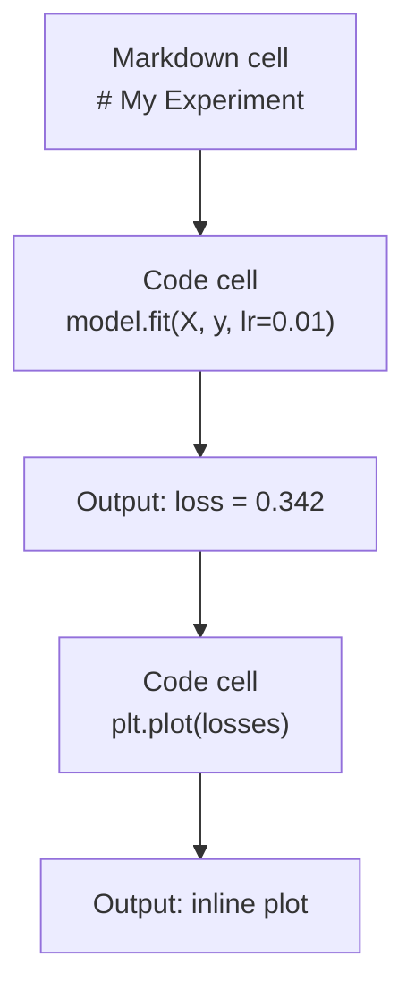
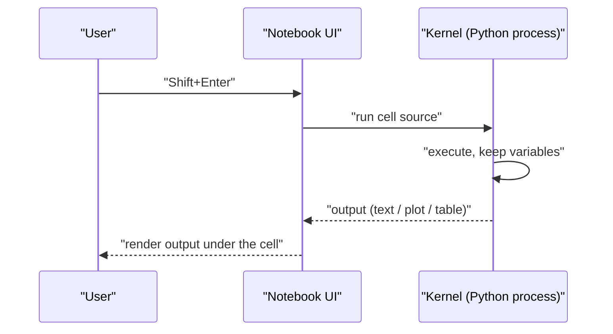
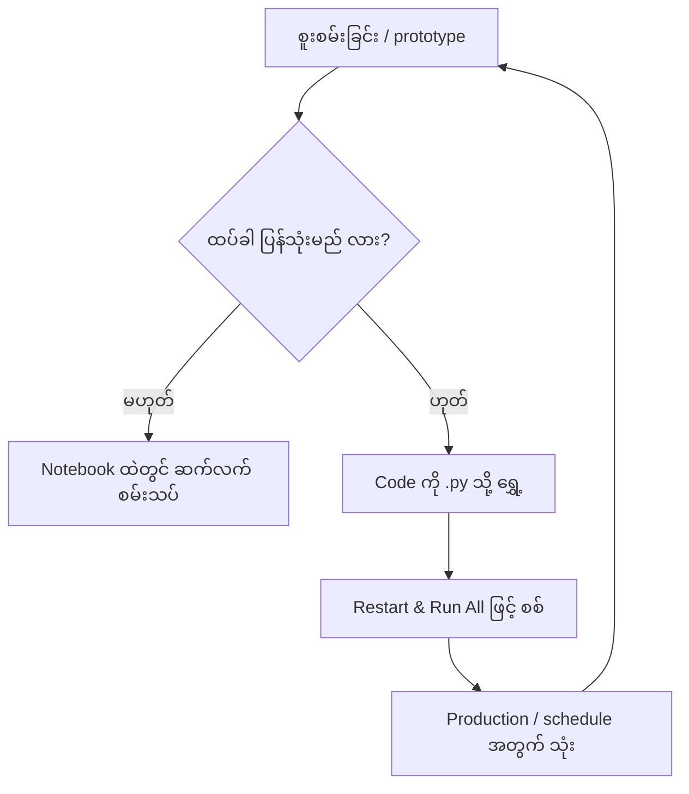
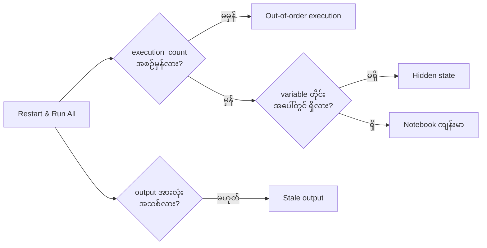

# Module 05 — Jupyter Notebooks (အဓိက သင်ခန်းစာ)

Source — `phases/00-setup-and-tooling/05-jupyter-notebooks/docs/en.md`။
Notebook သည် AI engineering ၏ လက်တွေ့စမ်းသပ်ခုံ (lab bench) ဖြစ်သည်။ ဤနေရာတွင် prototype လုပ်ပြီး၊ အလုပ်လုပ်သည့် အပိုင်းကို production သို့ ရွှေ့ရသည်။

## ၁. ပြဿနာ — Notebook သည် ဘာကြောင့် လိုအပ်သနည်း

AI paper၊ tutorial နှင့် Kaggle competition တိုင်းသည် Jupyter notebook ကို သုံးသည်။ Notebook သည် code ကို အပိုင်းလိုက် run နိုင်စေသည်၊ output ကို inline မြင်နိုင်စေသည်၊ code နှင့် ရှင်းလင်းချက် စာသားကို ရောနှောနိုင်စေသည်၊ ပြီးလျှင် iteration ကို အလွန်လျင်မြန်စေသည်။ Notebook မရှိဘဲ AI ကို လေ့လာခြင်းသည် မှတ်စုစက္ကူ (scratch paper) မရှိဘဲ သင်္ချာ အိမ်စာ လုပ်ခြင်းနှင့် တူသည်။

သို့သော် notebook တွင် တကယ့် trap များ ရှိသည်။ လူအများသည် notebook ကို အလုပ်တိုင်းအတွက် သုံးကြသည် — ထို trap များအတွက် မကောင်းသည့် အလုပ်များအထိ ပါဝင်သည်။ Notebook ကို မည်သည့်အခါ သုံးရမည်၊ script ကို မည်သည့်အခါ သုံးရမည်ကို သိခြင်းသည် နောက်ပိုင်း debugging သည် အိပ်မက်ဆိုးဖြစ်ခြင်းမှ ကာကွယ်ပေးသည်။

## ၂. အခြေခံ သဘောတရား — Cell၊ Kernel နှင့် `.ipynb`

Notebook ဆိုသည်မှာ cell၏ စာရင်း တစ်ခု ဖြစ်သည်။ Cell တိုင်းသည် code သို့မဟုတ် text ဖြစ်သည်။ Code cell သည် Python ကို run ပြီး output ပြသည်။ Markdown cell သည် ဖော်မတ် ချထားသည့် စာသားကို render လုပ်သည်။



**Figure 1 — Notebook cell တစ်လုံးမှ တစ်လုံးသို့ output စီးဆင်းပုံ**

ပုံရှင်းလင်းချက် (Figure 1)
1. Notebook ကို အပေါ်မှ အောက်သို့ ဖတ်သည် — cell တိုင်းသည် အစီအစဉ်လိုက် အလုပ်လုပ်သည့် အပိုင်း တစ်ခု ဖြစ်သည်။
2. ပထမ cell သည် markdown ဖြစ်သည် — ၎င်းသည် run ခြင်း မလုပ်ဘဲ ခေါင်းစဉ်နှင့် ရှင်းလင်းချက်ကို render လုပ်သည်။
3. code cell ကို run လျှင် code သည် kernel သို့ ရောက်ပြီး output သည် cell အောက်တွင် ချက်ချင်း ပေါ်လာသည်။
4. Plot ကဲ့သို့ output သည် စာသားအစား ရုပ်ပုံအဖြစ် cell အောက်တွင် တိုက်ရိုက် ပေါ်လာသည်။

Kernel ဆိုသည်မှာ နောက်ကွယ်တွင် run နေသည့် Python process တစ်ခု ဖြစ်သည်။ Cell ကို run လျှင် notebook UI သည် code ကို kernel သို့ ပို့သည်၊ kernel သည် ၎င်းကို execute လုပ်ပြီး ရလဒ်ကို ပြန်ပို့သည်။ Cell အားလုံးသည် kernel တစ်ခုတည်းကို မျှဝေ အသုံးပြုသည် — ထို့ကြောင့် variable များသည် cell များအကြား တည်ရှိနေသည်။



**Figure 2 — Cell တစ်ခု run သည့်အခါ UI နှင့် kernel အကြား အစီအစဉ်**

ပုံရှင်းလင်းချက် (Figure 2)
1. User သည် cell တွင် `Shift+Enter` ကို နှိပ်သည်။
2. Notebook UI သည် cell၏ source ကို kernel သို့ ပို့သည်။
3. Kernel သည် code ကို execute လုပ်ပြီး variable များကို memory တွင် ထိန်းထားသည်။
4. Kernel သည် output ကို UI သို့ ပြန်ပို့သည်၊ UI သည် ၎င်းကို cell အောက်တွင် render လုပ်သည်။
5. Kernel တစ်ခုတည်းက လက်ခံသည့်အတွက် cell များကို မည်သည့်အစဉ်ဖြင့် နှိပ်သည်ဖြစ်စေ၊ variable များ ဆက်လက် တည်ရှိသည်။ "မည်သည့်အစဉ်ဖြင့် နှိပ်သည်ဖြစ်စေ" ဆိုသည့် အချက်သည် အားသာချက် နှင့် အန္တရာယ် နှစ်မျိုးလုံး ဖြစ်သည်။

## ၃. လက်တွေ့ ပြင်ဆင်ခြင်း — မည်သည့် အင်တာဖေ့စ် ရွေးမည်

အင်တာဖေ့စ် သုံးမျိုး ရှိသည်၊ format တစ်မျိုးတည်း (`.ipynb`) ကို ဖတ်/ရေး သည်။

| အင်တာဖေ့စ် | Install | သင့်လျော်သည့် အလုပ် |
|---|---|---|
| JupyterLab | `pip install jupyterlab` ပြီးလျှင် `jupyter lab` | Full IDE အတွေ့အကြုံ၊ tab အများ၊ file browser၊ terminal |
| Jupyter Notebook | `pip install notebook` ပြီးလျှင် `jupyter notebook` | ရိုးရှင်း၊ လျင်မြန်၊ notebook တစ်ခုချင်း |
| VS Code | "Jupyter" extension ကို install | editor ထဲတွင်တင်၊ git ချိတ်ဆက်မှု၊ debugging |

အင်တာဖေ့စ် သုံးမျိုးလုံးသည် `.ipynb` ဖိုင် တစ်မျိုးတည်းကို ဖတ်/ရေး သည်။ နှစ်သက်သည့် အင်တာဖေ့စ်ကို ရွေးနိုင်သည်။ AI အလုပ်တွင် JupyterLab ကို အများဆုံး သုံးသည်။

```bash
pip install jupyterlab
jupyter lab
```

- `pip install jupyterlab` သည် JupyterLab package ကို လက်ရှိ Python environment ထဲ install လုပ်သည်။ ရလဒ်သည် `jupyter` command ရရှိလာခြင်း ဖြစ်သည်။
- `jupyter lab` သည် local server ကို စတင်ပြီး browser တွင် JupyterLab ကို ဖွင့်သည်။ မအောင်မြင်ပါက `jupyter` command သည် PATH တွင် ရှိ/မရှိကို စစ်ပါ။

**Keyboard shortcut** နှစ်မျိုး ရှိသည်။ `Escape` ကို နှိပ်လျှင် command mode (ဘယ်ဘက် အပြာတန်း)၊ `Enter` ကို နှိပ်လျှင် edit mode (စိမ်းတန်း) သို့ ရောက်သည်။

Command mode တွင် အသုံးများသည့် key များ —

| Key | လုပ်ဆောင်ချက် |
|---|---|
| `Shift+Enter` | cell ကို run ပြီး နောက် cell သို့ ရွှေ့သည် |
| `A` | အထက် cell ထည့်သည် |
| `B` | အောက် cell ထည့်သည် |
| `DD` | cell ကို ဖျက်သည် |
| `M` | markdown အဖြစ် ပြောင်းသည် |
| `Y` | code အဖြစ် ပြောင်းသည် |
| `Z` | cell လုပ်ဆောင်ချက်ကို undo လုပ်သည် |
| `Ctrl+Shift+H` | shortcut အားလုံးကို ပြသည် |

Edit mode တွင် — `Tab` သည် autocomplete၊ `Shift+Tab` သည် function signature ကို ပြသည်၊ `Ctrl+/` သည် comment ကို toggle လုပ်သည်။ `Shift+Enter` ကို တစ်နေ့ ထောင်နှင့်ချီ အသုံးပြုမည် ဖြစ်သည်။ ၎င်းကို အရင် လေ့လာပါ။

## ၄. Cell အမျိုးအစား နှစ်မျိုး

Code cell သည် Python ကို run ပြီး output ပြသည် —

```python
import numpy as np
data = np.random.randn(1000)
data.mean(), data.std()
```

Output — `(0.0032, 0.9987)`။

Markdown cell သည် ဖော်မတ် ချထားသည့် စာသားကို render လုပ်သည်။ ခေါင်းစဉ်၊ bold၊ italic၊ LaTeX သင်္ချာ (`$E = mc^2$`)၊ table နှင့် ရုပ်ပုံများကို ထောက်ပံ့သည်။ မိမိ လုပ်နေသည့် အလုပ်နှင့် အကြောင်းရင်းကို မှတ်တမ်းတင်ရန် သုံးရသည်။

## ၅. Magic Commands

Magic command များသည် Python မဟုတ်ပါ။ ၎င်းတို့သည် Jupyter အတွက် သီးသန့် command များဖြစ်ပြီး `%` (line magic) သို့မဟုတ် `%%` (cell magic) ဖြင့် စသည်။

**Code ကို အချိန်တိုင်းခြင်း —**

```python
%timeit np.random.randn(10000)
```

Output — `45.2 us +/- 1.3 us per loop`။

```python
%%time
model.fit(X_train, y_train, epochs=10)
```

Output — `Wall time: 2.34 s`။

`%timeit` သည် code ကို အကြိမ်များစွာ run ပြီး ပျမ်းမျှကို တွက်သည်။ `%%time` သည် တစ်ကြိမ်သာ run သည်။ Microbenchmark အတွက် `%timeit` ကို၊ training run အတွက် `%%time` ကို သုံးရသည်။

**Inline plot ကို ဖွင့်ခြင်း —**

```python
%matplotlib inline
```

ဤနောက်ပိုင်းတွင် `plt.plot()` သို့မဟုတ် `plt.show()` တိုင်းသည် notebook ထဲတွင် တိုက်ရိုက် render လုပ်သည်။

**Notebook မှ မထွက်ဘဲ package install လုပ်ခြင်း —**

```python
!pip install scikit-learn
```

`!` အစ သည် shell command မည်သည့်ဟာကိုမဆို run သည်။

**Environment variable ကို စစ်ခြင်း —**

```python
%env CUDA_VISIBLE_DEVICES
```

## ၆. Rich Output ကို Inline ပြသခြင်း

Notebook သည် cell၏ နောက်ဆုံး expression ကို အလိုအလျောက် ပြသည်။ သို့သော် ၎င်းကို ထိန်းချုပ်နိုင်သည် —

```python
import pandas as pd

df = pd.DataFrame({
    "model": ["Linear", "Random Forest", "Neural Net"],
    "accuracy": [0.72, 0.89, 0.94],
    "training_time": [0.1, 2.3, 45.6]
})
df
```

ဤသည် စာသား dump အစား ဖော်မတ် ချထားသည့် HTML ဇယားကို render လုပ်သည်။ Plot လည်း ထိုနည်းတူ ဖြစ်သည် —

```python
import matplotlib.pyplot as plt

plt.figure(figsize=(8, 4))
plt.plot([1, 2, 3, 4], [1, 4, 2, 3])
plt.title("Inline Plot")
plt.show()
```

Plot သည် cell အောက်တွင် ပေါ်လာသည်။ ထို့ကြောင့် notebook သည် AI အလုပ်တွင် အသုံးများသည် — data၊ plot နှင့် code ကို တစ်နေရာတည်းတွင် တွဲဖက် မြင်ရသည်။ ရုပ်ပုံများအတွက် —

```python
from IPython.display import Image, display
display(Image(filename="architecture.png"))
```

## ၇. Google Colab

Colab သည် cloud ထဲတွင် ရှိသည့် အခမဲ့ Jupyter notebook ဖြစ်သည်။ GPU၊ ကြိုတင် install လုပ်ထားသည့် library များနှင့် Google Drive ချိတ်ဆက်မှုကို ပေးသည်။ Setup မလိုအပ်ပါ။

1. https://colab.research.google.com သို့ သွားပါ။
2. ဤ course မှ `.ipynb` ဖိုင် မည်သည့်ဟာကိုမဆို upload လုပ်ပါ။
3. Runtime > Change runtime type > T4 GPU (အခမဲ့) ကို ရွေးပါ။

Local Jupyter နှင့် Colab ၏ ကွာခြားချက် —

- Session များအကြား ဖိုင်များ မတည်ရှိပါ (Drive သို့ save လုပ်ခြင်း သို့မဟုတ် download လုပ်ရသည်)။
- ကြိုတင် install လုပ်ထားသည် — numpy၊ pandas၊ matplotlib၊ torch၊ tensorflow၊ sklearn။
- ဖိုင် upload/download အတွက် `from google.colab import files` ကို သုံးသည်။
- တည်ရှိသည့် storage အတွက် `from google.colab import drive; drive.mount('/content/drive')` ကို သုံးသည်။
- အခမဲ့ tier သည် ရပ်နားချိန် ၉၀ မိနစ် ပြည့်လျှင် session ကို ပိတ်သည်။

## ၈. Notebook နှင့် Script — မည်သည့်အလုပ်အတွက် မည်သည့်ဟာ

| Notebook အတွက် | Script အတွက် |
|---|---|
| Dataset ကို စူးစမ်းခြင်း | Training pipeline |
| Model ကို prototype လုပ်ခြင်း | ပြန်သုံးနိုင်သည့် utility |
| ရလဒ်ကို visualize လုပ်ခြင်း | `if __name__` ပါသည့် အရာ |
| မိမိ အလုပ်ကို ရှင်းပြခြင်း | အစီအစဉ်အတိုင်း run သည့် code |
| အမြန် စမ်းသပ်မှု | Production code |
| Course exercise | Package နှင့် library |

စည်းမျဉ်းမှာ — **explore in notebooks, ship in scripts**။ AI တွင် အသုံးများသည့် လုပ်ငန်းစဉ် — (၁) notebook ထဲတွင် data ကို စူးစမ်းသည်၊ (၂) notebook ထဲတွင် model ကို prototype လုပ်သည်၊ (၃) အလုပ်လုပ်လျှင် code ကို `.py` ဖိုင်များသို့ ရွှေ့သည်၊ (၄) ထို `.py` ဖိုင်များကို ထပ်မံ စမ်းသပ်ရန် notebook သို့ ပြန် import လုပ်သည်။



**Figure 3 — Notebook မှ script သို့ ရွှေ့သည့် ဆုံးဖြတ်ချက်**

ပုံရှင်းလင်းချက် (Figure 3)
1. အလုပ်သည် စူးစမ်းခြင်း သို့မဟုတ် prototype ဖြင့် notebook ထဲတွင် စသည်။
2. ရလဒ်ကို ထပ်ခါ ပြန်သုံးမည် ဟုတ်/မဟုတ်ကို မေးသည်။
3. မဟုတ်လျှင် notebook ထဲတွင် ဆက်လက် စမ်းသပ်သည် — ထိုအလုပ်အတွက် notebook သည် သင့်လျော်သည်။
4. ဟုတ်လျှင် code ကို `.py` ဖိုင်သို့ ရွှေ့ပြီး "Restart & Run All" ဖြင့် အပေါ်မှ အောက်သို့ အလုပ်လုပ်ကြောင်း စစ်သည်။
5. အောင်မြင်လျှင် production သို့မဟုတ် schedule အတွက် script ကို သုံးသည်၊ ထို့နောက် စမ်းသပ်မှု အသစ်အတွက် notebook သို့ ပြန်ရောက်သည်။

## ၉. Operational Cautions — Notebook ၏ Trap များ

**Out-of-order execution။** ဖတ်သူသည် cell 5 ကို run ပြီး၊ ထို့နောက် cell 2 ကို၊ ထို့နောက် cell 7 ကို run သည်။ မိမိ machine တွင် ဖိုင်သည် အလုပ်လုပ်သည်၊ သို့သော် အခြားသူတစ်ဦးက အပေါ်မှ အောက်သို့ run လျှင် ကျရှုံးသည်။ ဖြေရှင်းချက် — မျှဝေမီ Kernel > Restart & Run All ကို ပြုလုပ်ရသည်။

**Hidden state။** Cell တစ်ခုကို ဖျက်လိုက်သည်၊ သို့သော် ၎င်းက ဖန်တီးခဲ့သည့် variable သည် memory တွင် ဆက်ရှိနေသည်။ Notebook သည် သန့်ရှင်းသလို ပေါ်သည်သော် အမှန်တကယ်တွင် ဖျက်လိုက်သည့် "ghost cell" ကို မှီခိုနေသည်။ ဖြေရှင်းချက် — Kernel ကို မကြာခဏ restart လုပ်ရသည်။

**Stale output (မှေးမှိန်နေသည့် ရလဒ်)။** Cell ကို ပြင်ပြီးနောက် ပြန် run ခြင်း မလုပ်လျှင် ပြသနေသည့် output သည် code အဟောင်းနှင့် ကိုက်ညီသည်။ ဖတ်သူသည် output ကို ယုံပြီး မှားသည့် နိဂုံးကို ချနိုင်သည်။ ဖြေရှင်းချက် — output ကို မယုံမီ code ကို ပြန် run ရသည်။

**Memory leaks (memory ယိုစိမ့်မှု)။** 4GB dataset ကို load လုပ်သည်၊ model ကို train လုပ်သည်၊ နောက် dataset တစ်ခုကို load လုပ်သည်။ မည်သည့်ဟာမျှ ပြန်လွတ်မသွားပါ။ ဖြေရှင်းချက် — `del variable_name` နှင့် `gc.collect()` ကို သုံးခြင်း သို့မဟုတ် kernel ကို restart လုပ်ခြင်း။



**Figure 4 — Restart & Run All ဖြင့် trap သုံးမျိုးကို ဖမ်းသည့် အစီအစဉ်**

ပုံရှင်းလင်းချက် (Figure 4)
1. စစ်ဆေးမှုကို Kernel > Restart & Run All ဖြင့် စသည် — kernel ဟောင်း၏ အခြေအနေ အားလုံးကို ဖျက်လိုက်သည်။
2. Cell များသည် အပေါ်မှ အောက်သို့ ပြန် run သည့်အခါ `execution_count` အစဉ်သည် မှန်/မမှန် ကို စစ်သည်။ မမှန်လျှင် out-of-order execution ဖြစ်သည်။
3. အစဉ်မှန်လျှင် cell တိုင်း အသုံးပြုသည့် variable သည် အပေါ်တွင် ရှိ/မရှိကို စစ်သည်။ မရှိလျှင် hidden state ဖြစ်သည်။
4. Output တိုင်း အသစ် ဖြစ်/မဖြစ်ကို စစ်သည်။ မဟုတ်လျှင် stale output ဖြစ်သည်။
5. စစ်ဆေးမှု အားလုံး အောင်မြင်လျှင် notebook ကို မျှဝေနိုင်သည်။

## ၁၀. မိမိကိုယ်ကို စစ်ဆေးခြင်း (Self-check)

**မေးခွန်း ၁။** `%timeit` နှင့် `%%time` ၏ ကွာခြားချက်သည် ဘာနည်း။
*အဖြေ။* `%timeit` သည် code ကို အကြိမ်များစွာ run ပြီး ပျမ်းမျှနှင့် စံလွဲမှုကို ပြသည် — microbenchmark အတွက် သင့်သည်။ `%%time` သည် cell ကို တစ်ကြိမ်သာ run ပြီး wall time ကို ပြသည် — training run အတွက် သင့်သည်။

**မေးခွန်း ၂။** Notebook တစ်ခုသည် မိမိ machine တွင် အလုပ်လုပ်ပြီး၊ အခြားသူ run လျှင် ကျရှုံးသည့် အများဆုံး အကြောင်းရင်းသည် ဘာနည်း၊ မည်သို့ စစ်မည်နည်း။
*အဖြေ။* Cell များကို အစဉ်မမှန် run ခြင်းမှ ဖြစ်သည့် hidden dependency ဖြစ်သည်။ Kernel > Restart & Run All ဖြင့် အပေါ်မှ အောက်သို့ linear run ကို စစ်ရသည်။

**မေးခွန်း ၃။** `.ipynb` ဖိုင်သည် အမှန်တကယ် ဘာနည်း။
*အဖြေ။* ၎င်းသည် cell၊ output နှင့် metadata ပါဝင်သည့် JSON ဖိုင် ဖြစ်သည်။ ထို့ကြောင့် ၎င်းကို ပရိုဂရမ်ဖြင့် ဖတ်၊ parse လုပ်နိုင်သည် — ဤ module ၏ lab သည် ထိုနည်းဖြင့် ပြုလုပ်သည်။

**မေးခွန်း ၄။** Code ကို notebook မှ `.py` script သို့ မည်သည့်အခါ ရွှေ့ရမည်နည်း။
*အဖြေ။* Code သည် ပြန်သုံးနိုင်သည့် utility၊ training pipeline သို့မဟုတ် production code ဖြစ်လာလျှင် ရွှေ့ရသည်။ စည်းမျဉ်းမှာ "explore in notebooks, ship in scripts" ဖြစ်သည်။

**မေးခွန်း ၅။** Hidden state ကို မည်သို့ ဖြေရှင်းမည်နည်း။
*အဖြေ။* Kernel ကို မကြာခဏ restart လုပ်ခြင်း၊ ထို့နောက် Restart & Run All ဖြင့် variable အားလုံး အပေါ်တွင် ရှိကြောင်း အတည်ပြုခြင်း ဖြစ်သည်။

## Technical review notes

- Source တွင် `%timeit np.random.randn(10000)` အတွက် output ကို `45.2 us +/- 1.3 us per loop` ဟု ပြထားသည်။ ဤတန်ဖိုးသည် machine အလိုက် ပြောင်းလဲသည်၊ ထို့ကြောင့် ဤ module သည် ၎င်းကို စံတန်ဖိုးအဖြစ် မသတ်မှတ်ဘဲ နမူနာအဖြစ်သာ ဖော်ပြသည်။
- Colab ၏ အခမဲ့ tier ရပ်နားချိန် (၉၀ မိနစ်) နှင့် ကြိုတင် install လုပ်ထားသည့် library စာရင်းသည် version အလိုက် ပြောင်းလဲနိုင်သည် — version အလိုက် ပြန်စစ်ရန် လိုသည်။
- Source ၏ learning objective တွင် "memory leaks" ကို trap အဖြစ် ဖော်ပြထားသည်။ ဤ module သည် ၎င်းကို "memory leaks" အဖြစ် ထိန်းထားပြီး၊ "stale output" ကို trap တစ်ခုအဖြစ် ထပ်ဖြည့်ထားသည် — ဤထပ်ဖြည့်ချက်သည် source ၏ "stale outputs" သတိပေးချက်နှင့် ကိုက်ညီသည်။
- Lab သည် Jupyter သို့မဟုတ် numpy ကို မသုံးပါ၊ `.ipynb` ကို JSON အဖြစ်သာ ဖတ်သည်၊ ထို့ကြောင့် offline နှင့် deterministic ဖြစ်သည်။

## References & Further Reading

- Source lesson — `phases/00-setup-and-tooling/05-jupyter-notebooks/docs/en.md`
  (https://aiengineeringfromscratch.com/lesson?path=phases%2F00-setup-and-tooling%2F05-jupyter-notebooks)
- JupyterLab Documentation — https://jupyterlab.readthedocs.io/
- IPython magic commands — https://ipython.readthedocs.io/en/stable/interactive/magics.html
- nbformat (notebook JSON format) — https://nbformat.readthedocs.io/
- Google Colab FAQ — https://research.google.com/colaboratory/faq.html
- 28 Jupyter Notebook Tips — https://www.dataquest.io/blog/jupyter-notebook-tips-tricks-shortcuts/
