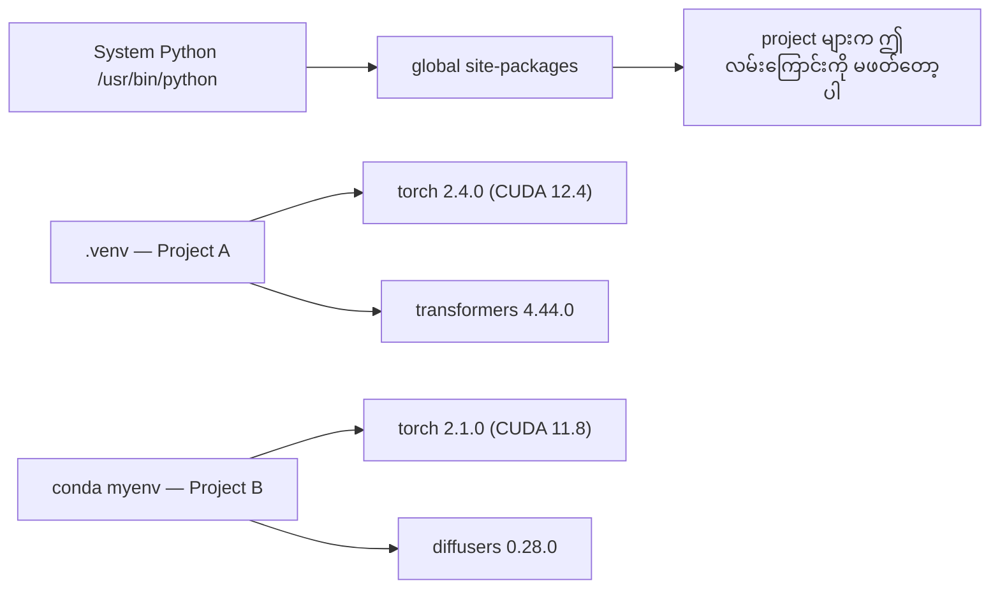
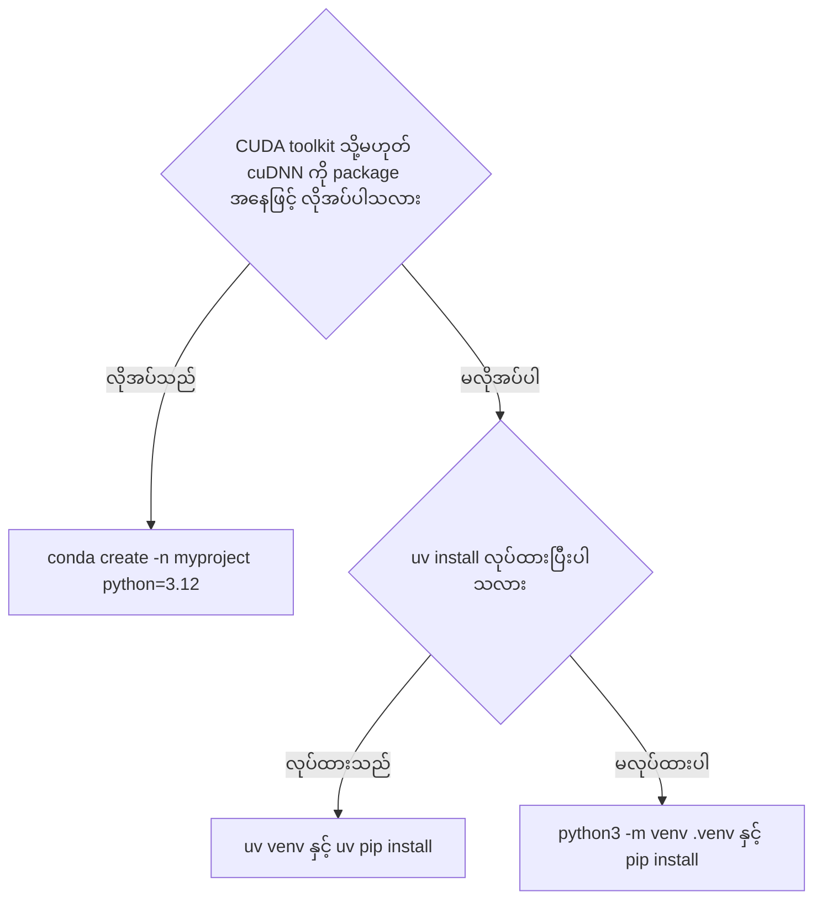
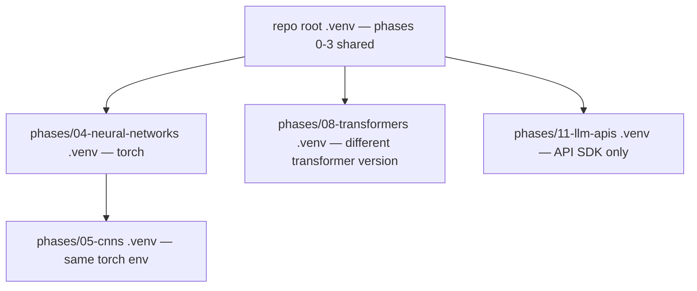
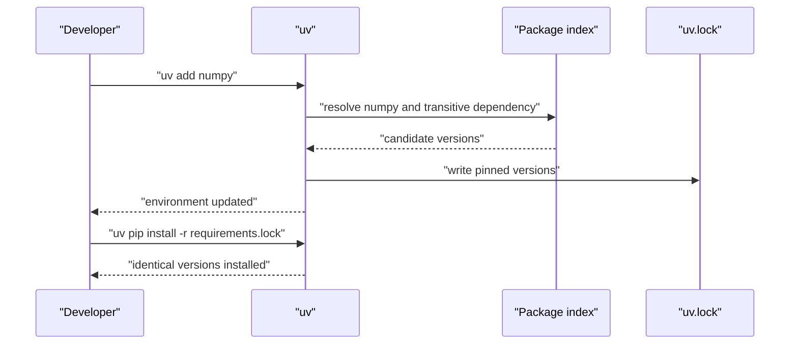

# Python Environments — သီးခြား ပတ်ဝန်းကျင် တည်ဆောက်ခြင်း

## ပြဿနာ — dependency hell ဟူသည့် အခြေအနေ

fine-tuning project တစ်ခုအတွက် PyTorch 2.4 ကို install လုပ်သည်။ နောက် တစ်ပတ်အကြာတွင် အခြား
project တစ်ခုသည် ၎င်း၏ CUDA build ကို ချိတ်ထားသဖြင့် PyTorch 2.1 ကို လိုအပ်သည်။ global အနေဖြင့်
upgrade လုပ်လိုက်ပါက ပထမ project ကျိုးသွားသည်။ downgrade လုပ်လိုက်ပါက ဒုတိယ project ကျိုးသွားသည်။
ဤအခြေအနေကို **dependency hell** ဟု ခေါ်သည်။

AI/ML အလုပ်တွင် ဤအခြေအနေ မကြာခဏ ဖြစ်ပေါ်သည်။ အကြောင်းရင်းများမှာ ဤသို့ ဖြစ်သည်။

- PyTorch၊ JAX နှင့် TensorFlow တစ်ခုစီသည် ကိုယ်ပိုင် CUDA bindings ကို သယ်ဆောင်လာသည်။
- model library များသည် framework version တိကျသည့် အရာကို pin လုပ်ထားသည်။
- global `pip install` သည် ရှိပြီးသား version ကို အစားထိုး ဖျက်လိုက်သည်။
- CUDA 11.8 build များသည် CUDA 12.x driver များနှင့် အလုပ်မလုပ်ပါ၊ အပြန်အလှန်လည်း အလုပ်မလုပ်ပါ။

ဖြေရှင်းနည်းမှာ ဤသို့ ဖြစ်သည် — **project တိုင်းသည် ကိုယ်ပိုင် package အစုနှင့် ကိုယ်ပိုင်
သီးခြား ပတ်ဝန်းကျင် (isolated environment) ရရှိသည်။**

## အခြေခံ သဘောတရား — virtual environment ဆိုသည်မှာ ဘာလဲ

**Virtual environment** သည် Python interpreter တစ်ခုနှင့် ထို interpreter အတွက် install လုပ်ထားသည့်
package များကို စုစည်းထားသည့် directory တစ်ခု ဖြစ်သည်။ ဤ directory သည် system Python နှင့်
သီးခြား တည်ရှိသည်။ environment တစ်ခုကို activate လုပ်လိုက်သည့်အခါ shell သည် `python` နှင့် `pip`
ဟူသည့် အမည်များကို ထို directory အတွင်းရှိ binary များသို့ ညွှန်ပြသည်။ ထို့ကြောင့် project A အတွင်း
`import torch` သည် 2.4.0 ကို ရရှိပြီး project B အတွင်း `import torch` သည် 2.1.0 ကို ရရှိသည်။
နှစ်ခုသည် တစ်ခုနှင့် တစ်ခု မထိခိုက်ပါ။

Figure 1 သည် global install နှင့် သီးခြား environment နှစ်ခု၏ ကွာခြားချက်ကို ပြသည်။



**Figure 1 — ပတ်ဝန်းကျင် သီးခြားခွဲထားမှု (environment isolation)**

**ပုံရှင်းလင်းချက် (Figure 1)**

1. ထိပ်ရှိ `System Python` သည် OS မှ install လုပ်ထားသည့် interpreter ဖြစ်သည်။ `which python` သည်
   `.venv/bin/python` ကို မပြဘဲ `/usr/bin/python` ကို ပြပါက environment activate မလုပ်ထားခြင်း ဖြစ်သည်။
2. Project A သည် ကိုယ်ပိုင် `.venv` directory ထဲတွင် `torch 2.4.0` ကို သိမ်းထားသည်။
3. Project B သည် အခြား environment ထဲတွင် `torch 2.1.0` ကို သိမ်းထားသည်။
4. ဤအခြေအနေတွင် version နှစ်ခုသည် ပဋိပက္ခ (conflict) မဖြစ်တော့ပါ — file နေရာ မတူသောကြောင့် ဖြစ်သည်။
5. `global site-packages` သည် ရှိနေဆဲ ဖြစ်သည်၊ သို့သော် environment activate လုပ်ထားစဉ် Python သည်
   ထို လမ်းကြောင်းကို ရှာဖွေမှု အစဉ်တွင် နောက်ဆုံးမှသာ ရောက်သည်။

### အဓိပ္ပာယ် ဖွင့်ဆိုချက် အဓိက အသုံးအနှုန်း ဇယား

| Term | အလွယ်တကူ ပြောသည့် အမည် | တကယ့် အဓိပ္ပာယ် |
|---|---|---|
| Virtual environment | "venv တစ်ခု" | Python interpreter နှင့် package များ ပါဝင်သည့် သီးခြား directory၊ system Python နှင့် ကင်းကွာ တည်ရှိသည် |
| Lockfile | "pinned dependency များ" | package တိုင်း၏ အတိအကျ version ကို မှတ်ထားသည့် ဖိုင်၊ machine တိုင်းတွင် တူညီသည့် install ကို အာမခံသည် |
| pyproject.toml | "setup.py အသစ်" | `setup.py`၊ `setup.cfg` နှင့် `requirements.txt` အစား ရောက်လာသည့် standard project configuration ဖိုင် |
| Transitive dependency | "dependency ၏ dependency" | package B သည် C ကို မှီခိုသည်။ B ကို မှီခိုသည့် A ကို install လုပ်ပါက C သည် A ၏ transitive dependency ဖြစ်သည် |
| CUDA mismatch | "GPU အလုပ်မလုပ်တော့ပါ" | PyTorch ကို GPU driver ကို ပံ့ပိုးသည့် CUDA version နှင့် မတူသည့် CUDA version အတွက် compile လုပ်ထားခြင်း |

## နည်းလမ်း သုံးမျိုး — uv၊ venv နှင့် conda

| အချက် | uv (အကြံပြုသည်) | venv (built-in) | conda (လိုအပ်သည့်အခါ) |
|---|---|---|---|
| install | `curl -LsSf https://astral.sh/uv/install.sh \| sh` | Python နှင့် အတူ ပါလာသည် | Miniconda installer script |
| အရှိန် | pip ထက် ၁၀ ဆမှ ၁၀၀ ဆ အထိ မြန်သည် (source ဖော်ပြသည့်အတိုင်း) | နှေးသည် | solver အပေါ် မူတည်သည် |
| Python version ကို စီမံခြင်း | `uv python install 3.12` | မလုပ်ဆောင်ပါ | `conda create -n myproject python=3.12` |
| non-Python dependency (CUDA toolkit၊ cuDNN၊ C library) | မလုပ်ဆောင်ပါ | မလုပ်ဆောင်ပါ | လုပ်ဆောင်သည် |
| environment ဖန်တီးခြင်း | `uv venv` | `python3 -m venv .venv` | `conda create -n myproject python=3.12` |
| package install | `uv pip install torch numpy` | `pip install torch numpy` | `conda install ... -c pytorch -c nvidia` |
| သင့်တော်သည့် အခြေအနေ | နေ့စဉ် AI project အများစု | uv install မလုပ်နိုင်သည့် စက် | system-wide install မလုပ်နိုင်သည့် shared cluster၊ တိကျသည့် CUDA toolkit version လိုသည့်အခါ |

`uv` သည် virtual environment၊ Python version နှင့် dependency resolution သုံးမျိုးလုံးကို tool တစ်ခုတည်းဖြင့်
စီမံသည်။ `venv` သည် Python ရှိသည့် နေရာတိုင်းတွင် အလုပ်လုပ်သည်၊ သို့သော် uv ထက် နှေးသည်။
`conda` သည် CUDA toolkit၊ cuDNN နှင့် C library ကဲ့သို့ non-Python dependency များကို စီမံသည်။
ထို့ကြောင့် — system-wide install မလုပ်နိုင်သည့် shared cluster တွင်၊ သို့မဟုတ် library တစ်ခု၏ install
လမ်းညွှန်ချက်တွင် "use conda" ဟု ရေးထားသည့်အခါတွင်သာ conda ကို သုံးရမည်။

Figure 2 သည် tool ရွေးချယ်သည့် ဆုံးဖြတ်ချက် လမ်းကြောင်းကို ပြသည်။



**Figure 2 — environment tool ရွေးချယ်သည့် ဆုံးဖြတ်ချက် လမ်းကြောင်း**

**ပုံရှင်းလင်းချက် (Figure 2)**

1. ပထမ မေးခွန်းသည် non-Python dependency လိုအပ်မှုကို စစ်သည်၊ အကြောင်းမှာ ဤအချက်သည်
   tool ရွေးချယ်မှုကို အဆုံးအဖြတ် ပေးသည့် အချက် ဖြစ်သည်။
2. "လိုအပ်သည်" လမ်းကြောင်းသည် conda သို့ ရောက်သည်။ ဥပမာ — တိကျသည့် CUDA toolkit version ကို
   system-wide install မလုပ်ဘဲ လိုချင်သည့်အခါ ဖြစ်သည်။
3. "မလိုအပ်ပါ" ဖြစ်ပါက ဒုတိယ မေးခွန်းသည် uv ရှိ/မရှိကို စစ်သည်။ uv ရှိပါက အမြန်ဆုံး လမ်းကြောင်းကို ရသည်။
4. uv မရှိပါက `python3 -m venv .venv` သည် အလုပ်လုပ်နေဆဲ နည်းလမ်း ဖြစ်သည်။
5. ဤ အစီအစဉ်တွင် environment တစ်ခုလျှင် tool တစ်မျိုးကို ရွေးရမည်၊ အကြောင်းမှာ pip နှင့် conda ကို
   ရောနှောခြင်းသည် dependency tracking ကို ပျက်စေသည်။

## လက်တွေ့ ပြင်ဆင်ခြင်း — command များ

### uv ဖြင့် environment ဖန်တီးခြင်း

```bash
curl -LsSf https://astral.sh/uv/install.sh | sh

uv python install 3.12

cd your-project
uv venv
source .venv/bin/activate
```

- ပထမ command သည် uv binary ကို install လုပ်သည်။ install script ကို `sh` ဖြင့် run သည့်အတွက်
  run မီ script အထဲရှိ URL ကို စစ်ရမည်။
- ဒုတိယ command သည် Python 3.12 ကို uv ကိုယ်တိုင် စီမံသည့် နေရာတွင် ထည့်သည်။ system Python ကို
  မထိပါ။
- `uv venv` သည် လက်ရှိ directory တွင် `.venv` ကို ဖန်တီးသည်။
- `source .venv/bin/activate` သည် ထို environment ကို shell ထဲ ဝင်စေသည်။ မအောင်မြင်ပါက
  `.venv/bin/activate` ဖိုင် တည်ရှိ/မတည်ရှိကို စစ်ပါ။

Package ထည့်ခြင်း —

```bash
uv pip install torch numpy
```

`pyproject.toml` ပါသည့် project တစ်ခုကို အဆင့်တစ်ဆင့်တည်း ဖန်တီးခြင်း —

```bash
uv init my-ai-project
cd my-ai-project
uv add torch numpy matplotlib
```

### venv ဖြင့် environment ဖန်တီးခြင်း

```bash
python3 -m venv .venv
source .venv/bin/activate   # Linux/macOS
.venv\Scripts\activate      # Windows

pip install torch numpy
```

`python3 -m venv .venv` သည် ဤ directory အတွက် သီးခြား interpreter နှင့် `pip` ကို ဖန်တီးသည်။
Windows တွင် activate script သည် `.venv\Scripts\activate` ဖြစ်သည်။ activate ပြီးနောက် shell prompt သည်
`(.venv)` ဖြင့် စသည်ကို တွေ့ရမည်။

### conda ဖြင့် environment ဖန်တီးခြင်း

```bash
# Install miniconda (not the full Anaconda)
curl -LsSf https://repo.anaconda.com/miniconda/Miniconda3-latest-Linux-x86_64.sh -o miniconda.sh
bash miniconda.sh -b

conda create -n myproject python=3.12
conda activate myproject

conda install pytorch torchvision torchaudio pytorch-cuda=12.4 -c pytorch -c nvidia
```

ဤနေရာတွင် full Anaconda မဟုတ်ဘဲ Miniconda ကို install လုပ်သည်ကို သတိထားရမည်၊ အကြောင်းမှာ
Miniconda သည် ပိုသေးပြီး လိုအပ်သည့် package ကို ကိုယ်တိုင် ရွေးထည့်နိုင်သည်။ စည်းမျဉ်း တစ်ခုသာ ရှိသည် —
**environment တစ်ခုအတွက် conda ကို သုံးပါက ထို environment အတွင်းရှိ package အားလုံးကို conda ဖြင့်သာ
ထည့်ရမည်။** conda environment ထဲသို့ `pip install` ကို ရောနှောထည့်ပါက ရှာဖွေရ ခက်ခဲသည့် dependency
conflict များ ဖြစ်ပေါ်သည်။ pip-only package တစ်ခုကို မဖြစ်မနေ သုံးရမည့် အခြေအနေတွင် conda package
များကို အရင် install လုပ်ပြီး pip package များကို နောက်ဆုံးမှ install လုပ်ရမည်။

### ဤ course အတွက် per-phase strategy

course တစ်ခုလုံးအတွက် environment တစ်ခုတည်း ဖန်တီးနိုင်သည်။ သို့သော် **မလုပ်သင့်ပါ**၊ အကြောင်းမှာ
phase တစ်ခုစီသည် တစ်ခါတစ်ရံ ပဋိပက္ခဖြစ်သည့် dependency များကို လိုအပ်သည်။ source ၏ strategy မှာ —

```
ai-engineering-from-scratch/
├── .venv/                    <-- shared lightweight env for phases 0-3
├── phases/
│   ├── 04-neural-networks/
│   │   └── .venv/            <-- PyTorch env
│   ├── 05-cnns/
│   │   └── .venv/            <-- same PyTorch env (symlink or shared)
│   ├── 08-transformers/
│   │   └── .venv/            <-- might need different transformer versions
│   └── 11-llm-apis/
│       └── .venv/            <-- API SDKs, no torch needed
```

Figure 3 သည် ဤ strategy ၏ ဖွဲ့စည်းပုံကို ပြသည်။



**Figure 3 — per-phase environment strategy**

**ပုံရှင်းလင်းချက် (Figure 3)**

1. repo root ၏ `.venv` သည် phases 0-3 အတွက် အလေးချိန် နည်းသည့် package များကို ထည့်ထားသည့် shared environment ဖြစ်သည်။
2. `phases/04-neural-networks` သည် ကိုယ်ပိုင် PyTorch environment ကို ရသည်။
3. `phases/05-cnns` သည် တူညီသည့် PyTorch environment ကို symlink အနေဖြင့် သို့မဟုတ် မျှဝေ၍ သုံးသည်၊
   အကြောင်းမှာ dependency set ချင်း တူညီသည်။
4. `phases/08-transformers` သည် transformer version ကွာခြားနိုင်သဖြင့် ကိုယ်ပိုင် environment ရသည်။
5. `phases/11-llm-apis` သည် API SDK များသာ လိုအပ်သည်၊ torch မလိုအပ်သဖြင့် သီးခြား ထားသည်။
6. ဤ အစီအစဉ်တွင် environment အရေအတွက် တိုးလာသည်၊ သို့သော် phase တစ်ခုကို upgrade လုပ်ခြင်းသည်
   အခြား phase ကို မထိခိုက်တော့ပါ။

## pyproject.toml အခြေခံ

Python project တိုင်းတွင် `pyproject.toml` ရှိသင့်သည်။ ၎င်းသည် `setup.py`၊ `setup.cfg` နှင့်
`requirements.txt` သုံးမျိုးလုံးကို ဖိုင် တစ်ခုတည်းဖြင့် အစားထိုးသည်။

```toml
[project]
name = "ai-engineering-from-scratch"
version = "0.1.0"
requires-python = ">=3.11"
dependencies = [
    "numpy>=1.26",
    "matplotlib>=3.8",
    "jupyter>=1.0",
    "scikit-learn>=1.4",
]

[project.optional-dependencies]
torch = ["torch>=2.3", "torchvision>=0.18"]
llm = ["anthropic>=0.39", "openai>=1.50"]
```

- `[project]` သည် အခြေခံ metadata ကို ထားသည်။ `requires-python` သည် interpreter အနိမ့်ဆုံး version ကို ကြေညာသည်။
- `dependencies` သည် project အခြေခံ package များ ဖြစ်သည်။ ဤနေရာတွင် `>=` ဖြင့် အနိမ့်ဆုံး version ကို သတ်မှတ်သည်။
- `[project.optional-dependencies]` သည် **group** အလိုက် ခွဲထားသည့် package များ ဖြစ်သည်။ `torch` group သည်
  framework နှင့် ဆက်စပ်သည့် package များကို စုထားသည်၊ `llm` group သည် LLM SDK များကို စုထားသည်။
- ဤဖွဲ့စည်းပုံကြောင့် လိုအပ်သည့် group ကိုသာ install လုပ်နိုင်သည်၊ အခြား group ၏ package ကြီးများကို
  ဆွဲမချရပါ။

Install လုပ်ခြင်း —

```bash
uv pip install -e ".[torch]"      # base + PyTorch
uv pip install -e ".[llm]"        # base + LLM SDKs
uv pip install -e ".[torch,llm]"  # everything
```

`-e` flag သည် **editable install** ဖြစ်သည်၊ ဆိုလိုသည်မှာ ဤ project ၏ code ကို copy မလုပ်ဘဲ
ရှိသည့် နေရာမှ တိုက်ရိုက် import လုပ်နိုင်သည်။ `".[torch]"` အတွင်းရှိ `[torch]` သည် ထည့်လိုသည့်
optional group ကို ညွှန်းသည်၊ group နှစ်ခုကို comma ဖြင့် ပေါင်းထည့်နိုင်သည်။

## Lockfiles — တူညီသည့် install ကို အာမခံခြင်း

**Lockfile** သည် dependency တိုင်း (transitive dependency အပါအဝင်) ကို အတိအကျ version တွင် pin လုပ်သည်။
ထို့ကြောင့် lockfile မှ install လုပ်သည့် မည်သူမဆို တူညီသည့် package set ကို ရရှိသည်။

```bash
# uv generates uv.lock automatically when using uv add
uv add numpy

# pip-tools approach
uv pip compile pyproject.toml -o requirements.lock
uv pip install -r requirements.lock
```

`uv add numpy` သည် `pyproject.toml` ကို ပြင်ဆင်ရုံသာမက `uv.lock` ဖိုင်ကိုလည်း ထုတ်ပေးသည်။
`uv pip compile` သည် `pyproject.toml` ကို ဖတ်ပြီး pinned version များ ပါသည့် `requirements.lock` ကို
ထုတ်သည်။ ထို ဖိုင်ကို `uv pip install -r requirements.lock` ဖြင့် install လုပ်သည်။

**Lockfile ကို git တွင် commit လုပ်ရမည်။** အခြားသူတစ်ဦးသည် repo ကို clone လုပ်ပါက lockfile မှ install
လုပ်သဖြင့် တူညီသည့် version များကို ရရှိသည်။

Figure 4 သည် lockfile ဖြစ်ပေါ်သည့် လုပ်ငန်းစဉ်ကို အဆင့်လိုက် ပြသည်။



**Figure 4 — lockfile ဖြစ်ပေါ်ခြင်းနှင့် ပြန်လည် install လုပ်ခြင်း**

**ပုံရှင်းလင်းချက် (Figure 4)**

1. Developer သည် `uv add numpy` ကို run သည်။ ဤ command သည် manifest ကို ပြင်ရုံသာမက resolution ကိုပါ စတင်သည်။
2. `uv` သည် package index သို့ ရောက်ပြီး numpy နှင့် ၎င်း၏ transitive dependency များအတွက်
   ကိုက်ညီသည့် version များကို ရှာသည်။
3. index မှ candidate version များ ပြန်လာပါက `uv` သည် တစ်ခုကို ရွေးချယ်သည်။
4. ရွေးချယ်သည့် version များကို `uv.lock` ထဲတွင် pin အနေဖြင့် ရေးသည်။ ဤဖိုင်သည် repo တွင် commit လုပ်ရမည့် ဖိုင် ဖြစ်သည်။
5. မတူသည့် machine တစ်ခုတွင် `uv pip install -r requirements.lock` ကို run ပါက တူညီသည့် version များ
   တိတိကျကျ install လုပ်သည်။ repository ကို ပြောင်းလဲသည့်အခါသာ lockfile ပြောင်းလဲသည်။

## လုပ်ငန်း ဆောင်ရွက်ရာတွင် သတိထားရမည့် အချက် — အဖြစ်များသည့် အမှား ၅ မျိုး

### ၁။ global အနေဖြင့် install လုပ်ခြင်း

```bash
pip install torch  # BAD: installs to system Python

source .venv/bin/activate
pip install torch  # GOOD: installs to virtual environment
```

Package များ မည်သည့် နေရာသို့ ရောက်သည်ကို ဤ command နှစ်ခုဖြင့် စစ်ရမည် —

```bash
which python       # should show .venv/bin/python, not /usr/bin/python
which pip           # should show .venv/bin/pip
```

`which python` သည် `/usr/bin/python` ကို ပြပါက environment သည် active မဖြစ်သေးပါ။ ထို အခြေအနေတွင်
install လုပ်လိုက်သည့် package သည် system အနှံ့ ရောက်သွားပြီး အခြား project များကို ထိခိုက်နိုင်သည်။

### ၂။ pip နှင့် conda ရောနှောခြင်း

```bash
conda create -n myenv python=3.12
conda activate myenv
conda install pytorch -c pytorch
pip install some-other-package   # BAD: can break conda's dependency tracking
conda install some-other-package # GOOD: let conda manage everything
```

conda သည် ကိုယ်ပိုင် dependency solver ကို ထိန်းသိမ်းသည်။ `pip install` သည် ထို solver ကို ကျော်ဖြတ်
သဖြင့် conda သည် environment ၏ တကယ့် အခြေအနေကို မသိတော့ပါ။ ရလဒ်မှာ နောက်တစ်ကြိမ် `conda install`
လုပ်သည့်အခါ ပြင်ရ ခက်သည့် conflict များ ဖြစ်ပေါ်သည်။

### ၃။ activate လုပ်ရန် မေ့ခြင်း

```bash
python train.py           # uses system Python, missing packages
source .venv/bin/activate
python train.py           # uses project Python, packages found
```

Prompt တွင် environment အမည် ပြသင့်သည် —

```
(.venv) $ python train.py
```

Prompt တွင် `(.venv)` မပေါ်ပါက activate မလုပ်ရသေးဟု မှတ်ရမည်။

### ၄။ `.venv` ကို git တွင် commit လုပ်ခြင်း

```bash
echo ".venv/" >> .gitignore
```

Virtual environment များသည် 200MB မှ 2GB အထိ ရှိသည်။ ၎င်းတို့သည် local သီးသန့် ဖြစ်ပြီး machine အချင်းချင်း
ကူးပြောင်း၍ မရပါ။ ထို့ကြောင့် `pyproject.toml` နှင့် lockfile ကို commit လုပ်ရမည်၊ `.venv/` ကို
မလုပ်ရ။

### ၅။ CUDA version mismatch

```bash
nvidia-smi                # shows driver CUDA version (e.g., 12.4)
python -c "import torch; print(torch.version.cuda)"  # shows PyTorch CUDA version

# These must be compatible.
# PyTorch CUDA version must be <= driver CUDA version.
```

`nvidia-smi` သည် driver က ပံ့ပိုးသည့် CUDA version ကို ပြသည်။ ဒုတိယ command သည် PyTorch ကို
compile လုပ်ထားသည့် CUDA version ကို ပြသည်။ PyTorch ၏ CUDA version သည် driver ၏ CUDA version
ထက် မကြီးရပါ။ မကိုက်ညီပါက `torch.cuda.is_available()` သည် `False` ကို ပြန်ပေးသည်။ ထို အခြေအနေတွင်
driver နှင့် ကိုက်ညီသည့် CUDA build အတွက် PyTorch ကို ပြန်လည် install လုပ်ရမည်။ wheel index URL နှင့်
version အလိုက် ပြန်စစ်ရန် လိုသည်။

## ကိုယ်တိုင် စစ်ဆေးခြင်း

**၁။ Virtual environment သည် မည်သည့် ပြဿနာကို ဖြေရှင်းသနည်း။**
Project တိုင်းကို ကိုယ်ပိုင် package set ဖြင့် သီးခြား ထားပေးသည်။ ထို့ကြောင့် project တစ်ခုအတွက်
PyTorch 2.4 ကို install လုပ်ခြင်းသည် အခြား project လိုအပ်သည့် PyTorch 2.1 ကို ဖျက်မပစ်တော့ပါ။

**၂။ Lockfile တစ်ခုတွင် ဘာပါသနည်း၊ ဘာကြောင့် commit လုပ်ရသနည်း။**
Package တိုင်း၏ အတိအကျ version နှင့် ၎င်း၏ transitive dependency များ ပါသည်။ commit လုပ်ပါက
repo ကို clone လုပ်သည့် မည်သူမဆို တူညီသည့် package များ ရရှိသဖြင့် ပြန်လည် ဖန်တီးနိုင်မှု (reproducibility) ရှိသည်။

**၃။ pip နှင့် conda ကို environment တစ်ခုတည်းတွင် ဘာကြောင့် မရောသင့်သနည်း။**
`pip install` သည် conda ၏ dependency solver ကို ကျော်ဖြတ်သဖြင့် conda သည် environment ၏
တကယ့် အခြေအနေကို မသိတော့ပါ။ ထို အခြေအနေသည် နောက်ပိုင်းတွင် ရှာဖွေရ ခက်သည့် version conflict
များကို ဖြစ်စေသည်။

**၄။ CUDA version နှစ်ခု ကိုက်/မကိုက် မည်သို့ စစ်သနည်း။**
`nvidia-smi` ဖြင့် driver ၏ CUDA version ကို ဖတ်သည်။ `python -c "import torch; print(torch.version.cuda)"`
ဖြင့် PyTorch ၏ CUDA version ကို ဖတ်သည်။ PyTorch ၏ version သည် driver ၏ version ထက် မကြီးရပါ။

**၅။ `which python` သည် `.venv/bin/python` ကို မပြပါက မည်သို့ လုပ်ရမည်း။**
Environment ကို activate မလုပ်ရသေးခြင်း ဖြစ်သည်။ `source .venv/bin/activate` ကို run ပြီး
prompt တွင် `(.venv)` ပေါ်/မပေါ် ပြန်စစ်ရမည်။ prompt ပေါ်ပါက `which python` သည် venv path ကို
ပြသင့်သည်။

## Technical review notes

- ဤ module ၏ command၊ flag နှင့် package အမည် အားလုံးကို source lesson
  (`phases/00-setup-and-tooling/06-python-environments/docs/en.md`) နှင့် `code/env_setup.sh` မှ
  အတိအကျ ကူးယူထားသည်။ Source တွင် မပါသည့် version ကို မထည့်ပါ။
- Source ၏ Mermaid figure တွင် `graph TD` syntax ကို သုံးထားသည်။ ဤ course ၏ `WRITING_RULES.md` က
  `flowchart TD/LR` သို့မဟုတ် `sequenceDiagram` ကို သတ်မှတ်သဖြင့် figure များကို `flowchart`/
  `sequenceDiagram` အဖြစ် ပြန်ရေးထားသည်။ အဓိပ္ပာယ်တူ အကြောင်းအရာကို ထိန်းထားသည်။
- Source တွင် CUDA နှင့် ဆက်စပ်၍ ဖော်ပြချက် နှစ်ခု ရှိသည် — "CUDA 11.8 builds don't work with CUDA
  12.x drivers (and vice versa)" နှင့် "PyTorch CUDA version must be <= driver CUDA version"။
  ဤနှစ်ခုကို တစ်ပြိုင်နက် ကျေနပ်စေသည့် စည်းမျဉ်းကို lab နှင့် ဤစာတွင် သုံးထားသည် — major CUDA version
  မတူပါက မကိုက်ညီဟု သတ်မှတ်ပြီး major version တူပါက torch CUDA version <= driver CUDA version
  ဖြစ်ရမည်။ CUDA သည် version အလိုက် ပြောင်းလဲနိုင်သဖြင့် run မီ official documentation ကို စစ်ရမည်။
- `MODULE_SPEC.md` တွင် ဤ module ၏ type ကို Python (Build) ဟု ဖော်ပြထားသည်၊ source သည်
  Languages: Shell ဟု ဖော်ပြသည်။ Lab သည် `MODULE_SPEC.md` အတိုင်း Python standard library ဖြင့်
  ရေးထားပြီး shell command များကို parse/စစ်ဆေးသည့် အနေဖြင့်သာ ကိုယ်စားပြုသည်။ environment
  တစ်ခုကိုမျှ တကယ် ဖန်တီးခြင်း၊ package တစ်ခုကိုမျှ တကယ် install လုပ်ခြင်း မပြုပါ။
- Source ၏ Exercise 1–4 သည် ကွန်ပျူတာပေါ်တွင် တကယ် run ရသည့် လုပ်ငန်းများ ဖြစ်သည်။ ဤ course ၏ lab
  စည်းမျဉ်းအရ offline ဖြစ်ရမည် ဖြစ်သဖြင့် lab ၏ exercise ၆ ခုသည် ထို လုပ်ငန်းများ၏ စစ်ဆေးချက်
  (parse၊ compare၊ decide) ကို ဖော်ပြသည်။ လက်တွေ့ run ရန် command များကို `exercise.md` တွင်
  သီးခြား ထည့်ထားသည်။

## References & Further Reading

- Source lesson — <https://aiengineeringfromscratch.com/lesson?path=phases%2F00-setup-and-tooling%2F06-python-environments>
- Source repository (MIT) — <https://github.com/rohitg00/ai-engineering-from-scratch>
- uv documentation — <https://docs.astral.sh/uv/>
- Python standard library `venv` — <https://docs.python.org/3/library/venv.html>
- Python Packaging User Guide, `pyproject.toml` — <https://packaging.python.org/en/latest/specifications/pyproject-toml/>
- Conda documentation — <https://docs.conda.io/projects/conda/en/latest/>
- PyTorch installation and CUDA wheel selection — <https://pytorch.org/get-started/locally/>
