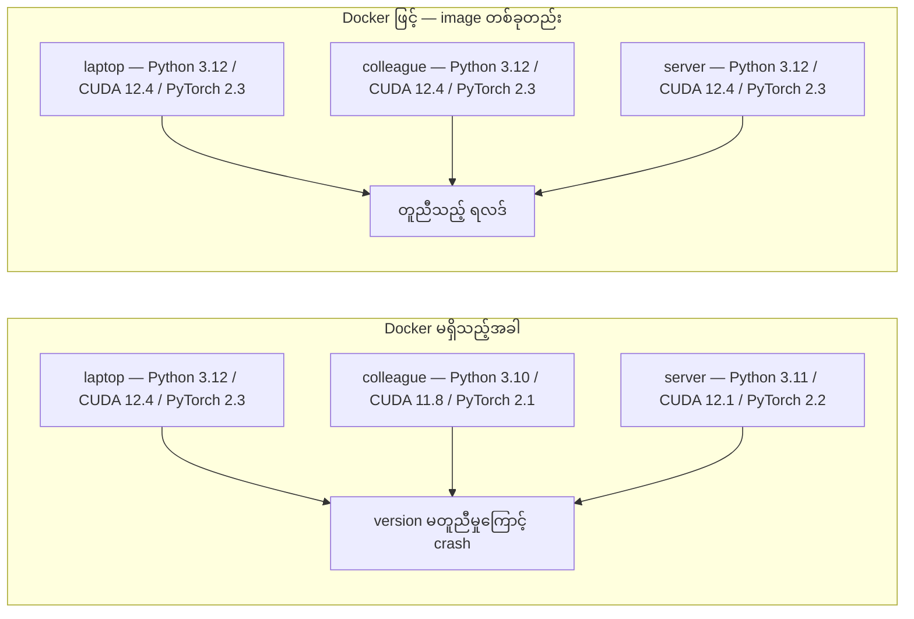
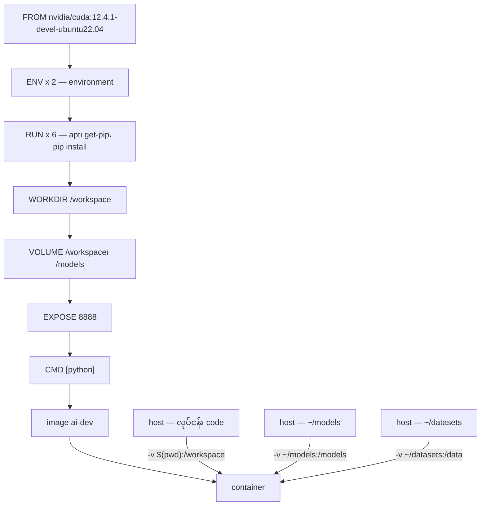
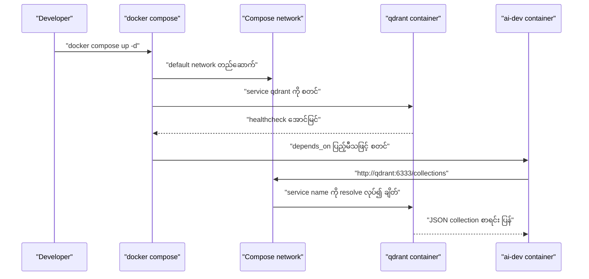

# Module 07 — Docker for AI

## ပြဿနာ — မတူညီသည့် စက်တွင် ကျရှုံးသည့် code

သင်၏ laptop တွင် PyTorch 2.3၊ CUDA 12.4 နှင့် Python 3.12 ဖြင့် model တစ်ခုကို
train လုပ်ပြီးပါသည်။ လုပ်ဖော်ကိုင်ဖက်ထံတွင် PyTorch 2.1၊ CUDA 11.8 နှင့် Python 3.10
ရှိသည်။ ထို model သည် ထို စက်တွင် crash ဖြစ်သည်။

AI ပရောဂျက်တိုင်းတွင် မှီခိုမှု (dependency) အများအပြား ရှိသည် — Python၊ PyTorch၊
CUDA driver၊ cuDNN၊ system-level C library များနှင့် `flash-attn` ကဲ့သို့ compiler
version ကွက်တိ လိုအပ်သည့် package များ ပါဝင်သည်။ ထို အစုအဝေးကို
**image** တစ်ခုအဖြစ် စုစည်းလိုက်ပါက မည်သည့် စက်တွင်မဆို တူညီစွာ run နိုင်သည်။

ဤ module ၏ ရည်မှန်းချက် လေးခု ရှိသည် —

1. CUDA၊ PyTorch နှင့် AI library များ ပါသည့် GPU-enabled Docker image ကို
   Dockerfile မှ build လုပ်နိုင်ခြင်း။
2. host directory များကို **volume** အဖြစ် mount လုပ်၍ model၊ dataset နှင့် code ကို
   container ပြန် build လုပ်သည့်အခါများတွင်ပါ ထိန်းသိမ်းနိုင်ခြင်း။
3. **NVIDIA Container Toolkit** ကို ပြင်ဆင်၍ container အတွင်း GPU ကို ဖော်ထုတ်နိုင်ခြင်း။
4. inference service နှင့် vector database တို့ပါသည့် multi-service stack ကို
   Docker Compose ဖြင့် စီမံနိုင်ခြင်း။

## အခြေခံ သဘောတရား — Docker သည် ဘာကို ပေးသနည်း

Docker သည် code၊ runtime၊ library နှင့် system tool တို့ကို container ဟုခေါ်သည့်
သီးခြားအစုအဝေး တစ်ခုအဖြစ် ထုပ်ပိုးသည်။ ၎င်းသည် အလေးချိန်နည်းသည့် virtual machine တစ်ခုနှင့်
ဆင်တူသည်၊ သို့သော် ကိုယ်ပိုင် OS kernel ကို မဖွင့်ဘဲ host OS kernel ကို
မျှဝေသုံးသဖြင့် မိနစ်များစွာ မလိုဘဲ စက္ကန့်ပိုင်းအတွင်း စတင်နိုင်သည်။



Figure 1 — Docker မရှိသည့်အခါ နှင့် Docker ဖြင့် ပတ်ဝန်းကျင် ကွာခြားချက်

ပုံရှင်းလင်းချက် (Figure 1) — ဘယ်ဘက် အုပ်စုတွင် စက် သုံးလုံး၏ Python/CUDA/PyTorch
version များ မတူညီသဖြင့် code တူညီသည့် နေရာတိုင်း၌ မတူညီသည့် ရလဒ် သို့မဟုတ် crash
ဖြစ်သည်။ ညာဘက် အုပ်စုတွင် image တစ်ခုတည်းမှ container များ ဖန်တီးသဖြင့် စက်
သုံးလုံးစလုံးတွင် version တူညီသည်။ ထို image ကို မျှဝေခြင်းဖြင့် "ငါ့စက်တွင် အလုပ်ဖြစ်သည်"
ဆိုသည့် ပြဿနာ ပျောက်သည်။

### Key vocabulary

| Term | အနက်အဓိပ္ပာယ် |
|---|---|
| Image | ဖတ်ရုံသာ ရသည့် template — ချက်ပြုတ်နည်း။ Dockerfile မှ build လုပ်သည်။ |
| Container | image တစ်ခု run နေသည့် instance — မီးဖိုခန်း။ |
| Dockerfile | image တည်ဆောက်ရန် instruction စာရင်း — layer အလိုက်။ |
| Volume | container ရပ်သွားသည့်တိုင် ကျန်ရှိသည့် persistent storage။ |
| docker-compose | multi-container application ကို YAML ဖြင့် သတ်မှတ်သည့် tool။ |

### AI ပရောဂျက်များတွင် Docker ပို၍ လိုအပ်သည့် အကြောင်းရင်း သုံးခု

1. **GPU driver များသည် ခိုင်မာမှု နည်းသည်။** CUDA 12.4 အတွက် ရေးထားသည့် code သည်
   CUDA 11.8 ပေါ်တွင် မရပါ။ Docker သည် CUDA toolkit ကို container အတွင်း
   သီးသန့် ထားရှိပြီး host GPU driver ကို NVIDIA Container Toolkit မှတစ်ဆင့်
   မျှဝေသုံးသည်။
2. **Model weight များ ကြီးမားသည်။** 7B parameter model တစ်ခုသည် fp16 ဖြင့် 14 GB
   ရှိသည်။ ပြန် build လုပ်တိုင်း ပြန်ဒေါင်းလုပ်ချခြင်းကို မလိုလားပါ။ Volume ဖြင့် host
   ရှိ models directory ကို mount လုပ်နိုင်သည်။
3. **Multi-service ဖွဲ့စည်းပုံ သာမန်ဖြစ်သည်။** တကယ့် AI application တစ်ခုသည် Python
   script တစ်ခုသာ မဟုတ်ပါ။ Inference server၊ RAG အတွက် vector database နှင့်
   web frontend ပါဝင်နိုင်သည်။ Docker Compose သည် ထို service အားလုံးကို command
   တစ်ခုဖြင့် စီမံသည်။

### AI တွင် အသုံးများသည့် container pattern

```
Dev Container
  Tool အပြည့်အစုံ။ Editor support။ Jupyter။ Debugging tool များ။
  Development နှင့် စမ်းသပ်မှုအတွင်း အသုံးပြုသည်။

Training Container
  အနည်းဆုံး။ Training script နှင့် dependency များသာ။
  GPU cluster ပေါ်တွင် run သည်။ Editor မပါ၊ Jupyter မပါ။

Inference Container
  Serving အတွက် optimize လုပ်ထားသည်။ image သေးသည်။ Cold start လျင်သည်။
  Production တွင် load balancer နောက်တွင် run သည်။
```

## နှိုင်းယှဉ်ချက် ဇယား — base image များ ရွေးချယ်ခြင်း

မှန်ကန်သည့် base image ကို ရွေးချယ်ခြင်းသည် debugging နာရီများစွာကို ကယ်တင်သည်။
`FROM` လိုင်းတွင် ရေးသည့် image သည် container အတွင်း ဘာများ ကြိုတင် တင်ပြီးဖြစ်သည်ကို
ဆုံးဖြတ်သည်။

| Base image | ပါဝင်သည့်အရာ | အသုံးပြုရန် | အရွယ်အစား |
|---|---|---|---|
| `nvidia/cuda:12.4.1-devel-ubuntu22.04` | CUDA toolkit အပြည့်အစုံ၊ compiler ပါသည် | `nvcc` လိုအပ်သည့် package များ (flash-attn, bitsandbytes) build လုပ်ရန် | ~4 GB |
| `nvidia/cuda:12.4.1-runtime-ubuntu22.04` | CUDA runtime သာ၊ compiler မပါ | Build ပြီးသား code ကို run ရန် | ~1.5 GB |
| `pytorch/pytorch:2.6.0-cuda12.4-cudnn9-runtime` | CUDA အပေါ် PyTorch တင်ပြီးသား | PyTorch install အဆင့်ကို ကျော်ရန် | ~6 GB |
| `python:3.12-slim` | CUDA မပါ၊ CPU သာ | CPU inference နှင့် အလေးချိန်နည်း tool များ | ~150 MB |

ဤ module သည် `devel` base ကို ရွေးသည်၊ အကြောင်းမှာ သင်ခန်းစာ၏ Dockerfile သည်
`build-essential` နှင့် Python dev package များဖြင့် အပေါ်မှ တည်ဆောက်ရန် လိုသောကြောင့်
ဖြစ်သည်။ Production serving အတွက်သာ ဖြစ်ပါက `runtime` base သို့ ပြောင်းခြင်းဖြင့်
~2.5 GB ခန့် သက်သာသည် (ဇယားတွင် ဖော်ပြသည့် အရွယ်အစားများသည် သင်ခန်းစာ၏
ခန့်မှန်းတန်ဖိုး ဖြစ်သည် — မိမိ image ၏ တိကျသည့် အရွယ်ကို `docker images` ဖြင့်
တိုင်းရမည်)။

## image layer နှင့် volume ချိတ်ဆက်ပုံ



Figure 2 — Dockerfile instruction များမှ layer ဖြစ်ပေါ်ခြင်း နှင့် volume mount

ပုံရှင်းလင်းချက် (Figure 2) — ထိပ်ပိုင်းတွင် `FROM` မှစ၍ instruction တိုင်းသည် layer
တစ်ခု ဖန်တီးသည်။ ဤ Dockerfile တွင် `FROM` နောက်ပိုင်း instruction ၁၂ ခု ရှိသဖြင့်
layer ၁၂ ခု ထပ်သည်။ မပြောင်းလဲသည့် layer များကို Docker သည် cache မှ ပြန်သုံးသဖြင့်
ဒုတိယ build သည် လျင်မြန်သည်။ အောက်ပိုင်းတွင် host directory သုံးခုကို `-v` ဖြင့်
container အတွင်း ချိတ်ဆက်ထားသည်။ ထို mount များကြောင့် container ပြန် build
လုပ်သည့်အခါများတွင်ပါ model နှင့် dataset များ ဆုံးရှုံးမည် မဟုတ်ပါ။

## လက်တွေ့ ပြင်ဆင်ခြင်း

### Step 1 — Docker ကို install လုပ်ခြင်း

```bash
# macOS
brew install --cask docker
open /Applications/Docker.app

# Ubuntu
curl -fsSL https://get.docker.com | sh
sudo usermod -aG docker $USER
# Group အပြောင်းအလဲ အကျိုးသက်ရောက်ရန် log out လုပ်ပြီး ပြန် log in ဝင်ရမည်
```

ထိုနောက် အောက်ပါ command နှစ်ခုဖြင့် စစ်သည်။

```bash
docker --version
docker run hello-world
```

`docker --version` သည် CLI version ကို ပြသည်။ `docker run hello-world` သည် image
တစ်ခုကို ဒေါင်းလုပ်ချပြီး container တစ်ခု run ကြည့်သည်။ မအောင်မြင်ပါက Docker daemon
မဖွင့်ထားခြင်း သို့မဟုတ် `docker` group အဖွဲ့ဝင် မဖြစ်သေးခြင်း ဖြစ်နိုင်သည်။

### Step 2 — NVIDIA Container Toolkit (NVIDIA GPU ရှိသည့် Linux)

ဤ toolkit သည် container များအား host GPU ကို အသုံးပြုခွင့် ပေးသည်။ macOS နှင့်
Windows (WSL2) အသုံးပြုသူများသည် ဤအဆင့်ကို ကျော်နိုင်သည် — ထို platform များတွင်
Docker Desktop သည် GPU passthrough ကို အခြားနည်းဖြင့် ကိုင်တွယ်သည်။

```bash
distribution=$(. /etc/os-release;echo $ID$VERSION_ID)
curl -fsSL https://nvidia.github.io/libnvidia-container/gpgkey | sudo gpg --dearmor -o /usr/share/keyrings/nvidia-container-toolkit-keyring.gpg
curl -s -L https://nvidia.github.io/libnvidia-container/$distribution/libnvidia-container.list | \
    sed 's#deb https://#deb [signed-by=/usr/share/keyrings/nvidia-container-toolkit-keyring.gpg] https://#g' | \
    sudo tee /etc/apt/sources.list.d/nvidia-container-toolkit.list

sudo apt-get update
sudo apt-get install -y nvidia-container-toolkit
sudo nvidia-ctk runtime configure --runtime=docker
sudo systemctl restart docker
```

လိုင်းတိုင်း၏ လုပ်ဆောင်ချက် — ပထမလိုင်းသည် OS distribution အမည်ကို ရယူသည်။
ဒုတိယနှင့် တတိယလိုင်းသည် NVIDIA ၏ package repository ကို apt source အဖြစ်
ထည့်သည်။ ထိုနောက် `nvidia-container-toolkit` package ကို တင်သည်။
`sudo nvidia-ctk runtime configure --runtime=docker` သည် Docker daemon ၏
configuration တွင် NVIDIA runtime ကို ထည့်သည်၊ `systemctl restart docker` ဖြင့်
ပြောင်းလဲမှုကို အသက်သွင်းသည်။

Container အတွင်း GPU ရောက်/မရောက် စစ်ရန် —

```bash
docker run --rm --gpus all nvidia/cuda:12.4.1-base-ubuntu22.04 nvidia-smi
```

GPU အချက်အလက် ပေါ်လာပါက toolkit အလုပ်ဖြစ်နေသည်။ ဤ command တွင် `--rm` သည်
container ပြီးဆုံးသည့်အခါ ဖျက်ပစ်ရန်၊ `--gpus all` သည် host GPU အားလုံးကို
ဖော်ထုတ်ရန် ဖြစ်သည်။

### Step 3 — AI အတွက် Dockerfile ရေးခြင်း

သင်ခန်းစာတွင် ဖော်ပြသည့် Dockerfile ကို အပိုင်းလိုက် ရှင်းပြသည်။ ဤ repository တွင်
ထို ဖိုင်၏ မိတ္တူကို `Dockerfile.example` အဖြစ် ထားရှိသည်။

```dockerfile
FROM --platform=linux/amd64 nvidia/cuda:12.4.1-devel-ubuntu22.04

ENV DEBIAN_FRONTEND=noninteractive
ENV PYTHONUNBUFFERED=1

RUN apt-get update && apt-get install -y --no-install-recommends \
    software-properties-common \
    git \
    curl \
    build-essential \
    && add-apt-repository -y ppa:deadsnakes/ppa \
    && apt-get update && apt-get install -y --no-install-recommends \
    python3.12 \
    python3.12-venv \
    python3.12-dev \
    && rm -rf /var/lib/apt/lists/*

RUN update-alternatives --install /usr/bin/python python /usr/bin/python3.12 1

RUN curl -sSL https://raw.githubusercontent.com/pypa/get-pip/3b73145063be545b649ad9ca83ea8da5fc915a4f/public/get-pip.py -o /tmp/get-pip.py \
    && echo "a341e1a43e38001c551a1508a73ff23636a11970b61d901d9a1cad2a18f57055  /tmp/get-pip.py" | sha256sum -c - \
    && python /tmp/get-pip.py \
    && rm /tmp/get-pip.py \
    && update-alternatives --install /usr/bin/pip pip /usr/local/bin/pip3.12 1

RUN python -m pip install --no-cache-dir --upgrade pip setuptools wheel

RUN python -m pip install --no-cache-dir \
    torch==2.6.0+cu124 \
    torchvision==0.21.0+cu124 \
    torchaudio==2.6.0+cu124 \
    --index-url https://download.pytorch.org/whl/cu124

RUN python -m pip install --no-cache-dir \
    numpy pandas scikit-learn matplotlib jupyter transformers datasets accelerate safetensors

WORKDIR /workspace

VOLUME ["/workspace", "/models"]

EXPOSE 8888

CMD ["python"]
```

ဖတ်သင့်သည့် အချက်များ —

- `FROM` လိုင်းရှိ `--platform=linux/amd64` သည် Mac (M1/M2/M3/M4) ပေါ်တွင် ဤ build
  အောင်မြင်ရန် လိုသည်။ CUDA base image တွင် arm64 variant ရှိပြီး Docker Desktop သည်
  Apple Silicon တွင် ၎င်းကို အလိုအလျောက် ရွေးသည်၊ သို့သော် PyTorch သည် `cu124`
  wheel များကို x86_64 အတွက်သာ ထုတ်သဖြင့် `pip install torch==2.6.0+cu124`
  အဆင့်သည် `No matching distribution found for torch==2.6.0+cu124` ဖြင့် ကျရှုံးသည်။
  Platform ကို pin လုပ်ခြင်းဖြင့် x86_64 image ကို ဆွဲပြီး emulation ဖြင့် run သည် —
  build နှေးပြီး container တွင် GPU မရှိပါ။ ထို အခြေအနေတွင် `docker run` command
  များမှ `--gpus all` ကို ဖယ်ရမည်။
- `ENV DEBIAN_FRONTEND=noninteractive` သည် apt ကို interactive မေးခွန်း မမေးစေရန်
  သတ်မှတ်သည် — build သည် လူမပါဘဲ ပြီးဆုံးနိုင်သည်။
- `ENV PYTHONUNBUFFERED=1` သည် Python ၏ output ကို ချက်ချင်း ထုတ်စေသည်၊ ထို့ကြောင့်
  `docker logs` တွင် log များကို အချိန်နှင့်တပြေးညီ မြင်ရသည်။
- `add-apt-repository -y ppa:deadsnakes/ppa` သည် Ubuntu 22.04 တွင် `python3.12`
  package ရရှိရန် deadsnakes PPA ကို ထည့်သည်။ `rm -rf /var/lib/apt/lists/*` သည်
  apt cache ကို ဖျက်၍ layer အရွယ်ကို လျော့သည်။
- `get-pip.py` ကို ဒေါင်းလုပ်ချပြီး `sha256sum -c -` ဖြင့် checksum စစ်သည်၊ ထိုနောက်
  run ပြီး ဖိုင်ကို ဖျက်သည်။ ဤအဆင့်သည် reproducible ဖြစ်ရန် commit hash ဖြင့်
  pin လုပ်ထားသည်။
- PyTorch package သုံးခုကို `--index-url https://download.pytorch.org/whl/cu124` ဖြင့်
  CUDA 12.4 build အဖြစ် တင်သည်။ `+cu124` suffix သည် ထို build ကို ရည်ညွှန်းသည်။
- `VOLUME ["/workspace", "/models"]` နှင့် `EXPOSE 8888` သည် နောက်ပိုင်း `docker run`
  တွင် mount လုပ်မည့် နေရာနှင့် Jupyter port ကို ကြေညာသည်။ `CMD ["python"]` သည်
  default command ဖြစ်သည်။

Build လုပ်ရန် —

```bash
docker build -t ai-dev -f phases/00-setup-and-tooling/07-docker-for-ai/code/Dockerfile .
```

ပထမအကြိမ်တွင် CUDA base image နှင့် PyTorch ကို ဒေါင်းလုပ်ချရသဖြင့် အချိန်ကြာသည်။
နောက်အကြိမ်များတွင် cache ဖြစ်နေသည့် layer များကို ပြန်သုံးသဖြင့် လျင်မြန်သည်။
ဤ repository တွင် ဤ build command ကို `-f modules/07_docker_for_ai/Dockerfile.example`
ဖြင့် ပြောင်းရမည်။



Figure 3 — `docker compose up` ၏ အစဉ်လိုက် လုပ်ငန်းစဉ် နှင့် service name resolution

ပုံရှင်းလင်းချက် (Figure 3) — Developer မှ `docker compose up -d` ကို ခေါ်သည့်အခါ
Compose သည် default network တစ်ခုကို အရင် ဖန်တီးသည်။ ထိုနောက် `qdrant` service ကို
စတင်ပြီး ကျန်းမာရေး စစ်ဆေးချက် (healthcheck) အောင်မြင်သည်အထိ စောင့်သည်။
`ai-dev` ၏ `depends_on` သည် `condition: service_healthy` ဖြစ်သဖြင့် ထို အခြေအနေ
ပြည့်မီမှသာ `ai-dev` ကို စတင်သည်။ ထိုနောက် `ai-dev` အတွင်းမှ `http://qdrant:6333`
ဟူသည့် အမည်ကို DNS မှတစ်ဆင့် `qdrant` container ၏ IP သို့ ဖြေရှင်းပေးသဖြင့်
ဆက်သွယ်မှု အောင်မြင်သည်။

### Step 4 — Compose ဖြင့် multi-service stack

RAG application တစ်ခုတွင် inference server နှင့် vector database နှစ်မျိုးစလုံး လိုသည်။
Docker Compose သည် ၎င်းတို့ကို command တစ်ခုဖြင့် စတင်သည်။ သင်ခန်းစာ၏
`code/docker-compose.yml` သည် အောက်ပါအတိုင်း ဖြစ်သည်။

```yaml
services:
  ai-dev:
    build:
      context: .
      dockerfile: Dockerfile
    deploy:
      resources:
        reservations:
          devices:
            - driver: nvidia
              count: all
              capabilities: [gpu]
    volumes:
      - ../../../:/workspace
      - ~/models:/models
      - ~/datasets:/data
    ports:
      - "8888:8888"
    stdin_open: true
    tty: true
    command: jupyter notebook --ip=0.0.0.0 --port=8888 --no-browser --allow-root

  qdrant:
    image: qdrant/qdrant:v1.12.5
    ports:
      - "6333:6333"
      - "6334:6334"
    volumes:
      - qdrant_data:/qdrant/storage

volumes:
  qdrant_data:
```

- `build:` block သည် image ကို ဒေသအတွင်း Dockerfile မှ တည်ဆောက်သည်။
- `deploy.resources.reservations.devices` သည် `--gpus all` နှင့် ညီမျှသည့် GPU
  ခွဲဝေမှုကို Compose syntax ဖြင့် ဖော်ပြသည် — `driver: nvidia`၊ `count: all`။
- `jupyter notebook --ip=0.0.0.0 --port=8888 --no-browser --allow-root` သည် container
  အတွင်းမှ notebook server ကို စတင်သည်။ `--ip=0.0.0.0` သည် container ပြင်ပမှ
  ချိတ်ဆက်နိုင်ရန် လိုသည်။
- `qdrant` service သည် `qdrant/qdrant:v1.12.5` image ကို သုံးပြီး `6333` (HTTP) နှင့်
  `6334` (gRPC) port နှစ်ခုကို ဖော်ထုတ်သည်။ `qdrant_data` named volume သည်
  vector data ကို container ရပ်သွားသည့်တိုင် ထိန်းသိမ်းသည်။

ဤ repository ၏ `docker-compose.yml` သည် ထို stack ကို အနည်းငယ် တိုးချဲ့ထားသည် —
`ai-dev` တွင် `depends_on: qdrant` (condition `service_healthy`) နှင့်
`environment: QDRANT_URL=http://qdrant:6333` ပါသည်။ ထို ဖိုင်သည်
`modules/07_docker_for_ai/Dockerfile.example` ကို ကိုးကားသဖြင့် ဤ module ၏
Dockerfile ကို အသုံးပြုသည်။

စတင်ရန် —

```bash
cd phases/00-setup-and-tooling/07-docker-for-ai/code
docker compose up -d
```

ရောက်ရှိမှု စစ်ရန် — AI container အတွင်းမှ —

```python
from qdrant_client import QdrantClient

client = QdrantClient(host="qdrant", port=6333)
print(client.get_collections())
```

`host="qdrant"` သည် service အမည် ဖြစ်သည်။ Docker Compose သည် network တစ်ခုကို
အလိုအလျောက် ဖန်တီးပြီး service အမည်တိုင်းကို hostname အဖြစ် မှတ်ပုံတင်ပေးသဖြင့်
`http://qdrant:6333` သို့ ရောက်နိုင်သည်။

ရပ်ရန် —

```bash
docker compose down
```

`-v` ထည့်ပါက qdrant volume ကိုပါ ဖျက်သည်။

```bash
docker compose down -v
```

### Step 5 — Volume mount များ

```bash
# code ကို mount
-v $(pwd):/workspace

# model directory ကို mount
-v ~/models:/models

# dataset များကို mount
-v ~/datasets:/data
```

Training script အတွင်းမှ mount လုပ်ထားသည့် path ကို ဖတ်သည်။

```python
from transformers import AutoModel

model = AutoModel.from_pretrained("/models/llama-7b")
```

Model သည် host filesystem ပေါ်တွင် တည်ရှိသဖြင့် container ကို ပြန် build လုပ်သည့်
အကြိမ်တိုင်း ပြန်ဒေါင်းလုပ်ချရမည် မဟုတ်ပါ။

### Step 6 — AI အလုပ်အတွက် အသုံးဝင်သည့် Docker command များ

```bash
# run နေသည့် container များ စာရင်း
docker ps

# image အားလုံး နှင့် ၎င်းတို့၏ အရွယ်အစား
docker images

# အသုံးမလိုသည့် image များ ဖျက်၍ disk space ပြန်ယူ
docker system prune -a

# run နေသည့် container အတွင်း GPU အသုံးပြုမှု စစ်
docker exec -it <container_id> nvidia-smi

# container မှ host သို့ ဖိုင် ကူး
docker cp <container_id>:/workspace/results.csv ./results.csv

# container log ကို အချိန်နှင့်တပြေးညီ ကြည့်
docker logs -f <container_id>
```

## လုပ်ငန်းလည်ပတ်မှုတွင် သတိပြုရန်

1. **`--gpus all` မပါပါက GPU မရှိပါ။** GPU လိုသည့် code သည် container အတွင်း
   CPU သို့ အလိုအလျောက် ကျဆင်းသည်။ PyTorch သည် CUDA မရှိကြောင်း တွေ့ပါက CPU သို့
   ပြန်ကျသည်။ သို့သော် နှေးသည်။ GPU လိုအပ်သည့်အခါ `--gpus all` သို့မဟုတ်
   `deploy.resources.reservations.devices` ကို စစ်ရမည်။
2. **Volume mount မရှိပါက data ပျောက်သည်။** Container အတွင်း ရေးလိုက်သည့်
   အရာအားလုံးသည် container ရပ်သည့်အခါ ဖျက်ခံရသည်။ Model နှင့် dataset များကို
   အမြဲတမ်း host မှ mount လုပ်ရမည်။
3. **Image tag များသည် အချိန်နှင့်အမျှ ပြောင်းလဲသည်။** `qdrant/qdrant:v1.12.5` ကဲ့သို့
   version ကို pin လုပ်ခြင်းသည် reproducible ဖြစ်သည်။ ဤ course ၏ လေ့ကျင့်ခန်း
   ဖိုင်တွင် `latest` ဖြင့် ရေးထားသည့် နေရာများ ရှိသဖြင့် run မီ official
   documentation နှင့် မိမိ driver/CUDA version ကို စစ်ရမည်။
4. **Port ကို host နှင့် container မှားယွင်းစွာ ရောထွေးခြင်း။** Container အတွင်းမှ
   `localhost` သည် ထို container ကိုယ်တိုင်ကို ညွှန်သည်၊ host ကို မညွှန်ပါ။
   ထို့ကြောင့် service နှစ်ခု ဆက်သွယ်ရာတွင် service အမည်ကို သုံးရမည်၊
   `localhost` ကို မသုံးရ။
5. **Image သည် ကြီးမားသည်၊ ထို့ကြောင့် cache ကို စီမံရမည်။** `devel` base သည် ~4 GB
   ဖြစ်ပြီး PyTorch layer များက ထပ်တိုးသည်။ `docker system prune -a` သည် disk
   space ပြန်ယူသည်၊ သို့သော် မလိုသည့် image များကိုပါ ဖျက်သဖြင့် နောက် build
   နှေးလာနိုင်သည်။
6. **`--platform=linux/amd64` သည် Mac တွင် emulation ဖြင့် run သည်။** ထို အခြေအနေတွင်
   GPU မရနိုင်ပါ။ Apple Silicon တွင် GPU အလုပ်အတွက် Lesson 01 ၏ MPS build ဖြင့်
   ဒေသအတွင်း run ခြင်းကို ရွေးသင့်သည်။

## Self-check

**မေးခွန်း ၁။ Container နှင့် virtual machine ၏ အဓိက ကွာခြားချက်ကား အဘယ်နည်း။**

အဖြေ — Container များသည် host OS kernel ကို မျှဝေသုံးပြီး process အဆင့်တွင်
သီးခြားခွဲထားသည်၊ ထို့ကြောင့် စက္ကန့်ပိုင်းအတွင်း စတင်နိုင်သည်။ VM များသည်
ကိုယ်ပိုင် kernel ပါသည့် ဧည့် OS အပြည့်အစုံကို run သဖြင့် အရင်းအမြစ် ပိုလိုပြီး
စတင်ချိန် ပိုကြာသည်။

**မေးခွန်း ၂။ Dockerfile ဆိုသည်မှာ အဘယ်နည်း၊ ဤ module ၏ Dockerfile သည် layer
မည်မျှ ဖန်တီးသနည်း။**

အဖြေ — Dockerfile သည် image တစ်ခု တည်ဆောက်ရန် instruction များကို အစဉ်လိုက်
ဖော်ပြသည့် ဖိုင် ဖြစ်သည်။ Instruction တိုင်းသည် layer တစ်ခု ဖန်တီးသည်။ ဤ module ၏
Dockerfile တွင် instruction ၁၃ ခု ရှိပြီး `FROM` နောက်ပိုင်း instruction ၁၂ ခု
ရှိသဖြင့် base layer အပေါ် layer ၁၂ ခု ထပ်သည်။

**မေးခွန်း ၃။ AI အလုပ်တွင် volume mount သည် အဘယ်ကြောင့် အရေးကြီးသနည်း။**

အဖြေ — Volume မရှိပါက container ရပ်သည့်အခါ model weight နှင့် dataset များ
ပျောက်သည်။ 7B parameter model တစ်ခုသည် fp16 ဖြင့် 14 GB ရှိသဖြင့် ပြန် build
လုပ်တိုင်း ပြန်ဒေါင်းလုပ်ချခြင်းသည် အချိန်နှင့် bandwidth ကို ဖြုန်းတီးသည်။
Volume သည် host directory ကို container အတွင်းသို့ ချိတ်ပေးသဖြင့် data သည်
host တွင် ကျန်ရှိသည်။

**မေးခွန်း ၄။ NVIDIA Container Toolkit သည် ဘာကို လုပ်ဆောင်သနည်း။**

အဖြေ — ၎င်းသည် runtime hook တစ်ခု ဖြစ်ပြီး host GPU များကို container များထံ
`--gpus` flag မှတစ်ဆင့် ဖော်ထုတ်ပေးသည်။ CUDA toolkit သည် container အတွင်း
တည်ရှိသည်၊ GPU driver ကို host မှ မျှဝေသုံးသည်။

**မေးခွန်း ၅။ Compose stack တွင် `ai-dev` service သည် `qdrant` ကို မည်သို့
ရောက်သနည်း၊ `localhost:6333` သည် အဘယ်ကြောင့် မရသနည်း။**

အဖြေ — Compose သည် network တစ်ခုကို အလိုလျောက် ဖန်တီးပြီး service အမည်များကို
hostname အဖြစ် မှတ်ပုံတင်ပေးသဖြင့် `http://qdrant:6333/collections` ဖြင့်
ရောက်နိုင်သည်။ Container အတွင်းမှ `localhost` သည် ထို container ကိုယ်တိုင်ကို
ညွှန်သဖြင့် `localhost:6333` သည် qdrant သို့ မရောက်ပါ။

## Technical review notes

- ဤ module ရှိ base image tag၊ port၊ service အမည်နှင့် package အားလုံးကို
  `phases/00-setup-and-tooling/07-docker-for-ai/docs/en.md` နှင့် ၎င်း၏ `code/`
  မှ ယူထားသည်။ `Dockerfile.example` သည် ထို `code/Dockerfile` ၏ မိတ္တူ ဖြစ်ပြီး
  ထိပ်တွင် မူရင်းလမ်းကြောင်း မှတ်ချက် တစ်ခုသာ ထပ်ထည့်ထားသည် — အကြောင်းအရာ
  မည်သည့်အချက်ကိုမျှ ပြောင်းမထားပါ။
- သင်ခန်းစာတွင် ဖော်ပြသည့် base image အရွယ်အစားများ (~4 GB၊ ~1.5 GB၊ ~6 GB၊
  ~150 MB) ကို ခန့်မှန်းတန်ဖိုးအဖြစ် ဖော်ပြသည်။ Image အပြည့်၏ တိကျသည့်
  အရွယ်အစားကို သင်ခန်းစာတွင် ဖော်ပြထားခြင်း မရှိသဖြင့် ဤ chapter နှင့် `lab.py`
  သည် တန်ဖိုးတစ်ခုကို မတီးဘဲ `docker images` ဖြင့် တိုင်းရန် ညွှန်ထားသည်။
- ဤ repository ၏ `docker-compose.yml` သည် သင်ခန်းစာ၏ compose ဖိုင်နှင့် မတူပါ —
  version ကို `latest` ဖြင့် ရေးထားပြီး `depends_on` နှင့် `QDRANT_URL`
  environment variable ထပ်ထည့်ထားသည်။ ထို ကွာခြားချက်ကို `lab.py`
  exercise 4 တွင် ဖိုင်နှစ်ခုကို နှိုင်းယှဉ်၍ ပြထားသည်။ `latest` tag သည်
  အချိန်နှင့်အမျှ ပြောင်းလဲသဖြင့် run မီ ပြန်စစ်ရန် လိုသည်။
- သင်ခန်းစာ၏ `docker run` ဥပမာများတွင် `-v $(pwd):/workspace` ကို ခွဲထုတ်မပြဘဲ
  multi-line အဖြစ် ဖော်ပြထားသည်။ `lab.py` သည် ထို flag များကို spec dict မှ
  command line တစ်လိုင်းအဖြစ် တည်ဆောက်သည် — flag အစဉ်နှင့် တန်ဖိုးများ မူရင်းအတိုင်း
  ဖြစ်သည်။
- `lab.py` သည် Docker daemon၊ network နှင့် GPU မလိုဘဲ Dockerfile နှင့် compose
  ဖိုင်၏ အကြောင်းအရာကို parse လုပ်သည်။ ထို့ကြောင့် exercise များ၏ output သည်
  တကယ့် Docker အထွက် မဟုတ်ဘဲ ဖိုင်များမှ တွက်ချက်ထားသည့် ရလဒ် ဖြစ်သည်။

## References & Further Reading

- သင်ခန်းစာ (source) — https://aiengineeringfromscratch.com/lesson?path=phases%2F00-setup-and-tooling%2F07-docker-for-ai
- သင်ခန်းစာ ဖိုင် — `phases/00-setup-and-tooling/07-docker-for-ai/docs/en.md`
  (rohitg00/ai-engineering-from-scratch, MIT)
- Docker — Dockerfile reference။ https://docs.docker.com/reference/dockerfile/
- Docker — Volumes။ https://docs.docker.com/engine/storage/volumes/
- Docker — Compose file reference။ https://docs.docker.com/reference/compose-file/
- Docker — `docker run` command reference။ https://docs.docker.com/reference/cli/docker/container/run/
- NVIDIA — NVIDIA Container Toolkit။ https://docs.nvidia.com/datacenter/cloud-native/container-toolkit/latest/
- PyTorch — Previous versions နှင့် CUDA wheel index။ https://pytorch.org/get-started/previous-versions/
- Qdrant — Docker အသုံးပြုခြင်း။ https://qdrant.tech/documentation/guides/installation/
