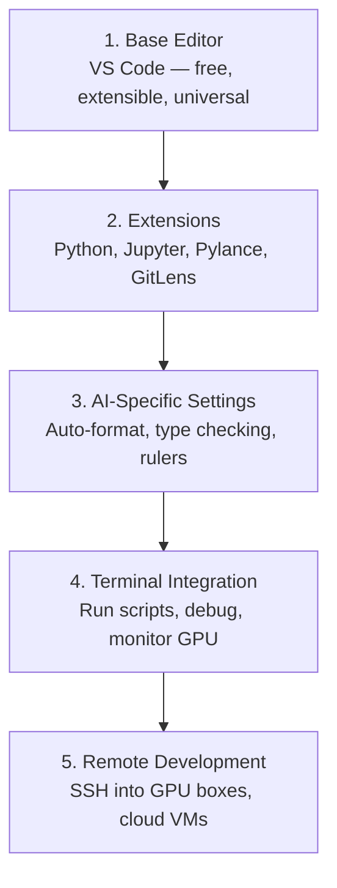
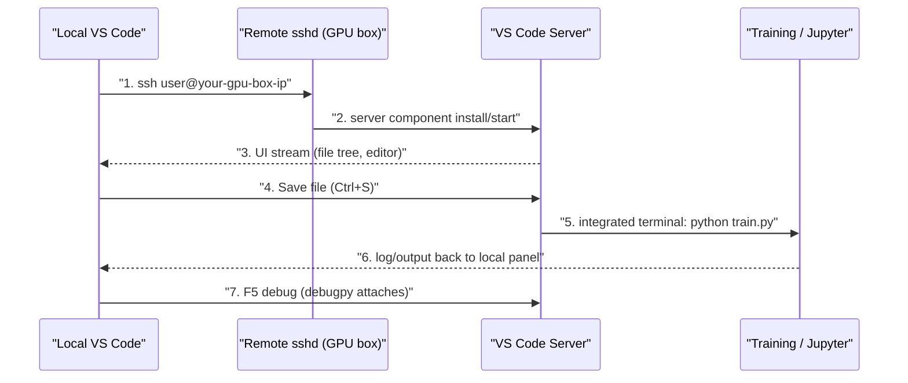
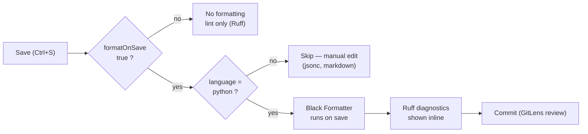

# Module 08 — Editor Setup

AI engineering အလုပ်တွင် မိမိ အချိန် အားလုံးနီးပါးကို **editor** အတွင်း ကုန်ဆုံးသည် — Python ရေးခြင်း၊
notebook run ခြင်း၊ training loop debug လုပ်ခြင်း၊ remote GPU machine သို့ ချိတ်ဆက်ခြင်း။
ထို့ကြောင့် editor ကို **တစ်ကြိမ်တည်း မှန်ကန်စွာ ချိန်ညှိခြင်း** သည် အချိန် ၂၀ မိနစ်ခန့် လိုအပ်ပြီး၊
မချိန်ညှိဘဲ ထားလျှင် နေ့တိုင်း မိနစ် ၂၀ ခန့် ဆုံးရှုံးစေသည်။

## ၁။ ပြဿနာ — ချိန်ညှိမှု မရှိသည့် editor ၏ ကုန်ကျစရိတ်

Editor တစ်ခုကို default အတိုင်း ထားလျှင် အောက်ပါ လက္ခဏာ များ ဖြစ်ပေါ်သည်။

- **Autocomplete မရှိခြင်း** — function အမည်နှင့် argument ကို မှတ်မိရန် ကြိုးစားရသည်။
- **Type hint မရှိခြင်း** — tensor shape နှင့် argument အမျိုးအစား မှားမှားကို run ပြီးမှ သိရသည်။
- **Inline error မရှိခြင်း** — import အမည် မှားခြင်းကို ဖိုင် သိမ်းချိန်တွင် မတွေ့ရဘဲ training စပြီးမှ တွေ့ရသည်။
- **Formatting ကို လက်ဖြင့် လုပ်ရခြင်း** — code style သည် လူတစ်ဦးနှင့် တစ်ဦး မတူညီဖြစ်သည်။
- **Terminal လုပ်ငန်းစဉ် ပြတ်တောက်ခြင်း** — run၊ monitor၊ install လုပ်ရန် window များ အကြား ပြောင်းရသည်။

AI အလုပ်၏ အထူးအချက်မှာ **တစ်ကြိမ် run လျှင် အချိန် များစွာ ကုန်သည်**။ ထို့ကြောင့် run မလုပ်မီ
တွေ့နိုင်သည့် အမှား တိုင်းသည် အချိန်နှင့် GPU ကုန်ကျစရိတ် ကို သက်သာစေသည်။ Type checking နှင့်
inline diagnostic သည် ဤနေရာတွင် တိုက်ရိုက် အကျိုးရှိသည်။

## ၂။ အခြေခံ သဘောတရား — editor setup ၏ အလွှာ ၅ လွှာ

AI engineering အတွက် editor setup ကို အောက်ခြေမှ အပေါ်သို့ အလွှာ ၅ လွှာ အဖြစ် စဉ်းစားသည်။
အလွှာ တစ်ခုချင်းစီသည် အပေါ်အလွှာအတွက် အခြေခံ ဖြစ်သည်။



**Figure 1 — editor setup ၏ အလွှာ ၅ လွှာ**

### ပုံရှင်းလင်းချက် (Figure 1)

1. **အလွှာ ၁ (Base Editor)** — VS Code ကို ထည့်သွင်းသည်။ အခမဲ့ ဖြစ်သည်၊ OS တိုင်းတွင် run သည်။
2. **အလွှာ ၂ (Extensions)** — Python၊ Jupyter၊ Pylance၊ GitLens စသည့် extension များ ထည့်သည်။
   Extension မရှိလျှင် အပေါ်အလွှာ များ အလုပ်မလုပ်ပါ။
3. **အလွှာ ၃ (AI-Specific Settings)** — format-on-save၊ type checking၊ ruler များ ကို ချိန်ညှိသည်။
   ဤအလွှာသည် ရေးသည့် အချိန်တွင် အမှားကို ဖမ်းသည်။
4. **အလွှာ ၄ (Terminal Integration)** — script run ခြင်း၊ GPU monitor လုပ်ခြင်း ကို editor အတွင်း လုပ်သည်။
5. **အလွှာ ၅ (Remote Development)** — Remote SSH ဖြင့် remote GPU machine ပေါ်ရှိ ဖိုင် များကို
   local ကဲ့သို့ ဖွင့်သည်။ AI အလုပ်တွင် အရေးအကြီးဆုံး အလွှာ ဖြစ်သည်။

အလွှာ ၅ လွှာ ကို ဤ Module တွင် အစဉ်လိုက် တည်ဆောက်သည်။

### LSP သည် ဘာကို ဖြေရှင်းပေးသည်

Editor သည် Python ကို ကိုယ်တိုင် နားမလည်ပါ။ Editor နှင့် language-specific server အကြား
စံသတ်မှတ်ချက် **Language Server Protocol (LSP)** ရှိသည်။ Python ၏ အနေအထားတွင် **Pylance** သည်
Pyright ကို အခြေခံသည့် language server ဖြစ်ပြီး type checking၊ autocomplete နှင့် import
resolution ကို ထောက်ပံ့သည်။

| အသုံးအနှုန်း | လူအများ ခေါ်သည့်အတိုင်း | အမှန်တကယ် အဓိပ္ပာယ် |
|---|---|---|
| LSP | "Autocomplete engine" | Editor များသည် language-specific server ထံမှ type info၊ completion နှင့် diagnostic ရရှိရန် စံသတ်မှတ်ချက် |
| Pylance | "The Python plugin" | Pyright ကို အသုံးပြု၍ type checking နှင့် IntelliSense ပေးသည့် Microsoft ၏ Python language server |
| Remote SSH | "Working on the server" | Remote machine ပေါ်တွင် အလေးချိန် မကြီးမားသည့် server component တစ်ခု run လုပ်ပြီး UI ကို local editor သို့ ပို့သည့် extension |
| Format on save | "Auto-prettier" | ဖိုင် သိမ်းတိုင်း formatter(Black၊ Ruff)ကို run စေခြင်း |

### Editor ရွေးချယ်မှု နှိုင်းယှဉ်ချက်

| Editor | အခြေခံ သဘောထား | ဤ course အတွက် သင့်တော်မှု |
|---|---|---|
| VS Code | အခမဲ့၊ extension ecosystem ကြီးမားသည်၊ Jupyter support ကောင်းသည် | **အကြံပြုသည်** — settings format နှင့် extension ID များ၏ ရင်းမြစ် |
| Cursor | VS Code fork၊ built-in AI code generation ပါသည် | Extension ecosystem နှင့် settings format တူညီသည်။ ဤ Module ၏ `settings.json` နှင့် `extensions.json` ကို တိုက်ရိုက် အသုံးပြုနိုင်သည် |
| Windsurf | AI-first VS Code fork | Extension၊ settings format နှင့် Remote SSH support တူညီသည် |
| Vim / Neovim | Terminal-native၊ ကိုယ်တိုင် ချိတ်ရသည် | Vim ကို ကျွမ်းကျင်ပြီးသားသူ အတွက်သာ တန်ဖိုးရှိသည်။ အသစ် စတင်သူအတွက် learning curve သည် AI engineering သင်ခြင်းနှင့် ယှဉ်ပြိုင်လိမ့်မည် |

Neovim ကို ရွေးလျှင် အနည်းဆုံး လိုအပ်သည့် အစိတ်အပိုင်း များမှာ —
**pyright** သို့မဟုတ် **pylsp** (type checking အတွက်၊ Mason သို့မဟုတ် manual install ဖြင့်)၊
**nvim-lspconfig** (language server integration)၊ **jupyter-vim** သို့မဟုတ် **molten-nvim**
(notebook-like execution)၊ **telescope.nvim** (file/symbol search)နှင့် **none-ls.nvim**
(black နှင့် ruff ဖြင့် formatting/linting)ဖြစ်သည်။

## ၃။ လက်တွေ့ ချိန်ညှိခြင်း

### အဆင့် ၁ — VS Code ထည့်သွင်းခြင်း

[code.visualstudio.com](https://code.visualstudio.com/) မှ မိမိ OS အတွက် installer ကို ရယူသည်။
Terminal မှ အောက်ပါ command ဖြင့် စစ်သည်။

```bash
code --version
```

ဤ command သည် VS Code ၏ version နှင့် commit hash ကို ပြသည်။ ရလဒ် ထွက်လာလျှင် `code` CLI သည်
PATH တွင် ရှိသည်။ macOS တွင် `code` မတွေ့လျှင် VS Code ကို ဖွင့်၍ `Cmd+Shift+P` နှိပ်ပြီး
"Shell Command" ကို ရိုက်ကာ "Install 'code' command in PATH" ကို ရွေးသည်။

### အဆင့် ၂ — essential extension များ ထည့်ခြင်း

VS Code ၏ integrated terminal (`` Ctrl+` `` ဖြင့် ဖွင့်သည်)တွင် အောက်ပါ command များ run သည်။

```bash
code --install-extension ms-python.python
code --install-extension ms-python.vscode-pylance
code --install-extension ms-toolsai.jupyter
code --install-extension eamodio.gitlens
code --install-extension ms-vscode-remote.remote-ssh
code --install-extension ms-python.debugpy
code --install-extension ms-python.black-formatter
code --install-extension charliermarsh.ruff
```

`code --install-extension <id>` သည် extension ID တစ်ခုကို Marketplace မှ ရယူ၍ ထည့်သည်။
ID တိုင်းသည် `publisher.name` format ဖြစ်သည်။ ရလဒ်ကို `code --list-extensions` ဖြင့် စစ်သည်။
Extension တိုင်း၏ တာဝန် မှာ အောက်ပါအတိုင်း ဖြစ်သည်။

| Extension | ID | ဘာအတွက် |
|---|---|---|
| Python | `ms-python.python` | Language support၊ virtual env detection၊ run/debug |
| Pylance | `ms-python.vscode-pylance` | Type checking၊ autocomplete၊ import resolution |
| Jupyter | `ms-toolsai.jupyter` | Notebook ကို VS Code အတွင်း run၊ variable explorer |
| GitLens | `eamodio.gitlens` | Inline git blame — မည်သူ ဘာပြောင်းသည် ကို ကြည့်ခြင်း |
| Remote SSH | `ms-vscode-remote.remote-ssh` | Remote GPU box ပေါ်ရှိ folder ကို local ကဲ့သို့ ဖွင့်ခြင်း |
| Debugpy | `ms-python.debugpy` | Python step-through debugging |
| Black Formatter | `ms-python.black-formatter` | Save လုပ်တိုင်း auto-format |
| Ruff | `charliermarsh.ruff` | အမြန် linting — အဖြစ်များသည့် အမှားကို ဖမ်းခြင်း |

Source lesson တွင် ပါသည့် `code/vscode/extensions.json` သည် အကြံပြု extension စာရင်း အပြည့်အစုံ ဖြစ်သည်။
ထို ဖိုင်ကို မိမိ project folder အတွင်း `.vscode/extensions.json` အဖြစ် ကူးထည့်လျှင် folder ဖွင့်ချိန်တွင်
VS Code က install လုပ်ရန် အလိုအလျောက် အကြံပြုသည်။

### အဆင့် ၃ — settings ချိန်ညှိခြင်း

`Settings > Open Settings (JSON)` မှ အောက်ပါ JSON ကို ထည့်သည်။ ဤဖိုင်တွင် comment မပါသော
တရားဝင် JSON ဖြစ်ရမည်။

```jsonc
{
    "python.analysis.typeCheckingMode": "basic",
    "editor.formatOnSave": true,
    "editor.rulers": [88, 120],
    "notebook.output.scrolling": true,
    "files.autoSave": "afterDelay"
}
```

`terminal` နှင့် ဆက်စပ်သည့် setting များကို အောက်ပါအတိုင်း ထည့်သည်။

```jsonc
{
    "terminal.integrated.defaultProfile.osx": "zsh",
    "terminal.integrated.defaultProfile.linux": "bash",
    "terminal.integrated.fontSize": 13,
    "terminal.integrated.scrollback": 10000
}
```

Key တိုင်း၏ အကျိုးသက်ရောက်မှု —

- **`python.analysis.typeCheckingMode: "basic"`** — Pylance သည် မှားသည့် argument အမျိုးအစားနှင့်
  tensor shape မကိုက်ညီမှုကို run မလုပ်မီ ပြသည်။
- **`editor.formatOnSave: true`** — save လုပ်တိုင်း Black run သည်။ Formatting ကို စဉ်းစားရန် မလိုအပ်သည်။
- **`editor.rulers: [88, 120]`** — Black သည် 88 ကော်လံတွင် wrap လုပ်သည်; 120 marker သည်
  docstring နှင့် comment ရှည်လာသည့် အခါ သတိပေးသည်။
- **`notebook.output.scrolling: true`** — Training loop သည် လိုင်းထောင်ပေါင်းများစွာ print သည်။
  Scrolling မဖွင့်လျှင် output panel သည် အကန့်အသတ်မရှိ ကြီးလာသည်။
- **`files.autoSave: "afterDelay"`** — သိမ်းရန် မေ့ခြင်းကို ကာကွယ်သည်။ ထိုသို့ မဖြစ်လျှင် training script သည်
  code အဟောင်းကို run လိမ့်မည်။
- **`terminal.integrated.scrollback: 10000`** — Terminal ထဲတွင် log လိုင်း ၁၀၀၀၀ အထိ ပြန်ကြည့်နိုင်သည်။

### အဆင့် ၄ — Terminal integration

VS Code ၏ integrated terminal သည် training script run ရန်၊ GPU ကို monitor လုပ်ရန်နှင့် environment
စီမံရန် နေရာ ဖြစ်သည်။ အသုံးဝင်သည့် shortcut များ —

| လုပ်ဆောင်ချက် | macOS | Linux/Windows |
|---|---|---|
| Terminal ဖွင့်/ပိတ် | `` Ctrl+` `` | `` Ctrl+` `` |
| Terminal အသစ် | `` Ctrl+Shift+` `` | `` Ctrl+Shift+` `` |
| Terminal ခွဲခြင်း | `` Cmd+\ `` | `Ctrl+Shift+5` |

Terminal ခွဲခြင်း သည် အလွန် အသုံးဝင်သည် — တစ်ခုတွင် script ကို run ပြီး၊ ကျန်တစ်ခုတွင်
`nvidia-smi -l 1` သို့မဟုတ် `watch -n 1 nvidia-smi` ဖြင့် GPU ကို ကြည့်သည်။

### အဆင့် ၅ — Remote Development (GPU box သို့ SSH)

ဤအဆင့်သည် AI အလုပ်အတွက် အရေးအကြီးဆုံး extension ဖြစ်သည်။ Training ကို remote machine
(cloud VM၊ lab server၊ Lambda၊ Vast.ai)ပေါ်တွင် run ရသည်။ Remote SSH သည် remote filesystem ကို
ဖွင့်ခြင်း၊ ဖိုင် ပြင်ခြင်း၊ terminal run ခြင်းနှင့် debug လုပ်ခြင်း ကို local ကဲ့သို့ ပြုလုပ်စေသည်။



**Figure 2 — Remote SSH ဖြင့် remote GPU box ပေါ်တွင် ပြင်ခြင်း နှင့် debug လုပ်ခြင်း**

### ပုံရှင်းလင်းချက် (Figure 2)

1. **အဆင့် ၁** — Local VS Code သည် `ssh user@your-gpu-box-ip` ဖြင့် remote machine သို့ ချိတ်သည်။
2. **အဆင့် ၂** — VS Code သည် remote machine ပေါ်တွင် server component ကို အလိုအလျောက်
   install လုပ်သည် (ပထမဆုံး ချိတ်ချိန်တွင် တစ်ကြိမ်သာ)။
3. **အဆင့် ၃** — File tree နှင့် editor UI ကို local သို့ ပို့သည်။ ဖိုင် များသည် remote machine ပေါ်တွင်
   တကယ် ရှိသည်။
4. **အဆင့် ၄–၅** — `Ctrl+S` ဖြင့် သိမ်းချိန်တွင် ဖိုင် သည် remote disk သို့ ရောက်သည်။ Integrated terminal
   သည် remote machine ပေါ်တွင် run သည်။
5. **အဆင့် ၆** — Training log နှင့် output သည် local panel သို့ ပြန်လာသည်။
6. **အဆင့် ၇** — `F5` ဖြင့် debug လုပ်လျှင် debugpy သည် remote process နှင့် ချိတ်သည်။
   Breakpoint သည် remote code ပေါ်တွင် ကျသည်။

Passwordless access အတွက် SSH key များ တည်ဆောက်သည်။

```bash
ssh-keygen -t ed25519 -C "your-email@example.com"
ssh-copy-id user@your-gpu-box-ip
```

`ssh-keygen` သည် `ed25519` အမျိုးအစား key အတွဲ(private + public)ကို `~/.ssh/` အတွင်း ဖန်တီးသည်။
`ssh-copy-id` သည် public key ကို remote machine ၏ `~/.ssh/authorized_keys` သို့ ကူးထည့်သည်။
ရလဒ်သည် password မလိုတော့သည့် ချိတ်ဆက်မှု ဖြစ်သည်။

ထို့နောက် `~/.ssh/config` တွင် host entry ထည့်သည်။

```
Host gpu-box
    HostName 203.0.113.50
    User ubuntu
    IdentityFile ~/.ssh/id_ed25519
    ForwardAgent yes
```

`Host gpu-box` သည် alias ဖြစ်သည်။ `HostName` သည် IP သို့မဟုတ် domain ဖြစ်သည်။
`IdentityFile` သည် private key လမ်းကြောင်း ဖြစ်သည်။ `ForwardAgent yes` သည် local SSH agent ကို
remote machine သို့ ဆက်လက် အသုံးပြုစေသည်။ ထို့နောက် `Remote-SSH: Connect to Host > gpu-box`
ဖြင့် ချက်ချင်း ချိတ်နိုင်သည်။ Remote SSH သည် cloud VM များ၊ lab server များ၊ Lambda နှင့်
Vast.ai ကဲ့သို့ ဝန်ဆောင်မှု များ ပေါ်တွင် အလုပ်လုပ်သည်။

### format-on-save မူဝါဒ ကို ဆုံးဖြတ်ခြင်း

Format-on-save သည် အလွန်အကျွံ ဖွင့်ထားလျှင် မလိုလားသည့် ဖိုင် များကိုပါ ပြောင်းလဲနိုင်သည်။
ထို့ကြောင့် language အလိုက် မူဝါဒ သတ်မှတ်သည်။



**Figure 3 — Save လုပ်ချိန်တွင် format-on-save မူဝါဒ ဆုံးဖြတ်သည့် လမ်းကြောင်း**

### ပုံရှင်းလင်းချက် (Figure 3)

1. **Save (Ctrl+S)** — ဖိုင် သိမ်းသည့် အချိန်တွင် မူဝါဒ စတင် အလုပ်လုပ်သည်။
2. **`formatOnSave` စစ်ခြင်း** — `false` ဖြစ်လျှင် formatting မ run ဘဲ Ruff diagnostics သာ ပြသည်။
3. **Language စစ်ခြင်း** — Python ဖြစ်လျှင် Black run သည်။ `jsonc` နှင့် `markdown` ကဲ့သို့ ဖိုင် များကို
   ကိုယ်တိုင် စီစဉ်ရန် ချန်ထားသည်။
4. **Black Formatter** — style ကို စံတူညီအောင် ပြင်သည်။ Code အဓိပ္ပာယ် မပြောင်းပါ။
5. **Ruff diagnostics** — အသုံးမပြုသည့် import၊ မသတ်မှတ်ထားသည့် variable ကဲ့သို့ အမှားကို inline ပြသည်။
6. **Commit** — GitLens ဖြင့် ပြောင်းလဲမှု ကို ပြန်စစ်ပြီး commit လုပ်သည်။

ဤ Module ၏ `lab.py` သည် ဤမူဝါဒ ကို exercise 4 တွင် ဆုံးဖြတ်ပြသည်။

## ၄။ လုပ်ငန်းသုံး သတိထားရမည့် အချက်

- **`settings.json` သည် တရားဝင် JSON ဖြစ်ရမည်** — key အသစ် ထည့်ချိန်တွင် ကော်မာ တစ်ခု ချို့လျှင်
  VS Code သည် ဖိုင် တစ်ခုလုံးကို လျစ်လျူရှုသည်။ ဖိုင် ပျက်နေလျှင် editor သည် အနီရောင် မျဉ်းဖြင့် ပြသည်။
- **Settings ကို user နှင့် workspace ခွဲထားရမည်** — machine အလိုက် ကွာခြားသည့် setting(ဥပမာ
  `IdentityFile` လမ်းကြောင်း)ကို workspace settings တွင် မထည့်သင့်ပါ။
- **Remote SSH သည် remote machine ပေါ်တွင် server component ကို install လုပ်သည်** —
  internet မရသည့် air-gapped server များတွင် ကြိုတင် ပြင်ဆင်မှု လိုသည်။
- **Remote ပေါ်တွင် extension များ ထပ်ထည့်ရသည်** — Python၊ Pylance ကဲ့သို့ extension သည်
  remote machine ပေါ်တွင် သီးခြား run သည်။ Local တွင် ထည့်ထားခြင်းက လုံလောက်မှု မရှိပါ။
- **`python.analysis.typeCheckingMode` ကို `strict` သို့ တိုက်ရိုက် မတင်သင့်ပါ** — library တွင် type
  အပြည့်အစုံ မရှိလျှင် အသုံးမလိုသည့် warning များ ဖြစ်ပေါ်သည်။ `basic` မှ ဖြည်းဖြည်း တင်သည်။
- **Extension ID နှင့် setting key များသည် version အလိုက် ပြောင်းလဲနိုင်သည်**။ Run မီ မိမိ version
  အတွက် official documentation ကို စစ်ပါ။
- **API key၊ token များကို settings.json တွင် မထည့်ရ**။ Environment variable သို့မဟုတ် `.env` ဖိုင်ကို
  အသုံးပြုသည်။
- **Notebook output ကို commit မလုပ်ရ** — output scrolling ဖွင့်ထားခြင်းသည် panel ကို ကာကွယ်သည်။
  `.ipynb` ဖိုင်တွင် output အပြည့် ပါလာနိုင်သည်။

## ၅။ ကိုယ်တိုင် စစ်ဆေးခြင်း (Self-check)

**မေးခွန်း ၁။ Language Server Protocol (LSP) သည် ဘာကို စံသတ်မှတ်သည်။**

အဖြေ — Editor များသည် language-specific server ထံမှ type info၊ completion နှင့် diagnostic ကို
တူညီသည့် နည်းလမ်းဖြင့် ရယူနိုင်ရန် စံသတ်မှတ်ချက် ဖြစ်သည်။ Editor နှင့် language server ကို
သီးခြားစီ ဖွံ့ဖြိုးစေသည်။ Python ၏ အနေအထားတွင် Pylance သည် ထို server အခန်းကဏ္ဍ မှ ပါဝင်သည်။

**မေးခွန်း ၂။ `notebook.output.scrolling` ကို ဖွင့်ရသည့် အကြောင်းရင်း က ဘာလဲ။**

အဖြေ — Training loop သည် လိုင်းထောင်ပေါင်းများစွာ print သည်။ ဖွင့်မထားလျှင် notebook ၏ output panel
သည် အကန့်အသတ်မရှိ ကြီးလာပြီး notebook ကို အသုံးမပြုနိုင်တော့ပါ။ ဖွင့်ထားလျှင် output သည်
သတ်မှတ်ထားသည့် အမြင့်အတွင်း scroll လုပ်သည်။

**မေးခွန်း ၃။ Remote GPU machine ပေါ်ရှိ ဖိုင်ကို local ကဲ့သို့ ပြင်နိုင်သည့် extension က ဘယ်ဟာလဲ။**

အဖြေ — `ms-vscode-remote.remote-ssh` ဖြစ်သည်။ ၎င်းသည် remote machine ပေါ်တွင် အလေးချိန် မကြီးမားသည့်
VS Code server ကို run လုပ်ပြီး UI ကို local editor သို့ ပို့သည်။ Terminal run ခြင်းနှင့် debug
လုပ်ခြင်းလည်း remote ပေါ်တွင် တကယ် ဖြစ်ပေါ်သည်။

**မေးခွန်း ၄။ `python.analysis.typeCheckingMode` ကို `basic` သတ်မှတ်လျှင် ဘာရသည်။**

အဖြေ — Pylance သည် မှားသည့် argument အမျိုးအစား၊ tensor shape မကိုက်ညီမှုနှင့် API parameter
မှားခြင်းကို ရေးနေစဉ် edit လုပ်ချိန်တွင် ဖမ်းသည်။ ထို့ကြောင့် run လုပ်ရန် မလိုမီ အမှားကို သိရသည်။

**မေးခွန်း ၅။ ဤ course တွင် Cursor သို့မဟုတ် Windsurf ကို သုံးလျှင် `settings.json` ကို ပြန်ရေးရန် လိုသလား။**

အဖြေ — မလိုပါ။ Cursor နှင့် Windsurf သည် VS Code fork များ ဖြစ်ပြီး extension ecosystem နှင့်
settings format တူညီသည်။ ဤ Module ၏ `settings.json` နှင့် `extensions.json` ကို တိုက်ရိုက်
အသုံးပြုနိုင်သည်။

## Technical review notes

- Source lesson တွင် extension ID၊ settings key နှင့် SSH config နမူနာ အားလုံး ပါသည်။ ဤအခန်းတွင်
  ထို တန်ဖိုး များကို မ ပြင်ဘဲ တိုက်ရိုက် အသုံးပြုထားသည်။ Extension ID တစ်ခုမျှ အသစ် ဖန်တီးထားခြင်း
  မ ရှိပါ။
- Source တွင် `code/vscode/settings.json` နှင့် `code/vscode/extensions.json` ကို ရည်ညွှန်းထားသည်။
  ထို ဖိုင် နှစ်ခုကို ဤ repository ၏ captured copy (`.../raw/code/`) တွင် မ တွေ့ရပါ။ ထို့ကြောင့်
  settings နှင့် extension စာရင်းကို **lesson document ၏ ကိုယ်ထည်ထဲတွင် ဖော်ပြထားသည့်အတိုင်း**
  (`settings.json` fenced block နှင့် Step 2 ၏ `code --install-extension` စာရင်း)အတိအကျ ယူထားသည်။
- `settings.json` နမူနာ နှစ်ခု (AI setting များနှင့် terminal setting များ) ကို source တွင် ခွဲပြထားသည်။
  Lab တွင် စစ်ဆေးရန် အဆင်ပြေစေရန် ထို key များကို ဖိုင် တစ်ခုတည်းအဖြစ် ပေါင်းထားသည်။ Key နှင့်
  တန်ဖိုး များကို မ ပြင်ထားပါ။
- Extension ID နှင့် VS Code setting key များ၏ အတိအကျ အမည် များသည် release အလိုက်
  ပြောင်းလဲနိုင်သည်။ ထို့ကြောင့် "version အလိုက် ပြန်စစ်ရန် လိုသည်" ဟု မှတ်ထားသည်။
- Source တွင် version နှင့် benchmark နံပါတ် မ ပါပါ။ ထို့ကြောင့် ဤအခန်းတွင် version နံပါတ် တစ်ခုမျှ
  မ ဖော်ပြထားပါ။
- `README.md` တွင် လိုအပ်သည့် သတိပေးချက် စာသား(command များသည် version အလိုက် ပြောင်းလဲနိုင်သည်)ကို
  ထည့်ထားသည်။

## References & Further Reading

- Source lesson — [Editor Setup](https://aiengineeringfromscratch.com/lesson?path=phases/00-setup-and-tooling/08-editor-setup)
  (`rohitg00/ai-engineering-from-scratch`၊ `phases/00-setup-and-tooling/08-editor-setup/docs/en.md`၊ MIT)
- Source repository — <https://github.com/rohitg00/ai-engineering-from-scratch>
- VS Code download — <https://code.visualstudio.com/>
- VS Code Settings documentation — <https://code.visualstudio.com/docs/getstarted/settings>
- VS Code Remote SSH documentation — <https://code.visualstudio.com/docs/remote/ssh>
- Cursor — <https://cursor.com>
- Windsurf — <https://windsurf.com>
- Neovim — <https://neovim.io/>
