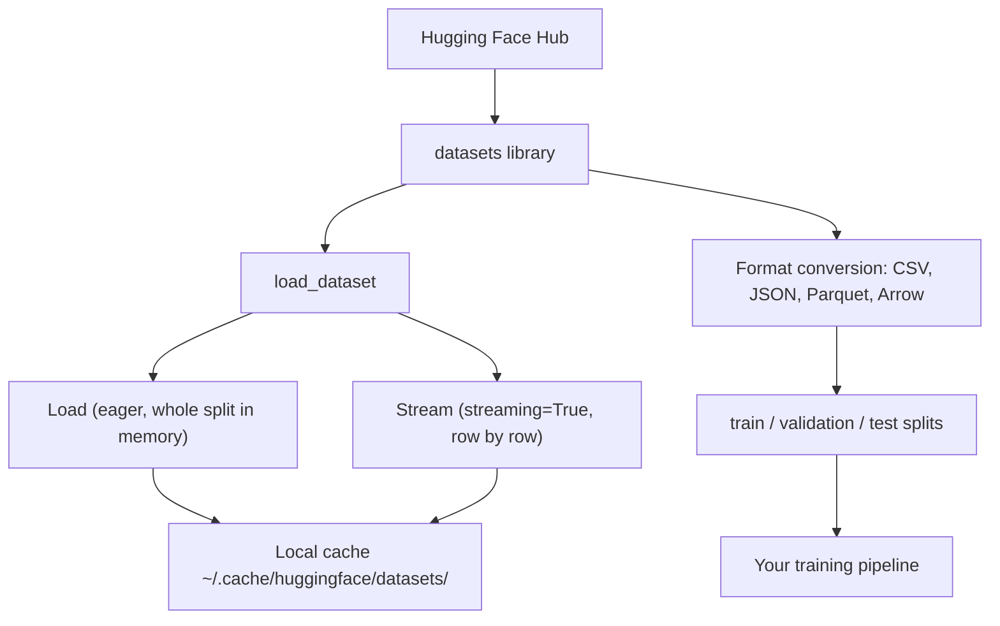
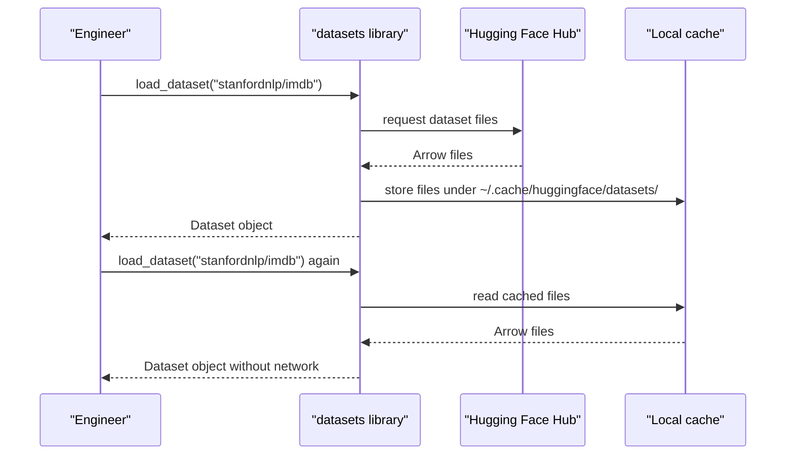
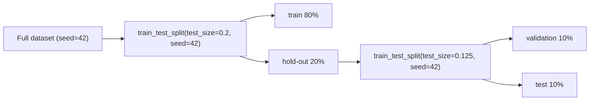

# Module 09 — Data Management

## ပြဿနာ — data လုပ်ငန်းစဉ် တစ်ခုတည်း မရှိခြင်း

AI project တိုင်းသည် data ဖြင့် စတင်သည်။ Dataset ရှာခြင်း၊ download လုပ်ခြင်း၊ format ပြောင်းခြင်း၊ training နှင့် evaluation အတွက် split ခွဲခြင်း၊
နောက် experiment ပြန်လုပ်နိုင်ရန် version ထိန်းခြင်း — ဤအလုပ်များကို လူကိုယ်တိုင် အကြိမ်တိုင်း ပြန်လုပ်ပါက နှေးပြီး အမှား များသည်။
ပြဿနာ၏ အမြစ်မှာ ထိုအလုပ်များကို **ပြန်လုပ်နိုင်သည့် လုပ်ငန်းစဉ် (repeatable workflow)** တစ်ခုအဖြစ် မသတ်မှတ်ထားခြင်း ဖြစ်သည်။

ဤ module သည် ထို လုပ်ငန်းစဉ်ကို သတ်မှတ်သည်။ အဓိက ကိရိယာ နှစ်ခု ရှိသည် —

- **`datasets`** — data load၊ stream၊ cache နှင့် format ပြောင်းခြင်းအတွက် Hugging Face ၏ library ဖြစ်သည်။
- **`huggingface_hub`** — model နှင့် file ကြီးများကို download လုပ်ပြီး cache လုပ်ခြင်းအတွက် library ဖြစ်သည်။

## အခြေခံ သဘောတရား — Hub မှ Training Pipeline အထိ



**Figure 1 — Hub မှ training pipeline အထိ data စီးဆင်းမှု**

ပုံရှင်းလင်းချက် (Figure 1)

1. Hugging Face Hub သည် dataset ၏ မူရင်း ဖိုင်များကို ထိန်းသိမ်းထားသည်။
2. `datasets` library သည် ထို Hub ကို ဖတ်ပြီး `load_dataset` function ကို ဖွင့်ပေးသည်။
3. `load_dataset` ကို ရိုးရိုး ခေါ်ပါက split တစ်ခုလုံးကို memory ထဲ ဖတ်သည် (eager)။ `streaming=True` ထည့်ပါက တစ်လိုင်းချင်း ဖတ်သည် (lazy)။
4. လမ်းကြောင်း နှစ်ခုစလုံးသည် ဖတ်လိုက်သည့် data ကို local cache ထဲ တစ်ကြိမ် သိမ်းသည်။ ဒုတိယအကြိမ် ဖတ်ပါက cache မှ ဖတ်သည်။
5. `to_csv`၊ `to_json`၊ `to_parquet` ဖြင့် format ပြောင်းပြီးနောက် split ခွဲသည်။
6. Split ခွဲပြီးသား data ကို training pipeline ထဲ ပို့သည်။

ဤပိုက်လိုင်း၏ အရေးကြီးဆုံး အချက်မှာ **အဆင့် ၄** ဖြစ်သည် — cache ရှိနှင့်ပြီးပါက နောက်တစ်ကြိမ် run ၏ latency သည် network အမြန်နှုန်းအပေါ် မမှီခိုတော့ပါ။

## Step 1: datasets library ကို install လုပ်ခြင်း

```bash
pip install datasets huggingface_hub
```

ဤ command သည် package နှစ်ခုကို install လုပ်သည်။ `datasets` သည် load၊ stream နှင့် format ပြောင်းခြင်းအတွက် ဖြစ်သည်။
`huggingface_hub` သည် model ဖိုင် တစ်ခုချင်း သို့မဟုတ် repository တစ်ခုလုံးကို download လုပ်ခြင်းအတွက် ဖြစ်သည်။
ဤ module ၏ `lab.py` သည် ထို package နှစ်ခုကို **မလိုပါ** — ထို lab သည် standard library သာ သုံးပြီး offline run သည်။

## Step 2: dataset တစ်ခု load လုပ်ခြင်း

```python
from datasets import load_dataset

dataset = load_dataset("stanfordnlp/imdb")
print(dataset)
print(dataset["train"][0])
```

ပထမလိုင်းသည် `load_dataset` function ကို ခေါ်ရန် import လုပ်သည်။
ဒုတိယလိုင်းသည် IMDB movie review dataset ကို download လုပ်ပြီး load သည်။
တတိယလိုင်းသည် split စာရင်း နှင့် row အရေအတွက် ကို print သည်။
စတုတ္ထလိုင်းသည် train split ၏ ပထမဆုံး example ကို print သည်။

ပထမအကြိမ် download ပြီးသောအခါ data သည် `~/.cache/huggingface/datasets/` တွင် သိမ်းသည်။ ထို့နောက် run တိုင်းသည် cache မှ ဖတ်သည်။



**Figure 2 — ပထမအကြိမ် download နှင့် ဒုတိယအကြိမ် cache ဖတ်ခြင်း**

ပုံရှင်းလင်းချက် (Figure 2)

1. Engineer သည် `load_dataset` ကို ခေါ်သည်။
2. library သည် Hub သို့ ဖိုင် တောင်းသည်။
3. Hub သည် Arrow format ဖိုင်များကို ပြန်ပေးသည်။
4. library သည် ထိုဖိုင်များကို local cache ထဲ ရေးသည်။
5. ဒုတိယအကြိမ် ခေါ်ပါက library သည် Hub ကို လုံးဝ မဆက်သွယ်တော့ဘဲ cache မှ ဖတ်သည်။ ထို့ကြောင့် ဒုတိယအကြိမ် သည် အလွန် မြန်သည်။

## Step 3: dataset ကြီးများကို stream လုပ်ခြင်း

Dataset အချို့သည် disk ထဲ မဆံ့နိုင်လောက်အောင် ကြီးသည်။ Streaming သည် ဖိုင်တစ်ခုလုံးကို download မလုပ်ဘဲ တစ်လိုင်းချင်း ဖတ်သည်။

```python
dataset = load_dataset("wikimedia/wikipedia", "20231101.en", split="train", streaming=True)

for i, example in enumerate(dataset):
    print(example["title"])
    if i >= 4:
        break
```

ပထမလိုင်းသည် dataset အမည်၊ config အမည် (`20231101.en`)၊ split နှင့် `streaming=True` ကို ပေးသည်။
`streaming=True` သည် eager loading အစား `IterableDataset` တစ်ခုကို ပြန်ပေးသည်။ `IterableDataset` တွင် `len()` မရှိပါ — row များကို အစဉ်လိုက် ဖတ်ရသည်။
`for` loop သည် row တစ်ခုချင်း လာသည့်အခါ ရေတွက်ပြီး `i >= 4` ဖြစ်ပါက ရပ်သည်။

အရေးကြီးသည့် အချက် — **memory အသုံးပြုမှုသည် dataset အရွယ်အစားနှင့် မသက်ဆိုင်ဘဲ ကိန်းသေ (constant) ဖြစ်သည်**။
ထို့ကြောင့် disk ထဲ မဆံ့သည့် dataset ကို ကိုင်တွယ်နိုင်သည်။ သို့သော် streaming တွင် random access မရနိုင်ပါ — နောက်သို့ ပြန်ကြည့်လိုပါက shuffle buffer သို့မဟုတ် local snapshot ကို သုံးရသည်။

## Step 4: dataset format များ

`datasets` library သည် အတွင်းပိုင်းတွင် **Apache Arrow** ကို သုံးသည်။ လိုအပ်ချက်အလိုက် အခြား format သို့ ပြောင်းနိုင်သည်။

```python
dataset = load_dataset("stanfordnlp/imdb", split="train")

dataset.to_csv("imdb_train.csv")
dataset.to_json("imdb_train.json")
dataset.to_parquet("imdb_train.parquet")
```

လိုင်းတိုင်းသည် split တစ်ခုလုံးကို ဖိုင် တစ်ခုအဖြစ် ရေးသည်။ `to_csv` သည် လူဖတ်နိုင်သည့် ဖိုင်၊ `to_json` သည် nested data အတွက်၊ `to_parquet` သည် columnar ဖိုင် ဖြစ်သည်။

| Format | Size | Read Speed | Best For |
|---|---|---|---|
| CSV | Large | Slow | Human readability, spreadsheets |
| JSON | Large | Slow | APIs, nested data |
| Parquet | Small | Fast | Analytics, columnar queries |
| Arrow | Small | Fastest | In-memory processing (what `datasets` uses internally) |

AI အလုပ်အတွက် **Parquet သည် အကောင်းဆုံး storage format** ဖြစ်သည်။ **Arrow သည် memory ထဲတွင် အလုပ်လုပ်သည့် format** ဖြစ်သည်။
**CSV နှင့် JSON သည် interchange** အတွက် ဖြစ်သည် — လူတစ်ဦး ဖတ်ရန် သို့မဟုတ် အခြား system တစ်ခုသို့ ပို့ရန် ဖြစ်သည်။
Size နှင့် read speed ကွာခြားချက်၏ အကြောင်းရင်းမှာ columnar သိုလှောင်မှု ဖြစ်သည် — column တစ်ခုတည်းကို ဖတ်ပါက ကျန် column များကို ဖတ်ရန် မလိုပါ။

## Step 5: data split များ

ML project တိုင်းတွင် split သုံးခု လိုသည် —

- **Train** — model သည် ဤ split မှ သင်သည် (ပုံမှန် ၈၀%)။
- **Validation** — training အတွင်း တိုးတက်မှုကို စစ်သည် (ပုံမှန် ၁၀%)။
- **Test** — training ပြီးဆုံးသည့်နောက် နောက်ဆုံး အကဲဖြတ်မှု (ပုံမှန် ၁၀%)။

Dataset အချို့သည် split ခွဲပြီးသား လာသည်။ မပါပါက ကိုယ်တိုင် ခွဲရသည် —

```python
dataset = load_dataset("stanfordnlp/imdb", split="train")

split = dataset.train_test_split(test_size=0.2, seed=42)
train_val = split["train"].train_test_split(test_size=0.125, seed=42)

train_ds = train_val["train"]
val_ds = train_val["test"]
test_ds = split["test"]

print(f"Train: {len(train_ds)}, Val: {len(val_ds)}, Test: {len(test_ds)}")
```



**Figure 3 — split နှစ်ဆင့်ဖြင့် 80/10/10 ခွဲခြင်း**

ပုံရှင်းလင်းချက် (Figure 3)

1. Dataset တစ်ခုလုံးကို အရင်ခွဲသည် — `test_size=0.2` ဖြစ်သောကြောင့် ၂၀% ကို hold-out အဖြစ် ဖယ်သည်။
2. ကျန် ၈၀% ကို train အဖြစ် သိမ်းထားသည်။
3. Hold-out ဖြစ်သည့် ၂၀% ကို ထပ်ခွဲသည် — `test_size=0.125` သည် ထို ၂၀% ၏ ၁၂.၅% ဖြစ်သောကြောင့် မူရင်း dataset ၏ ၂.၅% မဟုတ်ဘဲ **၁၀%** ဖြစ်သည်။
4. ရလဒ်သည် validation ၁၀% နှင့် test ၁၀% ဖြစ်သည်။
5. ဤနည်းလမ်းဖြင့် မူရင်း ၈၀/၁၀/၁၀ အချိုးကို မိတ္တူ ဖန်တီးသည်။

**seed ကို အမြဲ သတ်မှတ်ရမည်**။ `seed=42` ကို ပေးပါက split သည် run တိုင်းတွင် တူညီသည်။
Seed မပါပါက run တစ်ခုနှင့် တစ်ခု split မတူတော့ဘဲ experiment ပြန်လုပ်နိုင်မှု (reproducibility) ပျက်သည်။
ဤ module ၏ lab သည် 80/10/10 အစား **70/15/15** ကို သုံးသည် — `MODULE_SPEC.md` တွင် သတ်မှတ်ထားသည့် အချိုး ဖြစ်သည်။ မူဝါဒ တူညီသည်။

## Step 6: model များကို download လုပ်ပြီး cache လုပ်ခြင်း

Model များသည် ဖိုင်ကြီးများ ဖြစ်သည်။ `huggingface_hub` သည် download နှင့် cache ကို ထိန်းသည်။

```python
from huggingface_hub import hf_hub_download, snapshot_download

model_path = hf_hub_download(
    repo_id="sentence-transformers/all-MiniLM-L6-v2",
    filename="config.json"
)
print(f"Cached at: {model_path}")

model_dir = snapshot_download("sentence-transformers/all-MiniLM-L6-v2")
print(f"Full model at: {model_dir}")
```

`hf_hub_download` သည် **ဖိုင် တစ်ခုတည်း** ကို ရယူသည်။ ထို့ကြောင့် `config.json` တစ်ခုတည်း လိုသည့်အခါ သင့်တော်သည်။
`snapshot_download` သည် **repository တစ်ခုလုံး** ကို ရယူသည်။ ထို့ကြောင့် model weight အားလုံး လိုသည့်အခါ သင့်တော်သည်။
Model များသည် `~/.cache/huggingface/hub/` တွင် cache ဖြစ်သည်။ တစ်ကြိမ် download ပြီးပါက နောက် run တွင် ချက်ချင်း load ဖြစ်သည်။

## Step 7: ဖိုင်ကြီးများကို ကိုင်တွယ်ခြင်း

Model weight နှင့် dataset ကြီးများကို git ထဲ မထည့်ရ။ ရွေးချယ်စရာ သုံးမျိုး ရှိသည်။

**Option A: .gitignore (အလွယ်ဆုံး)**

```
*.bin
*.safetensors
*.pt
*.onnx
data/*.parquet
data/*.csv
models/
```

ဤ pattern များကို `.gitignore` ထဲ ထည့်ပါက `git status` သည် ထိုဖိုင်များကို လုံးဝ မပြပါ။ အားနည်းချက်မှာ ဖိုင် မည်သည့် version ဖြစ်သည်ကို git က မသိနိုင်ခြင်း ဖြစ်သည်။

**Option B: Git LFS (large file ကို git ထဲ လမ်းညွှန်ချက်ဖြင့် ထည့်ခြင်း)**

```bash
git lfs install
git lfs track "*.bin"
git lfs track "*.safetensors"
git add .gitattributes
```

ပထမလိုင်းသည် မိမိ machine တွင် Git LFS ကို တစ်ကြိမ် setup လုပ်သည်။
ဒုတိယနှင့် တတိယလိုင်းသည် မည်သည့် pattern ကို LFS ဖြင့် ထိန်းမည်ကို သတ်မှတ်သည်။ ထို သတ်မှတ်ချက်သည် `.gitattributes` ဖိုင်ထဲ ရေးသည်။
Git LFS သည် repository ထဲတွင် **pointer** သာ ထားပြီး ဖိုင်အစစ်ကို သီးခြား server တွင် သိမ်းသည်။ GitHub သည် **1 GB free** ပေးသည်။

**Option C: DVC (data version control)**

```bash
pip install dvc
dvc init
dvc add data/training_set.parquet
git add data/training_set.parquet.dvc data/.gitignore
git commit -m "Track training data with DVC"
```

`dvc init` သည် repository ထဲ DVC ကို စသည်။ `dvc add` သည် data ဖိုင်ကို DVC ထဲ ထည့်ပြီး ဖိုင်၏ hash ကို မှတ်သည့် `.dvc` ဖိုင် အသေးစားတစ်ခု ဖန်တီးသည်။
`git add` နှင့် `git commit` သည် ထို `.dvc` ဖိုင်ကို git history ထဲ ထည့်သည်။
Data အစစ်သည် S3၊ GCS သို့မဟုတ် အခြား remote storage backend တွင် နေသည်။

| Approach | Complexity | Best For |
|---|---|---|
| .gitignore | Low | Personal projects, downloaded data you can re-fetch |
| Git LFS | Medium | Teams sharing model weights via git |
| DVC | High | Reproducible experiments, large datasets, teams |

ဤ course အတွက် **`.gitignore` သည် လုံလောက်သည်**။ machine အသီးသီးတွင် experiment အတိအကျ ပြန်လုပ်ရန် လိုပါက DVC ကို သုံးရသည်။
ဖော်ပြထားသည့် storage quota (ဥပမာ GitHub ၏ 1 GB) သည် **version အလိုက် ပြန်စစ်ရန် လိုသည်**။

## Step 8: storage pattern များ

**Local storage** သည် **~10 GB အောက်** dataset များအတွက် သင့်တော်သည်။ HF cache သည် ထို အလုပ်ကို အလိုအလျောက် လုပ်သည်။

```python
import os

local_path = os.path.expanduser("~/.cache/huggingface/datasets/")

# s3_path = "s3://my-bucket/datasets/"
# gcs_path = "gs://my-bucket/datasets/"
```

`os.path.expanduser` သည် `~` ကို မိမိ home directory အမည်အစစ်ဖြင့် အစားထိုးသည်။ ထို့ကြောင့် path သည် machine တိုင်းတွင် မှန်သည်။
အောက်လိုင်း နှစ်လိုင်းသည် comment ဖြစ်သည် — remote GPU instance ပေါ်တွင် fine-tune လုပ်သည့်အခါ cloud path ကို သုံးရန် ရည်ရွယ်သည်။

DVC သည် S3 နှင့် GCS နှင့် တိုက်ရိုက် ချိတ်သည် —

```bash
dvc remote add -d myremote s3://my-bucket/dvc-store
dvc push
```

ပထမလိုင်းသည် `dvc-store` bucket ကို default remote အဖြစ် သတ်မှတ်သည်။
ဒုတိယလိုင်းသည် local cache ထဲရှိ data ကို ထို remote သို့ တင်သည်။ ထို့ကြောင့် အခြား machine တစ်ခုတွင် `dvc pull` ဖြင့် တူညီသည့် data ကို ပြန်ရနိုင်သည်။

ဤ course အတွက် local storage လုံလောက်သည်။ Remote GPU instance ပေါ်တွင် fine-tune လုပ်သည့်အခါ cloud storage သည် သက်ဆိုင်လာသည်။

## Datasets Used in This Course

| Dataset | Lessons | Size | What It Teaches |
|---|---|---|---|
| IMDB | Tokenization, classification | 84 MB | Text classification basics |
| WikiText | Language modeling | 181 MB | Next-token prediction |
| SQuAD | QA systems | 35 MB | Question answering, spans |
| Common Crawl (subset) | Embeddings | Varies | Large-scale text processing |
| MNIST | Vision basics | 21 MB | Image classification fundamentals |
| COCO (subset) | Multimodal | Varies | Image-text pairs |

ဤ dataset အားလုံးကို ယခု ချက်ချင်း download လုပ်ရန် မလိုပါ။ lesson တိုင်းသည် မိမိ လိုအပ်သည့် dataset ကို သတ်မှတ်သည်။

## Operational cautions — လုပ်ငန်းတွင် သတိထားရန်

1. **Seed မပါသော split ဖြင့် experiment မလုပ်ရ။** Seed မရှိပါက validation နှင့် test သည် run တိုင်းတွင် ပြောင်းနေပြီး metric နှိုင်းယှဉ်မှု အဓိပ္ပာယ် မရှိတော့ပါ။
2. **Test split ကို တစ်ကြိမ်ထက်ပို၍ မသုံးရ။** Test ဖြင့် hyperparameter ချိန်ပါက test သည် validation အဖြစ် ပြောင်းသွားပြီး အကဲဖြတ်မှု၏ ဘက်လိုက်မှု ကင်းမဲ့ခြင်း ပျက်သည်။
3. **Streaming နှင့် shuffle။** `streaming=True` တွင် random access မရပါ။ ထို့ကြောင့် shuffle လုပ်လိုပါက buffer တစ်ခု လိုသည်။ buffer သည် memory ကို ယူသည် — buffer အရေအတွက်နှင့် memory သည် အချိုးကျသည်။
4. **Cache သည် disk ကို တိတ်တဆိတ် ဖြည့်သည်။** `~/.cache/huggingface/` သည် GB ရာနှင့်ချီ ယူနိုင်သည်။ Dataset အသစ် download မလုပ်မီ `df -h` ဖြင့် နေရာ လွတ်ကို စစ်ပါ။
5. **`len()` ကို မယူမိရန်။** `IterableDataset` တွင် `len()` မရှိပါ။ streaming dataset ကို `len()` လုပ်ပါက ဖိုင် တစ်ခုလုံးကို ဖတ်ပြီး streaming ၏ အကျိုးကျေးဇူး ပျက်သည်။
6. **Format ပြောင်းခြင်းသည် ဖိုင် အသစ် ဖန်တီးသည်။** `to_parquet` သည် မူရင်း cache ကို မဖျက်ပါ။ ထို့ကြောင့် disk အသုံးပြုမှုသည် နှစ်ဆ ဖြစ်နိုင်သည်။
7. **`.dvc` ဖိုင်ကို git ထဲ ထည့်ရမည်။** Data အစစ်ကို git ထဲ မထည့်ရသည့်အခါ `.dvc` ဖိုင် (hash ပါသည်) သည် version ထိန်းရန် တစ်ခုတည်းသော နည်းလမ်း ဖြစ်သည်။ မေ့ပါက DVC ၏ အကျိုးကျေးဇူး မရပါ။

## ကိုယ်တိုင် စစ်ဆေးခြင်း (Self-check)

**မေးခွန်း ၁။** Parquet သည် CSV ထက် storage format အဖြစ် ဘာကြောင့် ပိုကောင်းသည်?

*အဖြေ။* Parquet သည် columnar binary format ဖြစ်သောကြောင့် ပိုကောင်းစွာ compress လုပ်နိုင်ပြီး column အဆင့် ဖတ်ခြင်း မြန်သည်။ CSV သည် စာလုံး ဖြင့် ရေးထားသည့် row-based format ဖြစ်သောကြောင့် ဖိုင် ကြီးပြီး ဖတ်ရ နှေးသည်။

**မေးခွန်း ၂။** `streaming=True` သည် ဘာလုပ်သည်?

*အဖြေ။* ဖိုင် တစ်ခုလုံးကို disk သို့ download မလုပ်ဘဲ row တစ်ခုချင်း လိုသည့်အခါ ဖတ်သည်။ ရလဒ်သည် `IterableDataset` ဖြစ်ပြီး memory အသုံးပြုမှုသည် dataset အရွယ်အစားနှင့် မသက်ဆိုင်ဘဲ ကိန်းသေ ဖြစ်သည်။

**မေးခွန်း ၃။** train / validation / test split သုံးခု ဘာကြောင့် လိုသည်?

*အဖြေ။* Train သည် model ကို သင်သည်။ Validation သည် training အတွင်း hyperparameter နှင့် ရပ်သည့်အချိန်ကို ဆုံးဖြတ်သည်။ Test သည် နောက်ဆုံးတွင် မမြင်ဖူးသေးသည့် data ပေါ် unbiased အကဲဖြတ်မှု ပေးသည်။ Split တစ်ခုတည်းသာ ရှိပါက overfitting ကို မခွဲခြားနိုင်ပါ။

**မေးခွန်း ၄။** `.gitignore` နှင့် DVC ကို မည်သည့်အခါ ခွဲသုံးရမည်?

*အဖြေ။* ဖိုင် ကို ပြန်ရယူနိုင်ပါက (download လုပ်နိုင်သည့် dataset) `.gitignore` လုံလောက်သည်။ Machine အသီးသီးတွင် experiment အတိအကျ ပြန်လုပ်ရန် လိုပါက data ၏ version ကို မှတ်ရန် DVC လိုသည်။

**မေးခွန်း ၅။** Seed သည် reproducibility အတွက် ဘာကြောင့် လိုသည်?

*အဖြေ။* `train_test_split` သည် row များကို random အစဉ်ဖြင့် ရောသည်။ Seed တူညီပါက ရောသည့် အစဉ်လည်း တူညီသည်။ ထို့ကြောင့် run တိုင်းတွင် split တူညီပြီး metric နှိုင်းယှဉ်နိုင်သည်။

## Technical review notes

- ဤ module ၏ command၊ function အမည်၊ cache path နှင့် size ကိန်းဂဏန်း အားလုံးသည် captured source lesson (`09-data-management__en.md`) နှင့် ၎င်း၏ `code/data_utils.py` မှ တိုက်ရိုက် ယူထားသည်။ Source တွင် မပါသည့် version ကို ဖော်ပြခြင်း မပြုပါ။
- Source ၏ split ဥပမာသည် **80/10/10** (`test_size=0.2` ထို့နောက် `test_size=0.125`, `seed=42`) ဖြစ်သည်။ ၎င်းကို မပြင်ဘဲ ဖော်ပြထားသည်။ Lab နှင့် exercise များတွင် သုံးသည့် **70/15/15** သည် `MODULE_SPEC.md` ၏ Module 09 exercise ၃ မှ လာသည် — source ၏ 80/10/10 နှင့် ကွဲပြားသည့်အတွက် ဤနေရာတွင် မှတ်ထားသည်။
- Source ၏ `code/data_utils.py` သည် network နှင့် `datasets` package ကို လိုသည်။ ဤ course ၏ lab စည်းမျဉ်း (standard library သာ၊ offline) နှင့် မကိုက်ညီသည့်အတွက် lab သည် source ၏ function အမည်များကို ယူပြီး stdlib (`csv`၊ `json`၊ `tracemalloc`၊ `random.Random`) ဖြင့် ပြန်ရေးထားသည်။ သဘောတရား တူညီသည်။
- `GitHub gives you 1 GB free` ဟူသည့် ကိန်းဂဏန်းသည် source တွင် ပါသည့်အတိုင်း ဖော်ပြထားသည်။ Quota မူဝါဒသည် **version အလိုက် ပြန်စစ်ရန် လိုသည်**။
- Parquet နှင့် Arrow ၏ byte အရွယ်အစားကို lab တွင် **ဖော်ပြခြင်း မပြုပါ** — standard library ဖြင့် ထို format နှစ်မျိုးကို ရေး၍ မရနိုင်သောကြောင့် တိုင်းတာနိုင်သည့် ကိန်းဂဏန်း မရှိပါ။ မတိုင်းတာရသေးသည့် ကိန်းဂဏန်းကို တီးလုပ်ခြင်း မပြုပါ။ CSV နှင့် JSON ၏ byte အရေအတွက်ကိုသာ တကယ် တိုင်းထားသည်။
- Lab ၏ memory ကိန်းဂဏန်းသည် 64 KiB bucket အထိ round up လုပ်ထားသည်။ `tracemalloc` ၏ raw peak သည် allocator အလိုက် run တိုင်းတွင် KB အနည်းငယ် လှုပ်ရှားနိုင်သည့်အတွက် bucket ဖြင့် ပြသည်။

## References & Further Reading

- Source lesson: `phases/00-setup-and-tooling/09-data-management/docs/en.md` — https://aiengineeringfromscratch.com/lesson?path=phases%2F00-setup-and-tooling%2F09-data-management
- Source repository (MIT): https://github.com/rohitg00/ai-engineering-from-scratch
- Source code: `phases/00-setup-and-tooling/09-data-management/code/data_utils.py`
- Hugging Face `datasets` documentation — https://huggingface.co/docs/datasets
- Hugging Face Hub client (`huggingface_hub`) documentation — https://huggingface.co/docs/huggingface_hub
- Apache Arrow documentation — https://arrow.apache.org/docs/
- Apache Parquet documentation — https://parquet.apache.org/docs/
- Git LFS documentation — https://git-lfs.com/
- DVC documentation — https://dvc.org/doc
- Python standard library — `csv`၊ `json`၊ `tracemalloc`၊ `random`၊ `tempfile` — https://docs.python.org/3/library/
