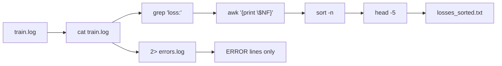
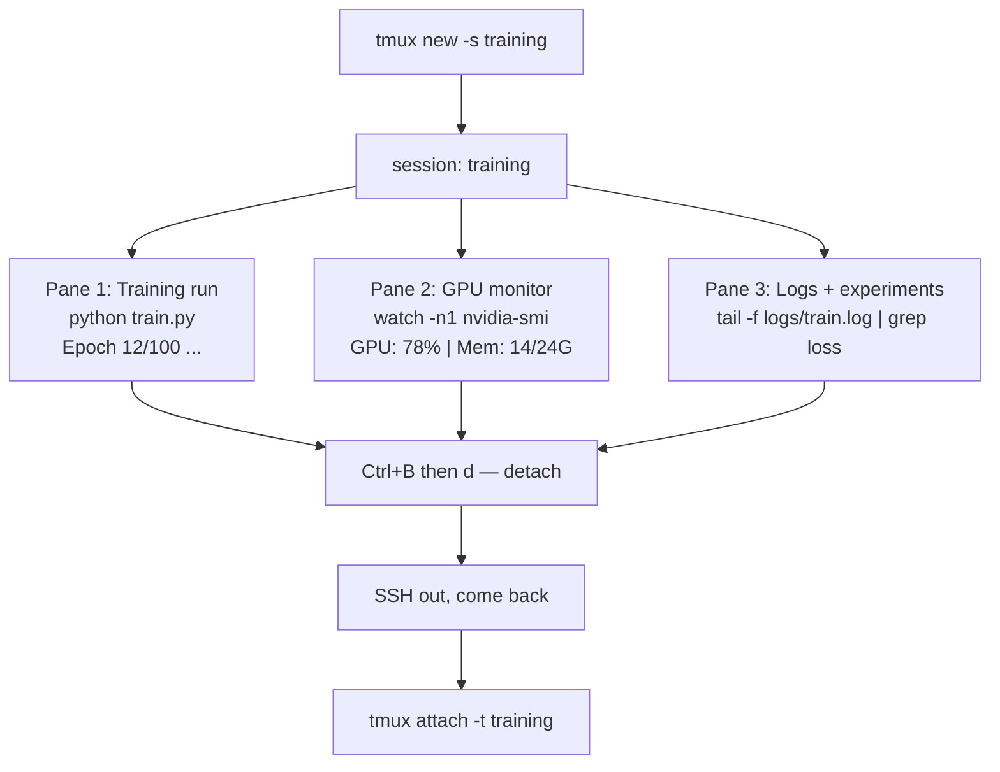
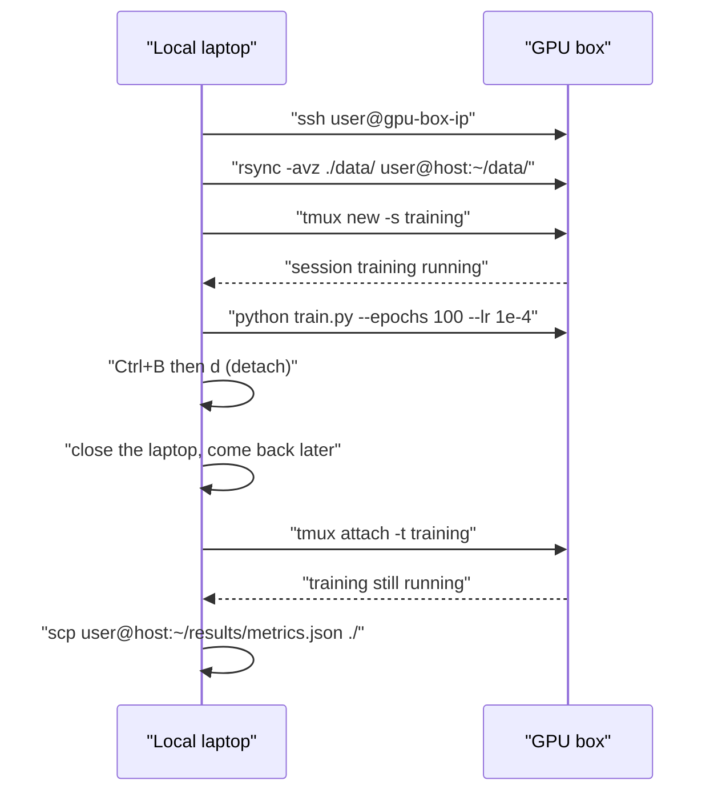

# Module 10 — Terminal & Shell

AI engineer တစ်ဦး၏ အလုပ်အများစုသည် terminal တွင် ဖြစ်ပေါ်သည်။ training run စတင်ခြင်း၊ GPU ၏ အခြေအနေ ကြည့်ရှုခြင်း၊
log ဖိုင်ကို အချိန်နှင့်တစ်ပြေးညီ ဖတ်ခြင်း၊ remote GPU machine သို့ SSH ဖြင့် ဝင်ရောက်ခြင်း — ဤအလုပ်အားလုံးသည်
shell ကို ဖြတ်သန်းသည်။ ဤ module သည် Unix သမိုင်း သို့မဟုတ် Bash scripting အနက်ကို မဟုတ်ဘဲ AI အလုပ်အတွက်
လိုအပ်သည့် terminal ကျွမ်းကျင်မှုကိုသာ သင်ပေးသည်။

ဤ module ကို ပြီးစီးပါက `grep`၊ pipe နှင့် redirect ဖြင့် training log ကို စစ်ထုတ် စီမံနိုင်မည်၊ pane များစွာ ပါသည့်
`tmux` session ကို ဖန်တီး၍ detach/reattach လုပ်နိုင်မည်၊ `htop`၊ `nvtop` နှင့် `nvidia-smi` ဖြင့် resource ကို
ကြည့်ရှုနိုင်မည်၊ `ssh`၊ `scp` နှင့် `rsync` ဖြင့် ဖိုင်များကို ရွှေ့နိုင်မည် ဖြစ်သည်။

---

## ၁။ ပြဿနာ — log ဖိုင်ကြီး တစ်ခုမှ အချက်အလက် ရှာခြင်း

training တစ်ကြိမ်သည် နာရီ ၂၀ ကြာနိုင်သည်။ ထိုအတွင်း `train.log` သည် လိုင်းရာထောင်ချီ ရေးသည်။ လူတစ်ဦးသည်
ထိုလိုင်းများကို editor ဖြင့် ဖတ်လျှင် အနှစ်ချုပ် ရရှိရန် နာရီပေါင်းများစွာ ကုန်သည်။ ပို၍ အရေးကြီးသည့် ပြဿနာမှာ
ထိုအလုပ်ကို **တစ်ကြိမ်တည်း** မဟုတ်ဘဲ နေ့တိုင်း ထပ်ခါတလဲလဲ လုပ်ရခြင်း ဖြစ်သည်။

ထို့ကြောင့် လိုအပ်သည်မှာ —

- လိုင်းရာထောင်ချီထဲမှ **စိတ်ဝင်စားသည့် လိုင်းများကိုသာ** ဆွဲထုတ်နိုင်ခြင်း (`grep`)။
- ဆွဲထုတ်သည့် ရလဒ်ကို **ရေတွက်၊ စီ၊ ဖြတ်** နိုင်ခြင်း (`wc`၊ `sort`၊ `head`၊ `tail`၊ `awk`)။
- ရလဒ်ကို **ဖိုင်အဖြစ် သိမ်း** နိုင်ခြင်း (`>`၊ `>>`)။
- training နာရီပေါင်းများစွာ ပြေးနေစဉ် terminal ကို ပိတ်လိုက်လျှင်လည်း အလုပ် **မရပ်တန့်** ခြင်း (`tmux`)။
- resource ပြဿနာ (OOM၊ နှေးကွေးမှု) ကို **အချိန်နှင့်တစ်ပြေးညီ** မြင်နိုင်ခြင်း (`htop`၊ `nvtop`၊ `nvidia-smi`)။

ဤငါးချက်ကို ပေါင်းစည်းလိုက်သည့်အခါ terminal တစ်ခုတည်းတွင် training run၊ GPU monitor နှင့် log tail
ကို တစ်ပြိုင်နက် လည်ပတ်စေနိုင်သည်။ ဤ module ၏ ကျန်အခန်းများသည် ထိုပေါင်းစည်းမှုကို လက်တွေ့ တည်ဆောက်ပေးသည်။

---

## ၂။ အခြေခံ သဘောတရား — shell သည် လုပ်ငန်းစဉ်များကို ချိတ်ဆက်သည့် ကိရိယာ

### ၂.၁ မိမိ shell ကို သိရှိခြင်း

`echo $SHELL` သည် လက်ရှိ login shell ၏ လမ်းကြောင်းကို ပြသည်။ ရလဒ်သည် `/bin/bash` သို့မဟုတ် `/bin/zsh`
ကဲ့သို့ ဖြစ်သည်။ system အများစုသည် `bash` သို့မဟုတ် `zsh` ကို သုံးသည်။ ဤ course ၏ command များသည်
နှစ်မျိုးလုံးတွင် အလုပ်လုပ်သည်။ မည်သည့် shell ဖြစ်သည်ကို မသိဘဲ ရှေ့ဆက်ခြင်း မပြုရ — အကြောင်းမှာ
`~/.bashrc` နှင့် `~/.zshrc` သည် မတူညီသည့် ဖိုင်များ ဖြစ်သည်။ alias ကို မှားသည့်ဖိုင်တွင် ရေးလျှင် အလုပ်မလုပ်ပါ။

### ၂.၂ pipe နှင့် redirect

**pipe** (`|`) သည် command တစ်ခု၏ stdout ကို နောက် command တစ်ခု၏ stdin အဖြစ် ပေးပို့သည်။
**redirect** (`>`၊ `>>`၊ `2>`) သည် stdout/stderr ကို ဖိုင်သို့ လမ်းလွှဲသည်။ ဤနှစ်ခုသည် log processing ၏
အခြေခံ ဖြစ်သည်။

Figure 1 သည် ဤ module တွင် အကြိမ်အများဆုံး အသုံးပြုသည့် လုပ်ငန်းစဉ်ကို ပြသည် — `cat` မှစ၍
`grep`၊ `awk`၊ `sort`၊ `head` ဖြင့် ဆင့်ကဲ စစ်ထုတ်ပြီး နောက်ဆုံး ဖိုင်တစ်ခုသို့ သိမ်းသည်။ error လိုင်းများကို
သီးခြား လမ်းလွှဲသည့် အကိုင်းကိုလည်း ထည့်ပြထားသည်။



**Figure 1 — training log ကို စစ်ထုတ်သည့် shell pipeline**

ပုံရှင်းလင်းချက် (Figure 1)

1. `cat train.log` သည် ဖိုင်တစ်ခုလုံးကို ဖတ်၍ pipe ထဲ ထည့်သည်။ ဤအဆင့်တွင် လိုင်း ၁၀၆ လိုင်း ရှိသည်။
2. `grep 'loss:'` သည် `loss:` ပါသည့် လိုင်းများကိုသာ ဆက်လွှတ်သည်။ ဤအဆင့်တွင် လိုင်း ၁၀၀ လိုင်း ဖြစ်သည်။
3. `awk '{print $NF}'` သည် လိုင်းတိုင်း၏ နောက်ဆုံး field ကို ဆွဲထုတ်သည် — ထို field သည် loss တန်ဖိုး ဖြစ်သည်။
4. `sort -n` သည် နံပါတ်အနေဖြင့် အငယ်စဉ် စီသည်။
5. `head -5` သည် အနိမ့်ဆုံး ၅ ခုကို ယူသည်။
6. `> losses_sorted.txt` သည် ထို ၅ လိုင်းကို ဖိုင်အဖြစ် ရေးသည်။ ဖိုင်ရှိနှင့်ပါက ဖုံးလွှမ်းသည်။
7. `2> errors.log` အကိုင်းသည် stdout မဟုတ်ဘဲ stderr ကို သီးခြားဖိုင် သိမ်းသည့် လမ်းလွှဲကို ပြသည်။

### ၂.၃ နောက်ခံတွင် လုပ်ဆောင်ခြင်း

training run သည် နာရီပေါင်းများစွာ ကြာသည်။ terminal ကို ဖွင့်ထားရန် မလိုအပ်သည့် နည်းလမ်းသုံးမျိုး ရှိသည်။
ထို သုံးမျိုး၏ ကွာခြားချက်ကို အောက်ပါ ဇယားတွင် ဖော်ပြထားသည်။

| နည်းလမ်း | terminal ပိတ်လျှင် ဆက်လုပ်သလား | ပြန်ဝင်နိုင်သလား |
|---|---|---|
| `command &` | မဆက်လုပ်ပါ | မဝင်နိုင်ပါ |
| `nohup command &` | ဆက်လုပ်သည် | မဝင်နိုင်ပါ (log ဖိုင်ကို ကြည့်ရသည်) |
| `screen` / `tmux` | ဆက်လုပ်သည် | ဝင်နိုင်သည် |

မိနစ်အနည်းငယ်ထက် ကြာသည့် အလုပ်တိုင်းအတွက် `tmux` ကို သုံးရမည်။ `nohup` သည် အလုပ်ကို မရပ်တန့်စေသော်လည်း
ပြန်ဝင်ကြည့်နိုင်သည့် စွမ်းရည် မရှိပါ။

---

## ၃။ လက်တွေ့ တည်ဆောက်ခြင်း

### ၃.၁ လမ်းကြောင်း ရွှေ့ခြင်း နှင့် အခြေခံ လုပ်ဆောင်ချက်များ

```bash
# Move around
cd ~/projects/ai-engineering-from-scratch
pwd
ls -la
```

`cd ~/projects/ai-engineering-from-scratch` သည် အလုပ်လုပ်သည့် လမ်းကြောင်းကို ပြောင်းသည်။
`pwd` သည် လက်ရှိ လမ်းကြောင်းအပြည့်အစုံကို ပြသည်။ `ls -la` သည် ဖိုင်အားလုံးကို (`.` ဖြင့် စသည့် ဖိုင်များ အပါ)
အခွင့်အရေး၊ ပိုင်ရှင်၊ အရွယ်အစားနှင့်တကွ ပြသည်။ ကျရှုံးပါက လမ်းကြောင်း အမည် မှန်မမှန် ပြန်စစ်ရမည်။

မှတ်ထားသင့်သည့် ကီးများ —

- `Ctrl+R` — ယခင် command ကို ရှာသည်။ ထပ်နှိပ်လျှင် နောက် ကိုက်ညီမှုသို့ ဆက်သွားသည်။
- `clear` သို့မဟုတ် `Ctrl+L` — မျက်နှာပြင်ကို ရှင်းသည်။
- `Ctrl+C` — ပြေးနေသည့် command ကို ရပ်သည်။
- `Ctrl+Z` — ပြေးနေသည့် command ကို suspend လုပ်သည်။ နောက်တစ်ကြိမ် `fg` ဖြင့် ပြန်ယူသည်။

### ၃.၂ log ကို pipe ဖြင့် စစ်ထုတ်ခြင်း

```bash
# Count how many times "loss" appears in a log
cat train.log | grep "loss" | wc -l

# Extract just the loss values from training output
grep "loss:" train.log | awk '{print $NF}' > losses.txt

# Watch a log file update in real time, filtering for errors
tail -f train.log | grep --line-buffered "ERROR"

# Sort experiments by final accuracy
grep "final_accuracy" results/*.log | sort -t= -k2 -n -r

# Redirect stdout and stderr to separate files
python train.py > output.log 2> errors.log

# Redirect both to the same file
python train.py > train_full.log 2>&1
```

- `grep "loss"` သည် ထို စကားလုံး ပါသည့် လိုင်းများသာ ထုတ်သည်။ `wc -l` သည် အရေအတွက်ကို ရေတွက်သည်။
- `awk '{print $NF}'` သည် လိုင်းတိုင်း၏ နောက်ဆုံး field ကို ထုတ်သည်။ `$NF` သည် "နောက်ဆုံး field" ဟု
  အဓိပ္ပာယ်ရသည်။
- `tail -f` သည် ဖိုင်၏ အဆုံးမှ လိုင်းများကို ပြပြီး ဖိုင်ကြီးလာသည်နှင့် ဆက်ပြသည်။ `--line-buffered` သည်
  pipe အတွင်း လိုင်းတိုင်း တစ်ချက်ချင်း ပို့စေရန် `grep` ကို ခိုင်းသည်။ ဤ option မပါလျှင် ရလဒ် နောက်ကျပြီး
  မြင်ရသည်။
- `sort -t= -k2 -n -r` သည် `=` ကို အပိုင်းခြားအဖြစ် ယူ၍ ဒုတိယ field ကို နံပါတ်အနေဖြင့် ကြီးစဉ် စီသည်။
- `>` သည် stdout ကို ဖိုင်သို့ ရေးသည် (ရှိပြီးသား အကြောင်းအရာကို ဖုံးလွှမ်းသည်)၊ `>>` သည် အဆုံးတွင်
  ထပ်ဖြည့်သည်၊ `2>` သည် stderr ကို သီးခြားဖိုင် ရေးသည်၊ `2>&1` သည် stderr ကို stdout ရှိရာသို့ ပို့သည်။

### ၃.၃ နောက်ခံတွင် ပြေးစေခြင်း

```bash
# Run in background (output still goes to terminal)
python train.py &

# Run in background, immune to hangup (closing terminal won't kill it)
nohup python train.py > train.log 2>&1 &

# Check what's running in background
jobs
ps aux | grep train.py

# Bring a background job to foreground
fg %1

# Kill a background process
kill %1
# or find its PID and kill that
kill $(pgrep -f "train.py")
```

`&` သည် command ကို နောက်ခံသို့ ပို့သည်။ `jobs` သည် လက်ရှိ shell ၏ နောက်ခံ အလုပ်များကို ပြသည်။
`ps aux | grep train.py` သည် စနစ်တစ်ခုလုံးရှိ လုပ်ငန်းစဉ်များထဲမှ ကိုက်ညီသည့်အရာကို ရှာသည်။
PID ဆိုသည်မှာ လုပ်ငန်းစဉ်တိုင်းအတွက် ပေးထားသည့် ထူးခြားသည့် နံပါတ် ဖြစ်သည်။ training process ကို
ရပ်ရန် ထို PID ကို `kill` သို့မဟုတ် `kill %1` ဖြင့် သုံးသည်။

### ၃.၄ tmux — အတွေ့အကြုံ အများဆုံး ကိရိယာ

`tmux` သည် terminal တစ်ခုအတွင်း terminal session များစွာ ဖန်တီးနိုင်သည့် terminal multiplexer ဖြစ်သည်။
detach လုပ်ပြီး နောက်မှ ပြန် attach လုပ်နိုင်သည်။

```bash
# Install
# macOS
brew install tmux
# Ubuntu
sudo apt install tmux

# Start a named session
tmux new -s training

# Split horizontally
# Ctrl+B then "

# Split vertically
# Ctrl+B then %

# Navigate between panes
# Ctrl+B then arrow keys

# Detach (session keeps running)
# Ctrl+B then d

# Reattach
tmux attach -t training

# List sessions
tmux ls

# Kill a session
tmux kill-session -t training
```

Figure 2 သည် lesson တွင် ဖော်ပြထားသည့် ပုံမှန် AI workflow ကို pane သုံးခုအဖြစ် ပြသည်။



**Figure 2 — pane သုံးခု ပါသည့် tmux session တစ်ခု၏ ဖွဲ့စည်းပုံ**

ပုံရှင်းလင်းချက် (Figure 2)

1. `tmux new -s training` သည် `training` အမည်ရှိ session အသစ်ကို ဖန်တီးသည်။
2. session အတွင်း pane သုံးခု ရှိသည်။ ပထမ pane က training run ကို ဆောင်သည်။
3. ဒုတိယ pane က `watch -n1 nvidia-smi` ဖြင့် GPU အခြေအနေကို တစ်စက္ကန့်တစ်ကြိမ် ပြန်ပြသည်။
4. တတိယ pane က `tail -f logs/train.log | grep loss` ဖြင့် loss လိုင်းများကို အချိန်နှင့်တစ်ပြေးညီ ပြသည်။
5. `Ctrl+B` ထို့နောက် `d` ဖြင့် detach လုပ်သည်။ program သုံးခုလုံး ဆက်လက် ပြေးနေသည်။
6. ပြန်လာသည့်အခါ `tmux attach -t training` ဖြင့် ဝင်သည်။ မည်သည့် အလုပ်မျှ အစမှ ပြန်စရန် မလိုပါ။

### ၃.၅ resource ကြည့်ရှုခြင်း — htop၊ nvtop၊ nvidia-smi

```bash
# System processes (better than top)
htop

# GPU processes (if you have NVIDIA GPU)
# Install: sudo apt install nvtop (Ubuntu) or brew install nvtop (macOS)
nvtop

# Quick GPU check without nvtop
nvidia-smi

# Watch GPU usage update every second
watch -n1 nvidia-smi

# See which processes are using the GPU
nvidia-smi --query-compute-apps=pid,name,used_memory --format=csv
```

`htop` သည် `top` ထက် ဖတ်ရလွယ်သည့် process viewer ဖြစ်သည်။ GPU မရှိပါက `nvtop` မလိုအပ်ပါ။
`nvidia-smi` သည် driver နှင့်တကွ လာသည့် အခြေခံ ကိရိယာ ဖြစ်သည်။ `--query-compute-apps` option သည်
GPU ကို သုံးနေသည့် လုပ်ငန်းစဉ်များကို CSV အနေဖြင့် ထုတ်သည်။

`htop` တွင် အသုံးဝင်သည့် ကီးများ —

- `F6` သို့မဟုတ် `>` — ကော်လံ အလိုက် စီသည် (memory အတွက် စီပါက memory leak ကို ရှာနိုင်သည်)။
- `F5` — tree view ကို ဖွင့်/ပိတ်သည် (child process များကို မြင်သည်)။
- `F9` — process တစ်ခုကို ရပ်သည်။
- `/` — process အမည်ဖြင့် ရှာသည်။

### ၃.၆ SSH၊ scp နှင့် rsync — remote GPU box

cloud GPU (Lambda၊ RunPod၊ Vast.ai) ကို ငှားသည့်အခါ SSH ဖြင့် ချိတ်ဆက်သည်။ `scp` သည် ဖိုင်အနည်းငယ်ကို
ကူးသည်။ `rsync` သည် ဖိုင်အများအပြား ပါသည့် directory တစ်ခုလုံးကို sync လုပ်ရာတွင် ပို၍ မြန်သည်။

```bash
# Basic connection
ssh user@gpu-box-ip

# With a specific key
ssh -i ~/.ssh/my_gpu_key user@gpu-box-ip

# Copy files to remote
scp model.pt user@gpu-box-ip:~/models/

# Copy files from remote
scp user@gpu-box-ip:~/results/metrics.json ./

# Sync a whole directory (faster for many files)
rsync -avz ./data/ user@gpu-box-ip:~/data/

# Port forward (access remote Jupyter/TensorBoard locally)
ssh -L 8888:localhost:8888 user@gpu-box-ip
# Now open localhost:8888 in your browser

# SSH config for convenience
# Add to ~/.ssh/config:
# Host gpu
#     HostName 192.168.1.100
#     User ubuntu
#     IdentityFile ~/.ssh/gpu_key
#
# Then just:
# ssh gpu
```

`scp model.pt user@gpu-box-ip:~/models/` တွင် အပိုင်းနှစ်ပိုင်း ရှိသည်။ ပထမပိုင်းသည် ဒေသတွင်း ဖိုင်၊
ဒုတိယပိုင်းသည် `host:path` ဖြစ်သည်။ `rsync -avz` တွင် `-a` သည် အခွင့်အရေးနှင့် အချိန်တံဆိပ် ပါသည့်
archive mode၊ `-v` သည် အသေးစိတ် ပြခြင်း၊ `-z` သည် network တွင် ချုံ့ခြင်း ဖြစ်သည်။ `ssh -L` သည်
port forwarding ဖြစ်သည်။ remote machine ၏ 8888 port ကို ဒေသတွင်း 8888 အဖြစ် ဖွင့်ပေးသည်။
ထို့ကြောင့် remote တွင် ပြေးနေသည့် Jupyter ကို ဒေသတွင်း browser မှ ကြည့်နိုင်သည်။

Figure 3 သည် ဒေသတွင်း laptop နှင့် remote GPU box အကြား လုပ်ငန်းစဉ်ကို အစဉ်လိုက် ပြသည်။



**Figure 3 — remote GPU box သို့ SSH ဖြင့် ဝင်ရောက်၍ training ကို ထိန်းချုပ်သည့် အစဉ်**

ပုံရှင်းလင်းချက် (Figure 3)

1. ဒေသတွင်းမှ `ssh user@gpu-box-ip` ဖြင့် remote machine သို့ ဝင်သည်။
2. လိုအပ်သည့် data ကို `rsync -avz` ဖြင့် ကူးသည်။
3. remote တွင် `tmux new -s training` ဖြင့် session ဖန်တီးသည်။
4. ထို session အတွင်း training run ကို စတင်သည်။
5. `Ctrl+B` ထို့နောက် `d` ဖြင့် detach လုပ်သည်။ SSH connection ကို ပိတ်လိုက်သော်လည်း training ဆက်ပြေးသည်။
6. ပြန်လာသည့်အခါ `tmux attach -t training` ဖြင့် ပြန်ဝင်သည်။ နောက်ဆုံး `scp` ဖြင့် ရလဒ်ဖိုင်ကို ပြန်ယူသည်။

### ၃.၇ AI အလုပ်အတွက် alias များ

alias များကို `~/.bashrc` သို့မဟုတ် `~/.zshrc` တွင် ထည့်သည်။ lesson ၏ ဖိုင်တစ်ခုလုံးကို ရယူရန် —

```bash
source phases/00-setup-and-tooling/10-terminal-and-shell/code/shell_aliases.sh
```

လိုအပ်သည့် alias များကိုသာ ကူးထည့်နိုင်သည်။ အဓိက alias များ —

```bash
# GPU status at a glance
alias gpu='nvidia-smi --query-gpu=index,name,utilization.gpu,memory.used,memory.total,temperature.gpu --format=csv,noheader'

# Kill all Python training processes
alias killtraining='pkill -f "python.*train"'

# Quick virtual environment activate
alias ae='source .venv/bin/activate'

# Watch training loss
alias watchloss='tail -f logs/*.log | grep --line-buffered "loss"'
```

`source` သည် ဖိုင်ထဲရှိ command များကို လက်ရှိ shell အတွင်း ချက်ချင်း အာနိသင် သက်ရောက်စေသည်။
alias အသစ် ရရှိမရရှိ စစ်ရန် `type <alias name>` ကို သုံးသည်။

### ၃.၈ အလုပ်တွင် ထပ်ခါတလဲလဲ ပေါ်လာသည့် ပုံစံများ

```bash
# Run training, log everything, notify when done
python train.py 2>&1 | tee train.log; echo "DONE" | mail -s "Training complete" you@email.com

# Compare two experiment logs side by side
diff <(grep "accuracy" exp1.log) <(grep "accuracy" exp2.log)

# Find the largest model files (clean up disk space)
find . -name "*.pt" -o -name "*.safetensors" | xargs du -h | sort -rh | head -20

# Download a model from Hugging Face
wget https://huggingface.co/model/resolve/main/model.safetensors

# Untar a dataset
tar xzf dataset.tar.gz -C ./data/

# Count lines in all Python files (see how big your project is)
find . -name "*.py" | xargs wc -l | tail -1

# Check disk space (training data fills disks fast)
df -h
du -sh ./data/*

# Environment variable check before training
env | grep -i cuda
env | grep -i torch
```

`tee` သည် output ကို မျက်နှာပြင်တွင် ပြရင်း ဖိုင်ထဲလည်း ရေးသည်။ `diff <(cmd1) <(cmd2)` သည်
command နှစ်ခု၏ output ကို ဖိုင်နှစ်ခုကဲ့သို့ ယူ၍ နှိုင်းယှဉ်သည်။ `sort -rh` သည် human-readable
အရွယ်အစားအနေဖြင့် ကြီးစဉ် စီသည်။ `xargs` သည် ရရှိသည့် လိုင်းများကို နောက် command ၏ argument အဖြစ်
ပေးပို့သည်။

### ၃.၉ ဤ course တွင် မည်သည့်အချိန် သုံးသလဲ

| ကိရိယာ | အသုံးပြုသည့် အချိန် |
|---|---|
| tmux | training run တိုင်း (Phases 3+) |
| `tail -f` + `grep` | training log ကို အချိန်နှင့်တစ်ပြေးညီ ကြည့်သည့်အခါ |
| `nohup` / `&` | အချိန်တိုတောင်းသည့် နောက်ခံ အလုပ် |
| `htop` / `nvtop` | training နှေးခြင်း၊ OOM error ဖြစ်ခြင်းကို စစ်သည့်အခါ |
| SSH + `rsync` | cloud GPU တွင် အလုပ်လုပ်သည့်အခါ |
| pipe + redirect | experiment ရလဒ်ကို စီမံသည့်အခါ |
| alias | ထပ်ခါတလဲလဲ ရိုက်ရသည့် command ကို ချုံ့သည့်အခါ |

---

## ၄။ လုပ်ငန်းတွင် သတိထားရမည့် အချက်များ

1. **`>` သည် ဖုံးလွှမ်းသည်။** `python train.py > train.log` ဟု ရေးလျှင် ယခင် log အားလုံး ပျောက်သည်။
   ဆက်ထည့်လိုပါက `>>` ကို သုံးရမည်။ log ကို ဖျက်မိခြင်းသည် AI အလုပ်တွင် အဖြစ်များသည့် ဆုံးရှုံးမှု ဖြစ်သည်။
2. **`--line-buffered` မပါသော `grep` သည် မြင်ရမည့် အချိန် နောက်ကျသည်။** pipe အတွင်း `grep` သည်
   output ကို buffer တွင် စုထားသည်။ log ကို အချိန်နှင့်တစ်ပြေးညီ ကြည့်ရန် ဤ option သည် မဖြစ်မနေ လိုသည်။
3. **terminal ကို ပိတ်လိုက်ခြင်းသည် `&` ဖြင့် ပြေးနေသည့် အလုပ်ကို ရပ်စေသည်။** နာရီပေါင်းများစွာ ကြာမည့်
   အလုပ်တိုင်းအတွက် `tmux` သို့မဟုတ် `nohup` ကို သုံးရမည်။
4. **`pkill -f "python.*train"` သည် ကျယ်ပြန့်လွန်းနိုင်သည်။** pattern သည် မလိုလားသည့် process တစ်ခုကို
   ကိုက်ညီလျှင် ထိုအလုပ်ပါ ရပ်သွားသည်။ မ run မီ `pgrep -af "python.*train"` ဖြင့် စာရင်းကို အရင် စစ်ရမည်။
5. **`sudo` လိုအပ်သည့် install များကို container အတွင်း မလုပ်ရ။** image တွင် ထည့်ရမည်။
6. **`rsync` သည် အဆုံးတွင် `/` ပါ/မပါ အပေါ် မူတည်၍ အပြုအမူ ကွာသည်။** `./data/` သည် directory ၏
   အကြောင်းအရာကို ကူးသည်။ `./data` သည် directory ကိုယ်တိုင်ကို ကူးသည်။ မှားလျှင် ဖိုင် ထပ်နေသည်။
7. **remote machine ပေါ်ရှိ အလုပ်ကို မဖျက်မီ စစ်ရမည်။** `kill $(pgrep -f "train.py")` သည် မိမိ
   မဟုတ်သည့် အခြားသူ၏ အလုပ်ကို ရပ်နိုင်သည် — shared GPU box တွင် အထူး သတိထားရမည်။
8. **tmux ၏ မူရင်း prefix သည် `Ctrl+B` ဖြစ်သည်။** သို့သော် `~/.tmux.conf` တွင် ပြောင်းနိုင်သည်။
   မိမိ machine ၏ setting ကို version အလိုက် ပြန်စစ်ရန် လိုသည်။
9. **version အလိုက် ပြောင်းလဲနိုင်သည်။** `tmux`၊ `htop`၊ `nvtop` နှင့် `nvidia-smi` ၏ option များသည်
   version နှင့် အတူ ပြောင်းလဲနိုင်သည်။ run မီ မိမိ version အတွက် official documentation ကို စစ်ရမည်။

---

## ၅။ မိမိကိုယ်ကို စစ်ဆေးခြင်း

**မေးခွန်း ၁။ `grep "loss:" train.log | awk '{print $NF}' > losses.txt` သည် လိုင်းတစ်ခုစီတွင်
မည်သည့်အလုပ်ကို လုပ်သလဲ။**

အဖြေ — `grep` သည် `loss:` ပါသည့် လိုင်းများကိုသာ ထုတ်သည်။ `awk` သည် လိုင်းတိုင်း၏ နောက်ဆုံး
field (loss တန်ဖိုး) ကို ထုတ်သည်။ `>` သည် ထို တန်ဖိုးများကို `losses.txt` သို့ ရေးသည်။
ဖိုင်ရှိနှင့်ပြီးပါက အကြောင်းအရာ အဟောင်း အားလုံး ဖုံးလွှမ်းခံရသည်။

**မေးခွန်း ၂။ `command &`၊ `nohup command &` နှင့် `tmux` သုံးမျိုးတွင် မည်သည့်အရာသည်
terminal ပိတ်လျှင် အလုပ် မရပ်ဘဲ ပြန်ဝင်ကြည့်နိုင်သလဲ။**

အဖြေ — `tmux` သာ ဖြစ်သည်။ `nohup command &` သည်လည်း terminal ပိတ်လျှင် ဆက်လုပ်သော်လည်း
တိုက်ရိုက် ပြန်ဝင်ကြည့်နိုင်သည့် စွမ်းရည် မရှိပါ။ log ဖိုင်ကို ဖတ်ရသည်။ `command &` သည်
terminal ပိတ်သည်နှင့် ရပ်သွားသည်။

**မေးခွန်း ၃။ pane သုံးခု ပါသည့် `tmux` session တစ်ခုကို တည်ဆောက်သည့် command အစဉ်ကို
ရေးပြပါ။**

အဖြေ —

```bash
tmux new-session -d -s training
tmux split-window -h -t training
tmux split-window -v -t training
tmux send-keys -t training:0.0 'python train.py --epochs 100 --lr 1e-4' C-m
tmux send-keys -t training:0.1 'watch -n1 nvidia-smi' C-m
tmux send-keys -t training:0.2 'tail -f logs/experiment.log' C-m
tmux select-pane -t training:0.0
tmux attach -t training
```

`-d` သည် session ကို နောက်ခံတွင် စသည်။ `split-window -h` နှင့် `-v` သည် pane များကို
အလျားလိုက်/ဒေါင်လိုက် ခွဲသည်။ `send-keys` သည် pane တစ်ခုသို့ စာလုံးများ ရိုက်ပေးသည်။
`C-m` သည် Enter ကို ကိုယ်စားပြုသည်။

**မေးခွန်း ၄။ `nvidia-smi --query-compute-apps=pid,name,used_memory --format=csv` သည်
`nvidia-smi` တစ်ခုတည်း ထက် ဘာကို ပိုပေးသလဲ။**

အဖြေ — GPU ကို အသုံးပြုနေသည့် လုပ်ငန်းစဉ်တိုင်း၏ PID၊ အမည်နှင့် သုံးနေသည့် memory ကို
စက်ဖြင့် ဖတ်နိုင်သည့် CSV အနေဖြင့် ပေးသည်။ memory ပိတ်ဆို့နေသည့် process ကို ရှာရန်
ဤ output ကို `sort` သို့မဟုတ် `grep` ဖြင့် ဆက်ဆံနိုင်သည်။

**မေးခွန်း ၅။ `scp` အစား `rsync` ကို မည်သည့်အခါ သုံးသင့်သလဲ။**

အဖြေ — ဖိုင်အများအပြား ပါသည့် directory တစ်ခုလုံးကို ကူးသည့်အခါ `rsync -avz` ကို သုံးသည်။
ပြီးသွားသည့် ဖိုင်များကို ကျော်ပြီး ကွာခြားချက်ကိုသာ ကူးသည့်အတွက် ပိုမြန်သည်။ ဖိုင်အနည်းငယ်
သို့မဟုတ် တစ်ဖိုင်တည်း အတွက် `scp` သည် ရိုးရှင်းသည်။

---

## Technical review notes

- Source သည် Exercise 3 တွင် `epoch $i loss: $(...)` ပုံစံ log ကို ဖန်တီးပြီး `grep loss` နောက်
  `awk '{print $NF}'` ဖြင့် loss တန်ဖိုးကို ရယူသည်။ `$NF` သည် နောက်ဆုံး field ဖြစ်ရန် လိုအပ်သည့်အတွက်
  ဤ course ၏ `lab.py` သည် log လိုင်းကို `epoch <n>/<total> lr: <lr> loss: <value>` ပုံစံဖြင့်
  ရေးသည် — loss သည် အဆုံးတွင် ရှိသည်။ ထို့ကြောင့် `awk '{print $NF}'` ၏ အပြုအမူသည်
  source အတိုင်း ဖြစ်သည်။ `lr:` field ကို ထပ်ဖြည့်ထားသည့် အကြောင်းမှာ grep/awk ဖြင့်
  စစ်ထုတ်ရာတွင် လက်တွေ့၌ learning rate ပါ ပါလာသည့်အတွက် ဖြစ်သည်။
- Source သည် `graph TD` ကို အသုံးပြုသည်။ ဤ course ၏ figure များသည် စည်းမျဉ်းအတိုင်း
  `flowchart TD/LR` နှင့် `sequenceDiagram` ကို သုံးသည် — အကြောင်းအရာ အတူတူ ဖြစ်သည်။
- `tmux` သည် ဤ စစ်ဆေးသည့် machine တွင် install မလုပ်ထားပါ။ ထို့ကြောင့် `lab.py` သည် tmux
  command များကို **မလုပ်ဆောင်ဘဲ** စာရင်း အဖြစ် တည်ဆောက်၍ စစ်သည်။ `solution.md` တွင်
  ထို အခြေအနေအတိုင်း ဖော်ပြထားသည်။
- `htop`၊ `nvtop`၊ `tmux` နှင့် `nvidia-smi` ၏ option များသည် version အလိုက် ပြောင်းလဲနိုင်သည်။
  ဤစာတွင် ဖော်ပြသည့် option များသည် source lesson တွင် ပါသည့်အတိုင်း ဖြစ်သည်။
- Source မှ ပေးထားသည့် ကျန်အချက်များ (alias စာရင်း၊ `find`/`xargs`/`tee`/`diff` ပုံစံများ၊
  SSH config ပုံစံ) ကို ပြင်ခြင်း မပြုဘဲ အတိုင်း ဖော်ပြထားသည်။

## References & Further Reading

- Source lesson — Terminal & Shell:
  https://aiengineeringfromscratch.com/lesson?path=phases%2F00-setup-and-tooling%2F10-terminal-and-shell
- Source repository — `rohitg00/ai-engineering-from-scratch`, `phases/00-setup-and-tooling/10-terminal-and-shell/`:
  https://github.com/rohitg00/ai-engineering-from-scratch
- GNU Coreutils manual — `cat`၊ `sort`၊ `head`၊ `tail`၊ `wc`:
  https://www.gnu.org/software/coreutils/manual/
- GNU grep manual — `--line-buffered` နှင့် regular expression option များ:
  https://www.gnu.org/software/grep/manual/
- tmux manual pages (`new-session`၊ `split-window`၊ `send-keys`၊ `attach`):
  https://man.openbsd.org/tmux
- OpenSSH manual — `ssh`၊ `scp`၊ `ssh_config`:
  https://www.openssh.com/manual.html
- rsync manual — `-a`၊ `-v`၊ `-z`:
  https://rsync.samba.org/documentation.html
- NVIDIA System Management Interface (`nvidia-smi`) documentation:
  https://developer.nvidia.com/system-management-interface
- htop manual:
  https://htop.dev/
