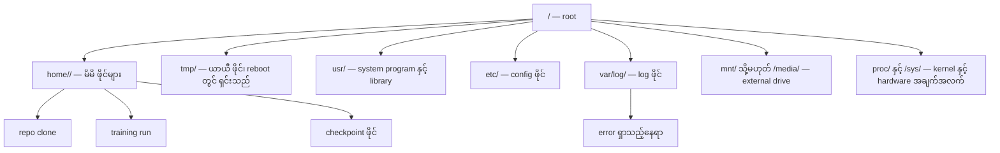
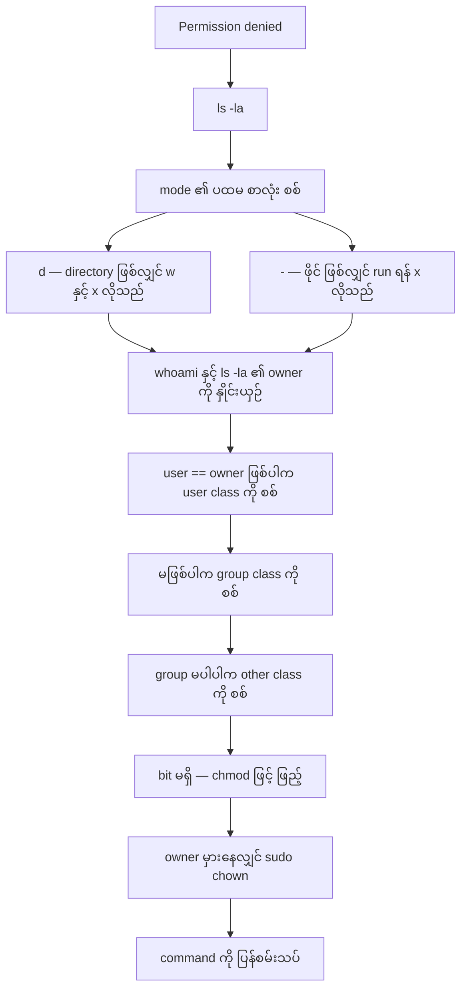
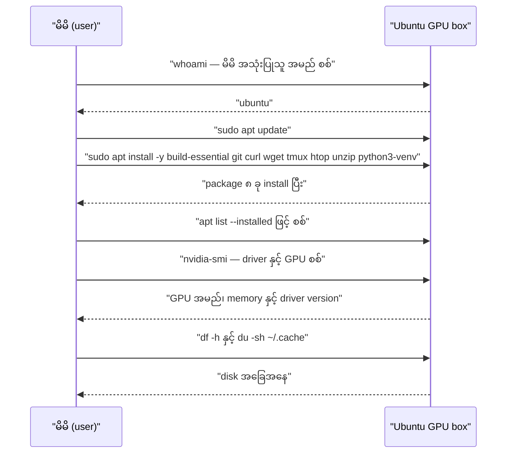

# Module 11 — Linux for AI

AI အလုပ်အများစုသည် Linux ပေါ်တွင် လည်ပတ်သည်။ မိမိ၏ laptop သည် macOS သို့မဟုတ် Windows ဖြစ်နိုင်သည်။
သို့သော် cloud GPU box တစ်ခု ငှားသည့်အခါ၊ Lambda instance တစ်ခု ဖန်တီးသည့်အခါ၊ EC2 machine တစ်ခု
စတင်သည့်အခါ ရောက်ရှိသည့် ပတ်ဝန်းကျင်သည် Ubuntu ဖြစ်သည်။ ထို machine တွင် Finder မရှိပါ၊ Explorer
မရှိပါ၊ GUI မရှိပါ။ terminal တစ်ခုသာ ရှိသည်။ file system ကို လမ်းကြောင်း ရှာနိုင်ခြင်း၊ package
install လုပ်နိုင်ခြင်း၊ process ကို စီမံနိုင်ခြင်း မရှိပါက GPU နာရီများကို အလဟသ ကုန်ဆုံးစေသည်။

ဤ module သည် ထို machine ပေါ်တွင် AI အလုပ်လုပ်ရန် လိုအပ်သည့် ကျွမ်းကျင်မှုကိုသာ သင်ပေးသည်။
Unix သမိုင်း၊ shell script တည်ဆောက်ခြင်း သို့မဟုတ် system administration အနက်ကို မဟုတ်ပါ။

ပြီးစီးပါက —

- Linux file system ၏ တည်ဆောက်ပုံကို နားလည်မည်။
- ဖိုင် လုပ်ဆောင်ချက်များကို command line မှ လုပ်နိုင်မည်။
- `chmod` နှင့် `chown` ဖြင့် "Permission denied" ကို ဖြေရှင်းနိုင်မည်။
- `apt` ဖြင့် package များ install လုပ်၍ GPU box အသစ်ကို အသင့် ဖြစ်စေနိုင်မည်။
- macOS နှင့် Linux ၏ ကွာခြားချက်များကို သိရှိမည်။

---

## ၁။ ပြဿနာ — GUI မရှိသည့် machine တွင် အလုပ်လုပ်ရခြင်း

မိမိ၏ laptop တွင် editor၊ file manager နှင့် browser ရှိသည်။ ထို အလေ့အကျင့်ဖြင့် remote GPU box တစ်ခုသို့
SSH ဖြင့် ဝင်သည့်အခါ အလေ့အကျင့် အားလုံး ပျောက်သွားသည်။ ထို machine တွင် —

- ဖိုင်ကို ဖျက်လိုပါက trash bin မရှိပါ — `rm` သည် ချက်ချင်း ပျက်စီးစေသည်၊ undo မရှိပါ။
- folder တစ်ခု ဖန်တီးရန် right-click မရှိပါ — `mkdir` ကို ရိုက်ရမည်။
- editor မရှိပါ — `cat`၊ `head`၊ `tail` သို့မဟုတ် `less` ဖြင့် ဖတ်ရမည်။
- error တစ်ခု ပေါ်လာသည့်အခါ ဖတ်ရသည့် လိုင်းတစ်လိုင်းသာ ရှိသည် — "Permission denied"။

ပြဿနာ၏ အူတိုင် မှာ — မိမိ၏ အလုပ်အတွက် လိုအပ်သည့် command အနည်းငယ်ကို မရခြင်း ဖြစ်သည်။
source lesson က ဤအချက်ကို တိုက်ရိုက် ဖော်ပြထားသည် — ထို command အနည်းငယ်ကို မတတ်ပါက
GPU နာရီများကို အလုပ်မဖြစ်ဘဲ ပေးရသည်။ ဤ module သည် ထို command အနည်းငယ်ကို စနစ်တကျ
ဖုံးလွှမ်းသည်။

---

## ၂။ အခြေခံ သဘောတရား — root တစ်ခုတည်းအောက်ရှိ ဖိုင် စနစ်

### ၂.၁ file system အပြင်အဆင်

Linux သည် အရာအားလုံးကို root `/` တစ်ခုတည်းအောက်တွင် စုစည်းသည်။ `C:\` မရှိပါ၊ `/Volumes` မရှိပါ။
AI အလုပ်တွင် အမှန်တကယ် ထိတွေ့သည့် directory များကို Figure 1 တွင် ပြထားသည်။



**Figure 1 — Linux root `/` အောက်ရှိ directory များ နှင့် AI အလုပ်နှင့် ဆက်စပ်မှု**

ပုံရှင်းလင်းချက် (Figure 1)

1. `/` သည် root ဖြစ်သည်။ ဖိုင် လမ်းကြောင်း တိုင်းသည် ဤနေရာမှ စသည်။
2. `home/<user>/` သည် မိမိ၏ ဖိုင် အားလုံး ရှိသည့်နေရာ ဖြစ်သည်။ `~` သည် ထို လမ်းကြောင်းကို ကိုယ်စားပြုသည်။
3. `tmp/` တွင် ယာယီ ဖိုင် ရေးသည်။ reboot လုပ်သည့်အခါ ရှင်းသွားသည် — ထို့ကြောင့် checkpoint ကို ထိုတွင် မသိမ်းရ။
4. `usr/` တွင် system program နှင့် library ရှိသည်။ `etc/` တွင် config ဖိုင်၊ `var/log/` တွင် log ဖိုင် ရှိသည်။
5. `proc/` နှင့် `/sys/` သည် တကယ့် ဖိုင် မဟုတ်ပါ — kernel နှင့် hardware အချက်အလက်ကို ဖိုင် ကဲ့သို့ ပြသည်။
6. repo clone၊ training run နှင့် checkpoint အားလုံးသည် `home/<user>/` အောက်တွင် ဖြစ်ပေါ်သည်။ log ကို ရှာလိုပါက `var/log/` ကို ဖတ်သည်။

### ၂.၂ owner၊ group နှင့် permission bit

Linux တွင် ဖိုင် တိုင်း၌ **owner** တစ်ဦး၊ **group** တစ်ခု နှင့် permission bit သုံးစု ရှိသည်။
`ls -l` ၏ ရလဒ်ကို ဖတ်တတ်ခြင်းသည် "Permission denied" ကို ဖြေရှင်းရန် အခြေခံ ဖြစ်သည်။
source lesson ၏ ဥပမာကို အောက်တွင် ပြထားသည်။

```text
ls -l train.py
# -rwxr-xr-- 1 user group 2048 Mar 19 10:00 train.py
#  ^^^             owner permissions: read, write, execute
#     ^^^          group permissions: read, execute
#        ^^        everyone else: read only
```

permission စစ်ဆေးမှု၏ အစဉ်ကို Figure 2 တွင် ပြထားသည်။ ဤအစဉ်သည် ဤ module ၏ lab exercise 2
တွင် တိုက်ရိုက် implement လုပ်ထားသည့် logic ဖြစ်သည်။



**Figure 2 — "Permission denied" ဖြစ်သည့်အခါ စစ်ဆေးရမည့် အစဉ်**

ပုံရှင်းလင်းချက် (Figure 2)

1. error ကို မြင်သည်နှင့် `ls -la <path>` ဖြင့် mode၊ owner နှင့် group ကို ဖတ်သည်။
2. mode ၏ ပထမ စာလုံးသည် `d` ဖြစ်ပါက ၎င်းသည် directory ဖြစ်သည်။ directory ထဲ ဖိုင် ရေးရန် `w` bit လိုသည်။
3. mode သည် `-` ဖြင့် စပါက ဖိုင် ဖြစ်သည်။ script တစ်ခုကို run ရန် `x` bit လိုသည်။
4. `whoami` ဖြင့် မိမိ အသုံးပြုသူ အမည်ကို ရ၍ `ls -la` ၏ owner နှင့် နှိုင်းယှဉ်သည်။ ကိုက်ညီပါက user class ကို စစ်သည်။
5. မကိုက်ညီပါက group class ကို စစ်သည်။ ထိုနှစ်ခုလုံး မကိုက်ညီပါက other class ကို စစ်သည်။
6. ထို class တွင် လိုအပ်သည့် bit မရှိပါက `chmod` ဖြင့် ဖြည့်သည်။ owner ကိုယ်တိုင် မှားနေပါက `sudo chown` လိုသည်။

### ၂.၃ permission ကို octal ဖြင့် ဖတ်ခြင်း

bit တစ်ခုစီ၏ တန်ဖိုးသည် — `r` = ၄၊ `w` = ၂၊ `x` = ၁ ဖြစ်သည်။ စု တစ်ခုစီကို ပေါင်းလိုက်ပါက
octal digit တစ်ခု ရသည်။ ထို့ကြောင့် `chmod` ကို နံပါတ်ဖြင့် ရေးနိုင်သည်။

| octal | symbolic | အဓိပ္ပာယ် |
|---|---|---|
| `644` | `-rw-r--r--` | owner ဖတ်/ရေး၊ group နှင့် other ဖတ်သာ — config ဖိုင် အတွက် သင့်တော်သည် |
| `755` | `-rwxr-xr-x` | owner အားလုံး၊ group နှင့် other run နိုင် — script နှင့် directory အတွက် သင့်တော်သည် |
| `600` | `-rw-------` | owner ဖတ်/ရေးသာ — key ဖိုင် အတွက် သင့်တော်သည် |
| `700` | `drwx------` | owner သာ ဝင်နိုင် — checkpoint directory အတွက် သင့်တော်သည် |

source lesson ၏ တိုက်ရိုက် ဖော်ပြချက် — `chmod +x train.sh` သည် script ကို run နိုင်စေသည်၊
`chmod 755 deploy.sh` သည် owner ကို အပြည့်အစုံ ပေး၍ ကျန်သူများကို ဖတ်/run ပေးသည်၊
`chmod 644 config.yaml` သည် owner ကို ဖတ်/ရေး ပေး၍ ကျန်သူများကို ဖတ်သာ ပေးသည်။

---

## ၃။ နှိုင်းယှဉ်ချက် ဇယား

### ၃.၁ macOS မှ Linux သို့ ကူးသည့်အခါ ကွာခြားချက်

| macOS | Linux | သတိထားရမည့် အချက် |
|---|---|---|
| `brew install` | `sudo apt install` | package အမည် တစ်ခါတစ်ရံ မတူပါ — `brew install readline` နှင့် `sudo apt install libreadline-dev` မတူပါ |
| `open file.txt` | `xdg-open file.txt` | remote box တွင် GUI မရှိပါ — `cat` သို့မဟုတ် `less` ကို သုံးရမည် |
| `pbcopy` / `pbpaste` | မရှိပါ | SSH အပေါ်တွင် clipboard သို့ pipe လုပ်ခြင်း မရပါ |
| `~/.zshrc` | `~/.bashrc` | macOS သည် zsh ကို မူရင်း သုံးသည်၊ server အများစုသည် bash သုံးသည် |
| `/opt/homebrew/` | `/usr/bin/`, `/usr/local/bin/` | binary များ ရှိသည့် နေရာ မတူပါ |
| `sed -i '' 's/a/b/' file` | `sed -i 's/a/b/' file` | macOS sed သည် `-i` နောက်တွင် အလွတ် string လိုသည်၊ Linux မလိုပါ |
| case-insensitive file system | case-sensitive file system | Linux တွင် `Model.py` နှင့် `model.py` သည် ဖိုင် နှစ်ခု ဖြစ်သည် |
| line endings `\n` | line endings `\n` | Windows သည် `\r\n` သုံးသဖြင့် bash script ပျက်သည် — `dos2unix` ဖြင့် ပြင်ရမည် |

### ၃.၂ အလုပ်အုပ်စုအလိုက် command များ

| အုပ်စု | command |
|---|---|
| လမ်းကြောင်း ရွှေ့ခြင်း | `pwd`, `ls`, `cd`, `find` |
| ဖိုင် လုပ်ဆောင်ချက် | `cp`, `mv`, `rm`, `mkdir`, `cat`, `head`, `tail`, `less` |
| ရှာဖွေခြင်း | `grep`, `find` |
| permission | `chmod`, `chown`, `sudo` |
| package | `apt update`, `apt install` |
| process | `htop`, `ps`, `kill`, `nvidia-smi` |
| service | `systemctl start/stop/restart/status` |
| disk | `df -h`, `du -sh` |
| network | `curl`, `wget`, `scp`, `rsync` |
| session | `tmux new/attach/detach` |

---

## ၄။ လက်တွေ့ configuration

### ၄.၁ လမ်းကြောင်း ရွှေ့ခြင်း

```bash
pwd                         # Where am I?
ls                          # What's here?
ls -la                      # What's here, including hidden files with details?
cd /path/to/dir             # Go there
cd ~                        # Go home
cd ..                       # Go up one level
```

`pwd` သည် လက်ရှိ လမ်းကြောင်း အပြည့်အစုံကို ပြသည်။ `ls` သည် လက်ရှိ directory ၏ အမည် စာရင်းကို ပြသည်။
`ls -la` သည် ဖျောက်ထားသည့် ဖိုင် (`.` ဖြင့် စသည့် ဖိုင်) အပါ အခွင့်အရေး၊ owner၊ အရွယ်အစား နှင့် ပြသည်။
`cd ~` သည် မည်သည့်နေရာမှ မဆို မိမိ၏ home directory သို့ ပြန်ပို့သည်။ `cd ..` သည် လမ်းကြောင်း တစ်ဆင့်
အထက်သို့ တက်သည်။ မအောင်မြင်ပါက လမ်းကြောင်း အမည် မှန်/မမှန် နှင့် `~` နေရာတွင် အခြား အသုံးပြုသူ တစ်ဦး၏
လမ်းကြောင်း ဖြစ်/မဖြစ် စစ်ရမည်။

### ၄.၂ ဖိုင် နှင့် directory

```bash
mkdir my-project            # Create a directory
mkdir -p a/b/c              # Create nested directories in one shot

cp file.txt backup.txt      # Copy a file
cp -r src/ src-backup/      # Copy a directory (recursive)

mv old.txt new.txt          # Rename a file
mv file.txt /tmp/           # Move a file

rm file.txt                 # Delete a file (no trash, it's gone)
rm -rf my-dir/              # Delete a directory and everything inside
```

`mkdir -p a/b/c` သည် လမ်းကြောင်း အားလုံးကို တစ်ကြိမ်တည်း ဖန်တီးသည်။ ဖြစ်ပြီးသား directory ရှိလျှင်လည်း
error မပေးပါ။ `cp -r` သည် directory ကို အတွင်းအပါ ကူးသည် — `-r` မပါပါက directory ကို ကူး၍ မရပါ။
`mv` သည် ဖိုင် တစ်ခုတည်း တွင် အမည်ပြောင်းခြင်း နှင့် နေရာရွှေ့ခြင်း နှစ်မျိုးလုံးကို လုပ်သည်။

**အရေးကြီးသည်** — source lesson က တိုက်ရိုက် ဖော်ပြထားသည် — `rm -rf` သည် အပြီးအပိုင် ဖျက်သည်။
undo မရှိပါ။ Enter မနှိပ်မီ လမ်းကြောင်းကို နှစ်ကြိမ် စစ်ရမည်။

### ၄.၃ ဖိုင် ဖတ်ခြင်း

```bash
cat file.txt                # Print entire file
head -20 file.txt           # First 20 lines
tail -20 file.txt           # Last 20 lines
tail -f log.txt             # Follow a log file in real time (Ctrl+C to stop)
less file.txt               # Scroll through a file (q to quit)
```

`cat` သည် ဖိုင် တစ်ခုလုံးကို ချက်ချင်း ပြသည် — ဖိုင် ကြီးလျှင် မျက်နှာပြင် ပြည့်သွားသည်။ `head -20` နှင့်
`tail -20` သည် အစ/အဆုံး လိုင်း ၂၀ ကို ပြသည်။ `tail -f` သည် ဖိုင် ကြီးလာသည်နှင့် ဆက်ပြသည် —
training log ကို အချိန်နှင့်တစ်ပြေးညီ ကြည့်ရန် ဤ option ကို သုံးသည်၊ ရပ်ရန် `Ctrl+C` ကို နှိပ်သည်။
`less` သည် ဖိုင် ကို အပိုင်းလိုက် ကြည့်စေသည်၊ ထွက်ရန် `q` ကို နှိပ်သည်။

### ၄.၄ ရှာဖွေခြင်း

```bash
grep "error" training.log           # Find lines containing "error"
grep -r "learning_rate" .           # Search all files in current directory
grep -i "cuda" config.yaml          # Case-insensitive search

find . -name "*.py"                 # Find all Python files under current dir
find . -name "*.ckpt" -size +1G     # Find checkpoint files larger than 1GB
```

`grep` သည် ဖိုင် အတွင်းရှိ လိုင်းများကို ရှာသည်။ `-r` သည် directory တစ်ခုလုံးအတွင်း ပြန်ပြန် ရှာသည်။
`-i` သည် အကြီးအသေး မခွဲခြားစေသည်။ `find` သည် ဖိုင် **အမည်** ကို ရှာသည် — ဖိုင် အတွင်းရှိ စာသားကို
မရှာပါ။ ထို့ကြောင့် `grep` နှင့် `find` သည် တာဝန် မတူပါ — တစ်ခုက စာသား၊ တစ်ခုက ဖိုင် အမည် ဖြစ်သည်။

### ၄.၅ permission — chmod နှင့် chown

```bash
chmod +x train.sh           # Make a script executable
chmod 755 deploy.sh         # Owner: full, others: read+execute
chmod 644 config.yaml       # Owner: read+write, others: read only

chown user:group file.txt   # Change who owns a file (needs sudo)
```

source lesson ၏ အချက် — "Permission denied" ပေါ်သည့်အခါ ၎င်းသည် နီးပါး အမြဲတမ်း permission ပြဿနာ
ဖြစ်သည်။ `chmod +x` သို့မဟုတ် `sudo` သည် အများစုကို ဖြေရှင်းသည်။ သို့သော် မည်သည့်နေရာတွင် မည်သည့်
တစ်ခုကို သုံးရမည်ကို ခွဲခြားရမည် — မိမိ ပိုင် ဖိုင် တစ်ခုတွင် run bit မရှိခြင်းသည် `chmod +x` ဖြစ်သည်။
ဖိုင် သည် အခြားသူ (root) ပိုင် ဖြစ်ခြင်းသည် `sudo chown` ဖြစ်သည်။ directory ကို မိမိ မပိုင်ခြင်းသည်
`sudo chown -R <user>:<group> <dir>` ဖြစ်သည်။ `sudo` သည် တစ်ကြိမ် root အခွင့်ကို ငှားသည်သာ ဖြစ်သည် —
ပြဿနာ၏ အရင်း (owner သို့မဟုတ် bit) ကို မပြောင်းပါ။

### ၄.၆ package management — apt

Ubuntu သည် `apt` ကို သုံးသည်။ system အဆင့် software ကို ဤနေရာမှ install လုပ်သည်။

```bash
sudo apt update             # Refresh the package list (always do this first)
sudo apt install -y htop    # Install a package (-y skips confirmation)
sudo apt install -y build-essential  # C compiler, make, etc. Needed by many Python packages
sudo apt install -y tmux    # Terminal multiplexer (keep sessions alive after disconnect)

apt list --installed        # What's installed?
sudo apt remove htop        # Uninstall
```

source lesson က GPU box အသစ်တွင် install လုပ်သည့် package စာရင်းကို ဤအတိုင်း ပြထားသည် —

```bash
sudo apt update && sudo apt install -y \
    build-essential \
    git \
    curl \
    wget \
    tmux \
    htop \
    unzip \
    python3-venv
```

`sudo apt update` သည် package list ကို လတ်ဆတ်စေသည်။ ဤအဆင့်ကို အမြဲ ပထမ လုပ်ရမည်။
`-y` သည် "install လုပ်ပါသလား" ဟူသည့် မေးခွန်းကို အလိုအလျောက် ဖြေသည်။ `build-essential` သည်
Python package အများအပြား compile လုပ်ရန် လိုသည့် C compiler နှင့် `make` ကို ပေးသည်။
`python3-venv` သည် virtual environment ဖန်တီးနိုင်စေသည်။ GPU box အသစ် တစ်ခုကို အသင့် ဖြစ်စေသည့်
အစဉ်ကို Figure 3 တွင် ပြထားသည်။



**Figure 3 — GPU box အသစ် တစ်ခုကို အသင့် ဖြစ်စေသည့် အစဉ်**

ပုံရှင်းလင်းချက် (Figure 3)

1. `whoami` ဖြင့် မိမိ အသုံးပြုသူ အမည်ကို စစ်သည်။ ဤအချက်သည် permission စစ်သည့်အခါ အခြေခံ ဖြစ်သည်။
2. `sudo apt update` ဖြင့် package list ကို လတ်ဆတ်စေသည်။ ဤအဆင့်ကို ကျော်လျှင် install သည် အဟောင်း version ကို ယူနိုင်သည်။
3. `sudo apt install -y` ဖြင့် package ၈ ခုကို တစ်ကြိမ်တည်း install လုပ်သည်။ `\` ဖြင့် လိုင်းကို ဆက်ရေးသည်။
4. `apt list --installed` ဖြင့် package များ ပါ/မပါ ပြန်စစ်သည်။
5. `nvidia-smi` ဖြင့် driver နှင့် GPU ပေါ်/မပေါ် စစ်သည်။ မပေါ်ပါက driver ပြဿနာ ဖြစ်သည်။
6. နောက်ဆုံး `df -h` နှင့် `du -sh ~/.cache` ဖြင့် disk အခြေအနေကို စစ်သည် — model နှင့် dataset သည် disk ကို လျင်မြန်စွာ ဖြည့်သည်။

### ၄.၇ users နှင့် sudo

```bash
whoami                      # What user am I?
sudo command                # Run a single command as root
sudo su                     # Become root (exit to go back, use sparingly)
```

cloud GPU instance အများစုတွင် အသုံးပြုသူ တစ်ဦးသာ ရှိပြီး `sudo` အခွင့် ရှိပြီး ဖြစ်သည်။
source lesson ၏ သတိပေးချက် — အရာအားလုံးကို root အနေဖြင့် မလုပ်ရ။ လိုအပ်သည့်အခါတွင်သာ `sudo` ကို သုံးရမည်။
root အနေဖြင့် ရေးလိုက်သည့် ဖိုင် သည် owner အဖြစ် root ကို ယူသွားသည် — ထို့နောက် မိမိ ဖတ်၍ မရနိုင်သည့်
အခြေအနေ ဖြစ်လာသည်။

### ၄.၈ processes နှင့် systemd

```bash
htop                        # Interactive process viewer (q to quit)
ps aux | grep python        # Find running Python processes
kill 12345                  # Gracefully stop process with PID 12345
kill -9 12345               # Force kill (use when graceful doesn't work)
nvidia-smi                  # GPU processes and memory usage
```

`htop` သည် process နှင့် memory ကို စောင့်ကြည့်သည်။ `ps aux | grep python` သည် လည်ပတ်နေသည့်
Python process များကို ရှာသည်။ `kill` သည် PID ဖြင့် process ကို ဦးစွာ ညင်သာစွာ ရပ်သည်။
မရပါက `kill -9` ဖြင့် အတင်းရပ်သည်။ `nvidia-smi` သည် GPU ကို သုံးနေသည့် process နှင့် memory
ပမာဏကို ပြသည်။

systemd သည် နောက်ခံ service များကို စီမံသည်။ inference server တစ်ခု လည်ပတ်လျှင် ဤ command များကို
သုံးသည် —

```bash
sudo systemctl start nginx          # Start a service
sudo systemctl stop nginx           # Stop it
sudo systemctl restart nginx        # Restart it
sudo systemctl status nginx         # Check if it's running
sudo systemctl enable nginx         # Start automatically on boot
```

`start`၊ `stop`၊ `restart` သည် လက်ရှိ အခြေအနေကို ပြောင်းသည်။ `status` သည် လည်ပတ်/မလည်ပတ် နှင့်
နောက်ဆုံး log လိုင်းများကို ပြသည်။ `enable` သည် boot လုပ်သည့်အခါ အလိုအလျောက် စတင်စေသည် —
`start` နှင့် `enable` သည် မတူပါ။

### ၄.၉ disk space

GPU box များတွင် disk နေရာ နည်းတတ်သည်။ model နှင့် dataset သည် လျင်မြန်စွာ ဖြည့်သည်။

```bash
df -h                       # Disk usage for all mounted drives
df -h /home                 # Disk usage for /home specifically

du -sh *                    # Size of each item in current directory
du -sh ~/.cache             # Size of your cache (pip, huggingface models land here)
du -sh /data/checkpoints/   # Check how big your checkpoints are

# Find the biggest space hogs
du -h --max-depth=1 / 2>/dev/null | sort -hr | head -20
```

`df -h` သည် mount လုပ်ထားသည့် drive တိုင်း၏ capacity၊ သုံးပြီး ပမာဏ၊ ကျန်နေသည့် ပမာဏ နှင့်
ရာခိုင်နှုန်းကို ပြသည်။ `du -sh` သည် directory တစ်ခုစီ၏ အရွယ်အစားကို ပြသည်။
`sort -hr` သည် လူဖတ်နိုင်သည့် အရွယ်အစား အနေဖြင့် ကြီးစဉ် စီသည်။ `2>/dev/null` သည်
ခွင့်မပြုသည့် directory များမှ error များကို ပစ်လွှတ်သည်။

နေရာ ပြန်ရရှိစေသည့် နည်းလမ်းများ —

```bash
pip cache purge             # Clear pip cache
sudo apt clean              # Clear apt cache
rm -rf checkpoints/epoch_01/ checkpoints/epoch_02/  # Remove checkpoints you do not need
```

### ၄.၁၀ networking

```bash
# Download files
wget https://example.com/model.bin                   # Download a file
curl -O https://example.com/data.tar.gz              # Same thing with curl
curl -s https://api.example.com/health | python3 -m json.tool  # Hit an API, pretty-print JSON

# Transfer files between machines
scp model.bin user@remote:/data/                     # Copy file to remote machine
scp user@remote:/data/results.csv .                  # Copy file from remote to local
scp -r user@remote:/data/checkpoints/ ./local-dir/   # Copy directory

# Sync directories (faster than scp for large transfers, resumes on failure)
rsync -avz --progress ./data/ user@remote:/data/
rsync -avz --progress user@remote:/results/ ./results/
```

`wget` နှင့် `curl -O` သည် source မှ ဖိုင် ကို ယူသည်။ `curl -s` သည် မလိုအပ်သည့် လိုင်းများကို
မပြဘဲ API ကို ခေါ်သည်။ `python3 -m json.tool` သည် JSON ကို လူဖတ်နိုင်သည့် ပုံစံဖြင့် ပြသည်။
`scp` တွင် အပိုင်း နှစ်ပိုင်း ရှိသည် — ပထမသည် ဒေသတွင်း ဖိုင်၊ ဒုတိယသည် `host:path` ဖြစ်သည်။

source lesson ၏ အကြံပြုချက် — ကြီးမားသည့် ဖိုင် အားလုံးအတွက် `scp` အစား `rsync` ကို သုံးရမည်။
`rsync` သည် ပြောင်းလဲသည့် byte များကိုသာ ကူးပြီး ပြတ်သွားသည့် ချိတ်ဆက်မှုကို ပြန်ဆက်သည်။
`-a` သည် permission နှင့် time stamp ပါသည့် archive mode၊ `-v` သည် အသေးစိတ် ပြခြင်း၊
`-z` သည် network ပေါ်တွင် ချုံ့ခြင်း ဖြစ်သည်။

### ၄.၁၁ tmux — session ကို ရှင်သန်စေခြင်း

SSH ဖြင့် remote box သို့ ဝင်ထားသည့်အခါ laptop ကို ပိတ်လိုက်ပါက training run လည်း ရပ်သွားသည်။
`tmux` သည် ထို အခြေအနေကို တားဆီးသည်။

```bash
tmux new -s train           # Start a new session named "train"
# ... start your training, then:
# Ctrl+B, then D            # Detach (training keeps running)

tmux ls                     # List sessions
tmux attach -t train        # Reattach to session

# Inside tmux:
# Ctrl+B, then %            # Split pane vertically
# Ctrl+B, then "            # Split pane horizontally
# Ctrl+B, then arrow keys   # Switch between panes
```

source lesson ၏ အချက် — ကြာရှည်သည့် training အလုပ် တိုင်းကို `tmux` အတွင်း အမြဲ run ရမည်။
detach လုပ်ပြီး laptop ကို ပိတ်လိုက်သော်လည်း session သည် server ပေါ်တွင် ဆက်လက် လည်ပတ်သည်။
ပြန်လာသည့်အခါ `tmux attach -t train` ဖြင့် ဝင်လိုက်ပါက မည်သည့် အလုပ်မျှ အစမှ ပြန်စရန် မလိုပါ။

### ၄.၁၂ WSL2 — Windows အသုံးပြုသူများအတွက်

Windows ပေါ်တွင် ရှိပါက WSL2 သည် dual-boot မလိုဘဲ တကယ့် Linux ပတ်ဝန်းကျင်ကို ပေးသည်။

```bash
# In PowerShell (admin)
wsl --install -d Ubuntu-24.04

# After restart, open Ubuntu from Start menu
sudo apt update && sudo apt upgrade -y
```

WSL2 သည် Linux kernel တကယ် ကို လည်ပတ်စေသည်။ ဤ module ရှိ အကြောင်းအရာ အားလုံးသည်
WSL2 အတွင်းတွင် အလုပ်လုပ်သည်။ Windows ဖိုင် များသည် WSL2 အတွင်းမှ `/mnt/c/Users/YourName/`
တွင် ရှိသည်။ GPU passthrough အတွက် Windows ဘက်တွင် NVIDIA driver ကို install ရမည် —
Linux driver မဟုတ်ပါ။ `Ubuntu-24.04` ကဲ့သို့ distribution tag သည် version အလိုက်
ပြန်စစ်ရန် လိုသည်။

### ၄.၁၃ quick reference card

source lesson ၏ quick reference card —

```text
Navigation:     pwd, ls, cd, find
Files:          cp, mv, rm, mkdir, cat, head, tail, less
Search:         grep, find
Permissions:    chmod, chown, sudo
Packages:       apt update, apt install
Processes:      htop, ps, kill, nvidia-smi
Services:       systemctl start/stop/restart/status
Disk:           df -h, du -sh
Network:        curl, wget, scp, rsync
Sessions:       tmux new/attach/detach
```

---

## ၅။ လုပ်ငန်းတွင် သတိထားရမည့် အချက်များ

1. **"Permission denied" ကို `sudo` ဖြင့် မဖြေရှင်းရ။** `sudo` သည် အခွင့်ကို ငှားသည်သာ။
   `ls -la` ဖြင့် mode၊ owner နှင့် group ကို အရင် ဖတ်ပြီး `chmod` လိုသလား `chown` လိုသလား
   ခွဲခြားရမည်။ root အနေဖြင့် ရေးလိုက်သည့် ဖိုင် သည် မိမိအတွက် နောက်တစ်ကြိမ် ဖတ်၍ မရနိုင်ပါ။
2. **`chmod 777` ကို ဖြေရှင်းချက် အဖြစ် မသုံးရ။** 777 သည် အားလုံးကို ဖတ်/ရေး/run အခွင့် ပေးသည်။
   multi-user သို့မဟုတ် ငှားထားသည့် machine တွင် ဤအချက်သည် လုံခြုံရေး ပြဿနာ ဖြစ်သည်။
   လိုအပ်သည့် bit ကိုသာ ဖြည့်ရမည်။
3. **`rm -rf` သည် undo မရှိပါ။** `rm -rf $DIR/` တွင် `$DIR` အလွတ် ဖြစ်နေပါက အလွန်ဆိုးသည့် အခြေအနေ
   ဖြစ်သည်။ Enter မနှိပ်မီ လမ်းကြောင်း အပြည့်အစုံ ဖြစ်/မဖြစ် စစ်ရမည်။
4. **`sudo apt update` ကို ကျော်၍ မရ။** ဤအဆင့် မလုပ်ဘဲ install လုပ်လျှင် package list အဟောင်းအပေါ်
   အခြေခံသဖြင့် version မမှန်ခြင်း သို့မဟုတ် "Unable to locate package" error ဖြစ်နိုင်သည်။
5. **case-sensitive ဖြစ်ခြင်း။** macOS မှ ရေးထားသည့် `from Model import net` သည် Linux တွင်
   `model.py` ရှိလျှင် ပျက်သည်။ `ImportError` မြင်သည့်အခါ ဖိုင် အမည်၏ အကြီးအသေး ကို အရင် စစ်ရမည်။
6. **line endings `\r\n`။** Windows မှ ယူလာသည့် script သည် `\r: command not found` ကဲ့သို့
   ထူးဆန်းသည့် error ပေးသည်။ `dos2unix script.sh` ဖြင့် ပြင်ရမည်။
7. **`sed -i` ၏ ကွာခြားချက်။** macOS မှ ရေးထားသည့် `sed -i '' 's/a/b/' file` သည် Linux တွင်
   အလွတ် string ကို ဖိုင် အမည် အဖြစ် ယူသဖြင့် ပျက်သည်။ Linux တွင် `sed -i 's/a/b/' file` ဖြစ်သည်။
8. **`tmp/` တွင် အလုပ် မသိမ်းရ။** reboot လုပ်သည့်အခါ `tmp/` သည် ရှင်းသည်။ checkpoint နှင့် dataset ကို
   `home/<user>/` သို့မဟုတ် mount လုပ်ထားသည့် data volume တွင် သိမ်းရမည်။
9. **`kill -9` ကို ဦးစွာ မသုံးရ။** ဦးစွာ `kill <PID>` ဖြင့် ညင်သာစွာ ရပ်ကြည့်သည်။
   `-9` သည် signal ကို လက်မခံစေသဖြင့် ဖိုင် များ ပျက်နိုင်သည်။
10. **version အလိုက် ပြောင်းလဲနိုင်သည်။** `apt`၊ `systemctl`၊ `tmux` နှင့် WSL2 distribution tag များ၏
    option များသည် version အလိုက် ပြောင်းလဲနိုင်သည်။ run မီ မိမိ version အတွက် official documentation
    ကို စစ်ရမည်။

---

## ၆။ မိမိကိုယ်ကို စစ်ဆေးခြင်း

**မေးခွန်း ၁။ Linux တွင် `~` သည် ဘာကို ကိုယ်စားပြုသလဲ။**

အဖြေ — လက်ရှိ အသုံးပြုသူ၏ home directory ကို ကိုယ်စားပြုသည်။ Linux တွင် `/home/<username>`
ဖြစ်တတ်သည်။ `cd ~` သည် မည်သည့်နေရာမှ မဆို home သို့ ပြန်ပို့သည်။

**မေးခွန်း ၂။ `sudo` ကို command တစ်ခု၏ ရှေ့တွင် ထည့်ခြင်း၏ အဓိပ္ပာယ် ဘာလဲ။**

အဖြေ — ထို command တစ်ခုတည်းကို root (administrator) အခွင့်အနေဖြင့် လည်ပတ်စေသည်။
`apt` ဖြင့် package install လုပ်ခြင်း၊ `systemctl` ဖြင့် service စီမံခြင်း၊ `chown` ဖြင့် owner
ပြောင်းခြင်း ကဲ့သို့ system အဆင့် လုပ်ဆောင်ချက်များအတွက် လိုသည်။ လိုအပ်သည့်အခါတွင်သာ သုံးရမည်။

**မေးခွန်း ၃။ shell script တစ်ခုကို run သည့်အခါ "Permission denied" ပေါ်လာသည်။ မည်သည့် command
က ဖြေရှင်းသလဲ။**

အဖြေ — `chmod +x script.sh` ဖြစ်သည်။ execute bit မရှိပါက shell သည် script ကို run ရန် ငြင်းသည်။
ဖိုင် သည် အခြားသူ ပိုင် ဖြစ်နေပါက `sudo chown <user>:<group> script.sh` ကို အရင် လုပ်ရသည်။

**မေးခွန်း ၄။ remote GPU box တွင် dataset က disk ကို ဖြည့်နေသည်။ အများဆုံး နေရာ ယူသည့်
directory များကို မည်သည့် command က ပြသလဲ။**

အဖြေ — `du -h --max-depth=1 / 2>/dev/null | sort -hr | head -20` ဖြစ်သည်။ `du -h` သည်
directory တစ်ခုစီ၏ အရွယ်အစားကို ပြသည်၊ `--max-depth=1` သည် ထိပ်ဆုံး အဆင့်သာ ကန့်သတ်သည်၊
`sort -hr` သည် ကြီးစဉ် စီသည်။ ရရှိသည့် ရလဒ်အရ checkpoint အဟောင်းများ၊ pip cache
(`~/.cache`) သို့မဟုတ် dataset အဟောင်းများကို ရှာနိုင်သည်။

**မေးခွန်း ၅။ macOS ၏ `sed -i` နှင့် Linux ၏ `sed -i` ကွာခြားချက် ဘာလဲ။**

အဖြေ — macOS (BSD sed) သည် `-i` နောက်တွင် backup အလွတ် string ကို လိုသည် —
`sed -i '' 's/a/b/' file`။ Linux (GNU sed) သည် ထို အလွတ် string မလိုပါ — `sed -i 's/a/b/' file`။
macOS တွင် ရေးထားသည့် script ကို Linux သို့ ယူလာသည့်အခါ ဤအချက်က ပျက်စီးစေသည်။

---

## Technical review notes

- Source သည် file system ပုံကို `graph TD` ဖြင့် ရေးထားသည်။ ဤ course ၏ စည်းမျဉ်းအတိုင်း ဤ module တွင်
  `flowchart TD` နှင့် `sequenceDiagram` ကို သုံးသည် — အကြောင်းအရာ တူညီသည်။ FHS ၏ အမည်များ
  (`home/`၊ `tmp/`၊ `usr/`၊ `etc/`၊ `var/log/`၊ `mnt/`၊ `proc/`) ကို source အတိုင်း ထားသည်။
- Source ၏ command၊ flag နှင့် ဥပမာ တန်ဖိုး အားလုံးကို ပြင်ခြင်း မပြုဘဲ အတိုင်း ဖော်ပြထားသည်။
  `chmod 755`၊ `chmod 644`၊ `chmod +x`၊ `chown user:group`၊ `sudo apt install -y`၊
  `du -h --max-depth=1 / 2>/dev/null | sort -hr | head -20`၊ `rsync -avz --progress` အားလုံး
  source အတိုင်း ဖြစ်သည်။
- ဤ machine သည် `sudo`၊ `apt` နှင့် NVIDIA GPU မရှိသည့် ပတ်ဝန်းကျင် ဖြစ်နိုင်သည်။ ထို့ကြောင့်
  `lab.py` သည် `chmod`၊ `chown`၊ `apt`၊ `df` နှင့် `du` ကို လုပ်ဆောင်ခြင်း မပြုဘဲ သတ်မှတ်ထားသည့်
  စာသား အပေါ်တွင် တုပစစ်ဆေးသည်။ `ls -la`၊ `df -h` နှင့် `du -sh` ၏ input များသည် ဤ module
  အတွက် ရေးထားသည့် သတ်မှတ်ထားသည့် စာသားများ ဖြစ်သည်။ `Use%` ကို `df -h` ပြသည့်အတိုင်း
  ယူထားသည် — `df -h` သည် အရွယ်အစား တစ်ခုစီကို သီးခြား လုံးဝန်းသဖြင့် ရာခိုင်နှုန်းသည်
  ပြန်တွက်သည့် တန်ဖိုးနှင့် အနည်းငယ် ကွာနိုင်သည်။
- `dos2unix` သည် အခြား package တစ်ခု ဖြစ်သည်။ source သည် ဤ command ကို ဖော်ပြသည် — ထို့ကြောင့်
  ဤ module တွင်လည်း ဖော်ပြထားသည်။ install လိုအပ်သည့် အချက် ဖြစ်သည်။
- `wsl --install -d Ubuntu-24.04` ၏ distribution tag နှင့် `apt`၊ `systemctl`၊ `tmux` ၏ option များသည်
  version အလိုက် ပြောင်းလဲနိုင်သည်။ run မီ မိမိ version အတွက် official documentation ကို စစ်ရမည်။

## References & Further Reading

- Source lesson — Linux for AI:
  https://aiengineeringfromscratch.com/lesson?path=phases%2F00-setup-and-tooling%2F11-linux-for-ai
- Source repository — `rohitg00/ai-engineering-from-scratch`, `phases/00-setup-and-tooling/11-linux-for-ai/`:
  https://github.com/rohitg00/ai-engineering-from-scratch
- Filesystem Hierarchy Standard (FHS) 3.0 — `/home`၊ `/tmp`၊ `/usr`၊ `/etc`၊ `/var`၊ `/proc` သတ်မှတ်ချက်:
  https://refspecs.linuxfoundation.org/FHS_3.0/fhs/index.html
- GNU Coreutils manual — `ls`၊ `cp`၊ `mv`၊ `rm`၊ `mkdir`၊ `chmod`၊ `chown`၊ `df`၊ `du`၊ `head`၊ `tail`:
  https://www.gnu.org/software/coreutils/manual/
- Ubuntu Server documentation — `apt` package management:
  https://ubuntu.com/server/docs/package-management
- Ubuntu documentation — users, groups and `sudo`:
  https://ubuntu.com/server/docs/security-users
- systemd manual — `systemctl` နှင့် `enable` နှင့် `start` ၏ ကွာခြားချက်:
  https://www.freedesktop.org/software/systemd/man/systemctl.html
- GNU grep manual — `-r`၊ `-i` option များ:
  https://www.gnu.org/software/grep/manual/
- GNU findutils manual — `find` ၏ `-name` နှင့် `-size`:
  https://www.gnu.org/software/findutils/manual/
- tmux manual pages — `new`၊ `attach`၊ `split-window`:
  https://man.openbsd.org/tmux
- OpenSSH manual — `scp`:
  https://www.openssh.com/manual.html
- rsync manual — `-a`၊ `-v`၊ `-z`၊ `--progress`:
  https://rsync.samba.org/documentation.html
- WSL2 installation documentation:
  https://learn.microsoft.com/windows/wsl/install
