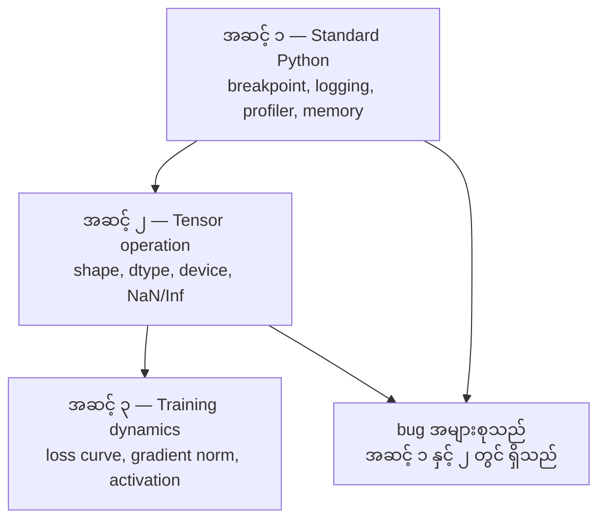
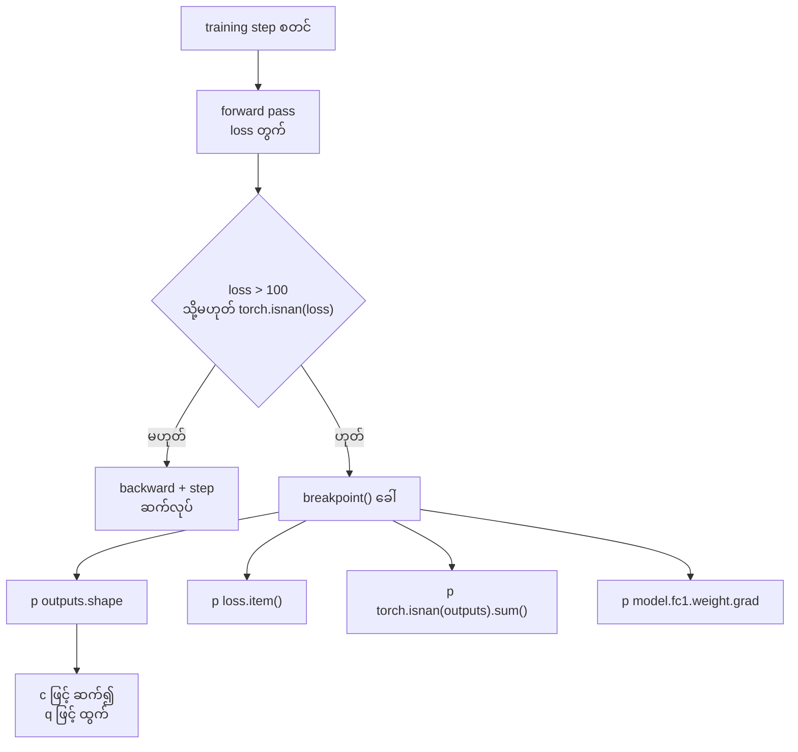
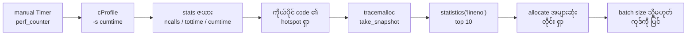
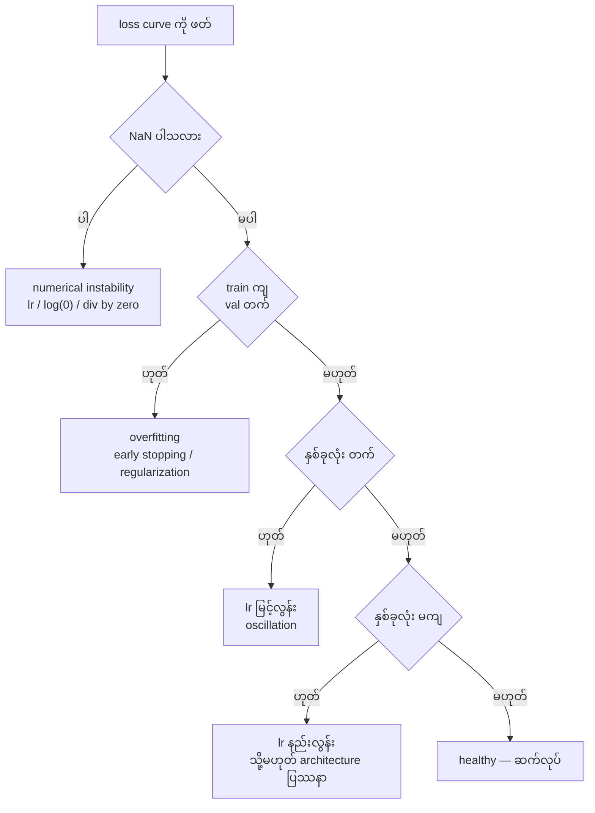

# Module 12 — Debugging & Profiling

## ၁။ ပြဿနာ — crash မဖြစ်သည့် bug

Web application တစ်ခု ကျရှုံးပါက stack trace ဖြင့် ချက်ချင်း သိသည်။ AI training loop
တစ်ခု ကျရှုံးပုံသည် အခြားပုံစံ ဖြစ်သည် — ၎င်းသည် ၈ နာရီ ကြာအောင် run သည်၊ GPU
အချိန် $200 ကုန်သည်၊ ပြီးနောက် input တိုင်း၏ mean ကို သာ ခန့်မှန်းသည့် model
တစ်ခုကို ထုတ်ပေးသည်။ Code သည် တစ်ခါမှ error မတင်ပါ။ Bug သည် tensor တစ်ခု
device လွဲနေခြင်း၊ `.detach()` ကို မေ့ခြင်း သို့မဟုတ် label များ feature ထဲ စိမ့်ဝင်ခြင်း
ဖြစ်နိုင်သည်။ Source ၏ အနှစ်ချုပ်သည် ဤသို့ ဖြစ်သည် —

> အဆိုးဆုံး AI bug များသည် crash မဖြစ်ပါ။ ၎င်းတို့သည် အမှိုက်အပေါ်တွင် တိတ်ဆိတ်စွာ
> train လုပ်ပြီး လှပသည့် loss curve ကို တင်ပြသည်။

ထို့ကြောင့် လိုအပ်သည်သည် stack trace ကို ဖတ်သည့် tools မဟုတ်ပါ။ **တန်ဖိုး မမှန်တော့သည့်
အခြေအနေကို မီမီ ဖမ်းသည့်** tools ဖြစ်သည်။ ရှေ့ဆက် မလုပ်မီ ဤ အချက်ကို လက်ခံရမည် —
AI code တွင် "run ပြီးသွားသည်" ဆိုသည်မှာ "မှန်သည်" ဟု မဆိုလိုပါ။

## ၂။ အခြေခံ အယူအဆ — debugging အဆင့် သုံးဆင့်

Source သည် AI debugging ကို အဆင့် သုံးဆင့်အဖြစ် ခွဲသည်။ အောက်ခြေသည် standard
Python အဆင့် ဖြစ်ပြီး အပေါ်ဆုံးသည် training ၏ အပြုအမူ အဆင့် ဖြစ်သည်။



**Figure 1 — Debugging အဆင့် သုံးဆင့်**

ပုံရှင်းလင်းချက် (Figure 1)

၁။ အဆင့် ၁ သည် Python ၏ ပုံမှန် tools များ ဖြစ်သည် — `breakpoint()`၊ `logging`၊
   profiler (`cProfile`, `line_profiler`) နှင့် memory tracker (`tracemalloc`)။
၂။ အဆင့် ၂ သည် tensor အဆင့် ဖြစ်သည် — shape၊ dtype၊ device နှင့် NaN/Inf တန်ဖိုး။
   ဤအဆင့်ကို စစ်ရန် `debug_print` ကဲ့သို့ helper လိုသည်။
၃။ အဆင့် ၃ သည် training သည် အချိန်အလိုက် မည်သို့ ပြုမူသည်ကို ကြည့်သည် — loss
   curve၊ gradient norm နှင့် activation distribution။ TensorBoard သည် ဤအဆင့်၏ tool ဖြစ်သည်။
၄။ Source ၏ အဓိက သတိပေးချက်သည် အောက်ခြေမှ အပေါ်သို့ မြားနှစ်ခုဖြင့် ပြထားသည် —
   လူအများစုသည် အဆင့် ၃ သို့ တိုက်ရိုက် ခုန်ပြီး TensorBoard ကို ငေးကြည့်တတ်သည်။
၅။ သို့သော် AI bug ၏ ၈၀ ရာခိုင်နှုန်းသည် အဆင့် ၁ နှင့် ၂ တွင် ရှိသည်။ ထို့ကြောင့်
   ရှာဖွေမှုကို အောက်ခြေမှ စရမည်။

## ၃။ နည်းလမ်း ရွေးချယ်ခြင်း — နှိုင်းယှဉ်ချက် ဇယား

Tool တိုင်းတွင် သင့်တော်သည့် အခြေအနေ ရှိသည်။ Source ပေးသည့် နည်းလမ်းများကို
အောက်ပါအတိုင်း နှိုင်းယှဉ်နိုင်သည် —

| နည်းလမ်း | ပြသည့် အချက် | ကုန်ကျစရိတ် | သင့်တော်သည့် အခြေအနေ |
|---|---|---|---|
| `debug_print` | shape၊ dtype၊ device၊ min/max/mean၊ NaN | အလွန်နည်း | tensor အဆင့် သံသယ ရှိသည့်အခါ |
| conditional `breakpoint()` | တန်ဖိုး တိုင်းကို အပြန်အလှန် စစ်ခြင်း | run ကို ရပ်သည် | loss သည် ရုတ်တရက် ပြောင်းသည့်အခါ |
| `logging` | timestamp နှင့် severity ပါသည့် မှတ်တမ်း | နည်း | ညဘက် run ကို မှတ်တမ်းတင်သည့်အခါ |
| `Timer` (perf_counter) | အပိုင်းအလိုက် အချိန် | နည်း | data loading နှင့် forward/backward ခွဲခြင်း |
| `cProfile` / `line_profiler` | function/လိုင်း အလိုက် အချိန် | အလယ်အလတ် | အလုံးစုံ နှေးသည့်အခါ |
| `tracemalloc` / `memory_profiler` | လိုင်း အလိုက် allocate | အလယ်အလတ် | memory ပြည့်ခါနီး သို့မဟုတ် OOM |
| TensorBoard | loss curve၊ weight/gradient histogram | နည်း (run ပြီးမှ) | အချိန်အလိုက် အပြုအမူ ကြည့်သည့်အခါ |

ဤဇယားသည် debugger ကို ရွေးသည့် ဇယား မဟုတ်ပါ — **မေးခွန်း အမျိုးအစား** ကို ရွေးသည့် ဇယား
ဖြစ်သည်။ "တန်ဖိုး မှန်/မမှန်" မေးခွန်းအတွက် `debug_print`; "ဘယ်နေရာ နှေးသည်" အတွက် profiler;
"အချိန်အလိုက် ပြောင်းလဲသည်" အတွက် TensorBoard။

## ၄။ လက်တွေ့ configuration

### Print debugging — tensor အတွက် ရည်ရွယ်သည့် print

Print debugging ကို အသေးအဖွဲ ဟု ထင်တတ်သည်။ Tensor code တွင် မမှန်ပါ — shape၊ dtype
နှင့် တန်ဖိုး အပိုင်းအခြား အားလုံးကို တစ်ချိန်တည်း ကြည့်ရန် ရည်ရွယ်သည့် print statement
တစ်ကြောင်းသည် debugger ထဲ အဆင့်လိုက် လျှောက်ခြင်းထက် ပိုကောင်းသည်။ Source ၏ helper —

```python
def debug_print(name, tensor):
    print(f"{name}: shape={tensor.shape}, dtype={tensor.dtype}, "
          f"device={tensor.device}, "
          f"min={tensor.min().item():.4f}, max={tensor.max().item():.4f}, "
          f"mean={tensor.mean().item():.4f}, "
          f"has_nan={tensor.isnan().any().item()}")
```

ဤ function သည် သံသယ ရှိသည့် operation တိုင်း၏ နောက်တွင် ခေါ်ရသည်။ Bug ကို ရှာပြီးပါက
print များကို ဖယ်လိုက်ရသည်။ `tensor.min().item()` သည် scalar tensor မှ Python float
တန်ဖိုးကို ယူသည်; `tensor.isnan().any().item()` သည် boolean အဖြစ် ပြန်သဖြင့် NaN
တစ်ခုတည်း ရှိခြင်းကိုပင် ဖမ်းသည်။

### Conditional breakpoint — လိုအပ်သည့်အခါသာ ရပ်ခြင်း

Built-in debugger သည် AI အလုပ်အတွက် အလွန်အသုံးဝင်သည်။ Training loop ထဲတွင်
`breakpoint()` ကို ချ၍ tensor များကို အပြန်အလှန် စစ်နိုင်သည်။

```python
def training_step(model, batch, criterion, optimizer):
    inputs, labels = batch
    outputs = model(inputs)
    loss = criterion(outputs, labels)

    if loss.item() > 100 or torch.isnan(loss):
        breakpoint()

    loss.backward()
    optimizer.step()
```

Debugger ထဲ ရောက်သည့်အခါ အသုံးဝင်သည့် command များ —

- `p outputs.shape` — shape စစ်ခြင်း
- `p loss.item()` — loss တန်ဖိုး ကြည့်ခြင်း
- `p torch.isnan(outputs).sum()` — NaN အရေအတွက် ရေတွက်ခြင်း
- `p model.fc1.weight.grad` — gradient စစ်ခြင်း
- `c` — ဆက်လုပ်ရန်၊ `q` — ထွက်ရန်

ဤသည်သည် **conditional debugging** ဖြစ်သည်။ ရုတ်တရက် မှားသည့်အခါသာ ရပ်သည်။
အဆင့် ၁၀၀၀၀ ရှိသည့် training run တစ်ခုအတွက် ဤအချက်သည် အလွန်အရေးကြီးသည်။



**Figure 2 — Conditional breakpoint ၏ ဆုံးဖြတ်ချက် လမ်းကြောင်း**

ပုံရှင်းလင်းချက် (Figure 2)

၁။ လမ်းကြောင်းသည် training step ၏ forward pass မှ စသည် — ထိုနေရာတွင် loss ကို ရသည်။
၂။ ဆုံးဖြတ်ချက် node သည် အခြေအနေ နှစ်ခုကို တစ်ချိန်တည်း စစ်သည် — loss သည် ၁၀၀ ထက်
   ကြီး/မကြီး နှင့် NaN ဖြစ်/မဖြစ်။
၃။ အခြေအနေ မမှီပါက လမ်းကြောင်းသည် ညာဘက်သို့ သွား၍ ပုံမှန်အတိုင်း backward နှင့်
   optimizer step ကို ဆက်လုပ်သည်။ ထို့ကြောင့် run သည် မရပ်ပါ။
၄။ အခြေအနေ မှီပါက `breakpoint()` သည် debugger ကို ဖွင့်သည်။ ဤနေရာတွင် run သည် ရပ်သည်။
၅။ Debugger ထဲတွင် node လေးခုဖြင့် ပြထားသည့် စစ်ဆေးချက်များကို လုပ်သည် — shape၊ loss
   တန်ဖိုး၊ NaN အရေအတွက် နှင့် gradient။
၆။ အဆုံးတွင် `c` ဖြင့် ဆက်လုပ်သည်။ ပြဿနာကို မဖြေရှင်းနိုင်သေးပါက `q` ဖြင့် ထွက်သည်။

### Logging — print ၏ နောက်တစ်ဆင့်

Debugging သည် ရေတို စစ်ဆေးမှုထက် ကျော်လွန်လာပါက print အစား logging ကို သုံးရသည်။

```python
import logging

logging.basicConfig(
    level=logging.INFO,
    format="%(asctime)s [%(levelname)s] %(message)s",
    handlers=[
        logging.FileHandler("training.log"),
        logging.StreamHandler()
    ]
)
logger = logging.getLogger(__name__)

logger.info("Starting training: lr=%.4f, batch_size=%d", lr, batch_size)
logger.warning("Loss spike detected: %.4f at step %d", loss.item(), step)
logger.error("NaN loss at step %d, stopping", step)
```

`basicConfig` သည် level၊ format နှင့် handler နှစ်ခုကို သတ်မှတ်သည် — `FileHandler` သည်
`training.log` ဖိုင်သို့ ရေးသည်၊ `StreamHandler` သည် terminal တွင် ပြသည်။ Logging သည်
timestamp၊ severity level နှင့် ဖိုင် output ကို ပေးသည်။ Training run သည် ည ၃ နာရီတွင်
ကျရှုံးပါက ရှာရမည့်အရာသည် ဖိုင် ဖြစ်သည် — terminal မှ လျော့ကျသွားသည့် output မဟုတ်ပါ။

### အချိန်တိုင်းခြင်း — Timer context manager

အချိန်သည် ဘယ်နေရာ ရောက်နေသည်ကို သိခြင်းသည် optimization ၏ ပထမ အဆင့် ဖြစ်သည်။

```python
import time

class Timer:
    def __init__(self, name=""):
        self.name = name

    def __enter__(self):
        self.start = time.perf_counter()
        return self

    def __exit__(self, *args):
        elapsed = time.perf_counter() - self.start
        print(f"[{self.name}] {elapsed:.4f}s")

with Timer("data loading"):
    batch = next(dataloader_iter)

with Timer("forward pass"):
    outputs = model(batch)

with Timer("backward pass"):
    loss.backward()
```

`__enter__` သည် `with` block စသည့်အခါ အချိန်ကို မှတ်သည်; `__exit__` သည် block ဆုံးသည့်အခါ
ကြာချိန်ကို တွက်ပြီး ပြသည်။ `time.perf_counter()` သည် monotonic ဖြစ်သဖြင့် ဤအလုပ်အတွက်
မှန်ကန်သည့် တိုင်းတာမှု ဖြစ်သည်။ Source ၏ အဖြစ်အများဆုံး တွေ့ရှိချက်သည် ဤသို့ ဖြစ်သည် —
**data loading သည် training အချိန်၏ ၆၀ ရာခိုင်နှုန်း** ကို စားတတ်သည်။ ဖြေရှင်းချက်သည်
GPU အသစ် မဟုတ်ပါ; DataLoader ၏ `num_workers > 0` ဖြစ်သည်။

### cProfile နှင့် line_profiler

လက်ဖြင့် timer ထက် ပိုလိုသည့်အခါ —

```bash
python -m cProfile -s cumtime train.py
```

ဤ command သည် function call တိုင်းကို cumulative time အလိုက် စီ၍ ပြသည်။ `-s cumtime`
သည် sort key ကို သတ်မှတ်သည်။ လိုင်း အလိုက် profile လုပ်ရန် —

```bash
pip install line_profiler
```

```python
@profile
def train_step(model, data, target):
    output = model(data)
    loss = F.cross_entropy(output, target)
    loss.backward()
    return loss

# Run with: kernprof -l -v train.py
```

`@profile` decorator သည် `line_profiler` မှ ပေးသည်; `kernprof -l -v` ဖြင့် run သည့်အခါ
လိုင်း အလိုက် အချိန်ကို ပြသည်။ Profiling သည် အချိန် ကို စားသဖြင့် run တိုင်း၏ အရှိန်ကို
ကျစေသည်; ထို့ကြောင့် ပြဿနာ ရှာသည့်အခါသာ ဖွင့်ရမည်။

### Memory profiling

CPU memory အတွက် `tracemalloc` သည် လိုင်း အလိုက် allocate လုပ်မှုကို ပြသည်။

```python
import tracemalloc

tracemalloc.start()

# your code here
model = build_model()
data = load_dataset()

snapshot = tracemalloc.take_snapshot()
top_stats = snapshot.statistics("lineno")
for stat in top_stats[:10]:
    print(stat)
```

`tracemalloc.start()` သည် tracking ကို စသည်; `take_snapshot()` သည် လက်ရှိ အခြေအနေကို
ဖမ်းသည်; `statistics("lineno")` သည် လိုင်း အလိုက် စီ၍ ပြသဖြင့် `[:10]` ဖြင့် အများဆုံး
၁၀ ခုကို ကြည့်သည်။ လိုင်း အလိုက် memory ကို `memory_profiler` ဖြင့်လည်း ကြည့်နိုင်သည် —

```bash
pip install memory_profiler
```

```python
from memory_profiler import profile

@profile
def load_data():
    raw = read_csv("data.csv")       # watch memory jump here
    processed = preprocess(raw)       # and here
    return processed
```

`python -m memory_profiler your_script.py` ဖြင့် run ပါက လိုင်း အလိုက် memory ကို ပြသည်။
GPU memory အတွက် PyTorch ၏ API ကို သုံးသည် —

```python
import torch

if torch.cuda.is_available():
    print(torch.cuda.memory_summary())

    print(f"Allocated: {torch.cuda.memory_allocated() / 1e9:.2f} GB")
    print(f"Cached: {torch.cuda.memory_reserved() / 1e9:.2f} GB")
```

OOM (Out of Memory) ဖြစ်သည့်အခါ source ၏ အစဉ်သည် ဤသို့ ဖြစ်သည် —

၁။ Batch size ကို လျှော့သည် (အမြဲ ပထမဆုံး စမ်းရမည့် အရာ)။
၂။ `torch.cuda.empty_cache()` ဖြင့် cached memory ကို ပြန်လွှတ်သည်။
၃။ ကြီးသည့် intermediate အတွက် `del tensor` နောက် `torch.cuda.empty_cache()`။
၄။ Mixed precision (`torch.cuda.amp`) ဖြင့် memory ကို တစ်ဝက် လျှော့သည်။
၅။ အလွန်နက်သည့် model အတွက် gradient checkpointing ကို သုံးသည်။



**Figure 3 — Profiling နှင့် memory ရှာဖွေမှု အစဉ်**

ပုံရှင်းလင်းချက် (Figure 3)

၁။ ရှာဖွေမှုသည် အလွယ်ဆုံး tool မှ စသည် — လက်ဖြင့် `Timer` ဖြင့် အပိုင်းအလိုက် အချိန်ကို ကြည့်သည်။
၂။ အပိုင်း ကြီး တစ်ခုခု နှေးသည်ကို သိပါက `cProfile` ဖြင့် function အဆင့်သို့ ဆင်းသည်။
၃။ ရလဒ် ဇယားတွင် column လေးခု ရှိသည် — function အမည်၊ ncalls၊ tottime (self time) နှင့်
   cumtime (sub-call ပါသည့် အချိန်)။
၄။ Hotspot ကို ရှာသည့်အခါ `site-packages` နှင့် built-in frame များကို ဖယ်ရမည် —
   ပြင်၍ မရနိုင်သည့် frame ကို အောင်မြင်စွာ optimize လုပ်၍ မရပါ။
၅။ အချိန် ပြဿနာ ပြီးပါက memory ကို ကြည့်သည် — `tracemalloc.take_snapshot()` ဖြင့် ဖမ်းသည်။
၆။ `statistics("lineno")[:10]` သည် အများဆုံး allocate လုပ်သည့် လိုင်းကို ရှေ့ဆုံးတွင် ပြသည်။
၇။ အဆုံးတွင် batch size လျှော့ခြင်း သို့မဟုတ် ကုဒ်ကို ပြင်ခြင်းဖြင့် အဆင့်ကို ပြန်စစ်သည်။

### အဖြစ်များသည့် AI bug လေးမျိုး

Source ၏ Part 7 သည် AI code တွင် ထပ်ခါတလဲလဲ ဖြစ်သည့် bug လေးမျိုးကို နှင့် ဖမ်းသည့်
နည်းလမ်းကို ပေးသည်။

**Shape mismatch** — အဖြစ်အများဆုံး bug ဖြစ်သည်။ Tensor တစ်ခုသည် `[batch, features]`
ဖြစ်နေစဉ် model သည် `[batch, channels, height, width]` ကို မျှော်လင့်နေသည်။ Source ၏
`check_shapes(model, sample_input)` သည် forward hook မှတစ်ဆင့် module တိုင်း၏
`input shape -> output shape` ကို ပြသည်; sample batch တစ်ခုဖြင့် တစ်ကြိမ် ခေါ်ရုံဖြင့်
model တစ်ခုလုံး၏ shape ကူးပြောင်းမှုကို မြေပုံရသည်။

**NaN loss** — meaning တစ်ခုခု ပေါက်ကွဲသွားခြင်း ဖြစ်သည်။ အကြောင်းရင်းများသည် —
learning rate မြင့်လွန်းခြင်း၊ ကိုယ်ပိုင် loss တွင် သုညဖြင့် စားခြင်း၊ သုည သို့မဟုတ်
အနုတ်ကိန်း၏ `log`၊ RNN တွင် gradient ပေါက်ကွဲခြင်း။ Source ၏ `detect_nan(model, loss, step)`
သည် NaN loss ကို တွေ့ပါက parameter တိုင်း၏ gradient ကို လိုက်၍ NaN/Inf ရှိသည့်
parameter အမည်ကို ပြသည်။

**Data leakage** — model သည် test set တွင် ၉၉ ရာခိုင်နှုန်း accuracy ရသည်ဆိုပါက
အလွန်ကောင်းသည်ဟု ထင်ရသည်။ ၎င်းသည် bug ဖြစ်သည်။ Source ၏
`check_data_leakage(train_set, test_set, id_column="id")` သည် train နှင့် test ၏ id set
နှစ်ခု ဆုံသည့် ပမာဏကို ကြည့်သည် — ဆုံသည့် sample ရှိပါက သတိပေးသည်။ ထို့အပြင်
**temporal leakage** ကိုလည်း စစ်ရသည် — အနာဂတ် data ဖြင့် အတိတ်ကို ခန့်မှန်းခြင်း;
split မလုပ်မီ timestamp အလိုက် စီရမည်။

**Wrong device** — CPU နှင့် GPU တွင် ရှိသည့် tensor နှစ်ခုသည် runtime error ဖြစ်စေသည်။
သို့သော် တစ်ခါတစ်ရံ tensor တစ်ခုသည် တိတ်ဆိတ်စွာ CPU တွင် ကျန်နေပြီး အခြားအားလုံးသည်
GPU တွင် ရှိနေတတ်သည် — ထိုအခါ training သည် ကျရှုံးခြင်း မရှိဘဲ နှေးရုံသာ ဖြစ်သည်။
`check_devices(model, *tensors)` သည် model device နှင့် tensor တိုင်း၏ device ကို
နှိုင်းယှဉ်၍ မတူပါက WARNING ပြသည်။

### TensorBoard — အချိန်အလိုက် အပြုအမူ

TensorBoard သည် training အတွင်း ဘာဖြစ်နေသည်ကို အချိန်အလိုက် ပြသည်။

```bash
pip install tensorboard
```

```python
from torch.utils.tensorboard import SummaryWriter

writer = SummaryWriter("runs/experiment_1")

for step in range(num_steps):
    loss = train_step(model, batch)

    writer.add_scalar("loss/train", loss.item(), step)
    writer.add_scalar("lr", optimizer.param_groups[0]["lr"], step)

    if step % 100 == 0:
        for name, param in model.named_parameters():
            writer.add_histogram(f"weights/{name}", param, step)
            if param.grad is not None:
                writer.add_histogram(f"grads/{name}", param.grad, step)

writer.close()
```

`SummaryWriter` သည် `runs/experiment_1` ဖိုဒါသို့ event ဖိုင်များ ရေးသည်။ `add_scalar`
သည် တန်ဖိုး တစ်ခုတည်းကို အချိန်အလိုက် မှတ်တမ်းတင်သည်; `add_histogram` သည် tensor
တစ်ခုလုံး၏ distribution ကို မှတ်တမ်းတင်သည်။ Launch လုပ်ရန် —

```bash
tensorboard --logdir=runs
```

TensorBoard တွင် ရှာရမည့် အချက်များကို source သည် ဤသို့ ပေးသည် —

- **Loss မကျခြင်း** — learning rate နည်းလွန်းခြင်း သို့မဟုတ် model architecture ပြဿနာ
- **Loss ရုတ်တရက် တက်/ကျ ဖြစ်ခြင်း** — learning rate မြင့်လွန်းခြင်း
- **Loss သည် NaN သို့ ရောက်ခြင်း** — numerical instability
- **Train loss ကျ၊ val loss တက်** — overfitting
- **Weight histogram များ သုညသို့ ကျုံ့ခြင်း** — vanishing gradient
- **Gradient histogram များ ပေါက်ကွဲခြင်း** — gradient clipping လိုသည်

### VS Code debugger

အပြန်အလှန် debugging အတွက် VS Code ကို `launch.json` ဖြင့် configure လုပ်သည် —

```json
{
    "version": "0.2.0",
    "configurations": [
        {
            "name": "Debug Training",
            "type": "debugpy",
            "request": "launch",
            "program": "${file}",
            "console": "integratedTerminal",
            "justMyCode": false
        }
    ]
}
```

`justMyCode` ကို false ထားခြင်းသည် library ကုဒ်ထဲသို့လည်း ဝင်စစ်နိုင်ရန် ဖြစ်သည်။
Breakpoint များကို gutter တွင် နှိပ်၍ ချသည်။ Variables pane သည် tensor များ၏
property များကို ကြည့်ရန် ဖြစ်သည်။ Debug Console သည် run နေစဉ်အတွင်း Python
expression များကို ခေါ်နိုင်စေသည်။ ဤအရာသည် data preprocessing pipeline ကို
အဆင့်လိုက် လျှောက်ကြည့်သည့်အခါ အသုံးအဝင်ဆုံး ဖြစ်သည်။

## ၅။ Loss curve ကို ဖတ်ခြင်း

Source ၏ Ship It နှင့် exercise ၄ သည် loss curve မှ overfit ကို ဆုံးဖြတ်ခြင်းကို
အလေးပေးသည်။ ဆုံးဖြတ်ချက် အစဉ်ကို အောက်ပါအတိုင်း ရေးနိုင်သည် —



**Figure 4 — Loss curve မှ ရောဂါ ရှာသည့် ဆုံးဖြတ်ချက် ဇယား**

ပုံရှင်းလင်းချက် (Figure 4)

၁။ ပထမ မေးခွန်းသည် NaN ဖြစ်သည် — NaN ရှိပါက အခြား စစ်ဆေးမှု မလိုတော့ပါ၊ ဂဏန်း
   တွက်ချက်မှု ပြဿနာ ဖြစ်သည်။
၂။ NaN မရှိပါက train loss နှင့် val loss ၏ လမ်းကြောင်းကို နှိုင်းယှဉ်သည်။
၃။ Train ကျနေစဉ် val တက်ပါက `overfitting` ဖြစ်သည် — ဖြေရှင်းချက်သည် early stopping
   သို့မဟုတ် regularization ဖြစ်သည်; training data ပိုမလိုပါ။
၄။ နှစ်ခုလုံး တက်ပါက learning rate မြင့်လွန်းသဖြင့် oscillation ဖြစ်သည် — lr ကို လျှော့ရမည်။
၅။ နှစ်ခုလုံး မကျဘဲ ရပ်နေပါက learning rate နည်းလွန်းခြင်း သို့မဟုတ် architecture
   ပြဿနာ ဖြစ်သည်။
၆။ နှစ်ခုလုံး ကျနေပါက run သည် healthy ဖြစ်သည် — ဆက်လုပ်နိုင်သည်။

## ၆။ လည်ပတ်ရေး သတိပြုရမည့် အချက်များ

- **အဆင့် ၃ မှ မစရ** — TensorBoard ကို ငေးကြည့်ခြင်းသည် အချိန် ကုန်သည်။ Bug ၏ ၈၀
  ရာခိုင်နှုန်းသည် အဆင့် ၁ နှင့် ၂ တွင် ရှိသဖြင့် `debug_print` နှင့် `check_shapes` မှ စရမည်။
- **NaN ကို အရင် စစ်ရ** — NaN သည် min/max/mean တွက်ချက်မှုတိုင်းကို ဖျက်ဆီးသဖြင့်
  တန်ဖိုး များကို မယုံမီ `has_nan` ကို စစ်ရမည်။
- **Conditional ဖြစ်ရမည်** — `breakpoint()` ကို condition မပါဘဲ ချပါက အဆင့် ၁၀၀၀၀ run
  တွင် အသုံးမဝင်ပါ။ `loss.item() > 100 or torch.isnan(loss)` ကဲ့သို့ အတိအကျ ချရမည်။
- **Profile ကို run တိုင်း မဖွင့်ရ** — `cProfile` နှင့် `line_profiler` သည် အရှိန်ကို ကျစေသည်;
  ပြဿနာ ရှာသည့်အခါသာ ဖွင့်ရမည်။ `time.perf_counter()` ကို အသုံးပြုသည့် တိုင်းတာမှုတွင်
  run တစ်ခုတည်း၏ ဂဏန်းကို မယုံရ — ပထမ run တွင် start-up cost ပါသည်။
- **Memory ကို လျှော့ရမည်** — OOM ဖြစ်သည့်အခါ ပထမဆုံး လုပ်ရမည့် အရာသည် batch size
  လျှော့ခြင်း ဖြစ်သည်; GPU အသစ် မလိုပါ။
- **Data leakage ကို အလေးအနက် စစ်ရ** — accuracy ၉၉ ရာခိုင်နှုန်းသည် အောင်မြင်မှု အထောက်အထား
  မဟုတ်ဘဲ သံသယ အချက် ဖြစ်သည်။
- **Version များ ကွာခြားသည်** — `line_profiler`၊ `memory_profiler` နှင့် `tensorboard` ၏
  command/flag များသည် version အလိုက် ပြောင်းလဲနိုင်သည်; version အလိုက် ပြန်စစ်ရန် လိုသည်။
- **Log ဖိုင် ထားရမည်** — `FileHandler` မပါသော run သည် ညဘက် ကျရှုံးသည့်အခါ
  အထောက်အထား ချန်မထားပါ။

## ၇။ ကိုယ်တိုင် စစ်ဆေးခြင်း (Self-check)

**မေးခွန်း ၁။ AI code ၏ bug သည် web application ၏ bug နှင့် ဘယ်လို ကွာခြားသလဲ။**
အဖြေ — AI bug များသည် error မတင်ဘဲ တန်ဖိုး မှားသည့် ရလဒ်ကို ထုတ်သည်။ Web app သည်
stack trace ဖြင့် ချက်ချင်း ကျရှုံးသည်; training loop သည် နာရီပေါင်းများစွာ မှားနေသည့်
အခြေအနေတွင် run ပြီး လှပသည့် loss curve ကို တင်ပြသည်။

**မေးခွန်း ၂။ Profiler သည် ဘာကို တိုင်းသလဲ။**
အဖြေ — Code ၏ အပိုင်း တိုင်း သုံးသည့် အရင်းအမြစ်ကို တိုင်းသည် — function တစ်ခုချင်း၏
အချိန် (tottime/cumtime)၊ memory allocation နှင့် GPU အသုံးပြုမှု။ ဤအချက်သည်
bottleneck ကို ရှာပြီး အနှေးဆုံး နေရာကို ဦးစားပေး optimize လုပ်ရန် အသုံးဝင်သည်။

**မေးခွန်း ၃။ Model သည် test set တွင် ၉၉ ရာခိုင်နှုန်း accuracy ရသည့်အခါ ပထမဆုံး
သံသယ ရမည့် AI-specific bug သည် ဘာလဲ။**
အဖြေ — Data leakage ဖြစ်သည်။ Test sample များသည် training set ထဲ စိမ့်ဝင်နေခြင်း
သို့မဟုတ် feature များထဲတွင် target label ပါနေခြင်း ဖြစ်နိုင်သည်။ Train/test id set
နှစ်ခု ဆုံ/မဆုံ စစ်ရမည်။

**မေးခွန်း ၄။ Training loop တစ်ခုကို profile လုပ်သည့်အခါ အဖြစ်အများဆုံး
တွေ့ရှိချက်သည် ဘာလဲ။**
အဖြေ — Data loading သည် forward နှင့် backward pass နှစ်ခုလုံး ပေါင်းထက် အချိန် ပိုစားတတ်သည်
(DataLoader တွင် `num_workers=0` ဖြစ်သည့်အခါ ၆၀ ရာခိုင်နှုန်း နှင့်အထက်)။ ဖြေရှင်းချက်သည်
`num_workers > 0` သတ်မှတ်၍ GPU တွက်ချက်မှုနှင့် တစ်ပြိုင်နက် data ကို load လုပ်ခြင်း ဖြစ်သည်။

**မေးခွန်း ၅။ Step ၅၀၀ တွင် NaN loss ကို တွေ့ပါက မည်သည့် နည်းလမ်းဖြင့်
အမြစ်ကို ရှာမည်နည်း။**
အဖြေ — ပထမဦးစွာ `detect_nan` ဖြင့် parameter တိုင်း၏ gradient တွင် NaN/Inf ရှိ/မရှိ စစ်သည်။
ထို့နောက် NaN ဖြစ်သည့် step တွင် conditional `breakpoint()` ကို ချ၍ tensor များကို
အပြန်အလှန် စစ်သည်။ အဖြစ်အများဆုံး အကြောင်းရင်းများသည် learning rate မြင့်လွန်းခြင်း၊
`log(0)` နှင့် သုညဖြင့် စားခြင်း ဖြစ်သည်။

## Technical review notes

- Source ၏ metadata သည် `Time: ~60 minutes` ဟု ဖော်ပြသည်; `MODULE_SPEC.md` သည်
  `~60 min` ဟု ဖော်ပြသည်။ ဤ module ၏ `README.md` တွင် spec ၏ တန်ဖိုးကို သုံးထားသည်;
  Source ၏ တန်ဖိုးသည် ကွာခြားသည်ကို ဤနေရာတွင် မှတ်ထားသည်။
- `lab.py` သည် torch မရှိသည့် machine တွင်လည်း run နိုင်ရမည် ဖြစ်သဖြင့် tensor ကို
  **nested list** အဖြစ် ကိုယ်စားပြုထားသည်။ `debug_print` သည် source ၏ function အမည်နှင့်
  field များ (shape၊ dtype၊ device၊ min၊ max၊ mean၊ has_nan) ကို ထိန်းထားပြီး
  tensor API ကို nested list အပေါ် တွက်သည့် helper ဖြင့် အစားထိုးထားသည်။
- Pure Python တွင် ကိန်းဂဏန်း သုညဖြင့် စားခြင်းသည် `ZeroDivisionError` မြှင့်သဖြင့်
  NaN အမှန်ကို `inf / inf` (IEEE 754) ဖြင့် ဖန်တီးထားသည်။ ရလဒ်သည် NaN အမှန် ဖြစ်သည် —
  ဖော်ပြထားခြင်း မဟုတ်ပါ။ `solution.md` ရှိ run ရလဒ်သည် ဤ run မှ တကယ် ရသည့် output ဖြစ်သည်။
- `cProfile` ၏ stats ဇယားနှင့် `tracemalloc` ၏ snapshot ကို **နမူနာ fixture** အဖြစ်
  `lab.py` ထဲတွင် ထည့်ထားသည်; ထို တန်ဖိုးများသည် source မှ မဟုတ်ပါ — profiling နှင့်
  memory ရှာဖွေမှု နည်းလမ်းကို offline တွင် သရုပ်ပြရန် ဖြစ်သည်။ မိမိ တန်ဖိုးကို
  `python -m cProfile -s cumtime` နှင့် `tracemalloc` ကို ကိုယ်တိုင် run ၍ ရယူရမည်။
- `training_health_report` ၏ ဇယား သုံးခု (overfit၊ healthy၊ unstable) သည် ဤ course
  ကိုယ်တိုင် ရေးသည့် နမူနာ data ဖြစ်သည်; သင်ခန်းစာ၏ ဆုံးဖြတ်ချက် အစဉ်ကို စစ်ရန် ဖြစ်သည်။
- Source တွင် ဖော်ပြထားသည့် အဖြစ်အများဆုံး တွေ့ရှိချက် (data loading ၆၀ ရာခိုင်နှုန်း) နှင့်
  OOM အတွက် အစဉ် ငါးဆင့်ကို source အတိုင်း ဖော်ပြထားသည် — ပြင်ထားခြင်း မရှိပါ။
- `pip install` command များနှင့် `tensorboard` flag များသည် version အလိုက်
  ပြောင်းလဲနိုင်သည် — version အလိုက် ပြန်စစ်ရန် လိုသည်။

## References & Further Reading

- Source lesson — https://aiengineeringfromscratch.com/lesson?path=phases%2F00-setup-and-tooling%2F12-debugging-and-profiling
- Source repository — https://github.com/rohitg00/ai-engineering-from-scratch (MIT), `phases/00-setup-and-tooling/12-debugging-and-profiling/`
- Python `breakpoint()` built-in — https://docs.python.org/3/library/functions.html#breakpoint
- Python `pdb` debugger — https://docs.python.org/3/library/pdb.html
- Python `logging` — https://docs.python.org/3/library/logging.html
- Python `time.perf_counter()` — https://docs.python.org/3/library/time.html#time.perf_counter
- Python `cProfile` နှင့် `profile` — https://docs.python.org/3/library/profile.html
- Python `tracemalloc` — https://docs.python.org/3/library/tracemalloc.html
- `line_profiler` — https://github.com/pyutils/line_profiler
- `memory_profiler` — https://github.com/pythonprofilers/memory_profiler
- TensorBoard — https://www.tensorflow.org/tensorboard
- PyTorch `torch.utils.tensorboard` — https://pytorch.org/docs/stable/tensorboard.html
- PyTorch CUDA memory management — https://pytorch.org/docs/stable/notes/cuda.html
