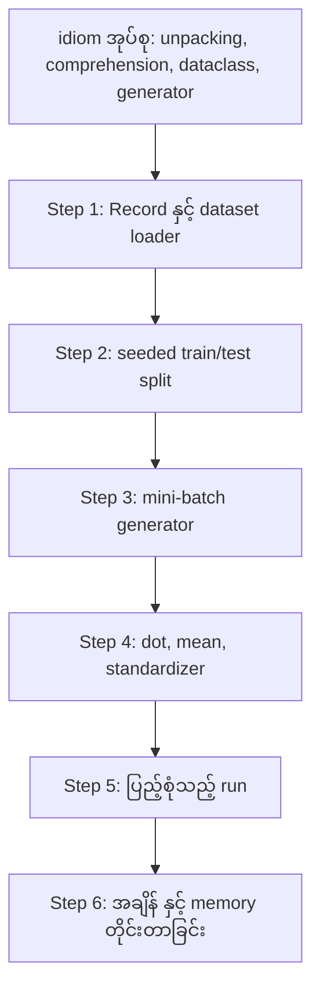
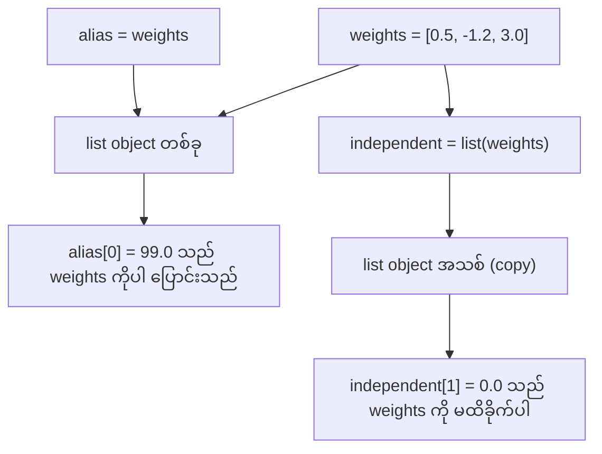
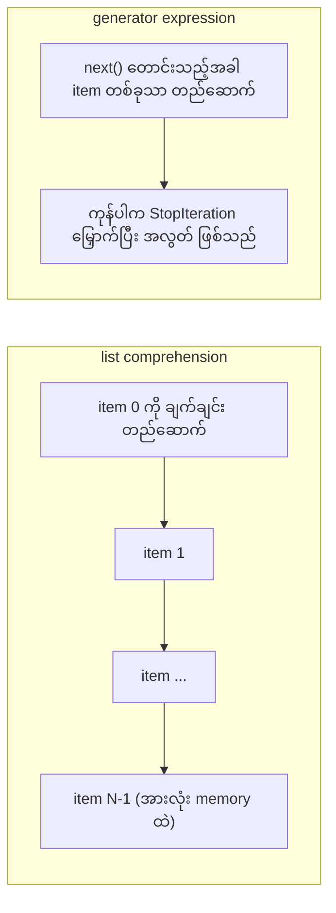

# Module 13 — Python for AI Engineering

> Most code in this course uses the same small set of Python idioms. Learn that set here, before the math and model lessons depend on it.

## ပြဿနာ — syntax ဖတ်နေရခြင်း နှင့် error မတက်သည့် အမှား

ဤ phase ပြီးနောက် သင်ခန်းစာများသည် သင်္ချာ နှင့် model အတွက် ရိုးရိုး Python ကို သုံးသည်။ Source lesson သည် `phases/*/*/code/` ရှိ Python ဖိုင် **541 ခု** ကို `ast` module ဖြင့် စစ်ထားသည်။ ထို ဖိုင် **276 ခု** သည် `dataclasses` ကို import လုပ်သည်။ ဖိုင် **187 ခု** သည် `random.seed` ကို ခေါ်သည် သို့မဟုတ် `random.Random` generator ကို ဖန်တီးသည်။ ထို idiom များသည် အသစ် ဖြစ်ပါက သင်္ချာကို ဖတ်လိုသည့်အခါ syntax ကို ဖတ်နေရသည်။

ဒုတိယ ပြဿနာမှာ **error မတက်ဘဲ ရလဒ် မှားစေသည့်** အပြုအမူ သုံးမျိုး ဖြစ်သည်။

- နာမည် (name) နှစ်ခုသည် object တစ်ခုတည်းကို ညွှန်နိုင်သည်။ ထို့ကြောင့် နာမည် တစ်ခုမှ တစ်ဆင့် ပြောင်းလိုက်သည့် အပြောင်းအလဲသည် အခြား နာမည်မှ လည်း မြင်ရသည်။
- Default argument သည် ခေါ်သည့် အကြိမ်တိုင်း ကြားတွင် မိမိ၏ တန်ဖိုးကို ထိန်းထားသည်။
- Generator သည် တစ်ကြိမ် ဖြတ်ပြီးပါက အလွတ် ဖြစ်သည်။ ဒုတိယ training epoch သည် data မရတော့ဘဲ loss မပြောင်းတော့ပါ။

တတိယ ပြဿနာမှာ အမြန်နှုန်း ဖြစ်သည်။ Source ကိုယ်တိုင် တိုင်းထားသည့် စမ်းသပ် laptop တွင် float တစ်သန်းအပေါ် pure Python loop သည် **~30 ms** ယူသည်။ NumPy သည် တူညီသည့် dot product ကို **1 ms အောက်** ဖြင့် တွက်သည်။ ထို အကြောင်းရင်းကို သိထားရမည်၊ ရှင်းလင်းသည့် loop နှင့် array operation ကြား ရွေးချယ်နိုင်ရမည်။

## အခြေခံ သဘောတရား — course code အများစု သုံးသည့် အရာ

Source lesson သည် ဖိုင် 541 ခုကို construct တစ်ခုစီ အနည်းဆုံး တစ်ကြိမ် သုံး/မသုံး ရေတွက်ထားသည်။ ကိန်းဂဏန်းများသည် lesson ရေးသည့် နေ့၏ အနေအထား ဖြစ်ပြီး lesson အသစ် ထည့်တိုင်း ပြောင်းလဲသည်။

| Construct | Files | Share |
|-----------|-------|-------|
| Function definitions | 541 | 100% |
| `if __name__ == "__main__":` | 529 | 98% |
| f-strings | 517 | 96% |
| Tuple unpacking | 448 | 83% |
| Classes | 379 | 70% |
| List comprehensions | 375 | 69% |
| Type hints on functions | 342 | 63% |
| Generator expressions | 326 | 60% |
| Slices | 314 | 58% |
| `lambda` | 175 | 32% |
| `try` and `except` | 120 | 22% |
| `with` statements | 96 | 18% |
| Dict comprehensions | 93 | 17% |
| Generator functions with `yield` | 14 | 3% |

Import များသည် standard module မည်သည့်အရာ အရေးကြီးသည်ကို ပြသည်။ ဖိုင် 541 ခုအနက် **340 ခု** သည် `from __future__ import annotations` ဖြင့် စသည်၊ **276 ခု** သည် `dataclasses` ကို import လုပ်သည်။ `math`၊ `random` နှင့် `json` module များသည် ဖိုင် **187**၊ **175** နှင့် **126** ခုတွင် ပါသည်။ `collections` သည် ဖိုင် 70 ခုတွင် ပါပြီး `itertools` သည် ဖိုင် **4 ခု** တွင်သာ ပါသည်။

Lesson တစ်ခုမျှ `map()` သို့မဟုတ် `filter()` ကို ခေါ်ခြင်း မရှိပါ။ ထို အလုပ်ကို comprehension များက လုပ်သည်။ `sorted`၊ `min`၊ `max` သို့မဟုတ် `.sort` ကို `key=` function နှင့်တကွ ခေါ်သည့် နေရာသည် ဖိုင် **140 ကျော်** တွင် ပါသည်။ ဤ lesson သည် ဤစာရင်း၏ အပေါ်ပိုင်း idiom များအတွက် အချိန် အများဆုံး ပေးသည်။

Figure 1 သည် idiom အုပ်စုမှ လက်တွေ့ build အထိ အစဉ်ကို ပြသည်။



**Figure 1 — idiom အုပ်စုမှ လက်တွေ့ toolkit အထိ အစဉ်**

ပုံရှင်းလင်းချက် (Figure 1)

1. Idiom အုပ်စု (unpacking၊ comprehension၊ dataclass၊ generator) သည် အခြေခံ အဆင့် ဖြစ်သည်။
2. Step 1 မှ Step 4 အထိ ထို idiom များဖြင့် သေးငယ်သည့် အစိတ်အပိုင်း တစ်ခုချင်း တည်ဆောက်သည်။
3. Step 5 သည် အစိတ်အပိုင်း အားလုံးကို ချိတ်ဆက်ပြီး ပြည့်စုံသည့် run တစ်ခု ရသည်။
4. Step 6 သည် ထို run ၏ အမြန်နှုန်း နှင့် memory ကို တိုင်းသည်။
5. ဤ module ၏ `lab.py` သည် ထို အစဉ်အတိုင်း exercise ၆ ခုကို စီထားသည်။

### နာမည်များသည် object များကို ညွှန်သည်

Python တွင် variable သည် object တစ်ခုကို ညွှန်သည့် **နာမည်** ဖြစ်သည်။ Assignment သည် နာမည်ကို object တစ်ခုနှင့် ချိတ်သည်။ Object ကို **ကူးယူခြင်း မဟုတ်ပါ**။ နာမည် နှစ်ခုသည် list တစ်ခုတည်းကို ညွှန်ပါက နာမည် တစ်ခုမှ ပြောင်းလိုက်သည့် အပြောင်းအလဲကို နာမည် နှစ်ခုစလုံးမှ မြင်ရသည်။ ဂဏန်း၊ string နှင့် tuple သည် မပြောင်းလဲနိုင်သောကြောင့် ထို စည်းမျဉ်းသည် သူတို့အတွက် ပြဿနာ မဖြစ်စေပါ။ List၊ dict နှင့် set သည် ပြောင်းလဲနိုင်သောကြောင့် သီးခြား version လိုပါက copy လုပ်ရမည်။

```python
weights = [0.5, -1.2, 3.0]
alias = weights
alias[0] = 99.0
print(weights)
```

```text
[99.0, -1.2, 3.0]
```

Source lesson သည် matrix အတွက် ထပ်တူ ထောင်ချောက်ကို လည်း ပြသည်။ `[[0] * 3] * 2` သည် အပြင်ဘက် list ကို အတွင်းဘက် list တစ်ခုတည်း၏ ကိုးကား နှစ်ခုဖြင့် ဖန်တီးသည်။ Comprehension ပုံစံ `[[0] * 3 for _ in range(2)]` သည် row တိုင်းအတွက် အတွင်းဘက် list အသစ် ဖန်တီးသည်။ သင်္ချာ phase သည် matrix ကို list များမှ တည်ဆောက်သောကြောင့် comprehension ပုံစံကို သုံးရမည်။

Figure 2 သည် နာမည် နှစ်ခု နှင့် copy တစ်ခု၏ ခြားနားချက်ကို ပြသည်။



**Figure 2 — နာမည် နှစ်ခု နှင့် copy တစ်ခု ကွာခြားချက်**

ပုံရှင်းလင်းချက် (Figure 2)

1. `weights` သည် list object တစ်ခုကို ညွှန်သည်။
2. `alias = weights` သည် ထို object တစ်ခုတည်းကို ညွှန်သည့် နာမည် အသစ် ဖြစ်သည်။ copy အသစ် မရပါ။
3. `alias[0] = 99.0` သည် ထို object ကို ပြောင်းသည်၊ ထို့ကြောင့် `weights` ဖြင့် ဖတ်သည့်အခါ လည်း တန်ဖိုး အသစ် ကို မြင်ရသည်။
4. `independent = list(weights)` သည် element များကို ကူးယူ၍ object အသစ် ဖန်တီးသည်။
5. Object အသစ်ကို ပြောင်းခြင်းသည် မူရင်း object ကို လုံးဝ မထိခိုက်ပါ။

### list သည် pointer ကို ကိုင်ထားသည်၊ array သည် ဂဏန်းကို ကိုင်ထားသည်

Python list သည် ဂဏန်းများကို တိုက်ရိုက် မသိမ်းပါ။ **pointer** များကို သိမ်းပြီး pointer တိုင်းသည် Python object တစ်ခုလုံးကို ညွှန်သည်။ 64-bit CPython build တွင် pointer တစ်ခုသည် **8 byte** ယူပြီး `float` object တစ်ခုသည် **24 byte** ယူသည်။ NumPy `float64` array သည် raw **8-byte** တန်ဖိုးများကို memory block တစ်ခုတည်းထဲတွင် ဘေးချင်း ကပ်သိမ်းသည်။

List ကို loop လုပ်သည့်အခါ element တိုင်းအတွက် အလုပ် အများအပြား လုပ်ရသည်။ Interpreter သည် bytecode instruction တစ်ခုချင်း run သည်။ Element တိုင်းအတွက် pointer ကို လိုက်ပြီး operand တိုင်း၏ type ကို စစ်သည်။ ထို့နောက် float မြှောက်ခြင်း code ကို ခေါ်ပြီး ရလဒ်အတွက် Python float object အသစ် ဖန်တီးသည်။

NumPy သည် တူညီသည့် သင်္ချာကို compiled code loop ဖြင့် raw တန်ဖိုးများအပေါ် တွက်သည်။ Data type ကို array တစ်ခုလုံးအတွက် တစ်ကြိမ်သာ စစ်ပြီး element တိုင်းအတွက် Python object တစ်ခုမျှ မဖန်တီးပါ။ Vectorized code သည် `(x - mean) / std` ကဲ့သို့ array တစ်ခုလုံးအပေါ် operation **တစ်ခု** ကို ဖော်ပြပြီး library က loop ကို run သည်။ ဤ lesson ၏ vector function များသည် ထို စည်းမျဉ်းကို လိုက်သည် — function တိုင်းသည် array operation တစ်ခုသာ လုပ်သောကြောင့် နောက်ပိုင်းတွင် NumPy ခေါ်ဆိုမှု တစ်ခုဖြင့် အစားထိုးနိုင်သည်။

### list သည် item အားလုံးကို ကိုင်ထားသည်၊ generator သည် တစ်ခုတည်း ကိုင်ထားသည်

List comprehension သည် နောက် လိုင်း မစမီ item အားလုံးကို တည်ဆောက်သည်။ Generator သည် caller က နောက် item ကို တောင်းသည့် အခါတိုင်း item တစ်ခုသာ တည်ဆောက်သည်။ List အတွက် memory သည် item အရေအတွက်နှင့်အတူ ကြီးလာသည်။ Generator အတွက် memory သည် item အရေအတွက် မည်မျှပင် ဖြစ်ပါစေ တူညီလုနီးပါး ရှိသည်။

Generator သည် တစ်ကြိမ်သာ run နိုင်သည်။ Item နောက်ဆုံး ပြီးပါက တောင်းသည့် အခါတိုင်း `StopIteration` ကို မြှောက်သည်၊ ထို့ကြောင့် ဒုတိယ `for` loop သည် item တစ်ခုမှ မရပါ။ Training code သည် dataset ကို epoch တိုင်း တစ်ကြိမ် ဖတ်သည်၊ ထို့ကြောင့် epoch တိုင်းအတွက် generator အသစ် ဖန်တီးရမည်။

Source တွင် generator function များ ရှားသည် (ဖိုင် 3%)။ သို့သော် deep learning သင်ခန်းစာများ သုံးသည့် data loader များသည် batch များ၏ iterable ဖြစ်သောကြောင့် ထို သဘောတရားသည် training loop တိုင်းတွင် ပါသည်။

```python
as_list = [i * i for i in range(1_000_000)]
as_generator = (i * i for i in range(1_000_000))
print(sys.getsizeof(as_list), sys.getsizeof(as_generator))
```

64-bit CPython တွင် list သည် **~8 MB** ကို report လုပ်ပြီး generator သည် **~200 byte** ကို report လုပ်သည်။ `sys.getsizeof` သည် list ၏ pointer များကိုသာ ရေတွက်ပြီး ဂဏန်း object များက memory ပိုယူသည်။ စစ်မှန်သည့် peak ကို `tracemalloc` ဖြင့် တိုင်းသည် — ထို module ကို debugging နှင့် profiling သင်ခန်းစာတွင် သုံးခဲ့သည်။

Figure 3 သည် list နှင့် generator ၏ memory ပုံစံကို ပြသည်။



**Figure 3 — list နှင့် generator ၏ memory ပုံစံ**

ပုံရှင်းလင်းချက် (Figure 3)

1. List comprehension သည် item တိုင်းကို ဆက်တိုက် တည်ဆောက်ပြီး item အားလုံးကို memory ထဲ တစ်ပြိုင်နက် ထားသည်။
2. ထို့ကြောင့် list ၏ memory သည် item အရေအတွက်နှင့် အချိုးကျ ကြီးလာသည်။
3. Generator expression သည် `next()` ဖြင့် တောင်းသည့် အခါတိုင်း item တစ်ခုသာ တည်ဆောက်ပြီး ပေးလိုက်သည်။
4. Item ကုန်ပါက generator သည် `StopIteration` ကို မြှောက်ပြီး အလွတ် ဖြစ်သည် — ဒုတိယ အကြိမ် ဖြတ်ခြင်းကို မရနိုင်ပါ။
5. ထို အချက်နှစ်ချက်သည် အမှား သုံးမျိုး စာရင်းရှိ တတိယအချက်၏ အရင်းအမြစ် ဖြစ်သည်။

## လိုအပ်သည့် idiom များ

ဤအပိုင်း၏ block တိုင်းသည် မိမိအပေါ် မိမိ run နိုင်သည်။ ဖိုင် တစ်ခုသို့ သိမ်းပြီး `python3` ဖြင့် run ပါ။ Block များသည် Python **3.11** သို့မဟုတ် အထက် လိုသည် — dev environment သင်ခန်းစာတွင် install လုပ်ခဲ့သည့် version ဖြစ်သည်။

### 1. Values, collections နှင့် unpacking

Python တွင် built-in collection လေးမျိုး ရှိသည်။

| Type | Example | Ordered | Can change | Course တွင် ပုံမှန် အသုံး |
|------|---------|---------|------------|---------------------------|
| `list` | `[0.5, 1.2]` | Yes | Yes | Samples, losses, weights |
| `tuple` | `(32, 784)` | Yes | No | Shapes, fixed records, dict keys |
| `dict` | `{"lr": 0.01}` | Insertion order | Yes | Configs, vocabularies, JSON rows |
| `set` | `{"cat", "dog"}` | No | Yes | Unique tokens, overlap checks |

Unpacking သည် sequence တစ်ခု၏ item များကို နာမည် အများအပြားသို့ လိုင်း တစ်လိုင်းတည်းဖြင့် ခွဲပေးသည်။ Star ပါသည့် နာမည်သည် ကျန် item များကို စုသည်။ f-string သည် expression တစ်ခု၏ တန်ဖိုးကို string ထဲ ထည့်သည်၊ colon နောက်တွင် format ထည့်နိုင်သည်။ `dict.get` သည် key မရှိပါက default တန်ဖိုးကို ပြန်ပေးသည်။ `in` test သည် set အရွယ်အစား မည်မျှပင် ဖြစ်ပါစေ အချိန် အတူတူလုနီးပါး ယူသည်။ Slice `a[start:stop:step]` သည် `start` ကို ပါဝင်စေပြီး `stop` ကို မပါဝင်စေပါ။ List slice သည် list အသစ် ဖြစ်သောကြောင့် list ကြီး တစ်ခုကို slice လုပ်ပါက pointer အားလုံး ကူးယူသွားသည်။

### 2. Comprehensions

Comprehension သည် iterable တစ်ခုမှ list၊ dict သို့မဟုတ် set ကို expression တစ်ခုတည်းဖြင့် တည်ဆောက်သည်။ ဖော်ပြသည့် သင်္ချာနှင့် တူညီစွာ ဖတ်ရသည်။

```python
scores = [0.91, 0.42, 0.77, 0.15, 0.66]
labels = [1 if s >= 0.5 else 0 for s in scores]
high = [s for s in scores if s > 0.6]
squares = {i: i * i for i in range(4)}
sum_sq = sum(s * s for s in scores)
```

```text
[1, 0, 1, 0, 1] [0.91, 0.77, 0.66] {0: 0, 1: 1, 2: 4, 3: 9} 2.0555
```

အဆုံးတွင် ပါသည့် `if` သည် item အချို့ကိုသာ ထားသည်။ `for` မတိုင်မီ expression သည် conditional expression (`a if condition else b`) ဖြစ်နိုင်သည်။ `for` clause နှစ်ခုသည် nested loop နှစ်ခုနှင့် အစဉ်တူသည်။ ကွင်းစကွင်း (`(` `)`) သည် generator expression ကို ဖန်တီးသည်။ `sum(s * s for s in scores)` တွင် `sum` သည် စတုရန်း တစ်ခုချင်း ဖတ်ပြီး Python သည် list တစ်ခုမျှ မတည်ဆောက်ပါ။ `zip(*matrix)` တွင် star သည် row တိုင်းကို သီးခြား argument အဖြစ် ပို့ပြီး `zip` သည် အနေအထား တိုင်း၏ item များကို အတွဲ ဖွဲ့သည်။

### 3. Functions, arguments နှင့် closures

Default တန်ဖိုးသည် argument ကို optional ဖြစ်စေသည်။ Keyword argument သည် call တွင် parameter ကို နာမည်ဖြင့် ခေါ်သည်။ Parameter list ထဲတွင် `*` တစ်ခုတည်း ရှိပါက နောက် parameter များသည် **keyword-only** ဖြစ်သည်။

```python
def clip(value, low=0.0, high=1.0):
    return max(low, min(high, value))


def train(data, *, lr=0.01, epochs=3):
    return f"{len(data)} samples, lr={lr}, epochs={epochs}"


def make_scaler(factor):
    def scale(values):
        return [v * factor for v in values]
    return scale
```

Keyword-only argument များဖြင့် `train(data, 0.1, 3)` ကဲ့သို့ ခေါ်ခြင်းသည် `TypeError` ကို မြှောက်သည်။ Caller သည် `lr=0.1` ဟု ရေးရမည်၊ ထို့ကြောင့် ဂဏန်း နှစ်ခု နေရာ လွဲခြင်း မဖြစ်နိုင်ပါ။ အတွင်းဘက် function `scale` သည် မိမိကို ဖန်တီးသည့် function မှ `factor` ကို သုံးသည်။ Python သည် `scale` ရှိနေသရွေ့ `factor` ကို သိမ်းထားသည်။ မိမိကို ဖန်တီးသည့် function မှ variable များကို ထိန်းထားသည့် function ကို **closure** ဟု ခေါ်သည်။ Build It ၏ standardizer သည် ထို closure ကို သုံးပြီး training statistics ကို သိမ်းထားသည်။

Python သည် default တန်ဖိုးကို `def` statement ကို run သည့် အချိန် တစ်ကြိမ်တည်း တွက်သည်။ ထို default ကို သုံးသည့် call တိုင်းသည် object တစ်ခုတည်းကို ရသည်။

```python
def add_bad(item, bucket=[]):
    bucket.append(item)
    return bucket


def add_good(item, bucket=None):
    if bucket is None:
        bucket = []
    bucket.append(item)
    return bucket
```

```text
add_bad("a") -> ['a']
add_bad("b") -> ['a', 'b']
add_good("a") -> ['a']
add_good("b") -> ['b']
```

List၊ dict သို့မဟုတ် set အတွက် default အဖြစ် **`None`** ကို သုံးရမည်။ Object အသစ်ကို function အတွင်းတွင် ဖန်တီးရမည်။

### 4. Classes နှင့် dataclasses

`@dataclass` decorator သည် annotated field များမှ `__init__`၊ `__repr__` နှင့် `__eq__` ကို ရေးပေးသည်။ `frozen=True` ဖြင့် object သည် ဖန်တီးပြီးနောက် မပြောင်းလဲနိုင်တော့ဘဲ dict key အဖြစ် သုံးနိုင်သည် သို့မဟုတ် set ထဲ ထည့်နိုင်သည်။ `field(default_factory=...)` သည် instance တိုင်းအတွက် list အသစ် ပေးသည် — အပိုင်း 3 ၏ share လုပ်ထားသည့် default ပြဿနာကို dataclass အတွင်း ဖြေရှင်းသည်။

Special method များသည် class ကို Python syntax နှင့် ချိတ်သည်။ `len(ds)` သည် `__len__` ကို ခေါ်ပြီး `ds[2]` သည် `__getitem__` ကို ခေါ်သည်။

```python
class SquaresDataset:
    def __init__(self, n):
        self.n = n

    def __len__(self):
        return self.n

    def __getitem__(self, index):
        if not 0 <= index < self.n:
            raise IndexError(index)
        return index, index * index
```

`list(ds)` အတွင်းရှိ `for` loop သည် `__iter__` method မပါဘဲ အလုပ် လုပ်သည်။ Python သည် `__getitem__` ကို 0၊ 1၊ 2 စသည်ဖြင့် `IndexError` ရသည့် အထိ ခေါ်သည်။ PyTorch ၏ map-style dataset များသည် ထို method နှစ်ခုတည်း — `__len__` နှင့် `__getitem__` — ကို သုံးသည်။

### 5. Iterators နှင့် generators

Iterable သည် `for` loop လက်ခံသည့် object တိုင်း ဖြစ်သည်။ `iter()` သည် ထိုမှ iterator ကို ရပြီး `next()` သည် iterator ထံမှ item တစ်ခု တောင်းသည်။ Item မကျန်တော့ပါက `StopIteration` ကို မြှောက်သည်။ `for` loop သည် `next()` ကို ကိုယ်စား ခေါ်ပြီး `StopIteration` တွင် ရပ်သည်။

```python
def countdown(n):
    while n > 0:
        yield n
        n -= 1


gen = countdown(3)
print(type(gen).__name__)
print(list(gen))
print(list(gen))
```

```text
generator
[3, 2, 1]
[]
```

Body တွင် `yield` ပါသည့် function သည် **generator function** ဖြစ်သည်။ ထို function ကို ခေါ်ပါက code တစ်လိုင်းမျှ မရပ်ဘဲ generator object ကို ပြန်ပေးသည်။ `next()` တိုင်းသည် body ကို နောက် `yield` အထိ run ပြီး ထို နေရာတွင် ရပ်ထားသည်။ ဒုတိယ `list(gen)` သည် အလွတ် ဖြစ်သည့် အကြောင်းရင်းမှာ ပထမတစ်ခုက generator ကို ကုန်စေခဲ့သောကြောင့် ဖြစ်သည်။ Generator သည် ဖိုင်တစ်ခုကို လိုင်း တစ်လိုင်းချင်း ဖတ်နိုင်သည်။

```python
def read_rows(path):
    with open(path, encoding="utf-8") as fh:
        header = fh.readline().rstrip("\n").split(",")
        for line in fh:
            yield dict(zip(header, line.rstrip("\n").split(",")))
```

`read_rows` သည် ဖိုင်၏ လိုင်း တစ်လိုင်းကိုသာ memory ထဲ ထားသည်။ Source ၏ ဥပမာသည် ဥပမာ တိုစေရန် comma ဖြင့် ဖြတ်သည်။ စစ်မှန်သည့် CSV ဖိုင်တွင် quote ထဲ၌ comma ပါနိုင်သောကြောင့် Build It သည် `csv` module ကို သုံးသည်။

### 6. Context managers နှင့် exceptions

`with` statement သည် setup code ကို run ပြီး၊ body ကို run ပြီး၊ ထို့နောက် cleanup code ကို run သည်။ Body သည် exception မြှောက်လျှင်လည်း cleanup သည် run သည်။ `open()` မှ ရသည့် file object သည် ဖိုင်ကို ပိတ်ပေးသည့် context manager ဖြစ်သည်။

`contextlib.contextmanager` decorator သည် generator တစ်ခုမှ ထို အမျိုးအစား object ကို ဖန်တီးသည်။ `yield` မတိုင်မီ code သည် setup ဖြစ်ပြီး `finally` block သည် cleanup ဖြစ်သည်။

```python
@contextmanager
def timer(label):
    start = time.perf_counter()
    try:
        yield
    finally:
        print(f"{label}: {(time.perf_counter() - start) * 1000:.1f} ms")
```

`try` block တွင် မည်သည့် exception ကို မျှော်လင့်သည်ကို တိတိကျကျ အမည်တပ်ရမည် — `ValueError`၊ `KeyError` စသည်။ အမည် မပါသည့် `except:` သည် `KeyboardInterrupt` ကို လည်း ကိုင်တွယ်သည်၊ ထို့ကြောင့် ထို အပိုင်းသည် loop ကို Ctrl+C ဖြင့် ရပ်နိုင်ခြင်းကို ပျက်စေနိုင်သည်။ Input မှားပါက ရှင်းလင်းသည့် message ဖြင့် exception မြှောက်ရမည်။ မိမိ၏ message သည် မူရင်း traceback ကို အစားထိုးပါက `from None` ကို ထည့်ရမည်။

### 7. Type hints, modules နှင့် main guard

Type hint များသည် ဖတ်သူကို function သည် ဘာ လက်ခံပြီး ဘာ ပြန်ပေးသည်ကို ပြသည်။ Python သည် run သည့်အခါ သူတို့ကို မစစ်ပါ။ mypy ကဲ့သို့ type checker သည် code မ run မီ ဖတ်သည်။

```python
def mean(values: Sequence[float]) -> float:
    if not values:
        raise ValueError("mean() needs at least one value")
    return sum(values) / len(values)
```

`from __future__ import annotations` ဖြင့် Python သည် hint တိုင်းကို string အဖြစ် သိမ်းသည်။ `Sequence` သည် `len()` နှင့် index ရှိသည့် object တိုင်း (list၊ tuple) ကို ဆိုသည်။ `Iterable` သည် `for` loop လက်ခံသည့် object တိုင်း ကို ဆိုသည်။ Course ဖိုင် အများအပြားသည် ထို နာမည်များကို `typing` မှ import လုပ်သည် — ထိုနည်းလည်း အလုပ် လုပ်သည်။

`.py` ဖိုင်တိုင်းသည် **module** ဖြစ်သည်။ `python3 file.py` ဖြင့် run ပါက Python သည် ထို ဖိုင်၏ `__name__` ကို `"__main__"` သတ်မှတ်သည်။ အခြား ဖိုင်က import လုပ်ပါက `__name__` သည် module နာမည် ဖြစ်သည်။ Main guard သည် ပထမ အခြေအနေတွင်သာ `main()` ကို ခေါ်သည်။ ထို guard ရှိသည့်အတွက် `code/tests/` ရှိ test များသည် `main.py` ကို demo မစဘဲ import လုပ်နိုင်သည်။

### 8. Files, JSON, CSV နှင့် sorting

`pathlib.Path` သည် path များကို `/` ဖြင့် ဆက်ပြီး ဖိုင် တစ်ခုလုံးကို call တစ်ခုတည်းဖြင့် ဖတ်/ရေး နိုင်သည်။ `encoding="utf-8"` ကို အမြဲ ပေးရမည်၊ အကြောင်းမှာ default encoding သည် operating system အပေါ် မူတည်သည်။

```python
by_score = sorted(rows, key=lambda r: r["score"], reverse=True)
print([r["text"] for r in sorted(rows, key=lambda r: (-r["label"], r["text"]))])
```

```text
['great movie', 'fine acting', 'boring plot']
['fine acting', 'great movie', 'boring plot']
```

JSON သည် ဂဏန်းများကို ဂဏန်း အဖြစ် ထားသည်။ CSV သည် field တိုင်းကို string အဖြစ် ပြန်ပေးသောကြောင့် field တိုင်းကို ကိုယ်တိုင် ပြောင်းရမည်။ CSV ဖိုင်ကို `newline=""` ဖြင့် ဖွင့်ရမည် — `csv` documentation က ထို အတိုင်း ညွှန်သည်။ `key=` function သည် item တိုင်းအတွက် Python နှိုင်းယှဉ်သည့် တန်ဖိုးကို ပြန်ပေးသည်။ `sorted`၊ `min` နှင့် `max` အားလုံး ထို အမျိုးအစား function ကို လက်ခံသည်။ Tuple key သည် ပထမ တန်ဖိုးဖြင့် စီပြီး သီးခြားတူပါကသာ ဒုတိယ တန်ဖိုးကို သုံးသည်။ အနုတ် လက္ခဏာသည် အကြီးဆုံး label ကို အရှေ့ ပို့သည်။ Python ၏ sort သည် stable ဖြစ်သောကြောင့် key တူသည့် item များသည် မူရင်း အစဉ်ကို ထိန်းသည်။

### 9. Counting, grouping နှင့် iterator tools

```python
from collections import Counter, defaultdict, deque
from itertools import chain, islice, product
```

```text
[('cat', 3), ('dog', 2)]
{'cat': [0, 2, 4], 'dog': [1, 5], 'bird': [3]}
[1.2, 1.1, 0.9] 1.067
```

`Counter` သည် hashable item (label၊ token) များကို ရေတွက်သည်။ `defaultdict(list)` သည် key အသစ် ကို ပထမဆုံး သုံးသည့် အခါ list အလွတ် တစ်ခု ဖန်တီးသည်၊ ထို့ကြောင့် group လုပ်သည့် loop သည် key ရှိ/မရှိ စစ်ရန် မလိုပါ။ `deque(maxlen=3)` သည် စတုတ္ထ item ထည့်သည့် အခါ အဟောင်းဆုံးကို ဖယ်သည် — loss များအပေါ် ရွှေ့လျားသည့် window တစ်ခု ရသည်။ `enumerate` သည် item တိုင်းကို index နှင့်တကွ ပေးသည်။

`product` သည် input များ၏ အပေါင်းစုံ ပေါင်းစပ်မှုကို ပေးသည် — hyperparameter grid ဖြစ်သည်။ `chain` သည် iterable များကို အဆုံးချင်း ဆက်သည်။ `islice` သည် generator အပါအဝင် iterator မည်သည့် အရာ၏ slice ကို မဆို ယူသည်။ Build It ၏ mini-batch generator သည် `islice` ကို သုံးသည်။

### 10. ဂဏန်းများအပေါ် loop သည် ဘာကြောင့် နှေးသည်

`dis` module သည် function တစ်ခုအတွက် interpreter run သည့် bytecode instruction များကို print သည်။

```python
def dot(a, b):
    total = 0.0
    for x, y in zip(a, b):
        total += x * y
    return total
```

`FOR_ITER` မှ ထို နေရာသို့ ပြန်ခုန်သည့် instruction အထိ သည် element တိုင်းအတွက် တစ်ကြိမ် run သည်။ ၎င်းသည် multiplication နှင့် addition တစ်စုံအတွက် **~10 instruction** ဖြစ်သည်။ တိကျသည့် instruction နာမည်များသည် **Python version အလိုက် ပြောင်းလဲသည်**။ Loop ၏ အဆင့် အနည်းငယ်သာ bytecode အဖြစ် run ပါက loop ပိုမြန်သည်။ `sum`၊ `map` နှင့် `zip` ကဲ့သို့ built-in function များသည် C ဖြင့် ရေးထားသည်။ Build It သည် ထို အကျိုးသက်ရောက်မှုကို pure Python ဖြင့် တိုင်းပြီး Use It သည် loop တစ်ခုလုံးကို NumPy ထဲ ရွှေ့သည်။

## Build It — နောက် သင်ခန်းစာများ လိုအပ်သည့် အစိတ်အပိုင်းများ

### Step 1: Record အမျိုးအစား နှင့် dataset loader

Loader သည် CSV ဖိုင် သို့မဟုတ် JSON ဖိုင်ကို ပုံစံ တစ်မျိုးတည်း — float feature tuple နှင့် integer label — အဖြစ် ဖတ်သည်။

```python
@dataclass(frozen=True)
class Record:
    features: tuple[float, ...]
    label: int
```

```text
[Record(features=(1.5, 60.0), label=1), Record(features=(1.8, 82.5), label=0)]
```

ပထမ row သည် feature နာမည်များနှင့် သူတို့၏ အစဉ်ကို သတ်မှတ်သည်။ `DictReader` နှင့် `json.loads` သည် key များကို ဖိုင် အစဉ်အတိုင်း ထားပြီး dict သည် key ထည့်သည့် အစဉ်ကို ထိန်းသည်။ JSON standard သည် object ၏ key များအတွက် အစဉ်ကို မသတ်မှတ်သောကြောင့် `row_to_record` သည် row တိုင်းကို ပထမ row ၏ အစဉ်အတိုင်း နာမည်ဖြင့် ဖတ်သည်။ Label မရှိခြင်း၊ feature မရှိ/ပို ခြင်း သို့မဟုတ် မသိသည့် ဖိုင် အမျိုးအစား သည် message ပါသည့် `ValueError` ကို မြှောက်သည် — ထို့ကြောင့် ဖိုင် မှားပါက run သည် အစ တွင်တင် ရပ်သည်။

### Step 2: seed ပါသည့် train/test split

```python
order = list(range(len(items)))
random.Random(seed).shuffle(order)
n_test = min(max(1, round(len(items) * test_fraction)), len(items) - 1)
```

```text
([9, 7, 5, 3, 0, 4, 1, 2], [6, 8])
```

`random.Random(seed)` သည် **ကိုယ်ပိုင်** random number generator ကို ဖန်တီးသည်။ `random.seed(seed)` သည် module အားလုံး မျှဝေသည့် global generator တစ်ခုတည်းကို ပြန်စသည်၊ ထို့ကြောင့် အခြား library တစ်ခုမှ ခေါ်ခြင်းသည် sequence ကို ပြောင်းနိုင်သည်။ Course တွင် lesson ဖိုင် **100 ခု** သည် `random.seed` ကို ခေါ်ပြီး **96 ခု** သည် `random.Random` ကို ဖန်တီးသည်။ Code အသစ်တွင် ကိုယ်ပိုင် generator ကို သုံးရမည်။ Function သည် index စာရင်းကို shuffle လုပ်သောကြောင့် input list သည် မူရင်း အတိုင်း ကျန်သည်။ Seed တူညီပါက split တူညီသည်။ Side တိုင်းတွင် အနည်းဆုံး item တစ်ခု ကျန်သောကြောင့် item 2 ခုအောက် ရှိသည့် list သည် `ValueError` မြှောက်သည်။ **standardization ကဲ့သို့ data မှ သင်သည့် အဆင့် မတိုင်မီ split ခွဲရမည်။** Debugging နှင့် profiling သင်ခန်းစာတွင် train နှင့် test data ထပ်နေခြင်းသည် test score ကို လွန်ကဲစွာ မြင့်စေသည်ကို တွေ့ခဲ့သည်။

### Step 3: mini-batch generator

```python
def batches(items, batch_size, drop_last=False):
    if batch_size < 1:
        raise ValueError(f"batch_size must be at least 1, got {batch_size}")
    return _batch_iter(iter(items), batch_size, drop_last)


def _batch_iter(iterator, batch_size, drop_last):
    while True:
        batch = list(islice(iterator, batch_size))
        if not batch or (drop_last and len(batch) < batch_size):
            return
        yield batch
```

```text
[[0, 1, 2, 3], [4, 5, 6, 7], [8, 9]]
[[0, 1, 2, 3], [4, 5, 6, 7]]
[3, 3, 1]
```

`islice` သည် iterator မှ `batch_size` အထိ item ယူသည်။ `batches` သည် `iter()` ကိုသာ လိုသောကြောင့် list၊ ဖိုင် နှင့် generator များကို လက်ခံသည်။ အလျားသည် batch size ၏ ဆတိုး မဖြစ်ပါက နောက်ဆုံး batch သည် သေးသည်။ `drop_last=True` သည် ထို batch ကို ဖယ်သည် — fix လုပ်ထားသည့် batch shape လိုသည့် model အတွက် ဖြစ်သည်။ အလုပ်ကို function နှစ်ခုဖြင့် ခွဲခြင်းမှာ generator function သည် ပထမ `next()` အထိ code မရပ်သောကြောင့် ဖြစ်သည်။ Check ကို generator အတွင်း ထားပါက `batches(data, 0)` သည် error မတက်ဘဲ ပြန်သွားပြီး error သည် နောက်ပိုင်း training loop အတွင်းမှ လာသည်။ အပြင်ဘက် function သည် ပုံမှန် function ဖြစ်သောကြောင့် argument ကို ချက်ချင်း စစ်သည်။ Epoch loop သည် epoch တိုင်းအတွက် `batches()` ကို ထပ်ခေါ်သည် — generator သည် item များကို တစ်ကြိမ်သာ ပေးသောကြောင့် ဖြစ်သည်။

### Step 4: Vector math နှင့် standardizer

```python
def dot(a, b):
    return sum(x * y for x, y in zip(a, b, strict=True))


def make_standardizer(rows):
    columns = list(zip(*rows))
    means = [mean(c) for c in columns]
    scales = [s if s > 0 else 1.0 for s in (std(c) for c in columns)]

    def standardize(row):
        return [(v - m) / s for v, m, s in zip(row, means, scales, strict=True)]

    return standardize
```

```text
32.0
5.0 2.0
[[-1.225, -1.225], [0.0, 0.0], [1.225, 1.225]]
[2.449, 2.449]
```

`strict=True` ဖြင့် vector နှစ်ခု၏ အလျား မတူပါက `zip` သည် `ValueError` ကို မြှောက်သည်။ ထို argument မပါပါက `zip` သည် အတိုဆုံး input ၏ အဆုံးတွင် ရပ်ပြီး error မတက်ဘဲ ရလဒ် မှား ကို ပြန်ပေးသည်။ `strict` argument သည် **Python 3.10 သို့မဟုတ် အထက်** လိုသည်။ `std` သည် `n` ဖြင့် စားသောကြောင့် population standard deviation ကို ပေးသည် — `statistics.pstdev` ကဲ့သို့ ဖြစ်သည်။ Sample မှ ပိုကြီးသည့် population ၏ ဖြန့်ကျက်မှုကို ခန့်မှန်းလိုပါက `n - 1` ဖြင့် စားရမည်။ `make_standardizer` သည် closure ဖြစ်သည်။ ထို function သည် training row များမှ means နှင့် standard deviation များကို တစ်ကြိမ် တွက်ပြီး `standardize` သည် သူတို့ကို သိမ်းထားသည်။ Function တစ်ခုတည်းကို test row များအပေါ် လည်း သုံးသောကြောင့် test data သည် statistics ကို သက်ရောက်မှု မရှိပါ။ Constant column တစ်ခု၏ standard deviation သည် 0 ဖြစ်သောကြောင့် standardizer သည် ထို column အတွက် scale 1 ကို သုံးသည်။

### Step 5: ပြည့်စုံသည့် run

`code/main.py` သည် အစိတ်အပိုင်းများကို ချိတ်ဆက်သည်။ Cluster နှစ်ခုမှ record 400 ခု ဖန်တီးပြီး CSV နှင့် JSON အဖြစ် သိမ်းကာ ဖိုင် နှစ်ခုစလုံးကို ပြန်ဖတ်သည်။ ထို့နောက် record များကို split ခွဲပြီး standardizer ကို training split အပေါ် fit လုပ်ကာ batch 48 များမှ class centroid များကို တွက်သည်။

```text
Python for AI engineering: a standard-library toolkit
data     400 records, CSV and JSON load back unchanged: True
split    320 train, 80 test, records in both: 0
batches  size 48: [48, 48, 48, 48, 48, 48, 32]
scale    train feature means after standardizing: [0.0, 0.0]
model    nearest-centroid test accuracy: raw 0.86, standardized 0.89
speed    dot product of 200,000 floats, best of 5:
           index loop         6.60 ms
           zip generator      5.93 ms
           map + mul          2.89 ms
memory   peak bytes to sum 100,000 squares:
           list              4,000,616
           generator               472
```

Nearest-centroid classifier သည် class တိုင်း၏ mean feature vector ကို သိမ်းသည်။ Input နှင့် အနီးဆုံး mean ရှိသည့် class ကို ခန့်မှန်းသည်။ `fit_centroids` သည် row များကို batch တစ်ခုချင်း ပေါင်းသည့်အတွက် training set တစ်ခုလုံးကို memory ထဲ ထားရန် မလိုပါ။ `predict` သည် အနီးဆုံး centroid ကို ရှာရန် `key=` function နှင့်တကွ `min()` ကို သုံးသည်။ Feature နှစ်ခု၏ scale သည် အလွန် ကွာသည် — ဒုတိယ feature သည် ပထမ၏ ဆယ်ဆ ပြန့်နှံ့သောကြောင့် raw distance ကို ထိန်းချုပ်ပြီး raw accuracy သည် နည်းသည်။ မိမိ machine ၏ အမြန်နှုန်း နှင့် memory ဂဏန်းများသည် ထို ဂဏန်းများနှင့် ကွာသည်။

### Step 6: အချိန် နှင့် memory တိုင်းတာခြင်း

```python
def best_time(fn, *args, repeat=5):
    times = []
    for _ in range(repeat):
        start = time.perf_counter()
        fn(*args)
        times.append(time.perf_counter() - start)
    return min(times)
```

`best_time` သည် run များစွာအနက် အမြန်ဆုံးကို report လုပ်သည်။ Machine အပေါ် ရှိသည့် အခြား program များသည် အချိန်ကို ပေါင်းထည့်နိုင်သည့်အတွက်သာ ဖြစ်သည်၊ ထို့ကြောင့် **minimum** သည် စစ်မှန်သည့် ကုန်ကျစရိတ်နှင့် အနီးစပ်ဆုံး ဖြစ်သည်။ `timeit` module ၏ documentation ကလည်း ထို အကြံ ကို ပေးသည်။ Python 3.11 ပါသည့် source ၏ စမ်းသပ် laptop တွင် index loop သည် **~33 ms** ယူပြီး zip version သည် **~30 ms**၊ `map` version သည် **~14 ms** ယူသည်။ ထို သုံးမျိုးစလုံး သင်္ချာ အတူတူ လုပ်သည်။ `map` version သည် ပိုမြန်သည့် အကြောင်းရင်းမှာ `map` နှင့် `operator.mul` သည် C ဖြင့် ရေးထားသောကြောင့် element တိုင်းအတွက် run သည့် bytecode instruction အရေအတွက် နည်းသည်။ Memory ဂဏန်းများသည် Figure 3 ကို ထပ်ငြိမ့်သည် — list အတွက် **~4 MB** နှင့် generator အတွက် **1 KB အောက်** ဖြစ်သည်။

## Use It — standard library နှင့် NumPy

### Standard library version များ

Standard library တွင် ကိုယ်တိုင် တည်ဆောက်သည့် အစိတ်အပိုင်း အများစု၏ စမ်းသပ်ပြီးသား version ရှိသည်။

| ကိုယ်တိုင် တည်ဆောက်သည့် အရာ | Standard library | မှတ်ချက် |
|-----------|------------------|------|
| `mean`, `std` | `statistics.fmean`, `statistics.pstdev` | Test များသည် ထို module နှင့် နှိုင်းယှဉ်သည် |
| `dot` | `math.sumprod` | Python 3.12 သို့မဟုတ် အထက် |
| `batches` | `itertools.batched` | Python 3.12 သို့မဟုတ် အထက်၊ tuple များကို ပေးသည် |
| `best_time` | `timeit.repeat` | Run များအတွင်း garbage collection ကို လည်း ပိတ်သည် |
| `peak_bytes` | `tracemalloc` | ထို module တည်း၊ snapshot နှင့် per-line statistics ပါသည် |

Course သည် Python 3.11 ကို support လုပ်သောကြောင့် `main.py` သည် ကိုယ်ပိုင် `dot` နှင့် `batches` ကို သုံးသည်။ Python 3.11 တွင် ထို block သည် ပထမ လိုင်းကိုသာ print သည်။

### တူညီသည့် သင်္ချာကို compiled array ဖြင့်

NumPy ကို Python environments သင်ခန်းစာမှ virtual environment ထဲ install လုပ်ပါ၊ ဥပမာ `uv pip install numpy`။ Lesson code နှင့် test များသည် ထို package ကို မလိုပါ။

Source ၏ စမ်းသပ် laptop တွင် NumPy သည် **1 ms အောက်** ယူပြီး pure Python version သည် **~30 ms** ယူသည်။ ထို ရလဒ် နှစ်ခုသည် နောက်ဆုံး digit များတွင် ကွာသည် — version နှစ်ခုသည် ရလဒ်များကို အစဉ် မတူဘဲ ပေါင်းသောကြောင့် ဖြစ်သည်။ Float addition သည် အစဉ် မတူပါက ရလဒ် အနည်းငယ် ကွာသည်။

NumPy ပိုမြန်သည့် အကြောင်းရင်း သုံးခု ရှိသည်။

- Array သည် raw `float64` တန်ဖိုးများကို **8 byte** စီဖြင့် memory block တစ်ခုတည်းထဲ သိမ်းသည်။ Float list တစ်ခုသည် တန်ဖိုးတိုင်းအတွက် 8-byte pointer နှင့် 24-byte float object လိုသည်။
- Loop သည် compiled code အဖြစ် run သည်။ NumPy သည် data type ကို array တစ်ခုလုံးအတွက် တစ်ကြိမ်သာ စစ်ပြီး element တိုင်းအတွက် Python object တစ်ခုမျှ မဖန်တီးပါ။
- Memory ထဲ ဘေးချင်း ကပ်နေသည့် တန်ဖိုးများသည် NumPy ကို SIMD instruction များ သုံးခွင့်ပေးသည် — instruction တစ်ခုဖြင့် တန်ဖိုး များစွာ ကို တွက်သည်။

Array အလွန် သေးငယ်ပါက NumPy call တစ်ခု၏ ပုံသေ ကုန်ကျစရိတ်သည် တို သည့် Python loop တစ်ခုထက် ကြီးနိုင်သည်။ Source ၏ exercise 4 သည် မိမိ machine တွင် NumPy ပိုမြန်လာသည့် အရွယ်အစားကို ရှာသည်။

### Broadcasting

Broadcasting သည် shape မတူသည့် array များကို code ထဲ loop မလိုဘဲ ပေါင်းစပ်ခွင့်ပေးသည်။ ဤ block သည် Step 4 ၏ `make_standardizer` နှင့် အလုပ် တူသည်။

```python
X = np.array([[1.0, 100.0], [2.0, 300.0], [3.0, 500.0]])
mu = X.mean(axis=0)
sigma = X.std(axis=0)
Z = (X - mu) / sigma
```

```text
(3, 2) (2,) (3, 2)
[[-1.225 -1.225]
 [ 0.     0.   ]
 [ 1.225  1.225]]
```

NumPy သည် shape နှစ်ခုကို နောက်ဆုံး dimension မှ ပထမ dimension သို့ နှိုင်းယှဉ်သည်။ Dimension နှစ်ခုသည် တူညီပါက သို့မဟုတ် တစ်ခုက 1 ဖြစ်ပါက ကိုက်ညီသည်။ ရှေ့မှာ မပါသည့် dimension ကို 1 အဖြစ် ရေတွက်သည်။ Size 1 ရှိသည့် dimension ကို ပိုကြီးသည့် dimension တစ်လျှောက် ထပ်သုံးပြီး NumPy သည် data ကို copy မလုပ်ပါ။

| `X` ၏ shape | အခြား array ၏ shape | ရလဒ် |
|--------------|--------------------------|--------|
| `(3, 2)` | `(2,)` — column mean များ | `(3, 2)` |
| `(3, 2)` | `(3, 1)` — `keepdims=True` ပါသည့် row norm များ | `(3, 2)` |
| `(3, 2)` | `(3,)` — `keepdims` မပါသည့် row norm များ | `ValueError` |

နောက်ဆုံး လိုင်းသည် အဖြစ်များသည့် အမှား ဖြစ်သည်။ NumPy သည် အနောက်ဆုံး 2 ကို 3 နှင့် နှိုင်းယှဉ်ပြီး တစ်ခုမျှ 1 မဟုတ်ပါ။ Row များအပေါ် reduce လုပ်ပြီး ရလဒ်ကို မူရင်း array နှင့် ပေါင်းလိုပါက `keepdims=True` ကို ထားရမည်။

## Operational cautions — လုပ်ငန်းတွင် သတိထားရန်

1. **List ကို copy မလုပ်ဘဲ နာမည် အသစ် မပေးရ။** `alias = weights` သည် copy မဖန်တီးပါ။ သီးခြား version လိုပါက `list(...)` သို့မဟုတ် `.copy()` ကို သုံးရမည်။ Matrix ကို `[[0] * n] * m` ဖြင့် မတည်ဆောက်ရ၊ comprehension ကို သုံးရမည်။
2. **Mutable object ကို default argument အဖြစ် မထားရ။** List၊ dict နှင့် set အတွက် default အဖြစ် `None` ကို သုံးပြီး object အသစ်ကို function အတွင်းတွင် ဖန်တီးရမည်။ Dataclass တွင် `field(default_factory=...)` ကို သုံးရမည်။
3. **Epoch တိုင်းအတွက် generator အသစ် ဖန်တီးရမည်။** Generator သည် တစ်ကြိမ်သာ ဖြတ်နိုင်သည်၊ ကုန်ပါက ဒုတိယ epoch သည် data မရဘဲ loss မပြောင်းတော့ပါ။
4. **Seed ကို ကိုယ်ပိုင် generator ဖြင့် သတ်မှတ်ရမည်။** `random.Random(seed)` ကို သုံးပါ၊ `random.seed` သည် global generator ဖြစ်သောကြောင့် အခြား library မှ ရောနှောနိုင်သည်။
5. **Split ကို statistic တွက်မီ ခွဲရမည်။** Standardizer ၏ mean နှင့် std သည် training split မှသာ လာရမည်၊ မဟုတ်ပါက test score မှား ဖြစ်သည်။
6. **`zip` တွင် `strict=True` ကို သုံးရမည်။** အလျား မတူသည့် vector နှစ်ခုကို တိတ်တဆိတ် ဖြတ်ခြင်းသည် error မတက်ဘဲ ရလဒ် မှားစေသည်။
7. **Array ကြီးအပေါ် pure Python loop ကို သတိထားရမည်။** Element တိုင်းအတွက် `FOR_ITER` မှ ပြန်ခုန်သည့် အထိ ~10 bytecode instruction run သည်။ ကြီးသည့် data အတွက် built-in function (`sum`၊ `map`) သို့မဟုတ် NumPy သို့ ရွှေ့ရမည်။
8. **`dis` နှင့် `sys.getsizeof` ၏ ဂဏန်းများသည် version အလိုက် ပြန်စစ်ရန် လိုသည်။** Bytecode နာမည်များနှင့် object အရွယ်အစားများသည် Python build အလိုက် ပြောင်းသည်။

## ကိုယ်တိုင် စစ်ဆေးခြင်း (Self-check)

**မေးခွန်း ၁။** `alias = weights` ပြီးနောက် `alias[0] = 99.0` ရေးပါက `weights` ပြောင်းသလား? ဘာကြောင့်လဲ?

*အဖြေ။* ပြောင်းသည်။ Python တွင် နာမည် နှစ်ခုသည် object တစ်ခုတည်းကို ညွှန်သည်၊ assignment သည် object ကို copy မလုပ်ပါ။ ထို့ကြောင့် နာမည် တစ်ခုမှ တစ်ဆင့် ပြောင်းလိုက်သည့် အပြောင်းအလဲကို နာမည် နှစ်ခုစလုံးမှ မြင်ရသည်။ သီးခြား version လိုပါက `list(weights)` ဖြင့် copy လုပ်ရမည်။

**မေးခွန်း ၂။** `def add_bad(item, bucket=[])` သည် ဒုတိယ အကြိမ် ခေါ်သည့်အခါ ဘာကြောင့် ပထမ item ကို ထပ်တွေ့ရသနည်း?

*အဖြေ။* Python သည် default တန်ဖိုးကို `def` statement ကို run သည့် အချိန် တစ်ကြိမ်တည်း တွက်သည်။ ထို့ကြောင့် list object တစ်ခုတည်းကို call တိုင်း မျှဝေသုံးသည်။ `None` ကို default အဖြစ် ထားပြီး function အတွင်းတွင် list အသစ် ဖန်တီးပါက ပြဿနာ မရှိတော့ပါ။

**မေးခွန်း ၃။** Generator ကို ဒုတိယ ဖြတ်သည့်အခါ ဘာကြောင့် အလွတ် ရသနည်း? Training loop တွင် မည်သို့ ဖြေရှင်းရမည်?

*အဖြေ။* Generator သည် item တိုင်းကို တောင်းသည့်အခါ တည်ဆောက်ပြီး item ကုန်ပါက တောင်းသည့် အခါတိုင်း `StopIteration` မြှောက်သည်။ ထို့ကြောင့် ဒုတိယ loop သည် item တစ်ခုမှ မရပါ။ Epoch တိုင်းအတွက် `batches()` ကို ထပ်ခေါ်ပြီး generator အသစ် ဖန်တီးရမည်။

**မေးခွန်း ၄။** List နှင့် NumPy array တွင် element တစ်ခု သိမ်းရန် memory မည်မျှ ကွာသနည်း?

*အဖြေ။* 64-bit CPython တွင် list သည် element တိုင်းအတွက် 8-byte pointer ထားပြီး pointer တိုင်းသည် သီးခြား `float` object (24 byte) ကို ညွှန်သည်။ NumPy `float64` array သည် တန်ဖိုးတိုင်းကို **8 byte** ဖြင့် memory block တစ်ခုတည်းထဲ တိုက်ရိုက် သိမ်းသည်။ ထို့ကြောင့် array သည် တူညီသည့် တန်ဖိုး အရေအတွက်အတွက် memory အများစု ကို သက်သာစေပြီး SIMD instruction များ သုံးနိုင်သည်။

**မေးခွန်း ၅။** `make_standardizer` သည် closure ဖြစ်သည် — မည်သည့် variable ကို ထိန်းထားသနည်း၊ ဘာကြောင့် အရေးကြီးသနည်း?

*အဖြေ။* `standardize` သည် training row များမှ တွက်ထားသည့် `means` နှင့် `scales` ကို ထိန်းထားသည်။ Test row များအပေါ် ထို function တစ်ခုတည်းကို သုံးသောကြောင့် test data သည် statistics ကို လုံးဝ မသက်ရောက်ပါ။ ထို အချက်သည် unbiased အကဲဖြတ်မှုအတွက် အရေးကြီးသည်။

## Technical review notes

- ဤ module ၏ construct ရေတွက်ချက် ဇယား၊ import ဂဏန်းများ၊ အမြန်နှုန်း နှင့် memory ဂဏန်းများ၊ function နာမည်များ အားလုံးသည် captured source lesson (`13-python-for-ai-engineering__en.md`) နှင့် ၎င်း၏ `code/main.py` မှ တိုက်ရိုက် ယူထားသည်။ Source တွင် မပါသည့် version သို့မဟုတ် benchmark ကို ဖော်ပြခြင်း မပြုပါ။
- ဇယားရှိ ဖိုင် အရေအတွက်များ (541၊ 529၊ 517 စသည်) သည် Source ကိုယ်တိုင် "lesson ရေးသည့် နေ့၏ အနေအထား ဖြစ်ပြီး lesson အသစ် ထည့်တိုင်း ပြောင်းလဲသည်" ဟု မှတ်ထားသည့်အတိုင်း ဖော်ပြထားသည်။ ထို့ကြောင့် ထို ဂဏန်းများသည် **version အလိုက် ပြန်စစ်ရန် လိုသည်**။
- အမြန်နှုန်း နှင့် memory ဂဏန်းများ (30 ms၊ 33 ms၊ 14 ms၊ 4,000,616 byte၊ 472 byte) သည် Source ၏ စမ်းသပ် laptop အပေါ် မူတည်သည်။ Source ကိုယ်တိုင် "Your speed and memory numbers will differ from these numbers." ဟု ရေးထားသည်။
- Lab ၏ output သည် wall-clock အချိန်ကို **မပြပါ**။ အချိန်ကို တိုင်းတာ သော်လည်း stability အတွက် repeat count ကိုသာ print သည်။ Memory ဂဏန်းသည် 1 MiB / 64 KiB bucket အထိ round up လုပ်ထားသောကြောင့် run တိုင်းတွင် တူညီသည်။ ဤ အချက်ကို module 09 ၏ `_round_up_kib` နည်းလမ်းနှင့် တူညီစွာ လုပ်ထားသည်။
- Source ၏ `main.py` သည် CSV နှင့် JSON ဖိုင် နှစ်မျိုးစလုံးကို ဖတ်သည်။ Lab (exercise 1) သည် CSV ကိုသာ ဖတ်သည် — MODULE_SPEC ၏ Module 13 exercise 1 က "dataclass နှင့် CSV loader" ဟု သတ်မှတ်ထားသောကြောင့် ဖြစ်သည်။ JSON လမ်းကြောင်း ကို Source တွင် ရှိသည့်အတိုင်း `explanation.md` ၏ Step 1 တွင် ဖော်ပြထားသည်။
- Source ၏ `run_demo(seed=...)` နှင့် exercise 5 (`ast` construct scan) သည် ဤ course ၏ lab စည်းမျဉ်း (offline၊ standard library၊ deterministic) နှင့် မကိုက်ညီသည့်အတွက် lab တွင် implement မလုပ်ပါ။ ထို အစား MODULE_SPEC ၏ exercise ၆ ခုကို implement လုပ်ထားသည်။
- `math.sumprod` နှင့် `itertools.batched` သည် Python 3.12+ လိုသည်။ Source ကိုယ်တိုင် "The course supports Python 3.11" ဟု ရေးထားသောကြောင့် ထို အချက်ကို ထိုအတိုင်း ထားသည်။ Version အလိုက် ပြန်စစ်ရန် လိုသည်။

## References & Further Reading

- Source lesson: `phases/00-setup-and-tooling/13-python-for-ai-engineering/docs/en.md` — https://aiengineeringfromscratch.com/lesson?path=phases%2F00-setup-and-tooling%2F13-python-for-ai-engineering
- Source repository (MIT): https://github.com/rohitg00/ai-engineering-from-scratch
- Source code: `phases/00-setup-and-tooling/13-python-for-ai-engineering/code/main.py`
- The Python Tutorial: Data Structures — https://docs.python.org/3/tutorial/datastructures.html
- The Python Tutorial: Classes — https://docs.python.org/3/tutorial/classes.html
- `dataclasses` — https://docs.python.org/3/library/dataclasses.html
- `collections` — https://docs.python.org/3/library/collections.html
- `itertools` — https://docs.python.org/3/library/itertools.html
- Sorting Techniques — https://docs.python.org/3/howto/sorting.html
- `timeit` — https://docs.python.org/3/library/timeit.html
- `random` — https://docs.python.org/3/library/random.html
- PEP 255: Simple Generators — https://peps.python.org/pep-0255/
- NumPy: Broadcasting — https://numpy.org/doc/stable/user/basics.broadcasting.html
- Harris et al., Array programming with NumPy, Nature 585, 2020 — https://doi.org/10.1038/s41586-020-2649-2
